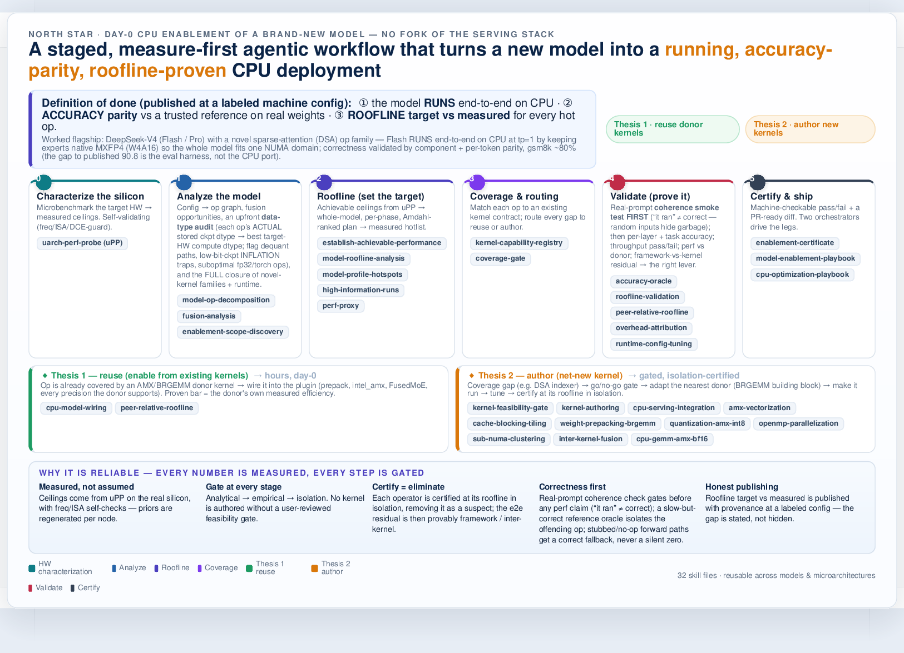
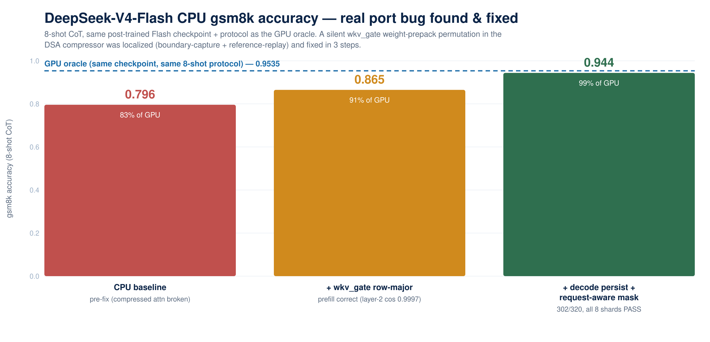
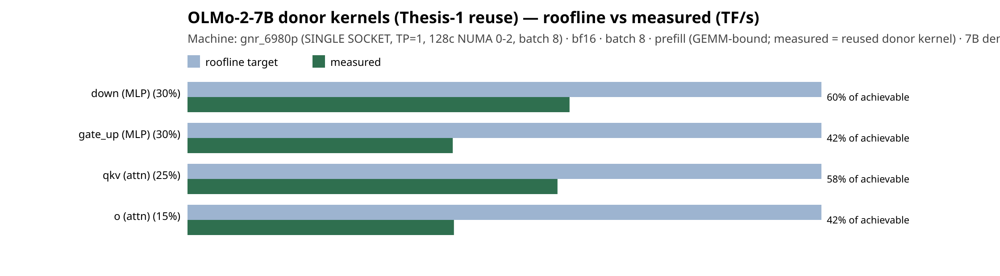

# sglang-cpu-opt — Automated CPU Model Enablement for SGLang

**North Star:** Deliver an AI Systems Performance Engineering Agentic Workflow along with skill files to automate day-0 support for new AI inference models with accuracy and performance.

**How:** An **agentic workflow** (parameterized skill files + agents) that takes a newly
released model and enables **performant, accurate CPU inference** in SGLang on Intel
Xeon (AMX) — as an Intel-maintained **plugin, no fork** — by reusing existing
hand-optimized kernels or creating new kernels (having distilled knowhow into skill files) and proving both correctness and performance.

> **Start here:** [THESIS_SUMMARY.md](THESIS_SUMMARY.md) — the one-page summary.
>
> **Correctness & hygiene, up front:** every enablement clears a fixed gate set *before* any number is published — (1) **dtype hygiene** — each weight family's stored dtype is audited and mapped to a supported compute dtype (low-bit **moved**, bf16 **computed**), and every `stored ≠ compute` dequant bridge is **parity-checked, not assumed**; (2) **coverage-gate** — no novel op is silently dense-approximated; (3) **accuracy oracle** — per-op kernel parity → real-prompt coherence → per-layer parity → task accuracy; (4) **reference oracle (Thesis 2, wherever a GPU + the model are available)** — a GPU reference forward captures per-(layer,op) tensors/logits so CPU bring-up is diffed against ground truth; the first divergent layer localizes integration bugs that per-op checks can't; (5) **honest roofline** — target vs measured at one labeled machine config. Unproven numbers are labeled UNVALIDATED, never implied.
>
> **Bird's-eye view of the agentic workflow & skills** — the staged, measure-first methodology behind the North Star (HW characterization → analysis → roofline → coverage → reuse/author → validate → certify), with all **32 skills** mapped to each stage.

> Interactive version: [docs/agentic-workflow-slide.html](docs/agentic-workflow-slide.html) (open in a browser).

## Two theses, one plugin

Two enablement paths through the same agentic workflow: **Thesis 1** reuses existing AMX kernels
(wiring + validation only); **Thesis 2** authors the missing kernels for a genuinely new architecture.

### Thesis 1 — throughput, all-known-kernels — PROVEN
Results on Intel Xeon 6980P / Granite Rapids, **single socket**:

> **Machine config is matched:** roofline **and** measured below are BOTH **single socket**
> (TP=1, 128c NUMA 0-2, batch 8). We always compare roofline vs measured at the *same* config
> (never single-socket roofline against dual-socket measured).

| Model | Precision | Accuracy (vs HF) | gsm8k | Throughput prefill / decode (tok/s) | Roofline vs measured (1-socket) |
|-------|-----------|------------------|-------|-------------------------------------|---------------------------------|
| OLMo-2-7B (dense) | BF16 | next-token parity 1.0 | 0.60 | 1321 / 91 | GEMM 60.6→18.2 TF (30% of streamed ceiling) · [report](plugin/validate/results/olmo2_7b_bf16_roofline.md) |
| OLMo-2-7B (dense) | INT8 (auto-quantized) | parity 1.0 | 0.61 | 2013 / 135 (~1.5×) | int8 ceiling ~121 TF/socket · report pending |
| OLMoE-1B-7B (MoE) | BF16 | parity 1.0 | 0.19* | 7629 / 251 | MoE decode weight-streaming bound · report pending |

*1B-active base model. Machine-checkable proof: [plugin/certificates/](plugin/certificates).

**Peer-relative performance** (OLMo-2-7B dense GEMMs vs the Llama-3-8B donor on the
identical AMX kernel): `eff_rel` 0.94–1.26 — all PASS. Both BF16 and INT8 were produced
automatically from the same donor kernels (capability inheritance).

### Thesis 2 — new-kernel leg

When the coverage-gate finds a genuinely new op, we **author the kernel**. The method is a
**spine-and-leaf playbook**: a shared **spine** every model walks — *HW characterization → decompose →
coverage-gate → roofline → reuse-or-author → validate → certify* — that calls into per-technique **leaf**
skills (parallelize, tile, vectorize/AMX, prepack/BRGEMM, quantize, fuse) whenever a kernel must be driven
toward its roofline. Two pages document it in full:

- 📘 **[Methodology playbook](docs/methodology-playbook.md)** — *the spine*: the Phase 0→3 waterfall + gate
  ladder, the per-kernel performance-gap ledger, and §5 correctness-bug localization & serving-completeness
  (boundary-capture + reference-replay, the weight-prepack audit, the three serving axes).
- 📗 **[Kernel-optimization playbook](docs/standalone-kernel-optimization-playbook.md)** — *the leaf*: the
  staged *how* for driving one kernel to its roofline (establish-achievable → parallelize → tile →
  vectorize/AMX → prepack/BRGEMM → quantize → fuse), each step gated by measurement.

#### What the playbook enforces (reusable across models)
- **Coverage-gate routing** — decompose the model, match every op to existing CPU kernels, and route
  *only* the genuinely novel ops to the author leg (here: DSA + MHC); never dense-approximate a gap.
- **Up-front precision / data-type hygiene** — census each weight family's *stored* dtype from the
  **real checkpoint** and map it to a HW-supported *compute* dtype (low-bit **moved**, bf16
  **computed**); every `stored ≠ compute` dequant bridge is **parity-checked, not assumed**.
- **Reference-first kernel authoring** — write each novel kernel against an in-tree numeric oracle and
  gate on parity *before* it enters the serving path. No unverified kernel ships.
- **Autonomous debugging loop (skill-driven) — test cheaply, learn the most per run, fail fast.** The
  agent drives bring-up and bug-localization itself through a set of workflow skills:
  **cheap iteration** on a *tiny arch-faithful* config (seconds, not minutes on a scarce big-memory
  node) plus a **deterministic-dummy CPU↔GPU parity** harness that localizes correctness **per-layer
  without a real-weight load** (bit-identical dummy weights across the CPU engine and the GPU
  container); **high-information runs** that disposition *several* hypotheses in one expensive run (a
  pre-submit disposition matrix + multi-vector capture, never a one yes/no run); **async-heartbeat
  auto-wake** so the loop runs *submit → wait → auto-wake → fix → resubmit* with no human polling; and
  **sneak-preview + early-abort** on any long run — chunk-checkpoint a usable partial, read it against
  an expected floor, and `scancel`+fix the moment it is clearly off instead of paying the full wall.
  See [`.agents/skills`](.agents/skills) — `shared/high-information-runs`,
  `throughput-enablement/accuracy-oracle`, `throughput-enablement/cpu-model-wiring`.
- **Performance methodology — cheapest, highest-signal first (the order matters):**
  1. **Rule out systemic-config pathology FIRST.** A single mis-setting (thread cliff, OpenMP
     spin-wait, NUMA bind) inflates *every* op roughly uniformly and dwarfs any per-op tuning — sweep
     it before ranking hotspots. (Here it was worth **63× prefill / 10× decode** on its own.)
  2. **Truncated model + dummy weights.** A depth-reduced, full-**WIDTH** proxy reproduces every
     per-op bottleneck queue-free in ~1/N the time; nearly all fix-iteration lives here.
  3. **Full model + dummy weights.** The authoritative perf-vs-roofline run at full shapes/footprint on
     the target node — *before* paying any real-weight load — catching depth-aggregate + capacity
     effects the proxy can't.
  4. **Full model + real weights.** Paid **only** for accuracy + a final no-regression confirm.
- **Accuracy oracle gates before any perf claim** — real-prompt coherence → per-token parity → task
  accuracy; a failing gate blocks the number (it did here — see below).
- **Boundary-capture + reference-replay localization** — when a per-layer cosine vs a *same-checkpoint*
  GPU oracle flags a divergent layer, dump that op's operands and replay an **independent** reference on the
  **identical** operands to split *arithmetic bug* from *wrong operands*, then an **operand-identity check**
  (live weight vs raw checkpoint) names the line. This drove a ~15-pt DSV4 gap to one weight; method in
  [playbook §5](docs/methodology-playbook.md).

**We applied this playbook end-to-end to DeepSeek-V4-Flash** — the flagship below. (A second,
**structurally different** architecture, a clean mostly-autonomous run of the *same* playbook to demonstrate
**velocity**, is being **re-run in a dedicated session** and will be added here when complete.)

#### 1 · DeepSeek-V4-Flash — flagship (novel kernels authored + validated)
**DeepSeek-V4-Flash** (284B total / 13B active MoE; 43 layers, 64-head MLA, 256 experts top-6) carries
**two genuinely novel op families** — DeepSeek Sparse Attention (lightning-indexer + KV-compressor +
top-k sparse-MLA) and MHC hash-clustering — while everything else is covered by the DeepSeek-V2 CPU donors.
- **Scope** — scope-discovery surfaced the *true* scope (DSA + MHC **plus** a runtime infra layer, not
  the "4 DSA kernels" a static op-scan implied) → [coverage/scope](plugin/coverage/deepseek_v4_flash_coverage.yaml).
- **Novel kernels authored + parity-validated on CPU** — DSA compressor softmax-pool, lightning-indexer,
  sparse-prefill attention ([compressor](plugin/intel_cpu_models/dsa_compressor_cpu.py),
  [indexer](plugin/intel_cpu_models/dsa_indexer_cpu.py),
  [sparse-attn](plugin/intel_cpu_models/dsa_sparse_attention_cpu.py)) + the MLA-core/MHC/infra layer
  ([_dsv4_cpu_infra.py](plugin/intel_cpu_models/_dsv4_cpu_infra.py)); the **composed** DSA attention
  reduces **exactly to dense at top-k=all** (err 1.8e-7), proving the sparse math
  ([dsa_attention_cpu.py](plugin/intel_cpu_models/dsa_attention_cpu.py)). A `index_gemm(M16)`
  feasibility gate returned a data-driven DEFER — no wrong kernel built.
- **Runs end-to-end at tp=1 by keeping the MXFP4 nibbles** — the routed experts stay **native 4-bit**
  on the CPU **MXFP4 W4A16** MoE kernel (fused fp4→bf16), so the model holds **~200 GB → fits ONE
  NUMA/SNC domain → clean tp=1** (loads ~135 s) → [run](plugin/validate/run_deepseekv4_flash_mxfp4_tp1.sbatch).
- **Correctness PASSES** — the accuracy oracle caught a real decode bug (DSA selection stubbed at
  decode → MLA gathered nothing → zero attention); fixed with a causal **dense fallback**. Per-token
  parity now passes (coherent, correct generations); the MXFP4 bridge is parity-checked standalone
  (cos 0.999992) and in-situ on the real checkpoint (cos 0.999995).
- **Accuracy CERTIFIED — the CPU port lands within ~1 pt of the GPU reference on the identical checkpoint.**
  Apples-to-apples at every link: published Flash-**Base** gsm8k **≈90.8%** → **GPU reproduces** it (**0.923**)
  → **same GPU code** on the post-trained **Flash** checkpoint we port = **0.9535** → our **CPU-optimized**
  build of that same model = **0.9437** (within ~1 pt). Getting there meant finding & fixing a **real ~15-pt
  CPU port bug** (a silent `wkv_gate` prepack permutation in the DSA compressor), not explaining it away. Full
  chain, the bug hunt, and the three-axis fix: **[accuracy certification](#deepseek-v4-flash--accuracy-certification-within-1-pt-of-the-gpu-reference-on-the-identical-checkpoint)** below.
- **Performance measured** — **baseline → optimized** (fully-naive eager path → all-C/AMX DSA kernels,
  dispatch-proven; 43L two-depth extrapolation, B=32, real-router guard): **prefill 79.8 → 174.5 tok/s
  (2.19×), decode 36.2 → 57.5 tok/s (1.59×)** on EMR, at **43% / 8% of the measured-EMR roofline** (prefill
  near its compute ceiling; decode overhead-bound with headroom).

**Deep dives for this model:**
- 🧩 **[Kernel-journey performance](docs/kernel-pilot-performance.md)** — per-kernel roofline vs baseline vs
  C/C++ for the six authored DSA kernels (streaming/cold-cache), the M-sweep, and the **GNR-vs-EMR** table.
- ⏱️ **[End-to-end wall time](docs/e2e-wall-time.md)** — the baseline-vs-optimized tok/s ledger, the
  **roofline calculation** (EMR + GNR constants + formulas), and the corrected decode attribution.
- ✅ **[Accuracy certification](#deepseek-v4-flash--accuracy-certification-within-1-pt-of-the-gpu-reference-on-the-identical-checkpoint)** — the full CPU-vs-GPU chain + the port-bug hunt (below).

**Key learnings (each distilled into a reusable skill — full set in the [playbook](docs/methodology-playbook.md)):**
1. **Compute from the native precision — keep the MXFP4 nibbles, never up-convert.** Feeding packed fp4
   straight to the W4A16 kernel is both a *capacity* win (~200 GB vs ~275 GB → fits one domain → tp=1) and
   *lossless* (fp4·2^k is exact in bf16). Up-converting fp4→fp8 doubled the footprint and forced a tp>1 swamp
   (~330× slower M=1 decode).
2. **Validate the measurement before optimizing.** The first per-op profile was an artifact — idle OpenMP
   threads busy-wait and thrash each forward; `OMP_WAIT_POLICY=passive` was worth **63× prefill / 10× decode**
   in that regime (but is a *regime-specific* lever — it regresses B=32 throughput, where spin wins).
3. **Audit every weight for prepack-vs-consumption mismatch (the ~15-pt correctness bug).** On a port that
   blanket VNNI/AMX-packs linears, a weight consumed by a plain matmul must be kept **row-major** — a packed
   weight + plain matmul is a *silent permutation*. The DSA `wkv_gate` hit this; signature = *live weight vs
   raw checkpoint orthogonal but per-row norms preserved*.
4. **Localize correctness bugs with boundary-capture + reference-replay, and validate three serving axes.**
   Per-layer cosine vs a same-checkpoint GPU oracle → first divergent layer → operand-identity check names the
   line; then prefill ≠ serving-correct (decode persistence + cross-request batching are separate gates). Full
   method: [playbook §5](docs/methodology-playbook.md).

**Remaining (scoped):** wire the authored DSA kernels into an **incremental-sparse decode**
(O(context²)→O(context·topk)) + the paged flash-MLA *serving* runtime; then **scale Flash's donor
kernels to the 1.6T Pro across a multi-socket EMR cluster**
(Kimi-K3-style TP/EP/PP) — Pro is too large for one GNR node at tp=1, so its story is *distribution*,
not new kernels. This is backend plumbing + tuning, not novel-kernel authoring — the DSA math is
authored + proven in isolation.

#### DeepSeek-V4-Flash — accuracy certification (within ~1 pt of the GPU reference on the identical checkpoint)
Two questions a technical reviewer asks — *is the implementation correct?* and *does it match a trusted
reference on task?* — are now answered the honest way, with an apples-to-apples chain at every link:

1. **Reproduce the published reference on GPU.** DeepSeek publishes gsm8k **≈90.8%** for
   DeepSeek-V4-Flash-**Base**; the **GPU reference code reproduces** it on that checkpoint — **0.923**
   (1210/1311) — so the harness + protocol are trustworthy.
2. **Establish the real target on the checkpoint we port.** The **same GPU code** on the **post-trained
   Flash** checkpoint (the one the CPU plugin actually runs) scores **0.9535** (1250/1311) — Flash has *no*
   separately-published gsm8k number, so this GPU-on-the-same-checkpoint run *is* the target.
3. **The CPU port matches it.** Our **CPU-optimized** build of that same Flash model reaches **0.9437**
   (302/320) — **within ~1 pt of the 0.9535 GPU result**, after finding and fixing a real ~15-pt CPU port
   bug. (An earlier draft claimed the gap was "the eval harness, not the port"; that was **wrong** and is
   corrected below — the correction itself is the lesson.)

**(A) Numerical faithfulness — proven at the component + token level, not asserted.**
- **Every `stored ≠ compute` dtype bridge is parity-gated against an independent oracle.** The MXFP4 W4A16
  expert path (the bulk of the model) matches a torch dequant oracle built from the *same* packed nibbles to
  **cos 0.999992 standalone / 0.999995 in-situ on the real checkpoint** — fp4·2^k is *exact* in bf16, so this
  is near-machine-precision, not a lossy approximation.
- **The novel sparse attention reduces *exactly* to dense at top-k = all (err 1.8e-7)** — a by-construction
  check of the DSA math against a dense reference that shares the rest of the pipeline.
- **Greedy (temperature-0) per-token parity passes** on real prompts — coherent, correct generations. This
  gate earned its keep: it caught a real decode bug (DSA selection stubbed at decode → MLA gathered nothing →
  zero attention), fixed with a causal dense fallback, *before* any number was published.
- **Per-layer CPU↔GPU parity on the REAL checkpoint** — a version-matched GPU oracle (same 0.5.20 build,
  same post-trained Flash checkpoint) captures every decoder layer's attention-module output on a frozen
  prompt; the CPU build now matches it **cos ≥ 0.998 for layers 0–27 and ≥ 0.978 through layer 42** (a smooth
  bf16/fp8-accumulation slope, no divergence cliff). This per-layer oracle is what localized the `wkv_gate`
  bug to the first compressed layer — see (B). (The earlier draft said DSV4's full-GPU per-layer oracle was
  infrastructure-blocked; the podman `--events-backend` workaround unblocked it this cycle.) A
  deterministic-dummy *bit-exact* variant of this same harness (name-seeded init → identical weights on CPU
  and the native-GPU container, decoupling wiring/kernel correctness from the dtype bridge) is part of the
  reusable toolkit.

**(B) The task gap was a REAL port bug — found by binding the comparator correctly, then localized to one line.**

| Row | gsm8k | Note |
|---|---|---|
| Published Flash-**Base** (DeepSeek) | **≈0.908** | reference point — a *different* (base, FP8) checkpoint |
| GPU reference on Flash-Base (our reproduction) | **0.923** | reproduces the published number (1210/1311, [`gpu_base_gsm8k.json`](plugin/validate/results/gpu_base_gsm8k.json)) → harness trusted |
| CPU baseline (pre-fix) | **0.796** | the number the "eval harness" story tried to explain away |
| + `wkv_gate` row-major fix (prefill) | **0.865** | compressed attention now correct in prefill (layer-2 cosine 0.9997) |
| **+ decode persist + request-aware mask (CPU final)** | **0.9437** | 302/320, all 8 shards PASS (0.90–0.975) — **within ~1 pt of GPU** |
| **GPU oracle — post-trained Flash (the port target), SAME 8-shot protocol** | **0.9535** | the apples-to-apples target (1250/1311, [`gpu_flash_gsm8k.json`](plugin/validate/results/gpu_flash_gsm8k.json)) |

- **The decisive move was the correctly-bound oracle.** The published 90.8 is Flash-**Base** (FP8), a
  *different* checkpoint — which we **reproduced on GPU** (**0.923**, consistent with published); our
  post-trained Flash has no published gsm8k number, so "below 90.8" was never a
  valid signal. Running the **GPU on the same checkpoint + same harness** gave **0.9535** → the real target was
  ~0.95, and CPU at 0.80 was genuinely ~15 pts low. *Comparator-provenance dissolved the false "below published"
  panic; the correctly-bound GPU oracle then revealed the gap was real after all.*
- **The bug: a silent weight-layout permutation.** The DSA compressor's `wkv_gate` projection was
  AMX-VNNI-**prepacked** (as the CPU path packs every linear) but **consumed by a plain matmul**
  (`compute_kv_score → linear_bf16_fp32`) → scrambled projection → garbage compressed KV → wrong attention on
  every compressed layer (37 of 43). This is the **same bug class** the plugin had already fixed for `wo_a`;
  `wkv_gate` was simply never audited.
- **Localized to one line via boundary-capture + reference-replay** (method now in the playbook §5): per-layer
  attn-output cosine vs the GPU oracle broke **exactly at the first compressed layer** (pure-SWA layers 0/1 =
  0.9995); a boundary capture + independent replay on identical operands showed the attention *arithmetic* was
  correct (self-consistency cos≈1.0) so the compressed-KV *values* were wrong; the operand-identity check — live
  `wkv_gate.weight` vs the raw checkpoint = **cos 0.0007 with per-row norms preserved** — named it a prepack
  permutation.
- **Three fixes, three correctness axes** (playbook §5.4): (1) keep `wkv_gate` row-major → **0.865**;
  (2) persist per-request compressed KV so **decode** attends long-range context (a prefill-only handoff ran
  decode SWA-only); (3) make the coverage mask **request-aware** (a position-only mask leaks across a batched
  prefill) → **0.9437**. Residual ~1 pt (0.9437 vs 0.9535) is benign bf16/fp8 accumulation over 43 layers
  (per-layer cosine declines smoothly, no cliff) + minor decode incremental-block omission on long gens.

**Reproducible, not hand-waved:** generations are saved (`--gens-out`) and scored offline
([`score_gsm8k.py`](plugin/validate/score_gsm8k.py) grid); the full run is node-parallel + chunked
([`run_gsm8k_dsv4_sharded.sbatch`](plugin/validate/run_gsm8k_dsv4_sharded.sbatch) +
[`combine_gsm8k_shards.py`](plugin/validate/combine_gsm8k_shards.py)); the standard harness is
[`run_gsm8k_lmeval.sbatch`](plugin/validate/run_gsm8k_lmeval.sbatch). Method codified in
[`accuracy-oracle`](.agents/skills/throughput-enablement/accuracy-oracle/SKILL.md).

**Precision & compute-type hygiene (checked up front, before any kernel is chosen).** GNR AMX has
native matmul tiles for **bf16 / fp16 / int8 only — no fp8 or fp4**. So model discovery audits every
weight family's *stored* dtype (from the real checkpoint, not just `quantization_config`) and maps it
to a *compute* dtype the hardware actually supports: sub-16-bit weights are **moved** low-bit (a
bandwidth/capacity win) and **computed in bf16** after a fused dequant. Every `stored ≠ compute` step
is a dequant **bridge** verified numerically, not assumed:

| Weight family (DeepSeek-V4-Flash) | Stored / moved | Compute (AMX) | Bridge | Lossless? | Correctness gate |
|---|---|---|---|---|---|
| MoE routed experts | **MXFP4** (e2m1 + e8m0 group-32) | **bf16** | W4A16, fused fp4→bf16 in-GEMM | ✅ fp4·2^k exact in bf16 | ✅ [parity](plugin/validate/test_mxfp4_moe_cpu.py) PASS · standalone cos 0.999992 + in-situ real-ckpt cos 0.999995 |
| MLA / indexer / shared-expert proj | **fp8** e4m3 | **bf16** | W8A16, dequant fp8→bf16 | ✅ fp8 levels exact in bf16 | donor fp8 CPU path |
| norms / router / embed / lm_head | bf16 | bf16 | none (native) | — | native |

int8 is the only low-precision AMX *compute* tile; fp4/fp8 route through **bf16** compute (not int8)
to stay lossless — the low precision is spent purely on movement/footprint. Keeping the experts
**native 4-bit** (instead of up-converting fp4→fp8, which doubles the footprint) is what lets the
whole model fit **one NUMA domain at tp=1**. Bridges + status: [dtype_bridge_gates](plugin/coverage/deepseek_v4_flash_coverage.yaml).

## Roofline target vs measured (published with every result)
Every published result carries the **roofline achievable target** alongside the **measured**
number, plus a **per-op breakdown** of which kernels fall short of their roofline (measured is
usually below target — the gap is the remaining optimization RoI). Target is published up front;
measured fills in when the kernels run. The **same chart serves both legs**: in the **new-kernel
leg (Thesis 2)** measured = *our authored* kernel; in the **reuse leg (Thesis 1)** measured = the
*reused donor* kernel, so the gap shows whether the donor kernels are actually optimized or leave
headroom (an RoI even when no new kernel was written).
- **Thesis 1 — donor-kernel optimization** (OLMo-2-7B, BF16, GNR): [report](plugin/validate/results/olmo2_7b_donor_roofline.md)
  ·  — reused donor GEMMs run at 0.94–1.26× the donor's own efficiency (wiring preserved) yet only **42–60% of the AMX ceiling** → headroom. Backend is oneDNN/LIBXSMM BRGEMM (best-in-class inner loop), so the gap is **composition/memory-traffic**, not tile-loop quality.
- **Thesis 2 — new-kernel authoring** · DeepSeek-V4-Flash (routed-expert MoE kernel dominates decode,
  MXFP4 W4A16, EMR): full ledger on the **[end-to-end wall time](docs/e2e-wall-time.md)** page —
  baseline → optimized **2.19× prefill / 1.59× decode** (43L, B=32, real-router guard), scored against the
  **measured-EMR roofline** (AMX bf16 12.4 TF, DRAM 848 GB/s): prefill ≈ **43%** of the compute roof (near
  ceiling), decode ≈ **8%** (overhead-bound, large headroom). Decode is **~88% C/AMX kernels, all dispatched**
  (dispatch-provenance verified); the remaining levers are MHC-aten (~7%) + the attention-glue seam (~8%), not
  a torch rewrite. *(An earlier "75% of DRAM-BW roofline" figure was a MoE mode-collapse artifact — a
  dummy-random router under-counted expert bytes; the real-router `W_active`=40 GB number supersedes it.)*
- **DeepSeek-V4-Pro (1.6T) — reuse + scale-out, NOT new-kernel authoring.** Pro is the *same* DSv4
  architecture as Flash (DSA + MHC + MLA + native-MXFP4 MoE), so Flash's authored CPU kernels are its
  **donors** — enabling Pro is Thesis-1-style *wiring + validation*, not new kernels. It is **too large
  for one GNR node at tp=1**: ~800 GB native MXFP4 exceeds a single 256 GB NUMA domain (and the 768 GB
  socket), so it can only run **TP≥2** — the decode-hostile config we measured at 2.8× slower. Its
  realistic home is a **multi-socket EMR cluster** (Kimi-K3-style TP/EP/PP across ~16 sockets) — a
  *distribution* story, not a kernel story. The [analytical roofline](plugin/validate/results/deepseek_v4_pro_roofline.md)
  is an earlier GNR-TP4 estimate kept for reference only; the multi-socket roofline is TBD and no
  single-node Pro run is claimed.
- Regenerate from a `model-profile-hotspots` run: `python plugin/validate/roofline_vs_measured.py
  --in <profile.json> --out-prefix plugin/validate/results/<name>`.

## Repository map
- [`docs/`](docs) — the deep-dive pages linked from Thesis 2 above:
  [methodology](docs/methodology-playbook.md) + [kernel-optimization](docs/standalone-kernel-optimization-playbook.md)
  playbooks, [kernel-journey](docs/kernel-pilot-performance.md) + [end-to-end wall-time](docs/e2e-wall-time.md)
  performance, and [`docs/archive/`](docs/archive) (point-in-time page snapshots; git history is the full archive).
- [`.agents/`](.agents) — the workflow: `agents/` (model-enablement, cpu-optimizer) and
  grouped `skills/` — see [`.agents/skills/README.md`](.agents/skills/README.md), which
  marks the **throughput-thesis** skills.
- [`plugin/`](plugin) — generated model classes (`intel_cpu_models/`), generic validators
  (`validate/`), the auto-quantizer (`quantize/`), **certificates** (`certificates/*.yaml`),
  and the DeepSeek coverage analysis (`coverage/*.yaml`).
- [`tools/`](tools) — node calibration + microbenchmarks.

## Reproduce
Each certificate carries its exact `reproduce:` commands. SGLang CPU install:
`sglang/docs/docs/hardware-platforms/cpu_server.mdx`. The validators are generic —
point `--model` / `--config` at any model. Weights are not stored here (downloaded separately).
