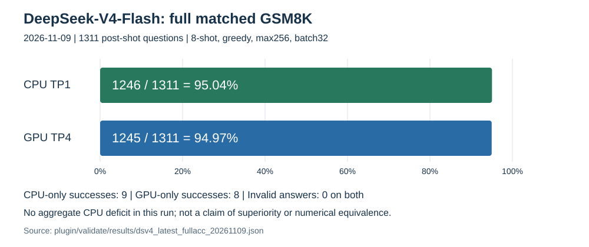

# DSv4-Flash accuracy closure: matched full evaluation

## Result and disposition

Completed **2026-11-09** (the retained evidence directory was named on November 7).

| Backend | Correct / evaluated | Accuracy | Invalid |
|---|---:|---:|---:|
| CPU TP1, accuracy-fix configuration | 1246 / 1311 | 95.04% | 0 |
| Fresh native GPU TP4 | 1245 / 1311 | 94.97% | 0 |



**No aggregate CPU deficit in this run. Close the task-accuracy campaign.**
The one-answer difference is not evidence of statistical superiority, numerical
equivalence, or general correctness certification. No default promotion or new
model investigation is implied. These are custom-protocol results, not a
reproduction of a published benchmark protocol.

CPU-only successes: **9**; GPU-only successes: **8**. Extracted-answer agreement:
**1283/1311**. All 1311 CPU extracted answers **and complete generation texts**
reproduce the previous CPU1246 run. The fresh GPU1245 result differs from the
historical GPU1250 result (16 regressions, 11 recoveries). Historical GPU used
batch64 and a different engine/cache lifecycle; its score is not the matched
comparator. No causal explanation of those GPU flips is established.

- [Machine-readable closure](../../plugin/validate/results/dsv4_latest_fullacc_20261109.json)
- [Chronological investigation and rejected hypotheses](DSv4-shared-clamp-disposition-REVIEW.md)
- [Campaign audit procedure](../../plugin/validate/close_latest_accuracy.py)

## Evaluated protocol and configuration

Checkpoint: `DeepSeek-V4-Flash`, not Flash-Base. First eight GSM8K test rows form
the demonstrations; the remaining **1311** are evaluated. Questions are numbered
0..1310 (dataset row = question ID + 8).

Both backends use the existing `Question:` / `Answer:` eight-shot prompt, greedy
decoding, max256 new tokens, stops `["Question", "Assistant:"]`, and the existing
`extract_final_answer` scorer. This run does not change parsing to improve scores.
Sixteen contiguous shards contain 82 questions each, except the last (81);
batch32, prefill512, BF16, context4096, total KV tokens131072, SWA ratio0.5,
max running requests256, radix cache OFF and overlap scheduling OFF.
Each logical shard has a fresh engine. CPU shards generate concurrently across
EMR nodes; GPU shards execute sequentially with TP4 and normal graph settings.

The CPU wave sets:

```sh
export SGLANG_USE_CPU_ENGINE=1 SGLANG_EXTERNAL_MODEL_PACKAGE=intel_cpu_models
export INTEL_CPU_DSV4_DSA_CPU=1 INTEL_CPU_DSV4_MXFP4_MOE=1 INTEL_CPU_DSV4_DSA_CKERNEL=1
export INTEL_CPU_DSV4_CHUNK_ACCUM=1 INTEL_CPU_DSV4_MXFP4_CLAMP=1 INTEL_CPU_DSV4_SHARED_CLAMP=1
export INTEL_CPU_DSV4_SHARED_QUANT_DIAGNOSTIC=0 INTEL_CPU_DSV4_COOP_MHC=0
export INTEL_CPU_DSV4_DECODE_THREADS=8 INTEL_CPU_DSV4_DECODE_THREADS_STICKY=1
export OMP_WAIT_POLICY=passive KMP_BLOCKTIME=0 GOMP_SPINCOUNT=0
```

No forced tokens, trace capture or precision-diagnostic variant is enabled.
Clamp defaults remain OFF in the general runtime. Unsupported CPU prefix-cache
reuse is contained by the plugin guard; the wave also explicitly disables radix.
The fixes include compressed-history lifecycle/chunk accumulation and native
routed/shared SwiGLU clamping. The runtime files retain co-located gated
diagnostics to preserve the **evaluated source bytes**, not to promote those
experiments. Other performance experiments and branch history are not merged.

CPU environment: SGLang `0.5.20.dev373+g5aab054ec` in
`/scratch/bkaul/venvs/sglang-cpu`. GPU image:
`docker.io/lmsysorg/sglang:v0.5.20-cu130`; retained digest is in `gpu/image_id.txt`.
The installed CPU source and GPU image source differ; this is a backend task
comparison, not an identical-build determinism test.

## Provenance and reproduction

### Per-question results and session handoff

**Start here to compare another run's accuracy progress.**

| Collateral | Location / access |
|---|---|
| All 1311 paired question results | [CSV in git](../../plugin/validate/results/dsv4_latest_fullacc_20261109_questions.csv), viewable/downloadable from GitHub |
| Final counts, paired difference IDs and shard-to-job mapping | [Summary JSON in git](../../plugin/validate/results/dsv4_latest_fullacc_20261109.json) |
| Investigation and intermediate accuracy comparisons | [Chronological report](DSv4-shared-clamp-disposition-REVIEW.md) |
| Scoring/coverage/source recheck | [Campaign audit](../../plugin/validate/close_latest_accuracy.py); command below |
| Full CPU generations, token IDs and shard scores | Shared-cluster path: `/scratch/bkaul/dsv4_latest_fullacc_20261107/cpu/shard_{0..15}/` |
| Full GPU generations, token IDs and shard scores | Shared-cluster path: `/scratch/bkaul/dsv4_latest_fullacc_20261107/gpu/shard_{0..15}/` |
| CPU stdout/stderr logs | Shared-cluster paths: `/scratch/bkaul/dsv4_latest_acc_401042_<shard>.log` or `/scratch/bkaul/dsv4_latest_acc_401068_<shard>.log`; select the final job using the summary's `cpu_jobs` mapping |
| GPU stdout/stderr log | Shared-cluster path: `/scratch/bkaul/dsv4_matched_gpu_acc_401058.log` |
| Original protocol, source manifest and GPU image identity | Evidence root below: `plan.json`, `source_hashes.json`, `gpu/image_id.txt` |

The CSV is a compact export of the retained CPU/GPU `gens.json` files, ordered
by `q`. It includes gold and extracted answers, per-backend correctness (0/1),
completion-token counts, finish types, shard and job IDs. Export validation
rescored every text using the repository scorer, checked unique full coverage,
and reconciled totals, paired successes and answer agreement to the summary.
Question text, generated reasoning and token-ID arrays are **not in the CSV**;
they remain in the external evidence. GitHub does not serve the shared-cluster
paths: a session without that filesystem can compare answers using the CSV but
cannot inspect raw generations or job logs.

Each shard directory contains:

- `gens.json`: a `gens` list with `q`, `gold`, `pred`, `text`,
  `output_token_ids`, token counts and `finish_reason`.
- `score.json`: cumulative shard counts and completion status.
- `runtime.json` and `stamp.txt`: resolved settings and run provenance.
- `complete`: the launcher's completion marker.

**Comparison contract for the receiving session:**

1. Baseline is CPU **1246/1311**, fresh matched GPU **1245/1311**.
   `q=0..1310`; `dataset_row_0based=q+8` because the first eight dataset rows are
   demonstrations. The original shard is `q // 82`; the last shard has 81 rows.
2. Join by `q` only after confirming the dataset hash and shot exclusion match.
   Check for duplicate IDs and gold mismatches; do not align by arrival order
   or assume another run's shard numbering is the same.
3. For a partial run, restrict BOTH scores to exactly its completed question IDs.
   Report numerator/denominator, recoveries and regressions on that shared subset.
   Do not compare a partial percentage with the full-set baseline percentage.
4. Compare prompt, batch/order, prefill, cache/engine lifecycle, stops, token
   budget and scorer before attributing a score change to a code fix. Use the
   configuration above, not the historical GPU1250 protocol.
5. To diagnose a changed answer, load the corresponding `gens.json` and inspect
   `text`, actual output IDs and finish reason. The CSV alone cannot explain
   a numerical divergence.

Copy this page's GitHub URL into the receiving session: it links to the git
results and records the external evidence paths without depending on chat history.

Retained external evidence: `/scratch/bkaul/dsv4_latest_fullacc_20261107`.
It contains frozen `source/`, `source_hashes.json`, `plan.json`, per-shard
`gens.json` (texts and token IDs), `score.json`, `runtime.json`, `stamp.txt`,
completion markers, GPU image identity and `cpu_shard_jobs.json`.
Raw dataset/generation corpora and model weights are **not included in git**.

- Frozen source manifest SHA256:
  `ab7753eae9f726c55708becf29d9b2815ff29457fa4098f2249fc0f39bdd1c29`.
- Dataset SHA256:
  `3730d312f6e3440559ace48831e51066acaca737f6eabec99bccb9e4b3c39d14`.
- CPU jobs: array401042 plus array401068 replacements **only for unstarted shards**.
  Final per-shard mapping is in the result JSON. GPU job:401058.
- CPU loader cap started at two and increased to four. Atomic shared-filesystem
  slots gate startup until `runtime.json`; generation proceeds independently.
  Four was an operational improvement, **not a measured universal optimum**.

The publication commit is not the original run commit: evaluated sources were
frozen from `12c04d1` plus then-uncommitted accuracy changes. Runtime Python/C++
and header files were compared byte-for-byte against that snapshot during
integration. The CLI audit below is a publication adaptation of the original
closure script; its digest therefore differs from the original audit digest.

From the repository root, recheck the **retained campaign**, without model loads:

```sh
/scratch/bkaul/venvs/sglang-cpu/bin/python plugin/validate/close_latest_accuracy.py \
  /scratch/bkaul/dsv4_latest_fullacc_20261107 \
  --data /scratch/bkaul/gsm8k_test.jsonl --out /tmp/dsv4-rechecked-summary.json
```

Choose a new output path: the audit refuses overwrites and Python `-O`.
It verifies the fixed campaign's expected source manifest, dataset, shard
coverage, run identities, CPU flags, matched runtime policy and independent
rescoring before writing. It also needs the historical CPU corpus identified by
`plan.json` to verify text reproduction. It is **not a general acceptance gate**
for arbitrary future protocols.

For a new model run, use a **new evidence directory**, freeze its `source/plugin`
tree, generate its SHA256 `source_hashes.json` and record its own `plan.json`.
Create `load_slots/`, `cpu/`, `gpu/` and a `cpu_loader_limit` file containing
`2` or `4`. These cluster-specific launchers use the model/data/venv paths above:

```sh
# ROOT points to the prepared, NEW evidence directory; never reuse completed shards.
sbatch --array=0-15 plugin/validate/run_accuracy_emr_wave.sbatch "$ROOT"
sbatch plugin/validate/run_accuracy_gpu_full.sbatch "$ROOT"
```

Arm completion and partial-score monitoring immediately, retain authoritative
terminal job states and require all completion artifacts. Do not treat an empty
queue as completion. The frozen launcher used two slots; the published CPU
launcher adds the tested live two/four-slot control used for replacement shards.
The source manifest for a new run must describe that new snapshot; the fixed
historical audit intentionally rejects it.

## Meta-learnings now encoded in the spine and leaves

1. Re-anchor a small residual gap with matched full-task evidence, not an
   indefinitely extended single-example precision sweep.
2. Reference identity includes batch grouping, engine/cache lifecycle and
   actual consumed prefixes, not just checkpoint and greedy sampling.
3. Operator error reduction, selected-answer recovery and net task improvement
   are separate claims. Preserve regression controls and default-OFF experiments.
4. Validate the reference and complete operands before causal attribution;
   equal attention inputs alone do not prove equal KV histories.
5. Maximize completed accuracy work per wall-hour: independently gate loading
   and generation, tune the loader cap from observations, checkpoint early,
   monitor continuously, and derive ETAs from the latest loading cohort.
6. Campaign closure is not default promotion or numerical-equivalence certification.

Routing: [enablement spine](../../.agents/skills/throughput-enablement/model-enablement-playbook/SKILL.md),
[accuracy leaf](../../.agents/skills/throughput-enablement/accuracy-oracle/SKILL.md),
[run-design leaf](../../.agents/skills/shared/high-information-runs/SKILL.md),
and [methodology spine](../methodology-playbook.md#residual-gap-decision-checkpoint).

## Publication validation and claim boundaries

The integration passed 20 focused tests (trace entry paths, prefix analysis,
shared regression helpers, native routed clamp, two/four-loader concurrency and
loader-failure propagation). Python syntax, shell syntax, skill frontmatter,
new document links and chart XML/data were checked. No new full model run was
launched for publication.

The published audit was exercised through its CLI: incorrect score counts,
runtime mismatch, wrong question IDs, a wrong CPU clamp flag, missing completion
and Python `-O` all failed without writing a summary. The valid retained
campaign regenerated the counts and paired results above.

| Claim | Evidence / estimator | Domain and falsifier | Disposition |
|---|---|---|---|
| No aggregate CPU deficit | CPU1246, GPU1245; one full run per backend, not a replicated mean | These 1311 IDs and settings; independent rescoring could contradict counts | Supported for this run |
| CPU historical reproduction | Exact comparison of 1311 saved texts and extracted answers | Any unequal text/answer falsifies; does not assert cross-backend token identity | No differences found |
| Runtime integrated from evaluated source | Byte comparison of runtime Python/C++/headers against frozen source | Any byte difference falsifies; docs and publication tooling intentionally differ | Matched |
| No promotion or general equivalence | Clamp flags remain explicit; quantization diagnostic OFF | Another protocol, backend/build or input can differ | Not claimed |
