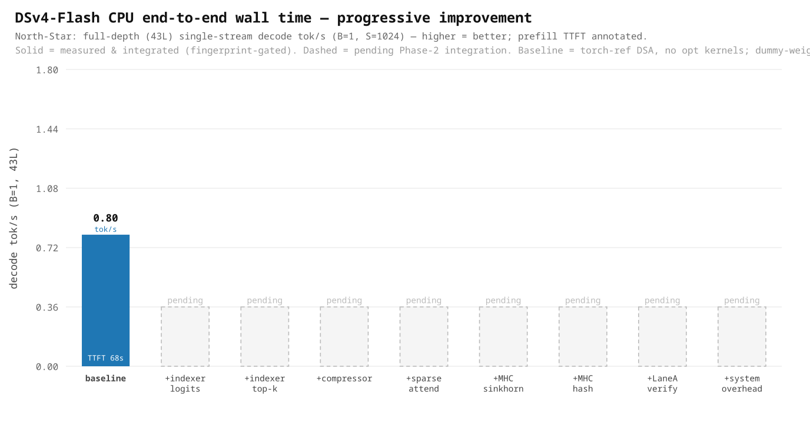

# DSv4-Flash CPU — end-to-end wall time: baseline & progressive improvement

Live ledger of the **North-Star metric** — end-to-end tok/s for DeepSeek-V4-Flash on CPU — as each authored
kernel is integrated into the serving path. This is the **Phase 2** deliverable of the
[methodology playbook](methodology-playbook.md#phase-2--north-star-end-to-end-wall-time); the per-kernel
standalone results live on the [kernel-pilot performance page](kernel-pilot-performance.md).

## Decode (TPOT) — prioritized work item: progression vs roofline

**Living chart** — perf-proxy (4-layer dummy) **B=32 decode tok/s** at the **full-node** config (all 3 SNC NUMA
domains / 128c — the max-throughput config), scored against the decode BW roofline (MoE weight-streaming). Where
it stands today:
- **D0 baseline 91 tok/s ≈ 76% of the roofline** — the MoE weight-streaming core is mature (Phase-1 batching +
  thread/affinity/spin-wait). **Config matters enormously: this is the full-node number; the single-NUMA
  per-rank bind is only 32 tok/s (2.8× lower, BW-bound)** — see the NUMA note below. The max-throughput
  demonstration uses the full node.
- **D1 all-C-kernels — NEUTRAL, not a regression (corrected).** The controlled **held-fixed** A/B (job 386039/
  390418, all kernels OFF-vs-ON, same job) measures **decode 91.2 → 94.2 (1.03×)** and **prefill 880.2 → 1002.8
  (1.14×)** — integrating the kernels is **perf-neutral at decode and a modest win at prefill**. The earlier "22
  tok/s regression" was a **measurement artifact of a *sequential* bisection** (toggling ops across separate runs
  drifts the scheduler/KV-pool regime; the torch baseline alone swung 81→24 with a `mem-fraction` knob). **Lesson:
  only a held-fixed OFF-vs-ON A/B in one job is trustworthy** ([playbook](methodology-playbook.md#phase-2--north-star-end-to-end-wall-time)).
- **D2–D3 pending (ghost bars) — the REAL decode levers (measured, job 390418 TIMEIT attribution):** decode is
  **~40% unoptimized TORCH compute**, *not* framework/dispatch (which is only ~5%). The recoverable buckets are
  **`dsa.mla.attend`** (the per-token Python-loop sparse attention, ~18%), **MHC `hc_pre`+`hc_post`** (~17%), and
  the **`dsa.indexer` torch einsum** (~3.5%) — **port these torch decode ops to kernels** (D2) — plus the
  **`moe.expert_apply` thread-cap** (~26%, a thread-count pathology, not a kernel) (D3). The earlier
  "framework/dispatch ≈ 39%" lever was **wrong** (that bucket is ~5%); bf16-KV is a prefill/long-context lever,
  not a decode one (the serving attention KV read is already bf16; the indexer is a ~3.5% torch einsum).

The full segregated ledger (prefill vs decode, stage-by-stage) is below.

Solid bar = measured & integrated (fingerprint-gated); dashed = pending Phase-2 integration.

## Phase-2 integration — status (in progress, honest)

The authored DSA/MHC C/C++ kernels are now **wired into the serving forward**, env-gated
(`INTEL_CPU_DSV4_DSA_CKERNEL=1`, per-op `INTEL_CPU_DSV4_CK_<op>`), default-OFF. **Op-level parity is validated**
(indexer cos 0.99999 / compressor cos 1.0 / MHC sinkhorn+combine cos 1.0; bf16-KV bit-identical). The
**controlled held-fixed end-to-end A/B now shows integration is perf-safe** — neutral at decode, a modest win at
prefill:

| perf-proxy (4-layer dummy), **held-fixed** OFF-vs-ON | prefill tok/s | decode tok/s |
|---|---:|---:|
| C-kernels OFF (torch) · B=32 | 880.2 | 91.2 |
| C-kernels ON · B=32 | **1002.8** (1.14×) | **94.2** (1.03×) |

(EMR, **job 386039** — all kernels OFF-vs-ON, mem-fraction fixed 0.85, prefill+decode in the *same* job;
[results](../plugin/validate/results/).)

> **⚠ Superseded — the earlier "10× regression" was a measurement artifact.** A prior *sequential* bisection
> (job 385956/386002) reported a ~10× prefill and ~4× decode regression and hypothesized **OpenMP runtime
> oversubscription** (GNU libgomp vs Intel libiomp5 collision). The **held-fixed** A/B above refutes it:
> toggling ops across *separate* runs drifted the scheduler/KV-pool/batching regime between points (the torch
> baseline alone swung decode 81→24 with a `mem-fraction` knob), manufacturing a phantom. The kernels are
> perf-neutral-to-positive end-to-end. **Root lesson (now in the playbook): measure integration deltas with a
> held-fixed OFF-vs-ON A/B in one job — never a sequential bisection; and a *tiny* op "regressing" large is a
> tell for a global/measurement pathology, not a slow op.**

**Next (the real levers, measured by the job-390418 decode attribution):** (1) **port the ~40% unoptimized-torch
decode ops to kernels** — `dsa.mla.attend` (the per-token Python-loop sparse attention, ~18%), MHC `hc_pre`+
`hc_post` (~17%), `dsa.indexer` einsum (~3.5%); (2) **MoE `expert_apply` thread-cap** (~26%, a thread-count
pathology — cap threads around the MoE apply, `runtime-config-tuning`, not a new kernel); (3) **incremental-sparse**
prefill O(S²)→O(S·topk). Framework/dispatch is only ~5% (the earlier "~39%" claim was wrong), and bf16-KV is a
prefill/long-context lever (the serving attention KV is already bf16). Every stage stays env-gated default-OFF
and fingerprint-gated.

## Operating point & headline
- **Input** S = 1024, **output** G = 8/step (G=256 applied analytically), full depth **43 layers**.
- **North-Star:** B=32 aggregate decode tok/s (throughput) **and** B=1 single-stream decode tok/s (latency floor).
- **Max-throughput demonstration (full-node):** **4L proxy decode 91.2 tok/s; 43L B=32 extrapolates to 9.4
  tok/s** (two-depth, job 390445: 4L=91.2, 8L=48.2 → t_layer=78.3 ms, t_fixed=37.9 ms). The B=1 latency floor is
  **0.80 tok/s** (43L).
- **⚠ NUMA config is the single biggest throughput knob.** This node is **one socket, 128 cores, 3 SNC NUMA
  domains**. The **full-node** config (all 3 domains, `OMP_NUM_THREADS=128`, no single-domain bind — the
  established canonical throughput config, cf. the Olmo2 certificate) gives **91 tok/s @ 4L**; a **single-NUMA
  per-rank** bind (`numactl -N0 -m0`, 1 SNC domain) gives only **32 tok/s** — a **2.8× gap**, confirmed by a
  held-fixed same-harness A/B (job 390442: 90.8 vs 32.0). Decode is weight-streaming BW-bound, so using all
  memory controllers is decisive. The demonstration and all ledger numbers below are **full-node**.
- **Node:** EMR Xeon (single socket, 128c, 3 SNC domains), `--constraint=ddr5600 --exclusive`,
  `OMP_NUM_THREADS=128 OMP_PROC_BIND=close OMP_PLACES=cores`, all NUMA domains.

## Prefill and decode are TWO work items (different rooflines, different maturity)

Prefill and decode are tracked **separately** — different bound, roofline, levers, and status. Optimizing one
says little about the other.

| | **Prefill (TTFT)** — compute-bound | **Decode (TPOT)** — memory-bound |
|---|---|---|
| **roofline** | `TTFT_floor = prefill_FLOPs / peak` (AMX bf16) | `tok/s_roof(M) = M·BW / (W_active + M·KV_tok)` |
| **DSA/MHC kernel leverage** | **HIGH** — indexer + sparse-attn run over the full S-token prompt (O(S·ctx)); the authored compute kernels are the main win | **LOW** — 1 query token/step; decode is dominated by MoE weight streaming, not DSA compute |
| **Phase-1 state** | unoptimized torch O(S²) attention — the big *unrealized* opportunity | **~76% of roof** (full-node) on the MoE weight-streaming core; the gap is the ~40% compute-bound torch DSA/MHC decode ops, not pure BW |
| **open levers** | (1) wire the authored DSA kernels (**done — held-fixed A/B neutral-to-positive, 1.14× prefill**); (2) incremental-sparse decode O(S²)→O(S·topk) | (1) **port the ~40% torch decode ops to kernels** (`mla.attend` loop + MHC + indexer); (2) **MoE `expert_apply` thread-cap** (~26%); (3) 43L full-depth validation |
| **status** | integration wired & **perf-safe** (held-fixed A/B: 1.14× prefill, job 386039) → authored-DSA compute win still to be realized via incremental-sparse | **MoE core ~76% roof; wall-time NOT done** — the lever is **porting the torch DSA/MHC decode ops to kernels** + the MoE thread-cap (measured attribution), not a framework pass |

**Are we done with decode?** No. The **MoE weight-streaming core** is near roofline (~76% at full-node B=32),
but the **job-390418 TIMEIT attribution shows ~40% of decode is unoptimized TORCH compute** — `dsa.mla.attend`
(per-token Python loop, ~18%), MHC `hc_pre`+`hc_post` (~17%), `dsa.indexer` einsum (~3.5%) — plus `moe.expert_apply`
(~26%, a thread-count pathology). Framework/dispatch is only ~5%. So the path to higher decode tok/s is **porting
those torch decode ops to kernels + the MoE thread-cap**, and the C-kernel swap is **perf-neutral** at decode
(held-fixed A/B 1.03×, job 390418). The remaining decode work is **porting the torch DSA/MHC decode ops to
kernels** (not a framework pass), the *same class* of compute-kernel work as prefill but on the decode-shaped
(M=1-per-seq) ops.

## Baseline (measured) — the denominator every optimization is scored against

| metric | full-depth (43L) | source |
|---|---:|---|
| **decode (B=1 latency floor)** | **1253 ms/step = 0.80 tok/s** | two-depth extrapolation, job 385387 |
| **decode (B=32 throughput, full-node)** | **3403 ms/step = 9.40 tok/s** | two-depth extrapolation, job 390445 (4L=91.2, 8L=48.2 tok/s) |
| **prefill (TTFT)** | **67.8 s** (S=1024) | two-depth extrapolation, job 385387 |

The **B=32 full-node** row is the max-throughput demonstration headline (all 3 SNC NUMA domains / 128c). The
B=1 row is the unoptimized single-stream floor. Both are the torch-reference-DSA path; the authored-kernel +
torch-op-port levers (D2/D3) raise the B=32 number from here.

**Why "dummy weights" are not fast:** `--load-format dummy` removes the checkpoint read and the fp4/fp8→bf16
dtype bridge, so *model load* is instant — but a GEMM with random weights does the **identical FLOPs**, so
*compute* is unchanged. The slowness is the unoptimized torch attention, not the weights.

**⚠ But the dummy *router* can mislead MoE wall-time (mode collapse).** DSv4 routes each token to a small
subset of its **256 experts**, and the batched-decode cost is set by the **distinct-expert working set** —
which *grows with batch* (`distinct_experts(B)·per_expert_bytes`). A random dummy router routes **degenerately**
(collapses the whole batch onto the same few experts), so a naive dummy proxy would read too few experts and
report a **falsely fast** MoE decode (and a single-expert path would hide the grouped-GEMM gather/scatter
routing bugs). This proxy therefore **keeps the real router/gate weights** (tiny — loaded even with dummy
*expert* weights), drives **varied tokens**, and **gates on the measured distinct-expert-per-batch histogram
matching the real `E(distinct | B)`** (not 1, not all-N) before any MoE wall-time is trusted. *(Methodology:
the [perf-proxy MoE mode-collapse rule](methodology-playbook.md#phase-2--north-star-end-to-end-wall-time).)*

## Calibration (two-depth linear model)
Wall time is linear in depth because every DSv4 layer is the same MoE+MLA+DSA archetype, so we extrapolate
from two shallow proxies instead of paying full depth each iteration:

$$t(L) = t_{fixed} + L\cdot t_{layer},\quad t_{layer}=\frac{t_8-t_4}{4},\quad t_{fixed}=t_4-4\,t_{layer}$$

| regime | proxy4 (4L) | proxy8 (8L) | $t_{fixed}$ | $t_{layer}$ | → 43L |
|---|---:|---:|---:|---:|---:|
| decode (ms/step) | 198.3 | 306.5 | 90.2 | 27.04 | **1253** |
| prefill (ms) | 7216 | 13425 | 1007 | 1552 | **67 754** |

Per-layer cost dominates (decode 93%, prefill 98.5%), so $t_{fixed}$ is small and the extrapolation is
well-conditioned. One full-depth dummy run will **validate** it before any headline number is final.

## Progressive-improvement ledgers (segregated by phase)
Two independent ledgers — **prefill (TTFT)** and **decode (TPOT)** — each records the wall time as (a) the
authored kernels are integrated **one at a time**, then (b) the **end-to-end optimizations** (overhead/dispatch,
bf16-KV, batching) land, every stage scored against **that phase's roofline**. Iteration metric = **perf-proxy
(4-layer dummy) B=32 tok/s** (queue-free vehicle); the **43-layer** headline is extrapolated/validated at the end.
Each stage is env-gated default-OFF, fingerprint/parity-gated; a measured **regression is a valid, recorded
stage** — the *why* is kept.

### Prefill progression — TTFT, compute-bound (roofline = prefill_FLOPs / AMX-peak)
*Prefill is where the authored DSA compute kernels are the main unrealized win (sparse-attn + indexer over the
full S-token prompt).*

| # | stage | prefill tok/s (proxy B=32) | Δ vs baseline | status |
|---|---|---:|---:|---|
| P0 | **baseline** (torch-ref DSA) | **880** | 1.00× | ✅ job 386039 (held-fixed) |
| P1 | all C-kernels ON (held-fixed A/B) | **1003** | **1.14×** | ✅ measured — **WIN** (job 386039) |
| ~~P1′~~ | ~~all C-kernels ON (naive, sequential bisect)~~ | ~~83.3~~ | ~~0.09×~~ | ⊘ **superseded** — phantom from un-held-fixed sweep (job 385956) |
| P2 | per-kernel held-fixed A/B (indexer/compressor/sparse/MHC) | — | — | ⏳ attribute the 1.14× to ops |
| P3 | + dispatch/parallel-region overhead pass | — | — | ⏳ |
| P4 | + incremental-sparse O(S²)→O(S·topk) | — | — | ⏳ (algorithmic) |
| P5 | 43L extrapolation + roofline (% of TTFT ceiling) | — | — | ⏳ |

### Decode progression — TPOT (full-node, all NUMA domains / 128c — the max-throughput config)
*The MoE weight-streaming core is ~76% of the BW roofline at B=32; the job-390418 attribution shows the open work
is **porting the ~40% unoptimized-torch decode ops to kernels** (`dsa.mla.attend` loop + MHC + indexer) + the MoE
`expert_apply` thread-cap — not a framework/dispatch pass (that bucket is only ~5%).*

| # | stage | decode tok/s (proxy B=32, full-node) | Δ vs baseline | status |
|---|---|---:|---:|---|
| D0 | **baseline** (torch-ref DSA, full-node 128c/all-NUMA) | **91.2** | 1.00× | ✅ job 386039/390418 (held-fixed) |
| D1 | all C-kernels ON (held-fixed A/B) | **94.2** | **1.03×** | ✅ measured — **NEUTRAL** (job 390418) |
| ~~D1′~~ | ~~all C-kernels ON (naive, sequential bisect)~~ | ~~21.9~~ | ~~0.27×~~ | ⊘ **superseded** — phantom from un-held-fixed sweep (job 385956/386002) |
| D2 | + port torch decode ops to kernels (`mla.attend` ~18% + MHC ~17% + indexer ~3.5%) | — | — | ⏳ **the main decode lever** (job 390418 attribution) |
| D3 | + MoE `expert_apply` thread-cap (~26%, thread-count fix) | — | — | ⏳ runtime-config, not a kernel |
| D4 | 43L extrapolation (full-node) | **9.40** | — | ✅ job 390445 (4L=91.2, 8L=48.2 → 43L) |

> **NUMA is the biggest throughput knob (confirmed, job 390442):** full-node (all 3 SNC domains, 128c) = **90.8
> tok/s @ 4L**; single-NUMA per-rank (`numactl -N0 -m0`, 1 domain) = **32.0 tok/s** — a **2.8× BW-bound gap** on
> the identical harness. All decode numbers here are full-node.

Full data: [wall_time_progress.json](../plugin/validate/results/wall_time_progress.json),
[dsv4_globalchk_386039](../plugin/validate/results/) (held-fixed OFF-vs-ON, prefill+decode); the superseded
sequential sweep is [dsv4_p2integ_*](../plugin/validate/results/) (job 385956).

## Method & gates (per stage)
1. **Freeze the kosher baseline** — tag the commit, golden dummy-weight fingerprint; every optimization is
   env-gated default-OFF so gate-off reproduces the baseline byte-for-byte.
2. **Integrate one op on the truncated proxy**, measure proxy4 (+ periodic proxy8 recalibration), extrapolate
   to 43L per regime — recording each delta **broken down into kernel / framework / dispatch** so it is
   bisectable to one op.
3. **MoE routing fidelity** (this is an MoE model): keep the **real router/gate weights** + drive **varied
   tokens**, and gate the proxy's **distinct-expert-per-batch histogram** against the real `E(distinct | B)`
   (not 1, not all-N) before trusting any MoE wall-time — a collapsed dummy router under-counts expert traffic.
4. **Gate:** the dummy-weight output fingerprint stays invariant (overhead/precision-equivalent transforms only).
5. **Publish the delta** here — including a no-change/regression, with the root cause.
6. **Address framework / dispatch overhead last** (after the kernels are wired): fewer/bigger parallel regions,
   bind-once-at-init, one rank per NUMA domain, prepack — doing it after keeps the per-kernel attribution clean.
7. After all ops: **one full-depth dummy run measures** the real wall time and **attributes it across
   components** (kernel / framework / dispatch), **validates** the two-depth extrapolation, and exposes residual
   depth-accumulating overhead to bisect; then the real-weight **accuracy** sign-off (Phase 3).

## Provenance
- Baseline + calibration: EMR job **385387** (`BATCHES=1` proxy4+proxy8, S=1024, reps=3, tp=1, bf16, dummy
  weights, mem-fraction 0.6), via `plugin/validate/bench_wall_time.py` / `run_dsv4_step0_calib.sbatch`.
- Chart: `plugin/validate/make_e2e_walltime_plot.py` from `results/wall_time_progress.json` (dependency-free SVG).
- The B≥8 baseline points are unmeasurable pre-optimization (torch-reference materialized attention OOM/
  watchdog-kills); they populate as the optimized DSA kernels replace that path.
