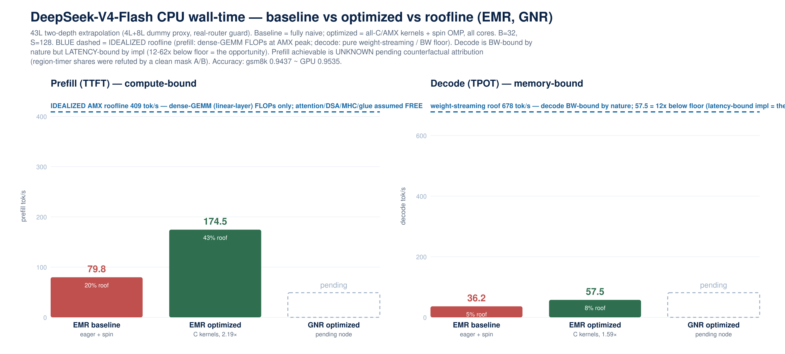
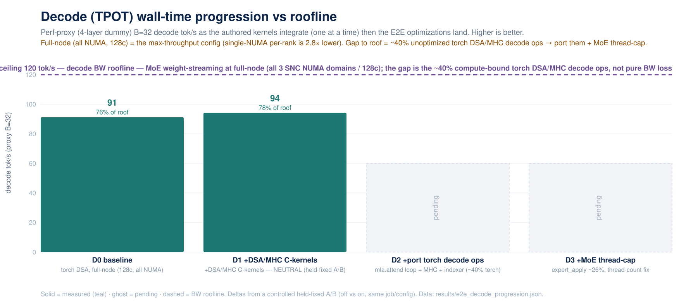
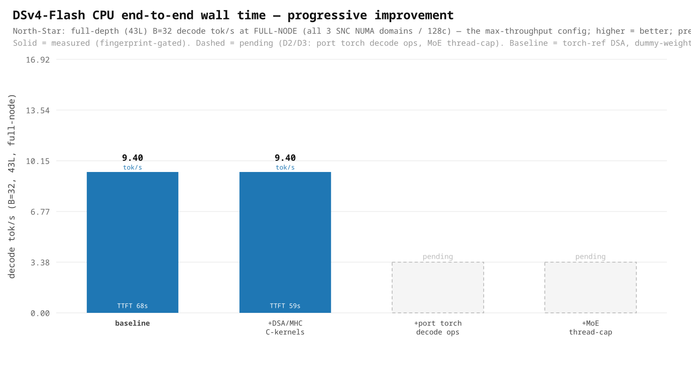

# DSv4-Flash CPU — end-to-end wall time: baseline & progressive improvement

Live ledger of the **North-Star metric** — end-to-end tok/s for DeepSeek-V4-Flash on CPU — as each authored
kernel is integrated into the serving path. This is the **Phase 2** deliverable of the
[methodology playbook](methodology-playbook.md#phase-2--north-star-end-to-end-wall-time); the per-kernel
standalone results live on the [kernel-pilot performance page](kernel-pilot-performance.md).

## Current real-weight C4 comparison on EMR (401687)

Completed 2026-11-11, full 43-layer real model, fixed32 threads, six independent
resident-process baseline/candidate pairs per point after separate warmups.
All requests generated five tokens, ignoring EOS. The candidate scored
1,252/1,311 versus the fresh native baseline's 1,245/1,311, with zero invalid
answers; this meets the declared no-observed-loss criterion, not automatic
promotion.

| Operating point | Native request time, median | C4 request time, median | Median paired request-time change [min, max] |
|---|---:|---:|---:|
| B1 / S3072 | 30.622 s | 28.191 s | -7.60% [-8.35%, -6.90%] |
| B32 / S128 | 35.741 s | 41.786 s | +17.13% [+16.32%, +21.53%] |
| B64 / S128 | 75.553 s | 111.265 s | +48.66% [+41.91%, +51.31%] |

Negative change is less time. Percentages are medians of paired changes,
not ratios of marginal median times. The long-prefill point improves, but
**short-prefill batch32/64 regress**: do not enable C4 unconditionally or mix
these measured full-model results with the older dummy-depth chart below.
The four decode steps are a bounded comparison, not steady-state decode.
See the [accuracy, phase timing and provenance record](dev/DSv4-serving-screen-401145-findings.md#10-authorized-full-c4-accuracy-and-matched-performance-wave-401687).

**Final C4 disposition, 2026-11-11:** retain these measurements as experimental
findings, without production integration. The user declined further native-port,
conditional-dispatch and accuracy-screen work. Existing production behavior
remains unchanged. The benefit is geometry-dependent; these points do not prove
that only batch 1 can benefit.

## GNR versus EMR: real-weight comparison and socket scaling

**Status, 2026-11-11: capacity checked; matched real-weight GNR speedup not yet
measured.** The chart below is an older dummy-weight depth extrapolation, not a
current full-model GNR/EMR comparison. Its pending GNR bars must not be filled
with a bandwidth ratio or a three-domain throughput projection.

Read-only topology checks on `pcl-gnrap01` and the running EMR accuracy worker
on `pcl-sprh01` established:

| Resource | EMR: Xeon Platinum 8592+ | GNR: Xeon 6980P |
|---|---:|---:|
| Physical cores per socket | 64 | 128 |
| NUMA domains per socket | 1 | 3 |
| Physical cores per domain | 64 | 42 or 43 |
| Memory per domain, approximately | 503-504 GiB | 251.5-252 GiB |
| Memory per socket, approximately | 503-504 GiB | 755.5-756 GiB |

Both hosts have two sockets. Commands: `lscpu`, `lscpu -e=CPU,NODE,SOCKET,CORE`,
and `numactl --hardware`. The latter reports memory in MiB despite its `MB`
label. Earlier descriptions on this page of an "EMR" socket with 128 cores and
three SNC domains do **not** describe the measured 8592+ host; do not use those
historical labels to normalize this comparison.

**Does the model fit one GNR domain?** The observed footprint suggests yes for
the current workload, subject to a real GNR load and memory-locality check.
Job 401687, worker 0 (Slurm job 401688), had scheduler PID 3354430 peak RSS
199,022,732 KiB (**189.8 GiB**) and parent PID 3354321 peak RSS 884,720 KiB
(**0.84 GiB**). The scheduler had no swap and almost all resident memory on
EMR NUMA node 0. This leaves approximately **60 GiB** against a GNR domain's
physical capacity, before other processes and workload growth. These are
observed process high-water marks, not a guaranteed maximum or a measured GNR
footprint. The checkpoint files total 159,617,149,040 bytes (**148.7 GiB**);
checkpoint size alone excludes runtime tensors, caches and loading temporaries.

The real-weight chart should distinguish:

1. **One replica / one NUMA domain:** matched source, inputs, batch, generation
   length, thread policy and cache lifecycle. Plot prefill, decode and complete
   request wall time; compute latency speedup as `EMR time / GNR time`.
2. **One complete socket:** independent TP1 replicas with local memory and
   disjoint cores. Test three GNR replicas, one per domain. Compare against both
   one and two EMR replicas: two copies appear to fit EMR's socket memory and
   can use separate 32-core groups, but share that domain's memory bandwidth.
   Record total batch/concurrency explicitly; throughput speedup is
   `GNR completed tokens/s / EMR completed tokens/s` over a common wall interval.

Three GNR replicas may approach three times **single-domain aggregate
throughput**, not three times faster individual requests or automatically three
times EMR socket throughput. Measure concurrent scaling rather than summing
isolated rates. This is data parallelism, not TP=3. Keep the approved native
path and the archived experimental C4 candidate separate, exclude warmup, and retain
replicate samples and spread before adding measured speedup labels.

### Bounded measurement protocol

The original paired protocol below records the failed attempts. On 2026-11-11
the user resumed GNR measurement as a **short native-only calibrated probe**,
not a full benchmark or another accuracy evaluation:

- Same real checkpoint, fixed32 threads and three existing workload points;
  five output tokens, explicit warmup, no thread sweep or C4 candidate.
- Pin main `1ac61ecacdc46ae4118bb2faa1109348961d8c86`, not the older
  `dsv4-tree-pilot` branch. Its model code is unchanged from the `34fe50f`
  accuracy-qualified baseline. Snapshot the main model and native-kernel trees
  byte-for-byte; the separate `dsv4_socket_models` measurement registry installs
  timing/state-reset observations without editing either tree. Run the same
  short native-only panel on EMR and GNR; the old dummy-depth chart is not the
  speedup denominator.
- Three isolated domain processes supply three samples per point; then three
  measured concurrent socket rounds after a socket warmup. Thirty request
  groups total, with several requests per group where batch/replicas require it.
- Prewarm checkpoint files under `numactl --cpunodebind=3,4,5 --interleave=3,4,5`
  before loading socket0 replicas. Record shard bytes/hashes, effective policy,
  domain memory before/after and job/plan identity. This uses the other socket
  for **load-time page cache**, not inference compute; no eviction, swapoff,
  checkpoint conversion, local copy or host-wide setting change.
- Keep the no-swap/99%-local scheduler gates at load and after requests. Compare
  repeated native inputs, schedules and output token IDs. If these fail, retain
  the raw evidence and stop before loading more replicas.

The cache-placement intervention is a hypothesis, not a demonstrated fit fix.
The first native-only GNR submission, job402061, stopped before any checkpoint
read because the prewarm validator incorrectly checked `membind` rather than
`interleavemask`. An on-node `numactl --show` check confirmed the requested
interleave mask3/4/5 alongside an allowed `membind` set0-5. The validator now
checks the effective policy, interleave mask and CPU-node binding and preserves
raw policy output; no memory criterion is relaxed. EMR job402060 is unaffected.
The corrected short probe is running as GNR **402075**, paired with EMR
**402060**. Launch records:

- EMR root: `/scratch/bkaul/dsv4-socket-walltime/main-short-20261112-I8TNCU`,
  harness commit `83f2917`, plan SHA256
  `e265eb8a15286134f8386c85dfcce9520439ab122d9ce6aa860d501111d727e9`.
- GNR root: `/scratch/bkaul/dsv4-socket-walltime/main-short-retry-20261112-Dg8eC6`,
  harness commit `4de0813`, plan SHA256
  `fe015de5ccf911da8bbf4c43c983a06bd5a2123e9a9d5f4f41e84aa2ee3d62c6`.
- Both plans have identical main-compute hashes, checkpoint inventory, inputs,
  runtime, sampling and schedules. The worker, aggregation, request-timing,
  memory-collection and locality-validation functions are AST-identical; the
  retry changes only prewarm-policy validation and its raw diagnostics.
- Startup was observed: GNR emitted checkpoint-prefetch progress, and EMR began
  loading its first replica. This is **not** a completed fit or speedup result.

The target remains matched GNR/EMR latency and bounded aggregate throughput;
no speedup is accepted until these gates and measurements complete. Prepare
the driver from the Git worktree with `prepare --baseline-only --remote-cache`
(preparation checks the frozen compute files against the pinned Git archive); its original
baseline/C4 mode remains available only for historical reproduction.

The [socket driver](../plugin/validate/compare_socket_walltime.py) reuses the
[accuracy wave's performance validator](../plugin/validate/c4_accuracy_wave.py),
the same tokenized inputs, native baseline and C4 candidate. It does **not** rerun
GSM8K. Both variants use real weights; the candidate remains unpromoted.
Operating points are B1/S3072 and B32/B64/S128, each generating five tokens with
EOS ignored (four decode steps). This bounds the run, but does not measure a
complete C128 compression cycle or long steady-state decode.

On GNR, three resident workers load sequentially, bind 32 disjoint physical cores
each, and place memory in domains 0/1/2 of socket 0. Each worker must pass its
load-time memory check and isolated measurements before the next model is loaded.
Each worker first runs alone:
one warm and one measured baseline/candidate pair per point, yielding three
process samples. The socket phase then runs all three concurrently, with one
warm pair and three measured pairs per point. Variant order alternates.
Socket repetitions reuse the same resident processes, not independent reloads.
This tests a fixed32 deployment, not a claim of optimal GNR thread tuning.

| Question | Evidence and disposition |
|---|---|
| Does each replica fit locally? | Actual RSS/high-water marks, no swap, at least 99% resident NUMA pages local; reject a locality failure rather than label it domain-local performance. |
| Is GNR faster for the same work? | Compare matched inputs, shapes, generation counts and source-bound per-phase/request timings against the EMR wave; retain slower results too. |
| Does one socket scale across domains? | Measure concurrent replicas over their common elapsed interval, with launch skew retained; do not sum isolated rates. |
| Does C4 help each workload? | Separate baseline/candidate pairs with state reset, identical initial input/cache anchors and forward schedules; report each point independently. |

Phase throughput uses the span from the earliest to latest model forward of
that phase across active replicas; request throughput uses total generated
tokens divided by the common request interval. These are bounded cohort
measurements, not serving TTFT/ITL or saturation throughput. The existing EMR
wave supplies six isolated-process pairs per point; two-replica EMR socket
throughput requires its own measurement and must not be inferred from them.

The first attempt (job 401713) loaded three models but rejected rank 0's first
warmup at the memory check. Its error combined missing residency and nonzero
swap, without retaining those fields, so it does not identify which condition
failed. No accepted timing pair or speedup resulted. The collector subsequently
worked in a small GNR process, but that does not establish full-model fit.
The retry retains load-time memory/domain information and rejected per-case raw
records, reports the exact failing values, and validates the first replica
before paying for the other two. The no-swap/99%-local criteria are unchanged.

Retry 401720 stopped at the first load-time check: scheduler RSS was about
181.4 GiB, with **1.19 GiB swapped**, despite more than 99.99% of its resident
NUMA pages being local. Domain 0 had only 1.37 GiB free and approximately
67.97 GiB of file pages alongside 182.69 GiB of anonymous pages. This points
to domain-local loading/page-cache pressure; it is not proof that the steady
model cannot fit or that a compute kernel failed. The earlier approximately
60 GiB margin was a footprint estimate, **not demonstrated swap-free loading**.
No GNR speedup has been accepted. The captured
`/scratch/bkaul/dsv4-socket-walltime/retry-20261111-cAOoYp/gnr/rank0/load-memory.json`
is the retained evidence; do not retry unchanged or relax the memory gate.

## Historical proxy comparison — baseline vs optimized (EMR, GNR) vs roofline

**43L two-depth extrapolation** (4L+8L dummy-weight proxy, **real-router guard ON** so routing matches the
real ~59 distinct experts/B=32 — see the mode-collapse note below). **Baseline** = fully naive (eager DSA +
OMP spin-wait + no thread-cap, the default first-run CPU path). **Optimized** = all authored C/AMX DSA kernels
(**dispatch-proven**, `eager=0`) + spin-wait OMP, all 128 cores. Operating point B=32, S=128. The accuracy of
the latest accuracy-fix configuration is measured separately: **GSM8K CPU 1246/1311 (95.04%) versus
fresh matched GPU 1245/1311 (94.97%)**. This does not revalidate the different performance configuration
above. See [accuracy closure and evaluated flags](dev/DSv4-accuracy-closure.md).

| EMR, 43L (two-depth) | baseline (naive) | optimized (C/AMX) | **speedup** |
|---|---:|---:|---:|
| **prefill** tok/s | 79.8 | 174.5 | **2.19×** |
| **decode** tok/s | 36.2 | 57.5 | **1.59×** |

*(GNR column pending node availability — ghost bars; filled when `pcl-gnrap01` frees.)* Matched-depth ratios
(4L and 8L, directly measured) agree with the extrapolation: prefill 2.18× at both depths, decode 1.32× (4L) /
1.44× (8L). Harness: [run_dsv4_perf_matrix.sbatch](../plugin/validate/run_dsv4_perf_matrix.sbatch), attribution
[run_dsv4_perf_attrib.sbatch](../plugin/validate/run_dsv4_perf_attrib.sbatch) (job 392780).

**Roofline position (honest, real-router, MEASURED EMR constants).** Roofline computed from a direct
uarch-probe of the EMR node (pcl-spr08: **AMX bf16 12.4 TFLOPS, DRAM 848 GB/s full-node**, job 392787):
**prefill ≈ 43% of the AMX compute roof** (409 tok/s), **decode ≈ 8% of the weight-streaming roof** (678 tok/s).
**But the 409 prefill roof is an IDEALIZED upper bound** — it counts only dense-GEMM (linear-layer) FLOPs and
assumes attention/DSA/MHC/norms/glue are free; only ~40% of real prefill wall-time is that GEMM, so 174.5 is
far closer to the achievable mixed-op ceiling than "43%" implies (**see "Prefill headroom" below**). **Decode
has large headroom** — and this **supersedes the earlier "~76% of roofline" claim**, which was a
**mode-collapse artifact**: a dummy-random
router collapsed routing onto a few experts, so `W_active` was ~2.3× too small and the proxy looked near-roof.
With the real router (correct `W_active` = 40 GB/step), the decode bound is **overhead/dispatch + the not-yet-
fused aten ops**, not raw BW.

### Roofline calculation (EMR + GNR — formulas + measured constants)

Both rooflines are rooted in **native-compute peak + DRAM bandwidth** (gap-ledger rule 13 — low-bit
experts/KV cut *bytes*, they do not raise a compute ceiling the HW lacks). Constants are **measured** per node
by the uarch-perf-probe ([tools/uarch_perf_probe](../tools/uarch_perf_probe); EMR job 392787, GNR job 372840).

| measured constant | **EMR** (pcl-spr08, 2 NUMA) | **GNR** (pcl-gnrap01, 6 NUMA) |
|---|---:|---:|
| AMX bf16 compute peak | **12.4 TFLOPS** | **30.9 TFLOPS** |
| DRAM BW, per-domain | 328.9 GB/s | 226.3 GB/s |
| DRAM BW, full-node (triad) | **848 GB/s** | **2152 GB/s** |

**Prefill (TTFT) — compute-bound.** `prefill_tok/s_roof = AMX_bf16_peak / FLOPs_per_token`.
FLOPs/token (43L, linear layers only, 2 MACs/param) = **30.2 GFLOP** = MLA proj + MoE active-experts
(top-6 + 1 shared) + router, summed over 43 layers.
- EMR: `12.4e3 / 30.2 = ` **409 tok/s** → optimized 174.5 = **43%**.
- GNR: `30.9e3 / 30.2 = ` **1023 tok/s** (the higher AMX peak raises the ceiling; GNR measured bars pending).

> **⚠ This prefill roofline is IDEALIZED** — linear-layer **dense-GEMM FLOPs only**, at the **resident** AMX
> peak. It assumes attention/DSA/MHC/norms/softmax/glue cost nothing. See **"Prefill headroom"** below for the
> per-op attribution (only ~40% of prefill is that GEMM), why 409 is structurally unreachable, what's actually
> recoverable, a **refined (additive) roofline**, and how to **validate the headroom cheaply before investing**.

**Decode (TPOT) — memory-bound (weight-streaming).** `decode_tok/s_roof = B / (W_active / BW_full-node)`,
where **`W_active`** = bytes read per decode step = per layer `[ distinct_experts(B)·fp4_bytes_per_expert +
shared_expert + dense/attn fp8 ]`, summed over 43 layers, **with REAL routing** (the mode-collapse guard):
- distinct_experts(B=32) ≈ **59** (measured, not dummy-random's ~135) × **12.58 MB/expert** (fp4: 3·moe_inter·H·0.5 B) = 742 MB/layer
- + dense/attn (fp8) ~175 MB/layer + shared ~13 MB/layer → **≈0.93 GB/layer × 43 = `W_active` ≈ 40 GB/step**
- EMR: `32 / (40 / 848) = ` **678 tok/s** → optimized 57.5 = **8%** (large headroom; overhead/dispatch-bound).
- GNR: `32 / (40 / 2152) = ` **1721 tok/s** full-node theoretical (a single tp=1 rank rarely saturates all 6
  domains, so treat as an upper bound; GNR measured bars pending).

> **⚠ The 678 decode roofline is idealized — but decode is BW-bound BY NATURE, latency-bound BY
> IMPLEMENTATION (a 12–62× gap that IS the opportunity).** Decode streams each weight once per step and
> reuses it ~M times, so it *should* approach the weight-streaming roofline. It doesn't: measured decode is
> **12× above the BW floor at M=32** (557 ms/step vs a 47 ms floor → **92% non-streaming overhead**) and
> **62× at M=1** (654 ms vs 10.6 ms → **98% overhead**). **This is a latency/overhead problem, not a
> physics ceiling.**
>
> **Correction (supersedes an earlier "~63 tok/s achievable" claim, which was WRONG).** The ~63 figure was
> derived as *"decode is ~88% C/AMX dispatched → only ~15% recoverable → 57.5/0.91 ≈ 63"* — it conflated
> **"dispatched to a C kernel" with "running at the kernel's roofline."** They are not the same: our own
> data shows `moe.expert_apply` (the C kernel) runs at **8 threads = 0.1 ms but 120 threads = 5175 ms** — a
> ~50,000× *threading* pathology; the kernel hits its floor at low threads but runs far above it otherwise.
> So "dispatched" ≠ "efficient," and the real achievable is the **BW roofline** (94 @ M=1 → 678 @ M=32 →
> 861 @ M=64), not 63. **The decode optimization thesis is to close the 12–62× latency gap** via (1)
> **thread right-sizing** (parallelize across experts/layers, not within a tiny M=1 GEMM), (2)
> **BRGEMM/grouped-expert GEMM** (one batched weight-stream instead of ~258 tiny per-expert launches/step),
> (3) **dispatch reduction / graph-capture**, and (4) **weight prefetch/overlap** — the Kimi-K3 single-stream
> levers. Larger batch *also* helps (amortizes fixed cost), but it is not the only lever. *(Sizing run:
> `run_dsv4_decode_reassess.sbatch`, job 393516 — thread sweep + per-op-vs-BW-floor attribution at M=1.)*

**Batch-sensitivity of the decode roofline (MoE: `W_active` GROWS with B).** Because more batch activates more
*distinct* experts, `W_active(B)` rises with B, so the decode roofline grows **sub-linearly** — doubling B does
**not** double the ceiling. Fitting a coverage model `distinct(B) = 256·(1−(1−p)^B)` to the measured
`distinct_experts(32) = 59`:

| B | distinct experts | `W_active` (GB) | decode roofline (tok/s) | × vs B=32 |
|--:|--:|--:|--:|--:|
| 16 | ~31 (est.) | ~25 | ~554 | 0.82× |
| **32** | **59 (measured)** | **40** | **678** | 1.00× |
| **64** | **~104 (est.)** | **~63** | **~840** | **~1.24×** |
| 128 | ~166 (est.) | ~96 | ~1130 | ~1.67× |

So the **decode roofline at M=64 ≈ ~840 tok/s (+24% vs M=32), not 2×** — the MoE expert-set growth (`W_active`
40 → ~63 GB) eats most of the batch gain, until experts saturate (all 256 → `W_active` ~143 GB, after which the
roofline grows linearly again). `distinct(64)` is **estimated** (coverage model fit to the single measured
point) — measure it directly with `INTEL_CPU_DSV4_EXPERT_HIST=1` to firm it up. **More important than the
roofline shift:** achieved decode improves *more* at M=64 by amortizing the per-step overhead (decode is
latency-bound at B=32), which is the real reason to raise batch.

*Why the old "~76% of roofline" was wrong:* it used dummy-random routing → ~135 "distinct" experts is actually
a collapsed subset, so the proxy under-read expert bytes (`W_active` ~2.3× too small) and looked near-roof. The
real-router `W_active` = 40 GB is the honest number.

## Prefill headroom — the 409 tok/s roofline is IDEALIZED (dense-GEMM only)

The **409 tok/s prefill roofline is a loose upper bound, not a reachable target.** Its denominator counts
**only the linear-layer dense-GEMM FLOPs** (30.2 GFLOP/token: MLA proj + MoE experts + router) at the
**resident** AMX peak (12.4 TF), and assumes the rest of the forward — attention (DSA sparse O(S²) +
lightning-indexer), MHC hash-clustering, softmax, norms, masking, and all layout/dtype glue — is **free**. It
isn't. A **wall-clock, category-tagged** attribution of a real prefill (job 393238, full 43L real weights, real
routing, B=32 S=128, optimized throughput config; `INTEL_CPU_DSV4_TIMEIT` boundary timers, parent timers
`moe`/`dsa.mla.attend` excluded to avoid double-count) confirms only **~41% of prefill wall-time is the AMX-GEMM
work the roofline models** (self-profiler had estimated ~40% — the wall-clock measurement validates it):

| prefill leaf (wall-clock) | bucket | % of timed leaves | in the 409 roofline? |
|---|---|---:|---|
| **`mla.b.mask`** (per-token Python mask-construction loop) | **glue** | **27.6%** ← #1 target | ❌ assumed free |
| `mla.b.pv` (attention PV GEMM) | kernel | 18.9% | ✅ |
| `moe.expert_apply` (MXFP4 experts) | kernel | 14.2% | ✅ |
| `mhc.hc_post` + `mhc.hc_pre` (MHC, eager) | torch | 16.7% | ❌ assumed free |
| `dsa.indexer` + `dsa.compressor` (eager) | torch | 14.8% | ❌ assumed free |
| `dense.fp8_linear` (MLA proj) | kernel | 7.8% | ✅ |

**Compute ≈ 41% / recoverable overhead ≈ 59%** of timed leaves. **⚠ The end-to-end prefill value of attacking
the `mla.b.mask` region is currently UNVALIDATED — both measurements that claimed to settle it are unreliable
(see below).** The `mla.b.mask` leaf (a per-token Python loop that materializes the coverage mask) *looked* like
the #1 recoverable target at ~28% of timed leaves, so we vectorized it (bit-exact, proven over 4000 fuzz cases +
in-situ assert) and cut the region from 8.7s → 0.25s (35×). **Bit-exactness stands; the perf claim does not.**

**⚠ UNVALIDATED — two broken measurements (do not cite either as proof):**
- The earlier `ABLATE_MASK` **"+7.3%"** (job 393314) was a **confounded proxy** — it forced a DENSE mask that
  changed attention semantics (more keys attended), so its delta mixed the mask-construction cost with a changed
  PV workload. Not the mask-construction lever.
- The follow-up **interleaved A/B** (job 393518) that reported **"−0.2% = zero gain"** is **invalid**: it toggled
  `os.environ` *per-rep after `sgl.Engine` construction*, but the Engine runs the model in an `mp.Process` worker
  **subprocess** that never sees the client's post-spawn `os.environ`. **Both arms ran the identical (spawn-time)
  configuration** → the "loop vs vectorized" comparison was really the same code twice, so it proves nothing
  about mask vectorization. (Same class of bug invalidated the increment-1 MHC A/B; the fix is a worker-side
  control file re-read per forward — see `dsv4_decode_fusion_review_response.md`.)

**What stands (methodology, not this datum):** a TIMEIT *region-timer* leaf is **not** a critical-path
attribution — accumulated region time can overlap/hide behind concurrent AMX compute, so only a **valid**
counterfactual (worker-side toggle, measure end-to-end wall) can decide whether removing it moves wall-clock.
The vectorized mask is **kept** (bit-exact, cleaner); whether it is a prefill *lever* awaits a repaired,
worker-verified A/B at a matched operating point.

Earlier self_cpu-profiler estimate (superseded by the wall-clock measurement above)

An earlier `torch.profiler` self-time profile (job 390877) estimated ~40% GEMM / 26% glue / 24% eager / 10%
fallback-matmul. The wall-clock TIMEIT above supersedes it: it confirms the ~40% compute but, by timing the
actual op *regions*, reveals the glue is concentrated in one op (`mla.b.mask`) rather than diffuse across
thousands of `copy_`/`index` calls — a more actionable picture.

**Why 409 is structurally unreachable (Amdahl).** ~60% of prefill is non-dense-GEMM work that is
memory-/dispatch-bound and physically cannot run at the AMX compute peak. Even an *infinitely fast* GEMM leaves
that 60% → the ceiling for **this op graph** is far below 409. The AMX GEMMs are already ~76% of their own
roofline, so **the headroom is not in the kernels — it is in the work the roofline pretends is free.** Hence
**174.5 is much closer to the achievable mixed-op ceiling than "43%" suggests.**

**Recoverable vs irreducible (the real levers, each bounded):**
- **~26% glue → inter-kernel-fusion.** The 14,790 `copy_` calls are the seam tax (dtype/layout/staging between
  kernels); fuse layouts / emit kernel-native output. *Bounded:* some gather/unpack is irreducible for
  sparse-MoE + MXFP4.
- **~24% eager math → kernelize** the DSA/MHC/softmax/masking (the same "port the torch ops" lever as decode).
- **~10% fallback `mm`/`bmm` → route to the AMX kernel** (the MLA attention bmm that missed the tuned path).
- *Not a lever:* making the AMX GEMMs faster — already near their own roof.

Realistic recovery is a **fraction** of that ~60%, so prefill could plausibly move from 174.5 toward **~250–300,
not** to 409. *(The wall-clock TIMEIT above supersedes the earlier `self_cpu` over-weighting, but note the
single-op `mla.b.mask` recovery it seemed to localize is UNVALIDATED — see the two-broken-measurements note
above; the real prefill lever must be re-established by a valid, worker-verified counterfactual.)*

## B=1 decode headroom (the Xeon low-batch operating point) — a DIFFERENT target

Xeon is targeted for **low-batch latency**, so the decode recovery must be attributed at **B=1**, not B=32. The
wall-clock TIMEIT attribution at B=1 (job 393239, full 43L real weights, latency config: OMP passive +
decode-cap=8; parents excluded) shows a **different** picture from prefill:

| B=1 decode leaf (wall-clock) | bucket | % of timed leaves |
|---|---|---:|
| `moe.expert_apply` (MXFP4 experts — weight-streaming) | kernel | 35.5% |
| `dense.fp8_linear` (MLA proj) | kernel | 16.9% |
| **`dsa.compressor` + `dsa.indexer` (eager)** | **torch** | **19.9%** |
| **`mhc.hc_pre` + `mhc.hc_post` (eager)** | **torch** | **9.8%** |
| `mla.b.pv` (attention PV) | kernel | 8.8% |
| `mla.b.mask` + `mla.b.gather` (glue) | framework | 6.9% |

**Compute ≈ 63% / recoverable overhead ≈ 37%.** The decode recovery target is **NOT the mask** (only ~7% here,
vs ~28% in prefill) — it is the **~30% eager/torch DSA compressor + indexer + MHC**, i.e. the "port the torch
decode ops to kernels" lever, now **ROI-justified by measurement at the operating point that matters for Xeon.**
The MoE `expert_apply` dominates (35%) and is weight-streaming compute at ~50% of its floor (partially
recoverable via the already-found MoE thread-scaling lever, not fusion). Corroborating signs this overhead is
real and recoverable: at B=1 the DSA C-kernels-ON path (7.3 tok/s) was *slower* than OFF (8.4), and the
overhead-attribution found `moe.expert_apply` **inverse thread scaling** (8 threads 0.1 ms → 120 threads 5175 ms).

**KPI-framing lesson:** the prefill and B=1-decode recovery targets are **different** (mask-fusion vs
eager-op-kernelization). Attributing at a single operating point (B=32) under-weighted the decode fixed-cost
levers that define the Xeon low-batch value. **Attribute optimization decisions at the TARGET operating point.**

## A refined roofline (recommended) — an additive "achievable" ceiling, not one idealized line

The single-resource AMX roofline is a weak signal precisely because it hides everything it assumes free.
Replace it with an **additive time-budget roofline** that gives each op-class its *own* achievable rate:

> `T_prefill_floor = Σ_class ( Work_class / AchievableRate_class )`,  `tok/s_achievable = tokens / T_prefill_floor`
> - **dense GEMM** → FLOPs / **streamed**-AMX-achievable (NOT the resident 12.4 TF peak — use the
>   establish-achievable streamed-GEMM rate, which is materially lower)
> - **sparse attention / bmm** → bytes gathered / achievable gather-BW (O(S·topk), not O(S²) dense)
> - **elementwise / norms / softmax** → activation bytes (read+write) / cache-or-DRAM BW
> - **glue** → bytes copied / memcpy-BW (or an explicit irreducible-overhead floor)

Report **two numbers**: the **idealized AMX ceiling** (409 — loose upper bound) **and** the **achievable mixed
roofline** (Σ per-class floors — the real target). Then the meaningful signal is **achieved ÷ achievable-mixed**,
and **achievable-mixed ÷ idealized** quantifies how much of the gap is *structural* (unreachable without changing
the op graph). This is the `model-roofline-analysis` skill's per-op-class, Amdahl-ranked method applied as a time
budget.

**First-order DSv4 time-budget rooflines — ⚠ WITHDRAWN for prefill (the attribution they rest on was refuted).**

*Prefill — ~~`~275 tok/s`~~ WITHDRAWN.* This estimate applied a "~60% of the non-GEMM is recoverable" floor to
the region-timer op-class split (GEMM 40% / glue 26% / eager 24% / fallback-mm 10%). But the mask A/B (above)
showed the biggest "recoverable" item (mask, ~19% by region timer) gives **0% end-to-end** — its region time is
overlapped/hidden, not critical-path. So the region-timer "60% recoverable" is **not** a reliable basis for an
achievable roofline, and the ~275 is withdrawn. The honest statement: prefill is **~202 tok/s** (clean
throughput_bench baseline; the earlier 174.5 is a different, lower-reading harness — see note), the idealized AMX
roofline is 409, and the **true achievable is UNKNOWN pending counterfactual (not region-timer) attribution** of
what actually sits on the prefill critical path. *(Harness note: bench_one_batch read ~175–187 tok/s; the
interleaved throughput_bench reads ~202 — protocol differences, not a regression.)*

*Decode — ~~`~63 tok/s`~~ WITHDRAWN (the estimate was wrong).* The earlier derivation (*"~88% C/AMX → only
~15% recoverable → 57.5/0.91 ≈ 63"*) **conflated dispatch with efficiency** and is superseded. Decode is
weight-streaming by nature, so its achievable is the **BW roofline** (678 @ M=32), and measured 57.5 is **12×
below the BW floor** — a latency/overhead problem (per-step threading pathology + ~258 tiny per-expert GEMM
launches), not a near-ceiling state. The true achievable is being **measured** (thread sweep + per-op-vs-BW-floor
attribution, job 393516) rather than estimated; the lever is thread right-sizing + BRGEMM expert-grouping +
dispatch reduction (converting latency-bound → BW-bound), *and* larger batch. See the **decode reassessment** box
in "Node comparison" above.

> These two time-budget numbers are **analytical estimates** — the softest inputs are the *recoverable fractions*
> (prefill 60% of the non-GEMM; decode 60% of the non-kernel). The **counterfactual-ablation experiment below
> replaces those assumptions with MEASURED floors** before any kernel is authored.

## Validating recoverable headroom BEFORE investing (cheap counterfactual ablation)

Don't author fused kernels on faith. The reliable, cheap "burn a few tokens to be sure" test is a
**counterfactual ablation**: in a **timing-only** run (dummy weights, 4L/8L proxy — output correctness does not
matter), **remove / no-op the suspected-recoverable work and measure the prefill delta**:

| lever to test | ablation (timing-only, env-gated) | the delta measures |
|---|---|---|
| glue (~26%) | replace layout/dtype conversions + `copy_`/`cat` with pass-through / preallocated reuse | **upper bound** of inter-kernel-fusion gain |
| eager DSA/MHC/softmax (~24%) | swap the eager math for a cheap stand-in (identity/zeros) | upper bound of kernelizing it |
| fallback `mm`/`bmm` (~10%) | route to the AMX kernel (or no-op) | upper bound of routing it |

The measured speedup is the **maximum** recoverable (you fully removed the cost), so it **bounds the ROI before a
single kernel is written**: if ablating glue + eager-math buys <15%, don't invest; if it buys 30–40%, build the
real fused kernels. Complement with **env-gated boundary timers** (wall-clock, to correct the `self_cpu`
over-weighting) and the **isolation microbench vs roofline floor** already in `operating_point.json`; gate each
lever on the **Amdahl bound** `share × (1 − floor/measured)` before committing. Method per the
**overhead-attribution** + **kernel-feasibility-gate** skills; harness:
[run_dsv4_perf_attrib.sbatch](../plugin/validate/run_dsv4_perf_attrib.sbatch).

## Decode (TPOT) — attribution (corrected, real-router phase-split, job 392782)

**What actually runs at decode (optimized path, dispatch-provenance-verified):** the heavy compute is **C/AMX
kernels, all dispatched** — the dispatch-provenance shows `eager=0` for `sparse_attend`, `moe`, `compressor`,
`indexer`, `sinkhorn`, `combine`, `topk`. By the phase-split TIMEIT (8L, B=32): the **kernel bucket is ~88% of
decode wall**; MoE core (`moe`+`expert_apply`) ~41%, dense fp8 ~10%, MLA attention core (qk/pv) ~5%.
- **The genuinely *not-C* compute is small: MHC `hc_pre`+`hc_post` ≈ 7%** (standard bf16 **aten** matmul+RMSNorm,
  never hand-fused to a C kernel — *optimized BLAS, not slow eager Python*), and the **attention mask/gather
  *glue* ≈ 8%** (the inter-kernel seam). **Framework/dispatch is ~8%, not ~40%** — the earlier "~40% unoptimized
  torch / ~39% framework" framing was **wrong on two counts**: it used a stale pre-fix profile, and it misread
  the TIMEIT *category tag* ("torch") as *eager dispatch* — the dispatch-provenance is the authority, and it
  shows those ops run as C kernels.
- **Remaining decode levers (small, specific — not a 40% rewrite):** (1) author a fused C kernel for **MHC**
  (~7%); (2) kill the **attention-glue seam** (~8%, an inter-kernel-fusion target — fuse gather/mask into the
  attend); (3) the proxy at B=32 real-router is **overhead/dispatch-bound** (far below the BW roof), so
  grain-size / parallel-region tuning is the lever, not more kernels. *bf16-KV is a prefill/long-context lever,
  not a decode one.*

**MoE mode-collapse guard (now ENFORCED in code, not just described).** Under `--load-format dummy` the router
weights are random → routing collapses onto a few of the 256 experts (~135 distinct/B=32 vs the real ~59),
under-counting expert weight-streaming and making decode look **falsely fast / falsely near-roofline**. The
proxy now injects the **real (tiny) gate weights + `tid2eid`** from the checkpoint
(`INTEL_CPU_DSV4_REAL_ROUTER=1`) so routing matches the real model (verified: distinct-expert count 135 → ~60).
All node-comparison numbers above use this guard.

The full segregated ledger (prefill vs decode, stage-by-stage) is below.

Solid bar = measured & integrated (fingerprint-gated); dashed = pending Phase-2 integration.

## Phase-2 integration — status (in progress, honest)

The authored DSA/MHC C/C++ kernels are now **wired into the serving forward**, env-gated
(`INTEL_CPU_DSV4_DSA_CKERNEL=1`, per-op `INTEL_CPU_DSV4_CK_<op>`), default-OFF. **Op-level parity is validated**
(indexer cos 0.99999 / compressor cos 1.0 / MHC sinkhorn+combine cos 1.0; bf16-KV bit-identical). The
**controlled held-fixed end-to-end A/B now shows integration is perf-safe** — neutral at decode, a modest win at
prefill:

| perf-proxy (4-layer dummy), **held-fixed** OFF-vs-ON | prefill tok/s | decode tok/s |
|---|---:|---:|
| C-kernels OFF (torch) · B=32 | 880.2 | 91.2 |
| C-kernels ON · B=32 | **1002.8** (1.14×) | **94.2** (1.03×) |

(EMR, **job 386039** — all kernels OFF-vs-ON, mem-fraction fixed 0.85, prefill+decode in the *same* job;
[results](../plugin/validate/results/).)

> **⚠ Superseded — the earlier "10× regression" was a measurement artifact.** A prior *sequential* bisection
> (job 385956/386002) reported a ~10× prefill and ~4× decode regression and hypothesized **OpenMP runtime
> oversubscription** (GNU libgomp vs Intel libiomp5 collision). The **held-fixed** A/B above refutes it:
> toggling ops across *separate* runs drifted the scheduler/KV-pool/batching regime between points (the torch
> baseline alone swung decode 81→24 with a `mem-fraction` knob), manufacturing a phantom. The kernels are
> perf-neutral-to-positive end-to-end. **Root lesson (now in the playbook): measure integration deltas with a
> held-fixed OFF-vs-ON A/B in one job — never a sequential bisection; and a *tiny* op "regressing" large is a
> tell for a global/measurement pathology, not a slow op.**

**Next (the real levers, measured by the job-390418 decode attribution):** (1) **port the ~40% unoptimized-torch
decode ops to kernels** — `dsa.mla.attend` (the per-token Python-loop sparse attention, ~18%), MHC `hc_pre`+
`hc_post` (~17%), `dsa.indexer` einsum (~3.5%); (2) **MoE `expert_apply` thread-cap** (~26%, a thread-count
pathology — cap threads around the MoE apply, `runtime-config-tuning`, not a new kernel); (3) **incremental-sparse**
prefill O(S²)→O(S·topk). Framework/dispatch is only ~5% (the earlier "~39%" claim was wrong), and bf16-KV is a
prefill/long-context lever (the serving attention KV is already bf16). Every stage stays env-gated default-OFF
and fingerprint-gated.

## Operating point & headline
- **Input** S = 1024, **output** G = 8/step (G=256 applied analytically), full depth **43 layers**.
- **North-Star:** B=32 aggregate decode tok/s (throughput) **and** B=1 single-stream decode tok/s (latency floor).
- **Max-throughput demonstration (full-node):** **4L proxy decode 91.2 tok/s; 43L B=32 extrapolates to 9.4
  tok/s** (two-depth, job 390445: 4L=91.2, 8L=48.2 → t_layer=78.3 ms, t_fixed=37.9 ms). The B=1 latency floor is
  **0.80 tok/s** (43L).
- **⚠ NUMA config is the single biggest throughput knob.** This node is **one socket, 128 cores, 3 SNC NUMA
  domains**. The **full-node** config (all 3 domains, `OMP_NUM_THREADS=128`, no single-domain bind — the
  established canonical throughput config, cf. the Olmo2 certificate) gives **91 tok/s @ 4L**; a **single-NUMA
  per-rank** bind (`numactl -N0 -m0`, 1 SNC domain) gives only **32 tok/s** — a **2.8× gap**, confirmed by a
  held-fixed same-harness A/B (job 390442: 90.8 vs 32.0). Decode is weight-streaming BW-bound, so using all
  memory controllers is decisive. The demonstration and all ledger numbers below are **full-node**.
- **Node:** EMR Xeon (single socket, 128c, 3 SNC domains), `--constraint=ddr5600 --exclusive`,
  `OMP_NUM_THREADS=128 OMP_PROC_BIND=close OMP_PLACES=cores`, all NUMA domains.

## Prefill and decode are TWO work items (different rooflines, different maturity)

Prefill and decode are tracked **separately** — different bound, roofline, levers, and status. Optimizing one
says little about the other.

| | **Prefill (TTFT)** — compute-bound | **Decode (TPOT)** — memory-bound |
|---|---|---|
| **roofline** | `TTFT_floor = prefill_FLOPs / peak` (AMX bf16) | `tok/s_roof(M) = M·BW / (W_active + M·KV_tok)` |
| **DSA/MHC kernel leverage** | **HIGH** — indexer + sparse-attn run over the full S-token prompt (O(S·ctx)); the authored compute kernels are the main win | **LOW** — 1 query token/step; decode is dominated by MoE weight streaming, not DSA compute |
| **Phase-1 state** | unoptimized torch O(S²) attention — the big *unrealized* opportunity | **~76% of roof** (full-node) on the MoE weight-streaming core; the gap is the ~40% compute-bound torch DSA/MHC decode ops, not pure BW |
| **open levers** | (1) wire the authored DSA kernels (**done — held-fixed A/B neutral-to-positive, 1.14× prefill**); (2) incremental-sparse decode O(S²)→O(S·topk) | (1) **port the ~40% torch decode ops to kernels** (`mla.attend` loop + MHC + indexer); (2) **MoE `expert_apply` thread-cap** (~26%); (3) 43L full-depth validation |
| **status** | integration wired & **perf-safe** (held-fixed A/B: 1.14× prefill, job 386039) → authored-DSA compute win still to be realized via incremental-sparse | **MoE core ~76% roof; wall-time NOT done** — the lever is **porting the torch DSA/MHC decode ops to kernels** + the MoE thread-cap (measured attribution), not a framework pass |

**Are we done with decode?** No. The **MoE weight-streaming core** is near roofline (~76% at full-node B=32),
but the **job-390418 TIMEIT attribution shows ~40% of decode is unoptimized TORCH compute** — `dsa.mla.attend`
(per-token Python loop, ~18%), MHC `hc_pre`+`hc_post` (~17%), `dsa.indexer` einsum (~3.5%) — plus `moe.expert_apply`
(~26%, a thread-count pathology). Framework/dispatch is only ~5%. So the path to higher decode tok/s is **porting
those torch decode ops to kernels + the MoE thread-cap**, and the C-kernel swap is **perf-neutral** at decode
(held-fixed A/B 1.03×, job 390418). The remaining decode work is **porting the torch DSA/MHC decode ops to
kernels** (not a framework pass), the *same class* of compute-kernel work as prefill but on the decode-shaped
(M=1-per-seq) ops.

## Baseline (measured) — the denominator every optimization is scored against

| metric | full-depth (43L) | source |
|---|---:|---|
| **decode (B=1 latency floor)** | **1253 ms/step = 0.80 tok/s** | two-depth extrapolation, job 385387 |
| **decode (B=32 throughput, full-node)** | **3403 ms/step = 9.40 tok/s** | two-depth extrapolation, job 390445 (4L=91.2, 8L=48.2 tok/s) |
| **prefill (TTFT)** | **67.8 s** (S=1024) | two-depth extrapolation, job 385387 |

The **B=32 full-node** row is the max-throughput demonstration headline (all 3 SNC NUMA domains / 128c). The
B=1 row is the unoptimized single-stream floor. Both are the torch-reference-DSA path; the authored-kernel +
torch-op-port levers (D2/D3) raise the B=32 number from here.

**Why "dummy weights" are not fast:** `--load-format dummy` removes the checkpoint read and the fp4/fp8→bf16
dtype bridge, so *model load* is instant — but a GEMM with random weights does the **identical FLOPs**, so
*compute* is unchanged. The slowness is the unoptimized torch attention, not the weights.

**⚠ But the dummy *router* can mislead MoE wall-time (mode collapse).** DSv4 routes each token to a small
subset of its **256 experts**, and the batched-decode cost is set by the **distinct-expert working set** —
which *grows with batch* (`distinct_experts(B)·per_expert_bytes`). A random dummy router routes **degenerately**
(collapses the whole batch onto the same few experts), so a naive dummy proxy would read too few experts and
report a **falsely fast** MoE decode (and a single-expert path would hide the grouped-GEMM gather/scatter
routing bugs). This proxy therefore **keeps the real router/gate weights** (tiny — loaded even with dummy
*expert* weights), drives **varied tokens**, and **gates on the measured distinct-expert-per-batch histogram
matching the real `E(distinct | B)`** (not 1, not all-N) before any MoE wall-time is trusted. *(Methodology:
the [perf-proxy MoE mode-collapse rule](methodology-playbook.md#phase-2--north-star-end-to-end-wall-time).)*

## Calibration (two-depth linear model)
Wall time is linear in depth because every DSv4 layer is the same MoE+MLA+DSA archetype, so we extrapolate
from two shallow proxies instead of paying full depth each iteration:

$$t(L) = t_{fixed} + L\cdot t_{layer},\quad t_{layer}=\frac{t_8-t_4}{4},\quad t_{fixed}=t_4-4\,t_{layer}$$

| regime | proxy4 (4L) | proxy8 (8L) | $t_{fixed}$ | $t_{layer}$ | → 43L |
|---|---:|---:|---:|---:|---:|
| decode (ms/step) | 198.3 | 306.5 | 90.2 | 27.04 | **1253** |
| prefill (ms) | 7216 | 13425 | 1007 | 1552 | **67 754** |

Per-layer cost dominates (decode 93%, prefill 98.5%), so $t_{fixed}$ is small and the extrapolation is
well-conditioned. One full-depth dummy run will **validate** it before any headline number is final.

## Progressive-improvement ledgers (segregated by phase)
Two independent ledgers — **prefill (TTFT)** and **decode (TPOT)** — each records the wall time as (a) the
authored kernels are integrated **one at a time**, then (b) the **end-to-end optimizations** (overhead/dispatch,
bf16-KV, batching) land, every stage scored against **that phase's roofline**. Iteration metric = **perf-proxy
(4-layer dummy) B=32 tok/s** (queue-free vehicle); the **43-layer** headline is extrapolated/validated at the end.
Each stage is env-gated default-OFF, fingerprint/parity-gated; a measured **regression is a valid, recorded
stage** — the *why* is kept.

### Prefill progression — TTFT, compute-bound (roofline = prefill_FLOPs / AMX-peak)
*Prefill is where the authored DSA compute kernels are the main unrealized win (sparse-attn + indexer over the
full S-token prompt).*

| # | stage | prefill tok/s (proxy B=32) | Δ vs baseline | status |
|---|---|---:|---:|---|
| P0 | **baseline** (torch-ref DSA) | **880** | 1.00× | ✅ job 386039 (held-fixed) |
| P1 | all C-kernels ON (held-fixed A/B) | **1003** | **1.14×** | ✅ measured — **WIN** (job 386039) |
| ~~P1′~~ | ~~all C-kernels ON (naive, sequential bisect)~~ | ~~83.3~~ | ~~0.09×~~ | ⊘ **superseded** — phantom from un-held-fixed sweep (job 385956) |
| P2 | per-kernel held-fixed A/B (indexer/compressor/sparse/MHC) | — | — | ⏳ attribute the 1.14× to ops |
| P3 | + dispatch/parallel-region overhead pass | — | — | ⏳ |
| P4 | + incremental-sparse O(S²)→O(S·topk) | — | — | ⏳ (algorithmic) |
| P5 | 43L extrapolation + roofline (% of TTFT ceiling) | — | — | ⏳ |

### Decode progression — TPOT (full-node, all NUMA domains / 128c — the max-throughput config)
*The MoE weight-streaming core is ~76% of the BW roofline at B=32; the job-390418 attribution shows the open work
is **porting the ~40% unoptimized-torch decode ops to kernels** (`dsa.mla.attend` loop + MHC + indexer) + the MoE
`expert_apply` thread-cap — not a framework/dispatch pass (that bucket is only ~5%).*

| # | stage | decode tok/s (proxy B=32, full-node) | Δ vs baseline | status |
|---|---|---:|---:|---|
| D0 | **baseline** (torch-ref DSA, full-node 128c/all-NUMA) | **91.2** | 1.00× | ✅ job 386039/390418 (held-fixed) |
| D1 | all C-kernels ON (held-fixed A/B) | **94.2** | **1.03×** | ✅ measured — **NEUTRAL** (job 390418) |
| ~~D1′~~ | ~~all C-kernels ON (naive, sequential bisect)~~ | ~~21.9~~ | ~~0.27×~~ | ⊘ **superseded** — phantom from un-held-fixed sweep (job 385956/386002) |
| D2 | + port torch decode ops to kernels (`mla.attend` ~18% + MHC ~17% + indexer ~3.5%) | — | — | ⏳ **the main decode lever** (job 390418 attribution) |
| D3 | + MoE `expert_apply` thread-cap (~26%, thread-count fix) | — | — | ⏳ runtime-config, not a kernel |
| D4 | 43L extrapolation (full-node) | **9.40** | — | ✅ job 390445 (4L=91.2, 8L=48.2 → 43L) |

> **NUMA is the biggest throughput knob (confirmed, job 390442):** full-node (all 3 SNC domains, 128c) = **90.8
> tok/s @ 4L**; single-NUMA per-rank (`numactl -N0 -m0`, 1 domain) = **32.0 tok/s** — a **2.8× BW-bound gap** on
> the identical harness. All decode numbers here are full-node.

Full data: [wall_time_progress.json](../plugin/validate/results/wall_time_progress.json),
[dsv4_globalchk_386039](../plugin/validate/results/) (held-fixed OFF-vs-ON, prefill+decode); the superseded
sequential sweep is [dsv4_p2integ_*](../plugin/validate/results/) (job 385956).

## Method & gates (per stage)
1. **Freeze the kosher baseline** — tag the commit, golden dummy-weight fingerprint; every optimization is
   env-gated default-OFF so gate-off reproduces the baseline byte-for-byte.
2. **Integrate one op on the truncated proxy**, measure proxy4 (+ periodic proxy8 recalibration), extrapolate
   to 43L per regime — recording each delta **broken down into kernel / framework / dispatch** so it is
   bisectable to one op.
3. **MoE routing fidelity** (this is an MoE model): keep the **real router/gate weights** + drive **varied
   tokens**, and gate the proxy's **distinct-expert-per-batch histogram** against the real `E(distinct | B)`
   (not 1, not all-N) before trusting any MoE wall-time — a collapsed dummy router under-counts expert traffic.
4. **Gate:** the dummy-weight output fingerprint stays invariant (overhead/precision-equivalent transforms only).
5. **Publish the delta** here — including a no-change/regression, with the root cause.
6. **Address framework / dispatch overhead last** (after the kernels are wired): fewer/bigger parallel regions,
   bind-once-at-init, one rank per NUMA domain, prepack — doing it after keeps the per-kernel attribution clean.
7. After all ops: **one full-depth dummy run measures** the real wall time and **attributes it across
   components** (kernel / framework / dispatch), **validates** the two-depth extrapolation, and exposes residual
   depth-accumulating overhead to bisect; then the real-weight **accuracy** sign-off (Phase 3).

## Provenance
- Baseline + calibration: EMR job **385387** (`BATCHES=1` proxy4+proxy8, S=1024, reps=3, tp=1, bf16, dummy
  weights, mem-fraction 0.6), via `plugin/validate/bench_wall_time.py` / `run_dsv4_step0_calib.sbatch`.
- Chart: `plugin/validate/make_e2e_walltime_plot.py` from `results/wall_time_progress.json` (dependency-free SVG).
- The B≥8 baseline points are unmeasurable pre-optimization (torch-reference materialized attention OOM/
  watchdog-kills); they populate as the optimized DSA kernels replace that path.
