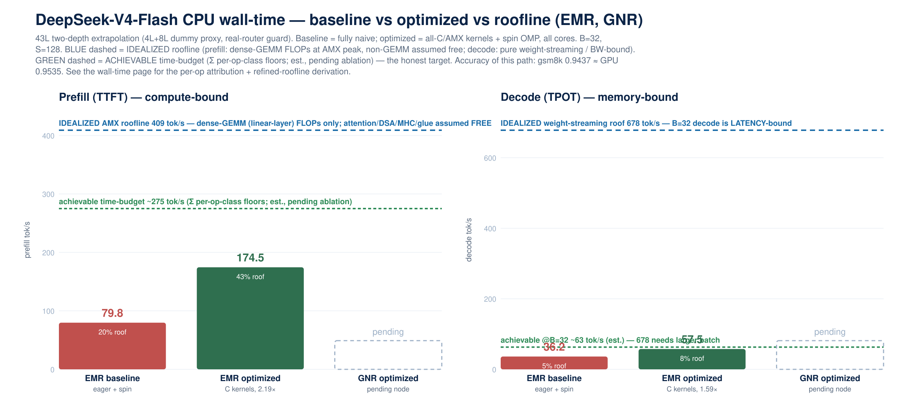
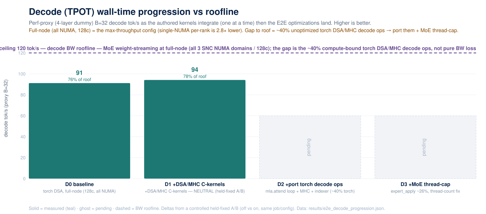
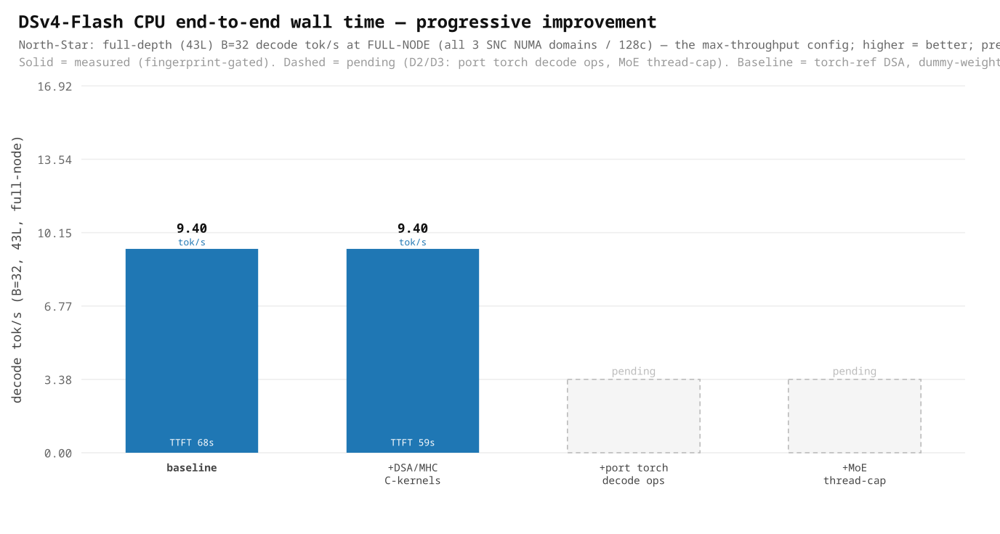

# DSv4-Flash CPU — end-to-end wall time: baseline & progressive improvement

Live ledger of the **North-Star metric** — end-to-end tok/s for DeepSeek-V4-Flash on CPU — as each authored
kernel is integrated into the serving path. This is the **Phase 2** deliverable of the
[methodology playbook](methodology-playbook.md#phase-2--north-star-end-to-end-wall-time); the per-kernel
standalone results live on the [kernel-pilot performance page](kernel-pilot-performance.md).

## Node comparison — baseline vs optimized (EMR, GNR) vs roofline

**43L two-depth extrapolation** (4L+8L dummy-weight proxy, **real-router guard ON** so routing matches the
real ~59 distinct experts/B=32 — see the mode-collapse note below). **Baseline** = fully naive (eager DSA +
OMP spin-wait + no thread-cap, the default first-run CPU path). **Optimized** = all authored C/AMX DSA kernels
(**dispatch-proven**, `eager=0`) + spin-wait OMP, all 128 cores. Operating point B=32, S=128. The accuracy of
this optimized compute path is established separately: **gsm8k 0.9437 ≈ GPU 0.9535** on the same checkpoint.

| EMR, 43L (two-depth) | baseline (naive) | optimized (C/AMX) | **speedup** |
|---|---:|---:|---:|
| **prefill** tok/s | 79.8 | 174.5 | **2.19×** |
| **decode** tok/s | 36.2 | 57.5 | **1.59×** |

*(GNR column pending node availability — ghost bars; filled when `pcl-gnrap01` frees.)* Matched-depth ratios
(4L and 8L, directly measured) agree with the extrapolation: prefill 2.18× at both depths, decode 1.32× (4L) /
1.44× (8L). Harness: [run_dsv4_perf_matrix.sbatch](../plugin/validate/run_dsv4_perf_matrix.sbatch), attribution
[run_dsv4_perf_attrib.sbatch](../plugin/validate/run_dsv4_perf_attrib.sbatch) (job 392780).

**Roofline position (honest, real-router, MEASURED EMR constants).** Roofline computed from a direct
uarch-probe of the EMR node (pcl-spr08: **AMX bf16 12.4 TFLOPS, DRAM 848 GB/s full-node**, job 392787):
**prefill ≈ 43% of the AMX compute roof** (409 tok/s), **decode ≈ 8% of the weight-streaming roof** (678 tok/s).
**But the 409 prefill roof is an IDEALIZED upper bound** — it counts only dense-GEMM (linear-layer) FLOPs and
assumes attention/DSA/MHC/norms/glue are free; only ~40% of real prefill wall-time is that GEMM, so 174.5 is
far closer to the achievable mixed-op ceiling than "43%" implies (**see "Prefill headroom" below**). **Decode
has large headroom** — and this **supersedes the earlier "~76% of roofline" claim**, which was a
**mode-collapse artifact**: a dummy-random
router collapsed routing onto a few experts, so `W_active` was ~2.3× too small and the proxy looked near-roof.
With the real router (correct `W_active` = 40 GB/step), the decode bound is **overhead/dispatch + the not-yet-
fused aten ops**, not raw BW.

### Roofline calculation (EMR + GNR — formulas + measured constants)

Both rooflines are rooted in **native-compute peak + DRAM bandwidth** (gap-ledger rule 13 — low-bit
experts/KV cut *bytes*, they do not raise a compute ceiling the HW lacks). Constants are **measured** per node
by the uarch-perf-probe ([tools/uarch_perf_probe](../tools/uarch_perf_probe); EMR job 392787, GNR job 372840).

| measured constant | **EMR** (pcl-spr08, 2 NUMA) | **GNR** (pcl-gnrap01, 6 NUMA) |
|---|---:|---:|
| AMX bf16 compute peak | **12.4 TFLOPS** | **30.9 TFLOPS** |
| DRAM BW, per-domain | 328.9 GB/s | 226.3 GB/s |
| DRAM BW, full-node (triad) | **848 GB/s** | **2152 GB/s** |

**Prefill (TTFT) — compute-bound.** `prefill_tok/s_roof = AMX_bf16_peak / FLOPs_per_token`.
FLOPs/token (43L, linear layers only, 2 MACs/param) = **30.2 GFLOP** = MLA proj + MoE active-experts
(top-6 + 1 shared) + router, summed over 43 layers.
- EMR: `12.4e3 / 30.2 = ` **409 tok/s** → optimized 174.5 = **43%**.
- GNR: `30.9e3 / 30.2 = ` **1023 tok/s** (the higher AMX peak raises the ceiling; GNR measured bars pending).

> **⚠ This prefill roofline is IDEALIZED** — linear-layer **dense-GEMM FLOPs only**, at the **resident** AMX
> peak. It assumes attention/DSA/MHC/norms/softmax/glue cost nothing. See **"Prefill headroom"** below for the
> per-op attribution (only ~40% of prefill is that GEMM), why 409 is structurally unreachable, what's actually
> recoverable, a **refined (additive) roofline**, and how to **validate the headroom cheaply before investing**.

**Decode (TPOT) — memory-bound (weight-streaming).** `decode_tok/s_roof = B / (W_active / BW_full-node)`,
where **`W_active`** = bytes read per decode step = per layer `[ distinct_experts(B)·fp4_bytes_per_expert +
shared_expert + dense/attn fp8 ]`, summed over 43 layers, **with REAL routing** (the mode-collapse guard):
- distinct_experts(B=32) ≈ **59** (measured, not dummy-random's ~135) × **12.58 MB/expert** (fp4: 3·moe_inter·H·0.5 B) = 742 MB/layer
- + dense/attn (fp8) ~175 MB/layer + shared ~13 MB/layer → **≈0.93 GB/layer × 43 = `W_active` ≈ 40 GB/step**
- EMR: `32 / (40 / 848) = ` **678 tok/s** → optimized 57.5 = **8%** (large headroom; overhead/dispatch-bound).
- GNR: `32 / (40 / 2152) = ` **1721 tok/s** full-node theoretical (a single tp=1 rank rarely saturates all 6
  domains, so treat as an upper bound; GNR measured bars pending).

> **⚠ The 678 decode roofline is ALSO idealized** — it assumes decode is **BW-bound** (pure weight-streaming).
> It isn't: at B=32 decode runs at **8% of 678**, i.e. it is **overhead/latency-bound, not BW-bound**. The 678
> is a **large-batch asymptote**, not a reachable B=32 target. The decode is already **~88% C/AMX** (near its
> kernel floor), so the near-term achievable at B=32 is **~63 tok/s** (recover the ~15% MHC-aten + attention
> glue; see the chart's green line and the decode attribution below). **The lever to approach 678 is larger
> batch** (amortize the per-step overhead), **not** more kernel work.

**Batch-sensitivity of the decode roofline (MoE: `W_active` GROWS with B).** Because more batch activates more
*distinct* experts, `W_active(B)` rises with B, so the decode roofline grows **sub-linearly** — doubling B does
**not** double the ceiling. Fitting a coverage model `distinct(B) = 256·(1−(1−p)^B)` to the measured
`distinct_experts(32) = 59`:

| B | distinct experts | `W_active` (GB) | decode roofline (tok/s) | × vs B=32 |
|--:|--:|--:|--:|--:|
| 16 | ~31 (est.) | ~25 | ~554 | 0.82× |
| **32** | **59 (measured)** | **40** | **678** | 1.00× |
| **64** | **~104 (est.)** | **~63** | **~840** | **~1.24×** |
| 128 | ~166 (est.) | ~96 | ~1130 | ~1.67× |

So the **decode roofline at M=64 ≈ ~840 tok/s (+24% vs M=32), not 2×** — the MoE expert-set growth (`W_active`
40 → ~63 GB) eats most of the batch gain, until experts saturate (all 256 → `W_active` ~143 GB, after which the
roofline grows linearly again). `distinct(64)` is **estimated** (coverage model fit to the single measured
point) — measure it directly with `INTEL_CPU_DSV4_EXPERT_HIST=1` to firm it up. **More important than the
roofline shift:** achieved decode improves *more* at M=64 by amortizing the per-step overhead (decode is
latency-bound at B=32), which is the real reason to raise batch.

*Why the old "~76% of roofline" was wrong:* it used dummy-random routing → ~135 "distinct" experts is actually
a collapsed subset, so the proxy under-read expert bytes (`W_active` ~2.3× too small) and looked near-roof. The
real-router `W_active` = 40 GB is the honest number.

## Prefill headroom — the 409 tok/s roofline is IDEALIZED (dense-GEMM only)

The **409 tok/s prefill roofline is a loose upper bound, not a reachable target.** Its denominator counts
**only the linear-layer dense-GEMM FLOPs** (30.2 GFLOP/token: MLA proj + MoE experts + router) at the
**resident** AMX peak (12.4 TF), and assumes the rest of the forward — attention (DSA sparse O(S²) +
lightning-indexer), MHC hash-clustering, softmax, norms, masking, and all layout/dtype glue — is **free**. It
isn't. A per-op profile of a real prefill (job 390877, `torch.profiler` self-time, categorized) shows only
**~40%** of prefill wall-time is the AMX-GEMM work the roofline models:

| op class | share of prefill self-time | nature | in the 409 roofline? |
|---|---:|---|---|
| **C/AMX kernels** (`fused_experts`, `fp8_scaled_mm`, `shared_expert`, `rmsnorm`) | **~40%** | dense GEMM; MoE core ~76% of its *own* roofline | ✅ yes — this is the 409 |
| **glue** (`copy_` ×14.8k, `cat`, `index`, `masked_fill`, `nan_to_num`) | **~26%** | layout/dtype/gather/staging — pure data movement | ❌ assumed free |
| **aten elementwise/reduction** (`softmax`, `mul`, `add`, `pow`, `sum`) | **~24%** | DSA/MHC/attention math still in eager torch | ❌ assumed free |
| **aten dense GEMM** (`mm`, `bmm`) | **~10%** | attention/proj matmuls on the generic path, not the AMX kernel | ❌ (counts FLOPs, not this path) |

**Why 409 is structurally unreachable (Amdahl).** ~60% of prefill is non-dense-GEMM work that is
memory-/dispatch-bound and physically cannot run at the AMX compute peak. Even an *infinitely fast* GEMM leaves
that 60% → the ceiling for **this op graph** is far below 409. The AMX GEMMs are already ~76% of their own
roofline, so **the headroom is not in the kernels — it is in the work the roofline pretends is free.** Hence
**174.5 is much closer to the achievable mixed-op ceiling than "43%" suggests.**

**Recoverable vs irreducible (the real levers, each bounded):**
- **~26% glue → inter-kernel-fusion.** The 14,790 `copy_` calls are the seam tax (dtype/layout/staging between
  kernels); fuse layouts / emit kernel-native output. *Bounded:* some gather/unpack is irreducible for
  sparse-MoE + MXFP4.
- **~24% eager math → kernelize** the DSA/MHC/softmax/masking (the same "port the torch ops" lever as decode).
- **~10% fallback `mm`/`bmm` → route to the AMX kernel** (the MLA attention bmm that missed the tuned path).
- *Not a lever:* making the AMX GEMMs faster — already near their own roof.

Realistic recovery is a **fraction** of that ~60%, so prefill could plausibly move from 174.5 toward **~250–300,
not** to 409. *Caveat:* profiler `self_cpu` over-weights many-call small ops, so the glue/eager shares are
likely overstated in wall-clock terms and the compute share higher — a boundary-timer attribution refines it.

## A refined roofline (recommended) — an additive "achievable" ceiling, not one idealized line

The single-resource AMX roofline is a weak signal precisely because it hides everything it assumes free.
Replace it with an **additive time-budget roofline** that gives each op-class its *own* achievable rate:

> `T_prefill_floor = Σ_class ( Work_class / AchievableRate_class )`,  `tok/s_achievable = tokens / T_prefill_floor`
> - **dense GEMM** → FLOPs / **streamed**-AMX-achievable (NOT the resident 12.4 TF peak — use the
>   establish-achievable streamed-GEMM rate, which is materially lower)
> - **sparse attention / bmm** → bytes gathered / achievable gather-BW (O(S·topk), not O(S²) dense)
> - **elementwise / norms / softmax** → activation bytes (read+write) / cache-or-DRAM BW
> - **glue** → bytes copied / memcpy-BW (or an explicit irreducible-overhead floor)

Report **two numbers**: the **idealized AMX ceiling** (409 — loose upper bound) **and** the **achievable mixed
roofline** (Σ per-class floors — the real target). Then the meaningful signal is **achieved ÷ achievable-mixed**,
and **achievable-mixed ÷ idealized** quantifies how much of the gap is *structural* (unreachable without changing
the op graph). This is the `model-roofline-analysis` skill's per-op-class, Amdahl-ranked method applied as a time
budget.

**First-order DSv4 time-budget rooflines (analytical estimate, pending ablation — the green lines on the chart):**

*Prefill — `~275 tok/s`.* Keep the measured op-class split (GEMM 40% / glue 26% / eager 24% / fallback-mm 10%)
and apply a per-class floor:

| class | share of current T | floor assumption | floor·share |
|---|---:|---|---:|
| C/AMX GEMM | 40% | unchanged (already ~76% of its own roof) | 0.40 |
| glue + eager-math + fallback-mm | 60% | **~60% recoverable** via fusion/kernelize/route; ~40% irreducible (sparse gather, MXFP4 unpack, dispatch) | 0.40 × 0.60 = 0.24 |

→ `T_floor ≈ 0.64 × T_now` → **achievable ≈ 174.5 / 0.64 ≈ 275 tok/s**. So measured **174.5 = 64% of the
achievable** (not 43% of a reachable ceiling), and the idealized 409 overstates the achievable by **~49%**.

*Decode — `~63 tok/s` at B=32.* Decode is already **~88% C/AMX** (near its kernel floor); only ~15% (MHC-aten
~7% + attention glue ~8%) is recoverable. Recovering ~60% of that → `T_floor ≈ 0.91 × T_now` → **achievable ≈
57.5 / 0.91 ≈ 63 tok/s**. Decode is thus **near its B=32 achievable**; the 678 BW roof is a **large-batch
asymptote**, reached by raising batch (amortizing per-step overhead), not by kernel work.

> These two time-budget numbers are **analytical estimates** — the softest inputs are the *recoverable fractions*
> (prefill 60% of the non-GEMM; decode 60% of the non-kernel). The **counterfactual-ablation experiment below
> replaces those assumptions with MEASURED floors** before any kernel is authored.

## Validating recoverable headroom BEFORE investing (cheap counterfactual ablation)

Don't author fused kernels on faith. The reliable, cheap "burn a few tokens to be sure" test is a
**counterfactual ablation**: in a **timing-only** run (dummy weights, 4L/8L proxy — output correctness does not
matter), **remove / no-op the suspected-recoverable work and measure the prefill delta**:

| lever to test | ablation (timing-only, env-gated) | the delta measures |
|---|---|---|
| glue (~26%) | replace layout/dtype conversions + `copy_`/`cat` with pass-through / preallocated reuse | **upper bound** of inter-kernel-fusion gain |
| eager DSA/MHC/softmax (~24%) | swap the eager math for a cheap stand-in (identity/zeros) | upper bound of kernelizing it |
| fallback `mm`/`bmm` (~10%) | route to the AMX kernel (or no-op) | upper bound of routing it |

The measured speedup is the **maximum** recoverable (you fully removed the cost), so it **bounds the ROI before a
single kernel is written**: if ablating glue + eager-math buys <15%, don't invest; if it buys 30–40%, build the
real fused kernels. Complement with **env-gated boundary timers** (wall-clock, to correct the `self_cpu`
over-weighting) and the **isolation microbench vs roofline floor** already in `operating_point.json`; gate each
lever on the **Amdahl bound** `share × (1 − floor/measured)` before committing. Method per the
**overhead-attribution** + **kernel-feasibility-gate** skills; harness:
[run_dsv4_perf_attrib.sbatch](../plugin/validate/run_dsv4_perf_attrib.sbatch).

## Decode (TPOT) — attribution (corrected, real-router phase-split, job 392782)

**What actually runs at decode (optimized path, dispatch-provenance-verified):** the heavy compute is **C/AMX
kernels, all dispatched** — the dispatch-provenance shows `eager=0` for `sparse_attend`, `moe`, `compressor`,
`indexer`, `sinkhorn`, `combine`, `topk`. By the phase-split TIMEIT (8L, B=32): the **kernel bucket is ~88% of
decode wall**; MoE core (`moe`+`expert_apply`) ~41%, dense fp8 ~10%, MLA attention core (qk/pv) ~5%.
- **The genuinely *not-C* compute is small: MHC `hc_pre`+`hc_post` ≈ 7%** (standard bf16 **aten** matmul+RMSNorm,
  never hand-fused to a C kernel — *optimized BLAS, not slow eager Python*), and the **attention mask/gather
  *glue* ≈ 8%** (the inter-kernel seam). **Framework/dispatch is ~8%, not ~40%** — the earlier "~40% unoptimized
  torch / ~39% framework" framing was **wrong on two counts**: it used a stale pre-fix profile, and it misread
  the TIMEIT *category tag* ("torch") as *eager dispatch* — the dispatch-provenance is the authority, and it
  shows those ops run as C kernels.
- **Remaining decode levers (small, specific — not a 40% rewrite):** (1) author a fused C kernel for **MHC**
  (~7%); (2) kill the **attention-glue seam** (~8%, an inter-kernel-fusion target — fuse gather/mask into the
  attend); (3) the proxy at B=32 real-router is **overhead/dispatch-bound** (far below the BW roof), so
  grain-size / parallel-region tuning is the lever, not more kernels. *bf16-KV is a prefill/long-context lever,
  not a decode one.*

**MoE mode-collapse guard (now ENFORCED in code, not just described).** Under `--load-format dummy` the router
weights are random → routing collapses onto a few of the 256 experts (~135 distinct/B=32 vs the real ~59),
under-counting expert weight-streaming and making decode look **falsely fast / falsely near-roofline**. The
proxy now injects the **real (tiny) gate weights + `tid2eid`** from the checkpoint
(`INTEL_CPU_DSV4_REAL_ROUTER=1`) so routing matches the real model (verified: distinct-expert count 135 → ~60).
All node-comparison numbers above use this guard.

The full segregated ledger (prefill vs decode, stage-by-stage) is below.

Solid bar = measured & integrated (fingerprint-gated); dashed = pending Phase-2 integration.

## Phase-2 integration — status (in progress, honest)

The authored DSA/MHC C/C++ kernels are now **wired into the serving forward**, env-gated
(`INTEL_CPU_DSV4_DSA_CKERNEL=1`, per-op `INTEL_CPU_DSV4_CK_<op>`), default-OFF. **Op-level parity is validated**
(indexer cos 0.99999 / compressor cos 1.0 / MHC sinkhorn+combine cos 1.0; bf16-KV bit-identical). The
**controlled held-fixed end-to-end A/B now shows integration is perf-safe** — neutral at decode, a modest win at
prefill:

| perf-proxy (4-layer dummy), **held-fixed** OFF-vs-ON | prefill tok/s | decode tok/s |
|---|---:|---:|
| C-kernels OFF (torch) · B=32 | 880.2 | 91.2 |
| C-kernels ON · B=32 | **1002.8** (1.14×) | **94.2** (1.03×) |

(EMR, **job 386039** — all kernels OFF-vs-ON, mem-fraction fixed 0.85, prefill+decode in the *same* job;
[results](../plugin/validate/results/).)

> **⚠ Superseded — the earlier "10× regression" was a measurement artifact.** A prior *sequential* bisection
> (job 385956/386002) reported a ~10× prefill and ~4× decode regression and hypothesized **OpenMP runtime
> oversubscription** (GNU libgomp vs Intel libiomp5 collision). The **held-fixed** A/B above refutes it:
> toggling ops across *separate* runs drifted the scheduler/KV-pool/batching regime between points (the torch
> baseline alone swung decode 81→24 with a `mem-fraction` knob), manufacturing a phantom. The kernels are
> perf-neutral-to-positive end-to-end. **Root lesson (now in the playbook): measure integration deltas with a
> held-fixed OFF-vs-ON A/B in one job — never a sequential bisection; and a *tiny* op "regressing" large is a
> tell for a global/measurement pathology, not a slow op.**

**Next (the real levers, measured by the job-390418 decode attribution):** (1) **port the ~40% unoptimized-torch
decode ops to kernels** — `dsa.mla.attend` (the per-token Python-loop sparse attention, ~18%), MHC `hc_pre`+
`hc_post` (~17%), `dsa.indexer` einsum (~3.5%); (2) **MoE `expert_apply` thread-cap** (~26%, a thread-count
pathology — cap threads around the MoE apply, `runtime-config-tuning`, not a new kernel); (3) **incremental-sparse**
prefill O(S²)→O(S·topk). Framework/dispatch is only ~5% (the earlier "~39%" claim was wrong), and bf16-KV is a
prefill/long-context lever (the serving attention KV is already bf16). Every stage stays env-gated default-OFF
and fingerprint-gated.

## Operating point & headline
- **Input** S = 1024, **output** G = 8/step (G=256 applied analytically), full depth **43 layers**.
- **North-Star:** B=32 aggregate decode tok/s (throughput) **and** B=1 single-stream decode tok/s (latency floor).
- **Max-throughput demonstration (full-node):** **4L proxy decode 91.2 tok/s; 43L B=32 extrapolates to 9.4
  tok/s** (two-depth, job 390445: 4L=91.2, 8L=48.2 → t_layer=78.3 ms, t_fixed=37.9 ms). The B=1 latency floor is
  **0.80 tok/s** (43L).
- **⚠ NUMA config is the single biggest throughput knob.** This node is **one socket, 128 cores, 3 SNC NUMA
  domains**. The **full-node** config (all 3 domains, `OMP_NUM_THREADS=128`, no single-domain bind — the
  established canonical throughput config, cf. the Olmo2 certificate) gives **91 tok/s @ 4L**; a **single-NUMA
  per-rank** bind (`numactl -N0 -m0`, 1 SNC domain) gives only **32 tok/s** — a **2.8× gap**, confirmed by a
  held-fixed same-harness A/B (job 390442: 90.8 vs 32.0). Decode is weight-streaming BW-bound, so using all
  memory controllers is decisive. The demonstration and all ledger numbers below are **full-node**.
- **Node:** EMR Xeon (single socket, 128c, 3 SNC domains), `--constraint=ddr5600 --exclusive`,
  `OMP_NUM_THREADS=128 OMP_PROC_BIND=close OMP_PLACES=cores`, all NUMA domains.

## Prefill and decode are TWO work items (different rooflines, different maturity)

Prefill and decode are tracked **separately** — different bound, roofline, levers, and status. Optimizing one
says little about the other.

| | **Prefill (TTFT)** — compute-bound | **Decode (TPOT)** — memory-bound |
|---|---|---|
| **roofline** | `TTFT_floor = prefill_FLOPs / peak` (AMX bf16) | `tok/s_roof(M) = M·BW / (W_active + M·KV_tok)` |
| **DSA/MHC kernel leverage** | **HIGH** — indexer + sparse-attn run over the full S-token prompt (O(S·ctx)); the authored compute kernels are the main win | **LOW** — 1 query token/step; decode is dominated by MoE weight streaming, not DSA compute |
| **Phase-1 state** | unoptimized torch O(S²) attention — the big *unrealized* opportunity | **~76% of roof** (full-node) on the MoE weight-streaming core; the gap is the ~40% compute-bound torch DSA/MHC decode ops, not pure BW |
| **open levers** | (1) wire the authored DSA kernels (**done — held-fixed A/B neutral-to-positive, 1.14× prefill**); (2) incremental-sparse decode O(S²)→O(S·topk) | (1) **port the ~40% torch decode ops to kernels** (`mla.attend` loop + MHC + indexer); (2) **MoE `expert_apply` thread-cap** (~26%); (3) 43L full-depth validation |
| **status** | integration wired & **perf-safe** (held-fixed A/B: 1.14× prefill, job 386039) → authored-DSA compute win still to be realized via incremental-sparse | **MoE core ~76% roof; wall-time NOT done** — the lever is **porting the torch DSA/MHC decode ops to kernels** + the MoE thread-cap (measured attribution), not a framework pass |

**Are we done with decode?** No. The **MoE weight-streaming core** is near roofline (~76% at full-node B=32),
but the **job-390418 TIMEIT attribution shows ~40% of decode is unoptimized TORCH compute** — `dsa.mla.attend`
(per-token Python loop, ~18%), MHC `hc_pre`+`hc_post` (~17%), `dsa.indexer` einsum (~3.5%) — plus `moe.expert_apply`
(~26%, a thread-count pathology). Framework/dispatch is only ~5%. So the path to higher decode tok/s is **porting
those torch decode ops to kernels + the MoE thread-cap**, and the C-kernel swap is **perf-neutral** at decode
(held-fixed A/B 1.03×, job 390418). The remaining decode work is **porting the torch DSA/MHC decode ops to
kernels** (not a framework pass), the *same class* of compute-kernel work as prefill but on the decode-shaped
(M=1-per-seq) ops.

## Baseline (measured) — the denominator every optimization is scored against

| metric | full-depth (43L) | source |
|---|---:|---|
| **decode (B=1 latency floor)** | **1253 ms/step = 0.80 tok/s** | two-depth extrapolation, job 385387 |
| **decode (B=32 throughput, full-node)** | **3403 ms/step = 9.40 tok/s** | two-depth extrapolation, job 390445 (4L=91.2, 8L=48.2 tok/s) |
| **prefill (TTFT)** | **67.8 s** (S=1024) | two-depth extrapolation, job 385387 |

The **B=32 full-node** row is the max-throughput demonstration headline (all 3 SNC NUMA domains / 128c). The
B=1 row is the unoptimized single-stream floor. Both are the torch-reference-DSA path; the authored-kernel +
torch-op-port levers (D2/D3) raise the B=32 number from here.

**Why "dummy weights" are not fast:** `--load-format dummy` removes the checkpoint read and the fp4/fp8→bf16
dtype bridge, so *model load* is instant — but a GEMM with random weights does the **identical FLOPs**, so
*compute* is unchanged. The slowness is the unoptimized torch attention, not the weights.

**⚠ But the dummy *router* can mislead MoE wall-time (mode collapse).** DSv4 routes each token to a small
subset of its **256 experts**, and the batched-decode cost is set by the **distinct-expert working set** —
which *grows with batch* (`distinct_experts(B)·per_expert_bytes`). A random dummy router routes **degenerately**
(collapses the whole batch onto the same few experts), so a naive dummy proxy would read too few experts and
report a **falsely fast** MoE decode (and a single-expert path would hide the grouped-GEMM gather/scatter
routing bugs). This proxy therefore **keeps the real router/gate weights** (tiny — loaded even with dummy
*expert* weights), drives **varied tokens**, and **gates on the measured distinct-expert-per-batch histogram
matching the real `E(distinct | B)`** (not 1, not all-N) before any MoE wall-time is trusted. *(Methodology:
the [perf-proxy MoE mode-collapse rule](methodology-playbook.md#phase-2--north-star-end-to-end-wall-time).)*

## Calibration (two-depth linear model)
Wall time is linear in depth because every DSv4 layer is the same MoE+MLA+DSA archetype, so we extrapolate
from two shallow proxies instead of paying full depth each iteration:

$$t(L) = t_{fixed} + L\cdot t_{layer},\quad t_{layer}=\frac{t_8-t_4}{4},\quad t_{fixed}=t_4-4\,t_{layer}$$

| regime | proxy4 (4L) | proxy8 (8L) | $t_{fixed}$ | $t_{layer}$ | → 43L |
|---|---:|---:|---:|---:|---:|
| decode (ms/step) | 198.3 | 306.5 | 90.2 | 27.04 | **1253** |
| prefill (ms) | 7216 | 13425 | 1007 | 1552 | **67 754** |

Per-layer cost dominates (decode 93%, prefill 98.5%), so $t_{fixed}$ is small and the extrapolation is
well-conditioned. One full-depth dummy run will **validate** it before any headline number is final.

## Progressive-improvement ledgers (segregated by phase)
Two independent ledgers — **prefill (TTFT)** and **decode (TPOT)** — each records the wall time as (a) the
authored kernels are integrated **one at a time**, then (b) the **end-to-end optimizations** (overhead/dispatch,
bf16-KV, batching) land, every stage scored against **that phase's roofline**. Iteration metric = **perf-proxy
(4-layer dummy) B=32 tok/s** (queue-free vehicle); the **43-layer** headline is extrapolated/validated at the end.
Each stage is env-gated default-OFF, fingerprint/parity-gated; a measured **regression is a valid, recorded
stage** — the *why* is kept.

### Prefill progression — TTFT, compute-bound (roofline = prefill_FLOPs / AMX-peak)
*Prefill is where the authored DSA compute kernels are the main unrealized win (sparse-attn + indexer over the
full S-token prompt).*

| # | stage | prefill tok/s (proxy B=32) | Δ vs baseline | status |
|---|---|---:|---:|---|
| P0 | **baseline** (torch-ref DSA) | **880** | 1.00× | ✅ job 386039 (held-fixed) |
| P1 | all C-kernels ON (held-fixed A/B) | **1003** | **1.14×** | ✅ measured — **WIN** (job 386039) |
| ~~P1′~~ | ~~all C-kernels ON (naive, sequential bisect)~~ | ~~83.3~~ | ~~0.09×~~ | ⊘ **superseded** — phantom from un-held-fixed sweep (job 385956) |
| P2 | per-kernel held-fixed A/B (indexer/compressor/sparse/MHC) | — | — | ⏳ attribute the 1.14× to ops |
| P3 | + dispatch/parallel-region overhead pass | — | — | ⏳ |
| P4 | + incremental-sparse O(S²)→O(S·topk) | — | — | ⏳ (algorithmic) |
| P5 | 43L extrapolation + roofline (% of TTFT ceiling) | — | — | ⏳ |

### Decode progression — TPOT (full-node, all NUMA domains / 128c — the max-throughput config)
*The MoE weight-streaming core is ~76% of the BW roofline at B=32; the job-390418 attribution shows the open work
is **porting the ~40% unoptimized-torch decode ops to kernels** (`dsa.mla.attend` loop + MHC + indexer) + the MoE
`expert_apply` thread-cap — not a framework/dispatch pass (that bucket is only ~5%).*

| # | stage | decode tok/s (proxy B=32, full-node) | Δ vs baseline | status |
|---|---|---:|---:|---|
| D0 | **baseline** (torch-ref DSA, full-node 128c/all-NUMA) | **91.2** | 1.00× | ✅ job 386039/390418 (held-fixed) |
| D1 | all C-kernels ON (held-fixed A/B) | **94.2** | **1.03×** | ✅ measured — **NEUTRAL** (job 390418) |
| ~~D1′~~ | ~~all C-kernels ON (naive, sequential bisect)~~ | ~~21.9~~ | ~~0.27×~~ | ⊘ **superseded** — phantom from un-held-fixed sweep (job 385956/386002) |
| D2 | + port torch decode ops to kernels (`mla.attend` ~18% + MHC ~17% + indexer ~3.5%) | — | — | ⏳ **the main decode lever** (job 390418 attribution) |
| D3 | + MoE `expert_apply` thread-cap (~26%, thread-count fix) | — | — | ⏳ runtime-config, not a kernel |
| D4 | 43L extrapolation (full-node) | **9.40** | — | ✅ job 390445 (4L=91.2, 8L=48.2 → 43L) |

> **NUMA is the biggest throughput knob (confirmed, job 390442):** full-node (all 3 SNC domains, 128c) = **90.8
> tok/s @ 4L**; single-NUMA per-rank (`numactl -N0 -m0`, 1 domain) = **32.0 tok/s** — a **2.8× BW-bound gap** on
> the identical harness. All decode numbers here are full-node.

Full data: [wall_time_progress.json](../plugin/validate/results/wall_time_progress.json),
[dsv4_globalchk_386039](../plugin/validate/results/) (held-fixed OFF-vs-ON, prefill+decode); the superseded
sequential sweep is [dsv4_p2integ_*](../plugin/validate/results/) (job 385956).

## Method & gates (per stage)
1. **Freeze the kosher baseline** — tag the commit, golden dummy-weight fingerprint; every optimization is
   env-gated default-OFF so gate-off reproduces the baseline byte-for-byte.
2. **Integrate one op on the truncated proxy**, measure proxy4 (+ periodic proxy8 recalibration), extrapolate
   to 43L per regime — recording each delta **broken down into kernel / framework / dispatch** so it is
   bisectable to one op.
3. **MoE routing fidelity** (this is an MoE model): keep the **real router/gate weights** + drive **varied
   tokens**, and gate the proxy's **distinct-expert-per-batch histogram** against the real `E(distinct | B)`
   (not 1, not all-N) before trusting any MoE wall-time — a collapsed dummy router under-counts expert traffic.
4. **Gate:** the dummy-weight output fingerprint stays invariant (overhead/precision-equivalent transforms only).
5. **Publish the delta** here — including a no-change/regression, with the root cause.
6. **Address framework / dispatch overhead last** (after the kernels are wired): fewer/bigger parallel regions,
   bind-once-at-init, one rank per NUMA domain, prepack — doing it after keeps the per-kernel attribution clean.
7. After all ops: **one full-depth dummy run measures** the real wall time and **attributes it across
   components** (kernel / framework / dispatch), **validates** the two-depth extrapolation, and exposes residual
   depth-accumulating overhead to bisect; then the real-weight **accuracy** sign-off (Phase 3).

## Provenance
- Baseline + calibration: EMR job **385387** (`BATCHES=1` proxy4+proxy8, S=1024, reps=3, tp=1, bf16, dummy
  weights, mem-fraction 0.6), via `plugin/validate/bench_wall_time.py` / `run_dsv4_step0_calib.sbatch`.
- Chart: `plugin/validate/make_e2e_walltime_plot.py` from `results/wall_time_progress.json` (dependency-free SVG).
- The B≥8 baseline points are unmeasurable pre-optimization (torch-reference materialized attention OOM/
  watchdog-kills); they populate as the optimized DSA kernels replace that path.
