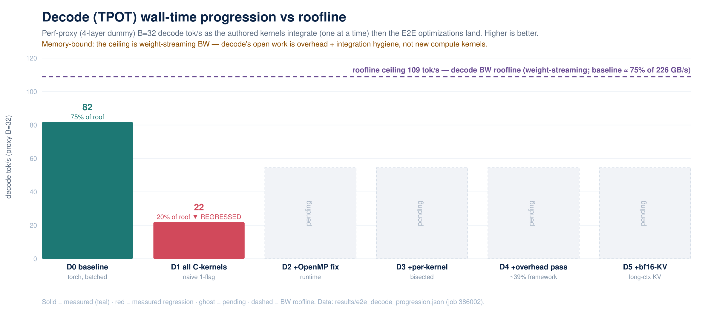

# DSv4-Flash CPU — end-to-end wall time: baseline & progressive improvement

Live ledger of the **North-Star metric** — end-to-end tok/s for DeepSeek-V4-Flash on CPU — as each authored
kernel is integrated into the serving path. This is the **Phase 2** deliverable of the
[methodology playbook](methodology-playbook.md#phase-2--north-star-end-to-end-wall-time); the per-kernel
standalone results live on the [kernel-pilot performance page](kernel-pilot-performance.md).

## Decode (TPOT) — prioritized work item: progression vs roofline

**Living chart** — perf-proxy (4-layer dummy) **B=32 decode tok/s** as each authored kernel integrates (one at a
time) then the end-to-end optimizations land, scored against the **decode BW roofline** (decode is
weight-streaming bound). Where it stands today:
- **D0 baseline 82 tok/s ≈ 75% of the roofline** — decode's memory-bound core is *already* mature (Phase-1
  batching + thread/affinity/spin-wait fixes); no kernel rewrite moves a weight-streaming ceiling.
- **D1 all-C-kernels (naive, one master flag) → 22 tok/s: a measured REGRESSION**, not a win — the in-engine
  C-kernel swap hit an **OpenMP-runtime pathology** (extensions build `-fopenmp` while ATen is OpenMP-backed on
  a bundled libgomp → contending thread pools). Recorded honestly; **no integration win is claimed until ≥ the
  torch baseline**.
- **D2–D5 pending (ghost bars):** fix the OpenMP runtime → **bisect per-kernel** (per-op flags, job 386002) →
  the **framework/dispatch overhead pass** (the *real* decode lever at ~39% of decode) → **bf16-KV** (bit-
  identical). The chart updates as each lands, so the decode story is visible top-of-page.

The full segregated ledger (prefill vs decode, stage-by-stage) is below.

Solid bar = measured & integrated (fingerprint-gated); dashed = pending Phase-2 integration.

## Phase-2 integration — status (in progress, honest)

The authored DSA/MHC C/C++ kernels are now **wired into the serving forward**, env-gated
(`INTEL_CPU_DSV4_DSA_CKERNEL=1`, per-op `INTEL_CPU_DSV4_CK_<op>`), default-OFF. **Op-level parity is validated**
(indexer cos 0.99999 / compressor cos 1.0 / MHC sinkhorn+combine cos 1.0; bf16-KV bit-identical). But the first
**end-to-end proxy measurement surfaced a regression, not a win** — the honest Phase-2 result:

| perf-proxy (4-layer dummy) | prefill tok/s | decode tok/s |
|---|---:|---:|
| C-kernels OFF (torch) · B=1 | 249 | 8.4 |
| C-kernels ON · B=1 | **27.9** (0.11×) | 7.3 (0.87×) |
| C-kernels OFF (torch) · B=32 | 879 | 81.3 |
| C-kernels ON · B=32 | **83.3** (0.09×) | 21.9 (0.27×) |

(EMR, job 385956; [results](../plugin/validate/results/) `reference_wave`→`dsv4_p2integ_*`.)

**Diagnosis (root-cause hypothesis): OpenMP runtime oversubscription**, not the kernel math. The ~10× prefill
slowdown holds at **B=32** (where there is ample work), so it is not small-work barrier overhead — it is the
classic **two-OpenMP-runtime** collision: the extensions build with `-fopenmp` (GNU libgomp) while torch uses
Intel OpenMP (libiomp5) inside the engine → contending thread pools. The standalone microbench never sees it
(no competing runtime), which is exactly why **Phase-2 integration ≠ Phase-1 microbench**. The kernels are
correct and 4–24× faster *standalone*; in-engine they must share one thread runtime.

**Next (the overhead pass, per the playbook):** (1) **bisect per-op** with the new `INTEL_CPU_DSV4_CK_<op>`
flags (one kernel at a time) to confirm the pathology is uniform (runtime-level) vs op-specific; (2) **unify the
OpenMP runtime** — build the extensions against torch's OpenMP / ensure `at::parallel_for` uses the engine pool
and no nested `#pragma omp parallel`, and cap `OMP_NUM_THREADS`/`KMP` to prevent oversubscription; (3) re-measure
OFF-vs-ON on the proxy, then full depth. **No integration win is claimed until measured ≥ the torch baseline and
climbing toward the roofline.** The bf16-KV lever (bit-identical) stays the one clean carry-forward meanwhile.

## Operating point & headline
- **Input** S = 1024, **output** G = 8/step (G=256 applied analytically), full depth **43 layers**.
- **North-Star:** B=32 aggregate decode tok/s (throughput) **and** B=1 single-stream decode tok/s (latency floor).
  The baseline below is the **B=1 latency floor**; the B=32 throughput point is added once decode-batching is wired
  (the torch-reference baseline OOM/watchdog-kills at B≥8, so only B=1 is measurable pre-optimization).
- **Node:** EMR Xeon 8592+ (64c/socket), `--constraint=ddr5600 --exclusive`, OMP64 close/cores, `numactl -N0 -m0`.

## Prefill and decode are TWO work items (different rooflines, different maturity)

Prefill and decode are tracked **separately** — different bound, roofline, levers, and status. Optimizing one
says little about the other.

| | **Prefill (TTFT)** — compute-bound | **Decode (TPOT)** — memory-bound |
|---|---|---|
| **roofline** | `TTFT_floor = prefill_FLOPs / peak` (AMX bf16) | `tok/s_roof(M) = M·BW / (W_active + M·KV_tok)` |
| **DSA/MHC kernel leverage** | **HIGH** — indexer + sparse-attn run over the full S-token prompt (O(S·ctx)); the authored compute kernels are the main win | **LOW** — 1 query token/step; decode is dominated by MoE weight streaming, not DSA compute |
| **Phase-1 state** | unoptimized torch O(S²) attention — the big *unrealized* opportunity | **near roofline** — batching + thread/affinity/spin-wait fixes → MoE at **~75%** of BW (170/226 GB/s) at B=32; ~10× over the B=1 start |
| **open levers** | (1) wire the authored DSA kernels (after the OpenMP fix); (2) incremental-sparse decode O(S²)→O(S·topk) | (1) **framework/dispatch ≈ 39% of decode** (the overhead pass); (2) **bf16-KV** long-context KV read; (3) fix the C-kernel integration regression |
| **status** | integration wired but **regressed** (OpenMP oversubscription) → real win not yet realized | **compute core DONE (~75% roof); wall-time NOT done** — needs the overhead/integration pass, not new compute kernels |

**Are we done with decode?** The **memory-bound core is essentially done** — Phase-1 batching + thread/affinity/
spin-wait put MoE weight streaming at ~75% of the BW roofline at B=32, and no kernel rewrite moves a
weight-streaming ceiling. Decode as a **wall-time is not done**: the per-op pivot shows **framework/dispatch is
~39% of decode** (the real remaining lever), the C-kernel swap currently **regresses** decode (OpenMP fix), and
**bf16-KV** isn't wired. The remaining decode work is **overhead + integration-hygiene**, the *opposite* of
prefill (where the authored DSA compute kernels are the main unrealized win).

## Baseline (measured) — the denominator every optimization is scored against

| metric | full-depth (43L) | source |
|---|---:|---|
| **decode** | **1253 ms/step = 0.80 tok/s** (B=1) | two-depth extrapolation, job 385387 |
| **prefill (TTFT)** | **67.8 s** (S=1024) | two-depth extrapolation, job 385387 |

This is the **unoptimized** path: torch-reference DSA with the materialized O(S²) attention and **no authored
kernels wired**. It is deliberately the slow starting point — exactly what Phase-2 integration replaces.

**Why "dummy weights" are not fast:** `--load-format dummy` removes the checkpoint read and the fp4/fp8→bf16
dtype bridge, so *model load* is instant — but a GEMM with random weights does the **identical FLOPs**, so
*compute* is unchanged. The slowness is the unoptimized torch attention, not the weights.

**⚠ But the dummy *router* can mislead MoE wall-time (mode collapse).** DSv4 routes each token to a small
subset of its **256 experts**, and the batched-decode cost is set by the **distinct-expert working set** —
which *grows with batch* (`distinct_experts(B)·per_expert_bytes`). A random dummy router routes **degenerately**
(collapses the whole batch onto the same few experts), so a naive dummy proxy would read too few experts and
report a **falsely fast** MoE decode (and a single-expert path would hide the grouped-GEMM gather/scatter
routing bugs). This proxy therefore **keeps the real router/gate weights** (tiny — loaded even with dummy
*expert* weights), drives **varied tokens**, and **gates on the measured distinct-expert-per-batch histogram
matching the real `E(distinct | B)`** (not 1, not all-N) before any MoE wall-time is trusted. *(Methodology:
the [perf-proxy MoE mode-collapse rule](methodology-playbook.md#phase-2--north-star-end-to-end-wall-time).)*

## Calibration (two-depth linear model)
Wall time is linear in depth because every DSv4 layer is the same MoE+MLA+DSA archetype, so we extrapolate
from two shallow proxies instead of paying full depth each iteration:

$$t(L) = t_{fixed} + L\cdot t_{layer},\quad t_{layer}=\frac{t_8-t_4}{4},\quad t_{fixed}=t_4-4\,t_{layer}$$

| regime | proxy4 (4L) | proxy8 (8L) | $t_{fixed}$ | $t_{layer}$ | → 43L |
|---|---:|---:|---:|---:|---:|
| decode (ms/step) | 198.3 | 306.5 | 90.2 | 27.04 | **1253** |
| prefill (ms) | 7216 | 13425 | 1007 | 1552 | **67 754** |

Per-layer cost dominates (decode 93%, prefill 98.5%), so $t_{fixed}$ is small and the extrapolation is
well-conditioned. One full-depth dummy run will **validate** it before any headline number is final.

## Progressive-improvement ledgers (segregated by phase)
Two independent ledgers — **prefill (TTFT)** and **decode (TPOT)** — each records the wall time as (a) the
authored kernels are integrated **one at a time**, then (b) the **end-to-end optimizations** (overhead/dispatch,
bf16-KV, batching) land, every stage scored against **that phase's roofline**. Iteration metric = **perf-proxy
(4-layer dummy) B=32 tok/s** (queue-free vehicle); the **43-layer** headline is extrapolated/validated at the end.
Each stage is env-gated default-OFF, fingerprint/parity-gated; a measured **regression is a valid, recorded
stage** — the *why* is kept.

### Prefill progression — TTFT, compute-bound (roofline = prefill_FLOPs / AMX-peak)
*Prefill is where the authored DSA compute kernels are the main unrealized win (sparse-attn + indexer over the
full S-token prompt).*

| # | stage | prefill tok/s (proxy B=32) | Δ vs baseline | status |
|---|---|---:|---:|---|
| P0 | **baseline** (torch-ref DSA) | **879** | 1.00× | ✅ job 385956 |
| P1 | all C-kernels ON (naive, 1 flag) | **83.3** | **0.09×** | ✅ measured — **REGRESSED** (OpenMP oversubscription) |
| P2 | + OpenMP-runtime fix (`-fopenmp-simd`) | — | — | ⏳ in progress |
| P3 | per-kernel bisection (indexer/compressor/sparse/MHC, one at a time) | — | — | ⏳ (per-op flags ready) |
| P4 | + dispatch/parallel-region overhead pass | — | — | ⏳ |
| P5 | + incremental-sparse O(S²)→O(S·topk) | — | — | ⏳ (algorithmic) |
| P6 | 43L extrapolation + roofline (% of TTFT ceiling) | — | — | ⏳ |

### Decode progression — TPOT, memory-bound (roofline = M·BW / (W_active + M·KV_tok))
*Decode's memory-bound core (MoE weight streaming) is already ~75% of the BW roofline at B=32; the open work is
overhead + integration hygiene, not new compute kernels.*

| # | stage | decode tok/s (proxy B=32) | Δ vs baseline | status |
|---|---|---:|---:|---|
| D0 | **baseline** (torch-ref DSA, batched + thread/spin-wait fixes) | **81.3** | 1.00× | ✅ job 385956 |
| D1 | all C-kernels ON (naive, 1 flag) | **21.9** | **0.27×** | ✅ measured — **REGRESSED** (OpenMP oversubscription) |
| D2 | + OpenMP-runtime fix (`-fopenmp-simd`) | — | — | ⏳ in progress |
| D3 | per-kernel bisection (one at a time) | — | — | ⏳ (per-op flags ready) |
| D4 | + framework/dispatch overhead pass (**~39% of decode**) | — | — | ⏳ the main decode lever |
| D5 | + bf16-KV (long-context KV read; bit-identical) | — | — | ⏳ carry-forward lever |
| D6 | 43L extrapolation + roofline (% of TPOT ceiling) | — | — | ⏳ |

> **43L baseline headline** (two-depth extrapolation, job 385387, the unoptimized torch path): decode **0.80
> tok/s** (B=1), prefill **67.8 s** (S=1024) — see the calibration table above. The proxy ledgers iterate the
> integration; the 43L number is finalized at P6/D6.

Full data: [wall_time_progress.json](../plugin/validate/results/wall_time_progress.json),
[dsv4_p2integ_*](../plugin/validate/results/) (job 385956, OFF-vs-ON proxy).

## Method & gates (per stage)
1. **Freeze the kosher baseline** — tag the commit, golden dummy-weight fingerprint; every optimization is
   env-gated default-OFF so gate-off reproduces the baseline byte-for-byte.
2. **Integrate one op on the truncated proxy**, measure proxy4 (+ periodic proxy8 recalibration), extrapolate
   to 43L per regime — recording each delta **broken down into kernel / framework / dispatch** so it is
   bisectable to one op.
3. **MoE routing fidelity** (this is an MoE model): keep the **real router/gate weights** + drive **varied
   tokens**, and gate the proxy's **distinct-expert-per-batch histogram** against the real `E(distinct | B)`
   (not 1, not all-N) before trusting any MoE wall-time — a collapsed dummy router under-counts expert traffic.
4. **Gate:** the dummy-weight output fingerprint stays invariant (overhead/precision-equivalent transforms only).
5. **Publish the delta** here — including a no-change/regression, with the root cause.
6. **Address framework / dispatch overhead last** (after the kernels are wired): fewer/bigger parallel regions,
   bind-once-at-init, one rank per NUMA domain, prepack — doing it after keeps the per-kernel attribution clean.
7. After all ops: **one full-depth dummy run measures** the real wall time and **attributes it across
   components** (kernel / framework / dispatch), **validates** the two-depth extrapolation, and exposes residual
   depth-accumulating overhead to bisect; then the real-weight **accuracy** sign-off (Phase 3).

## Provenance
- Baseline + calibration: EMR job **385387** (`BATCHES=1` proxy4+proxy8, S=1024, reps=3, tp=1, bf16, dummy
  weights, mem-fraction 0.6), via `plugin/validate/bench_wall_time.py` / `run_dsv4_step0_calib.sbatch`.
- Chart: `plugin/validate/make_e2e_walltime_plot.py` from `results/wall_time_progress.json` (dependency-free SVG).
- The B≥8 baseline points are unmeasurable pre-optimization (torch-reference materialized attention OOM/
  watchdog-kills); they populate as the optimized DSA kernels replace that path.
