# GLM-5.3-Flash CPU kernel performance journey

## Kernel performance at a glance

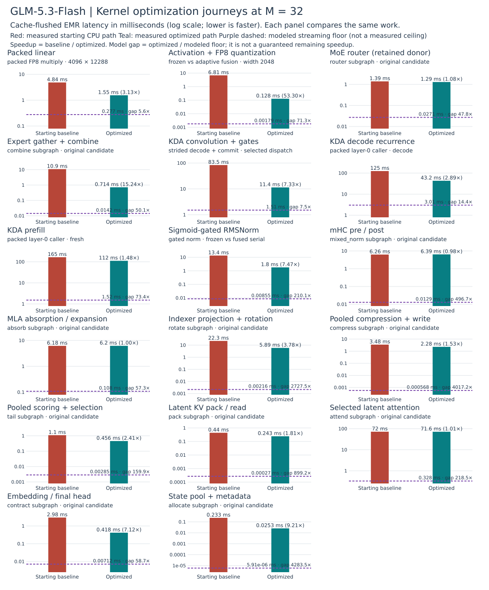

**Every panel shows three quantities:** the measured **starting baseline** (red), the measured **optimized implementation** (teal), and a **modeled roofline** (purple dashed), all in milliseconds for the operation named in the panel. **Speedup = baseline / optimized. Model gap = optimized / modeled floor.** A 3× speedup is an observed improvement; a 3× model gap is not a promise of another 3×.

**Baseline means where we started**, not a newly written scalar kernel. For packed FP8 linear this was the frozen C++ multiply; at M=32 it fell from **4.84 to 1.55 ms (3.13×)**, versus a **0.277 ms model (5.58× gap)**. Where we started in Torch or in a mixed CPU caller, its measured time is the baseline. The eleven historical subgraph panels compare reference and candidate in the initial wave; later caller and holdout results remain in the kernel sections. Sources: [starting timing pairs](plots/glm5/starting_baselines.csv), [original subgraph wave](plots/glm5/roofline_cold.csv), [KDA callers](plots/glm5/kda_grid_409001.csv). [C++-to-C++ comparisons](plots/glm5/cpp_baselines.csv) answer a different question.

Roofline assumptions and exclusions

The [original eleven models](#roofline-comparison) retain their published byte and dot counts. The other six use the same job 406478 calibration (184.04 GB/s streaming bandwidth; 17.59 TFLOP/s BF16 library rate). Packed FP8 counts packed operands, scales, output and dot FLOPs. Activation/quantization and gated norm count useful input/output bytes. Strided recurrent decode counts active convolution and temporal state reads/writes. The two full KDA callers count the seven BF16 projection weights once, their dot FLOPs, and pool traffic: one final state write for a fresh sequence, or a read/write per active decode slot. Use the larger of byte-time and dot-time where both are modeled. These optimistic models omit work such as conversion, nonlinear arithmetic, intermediate traffic and dispatch; logical bytes are not DRAM-counter readings. **No whole-family attainable ceiling is certified.**

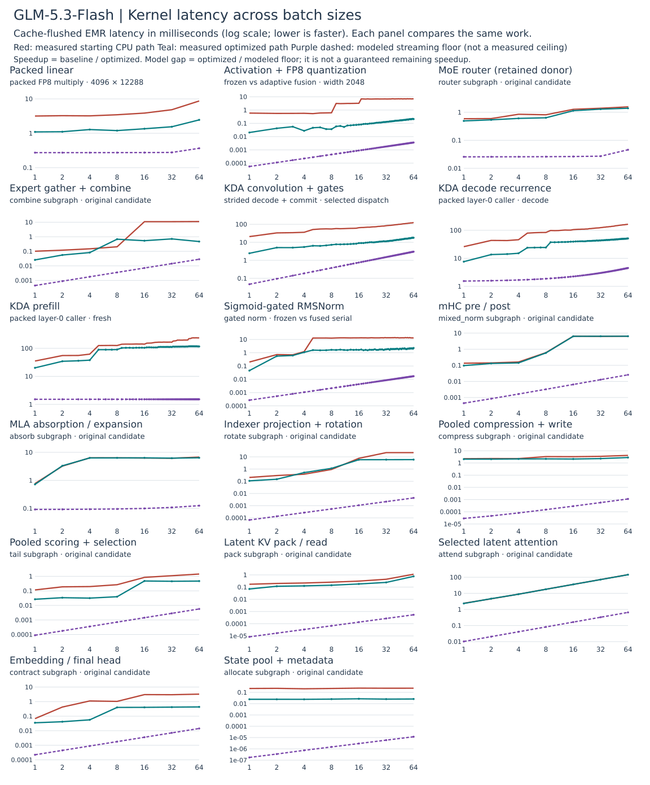

**Across batches:** the horizontal axis is batch size, the vertical axis is latency in milliseconds. Lines connect measured or modeled coordinates; they do not establish intermediate results. [M=32 figure](plots/glm5/journeys_m32_v4.png) · [Batch sweep](plots/glm5/journeys_msweep_v4.png) · [Offline plots](plots/glm5/journeys.html?raw=true) · [Model formulas and renderer](../plugin/validate/plot_glm5_panels.py).

### Detailed caller and roofline evidence

<!-- glm5-inline -->

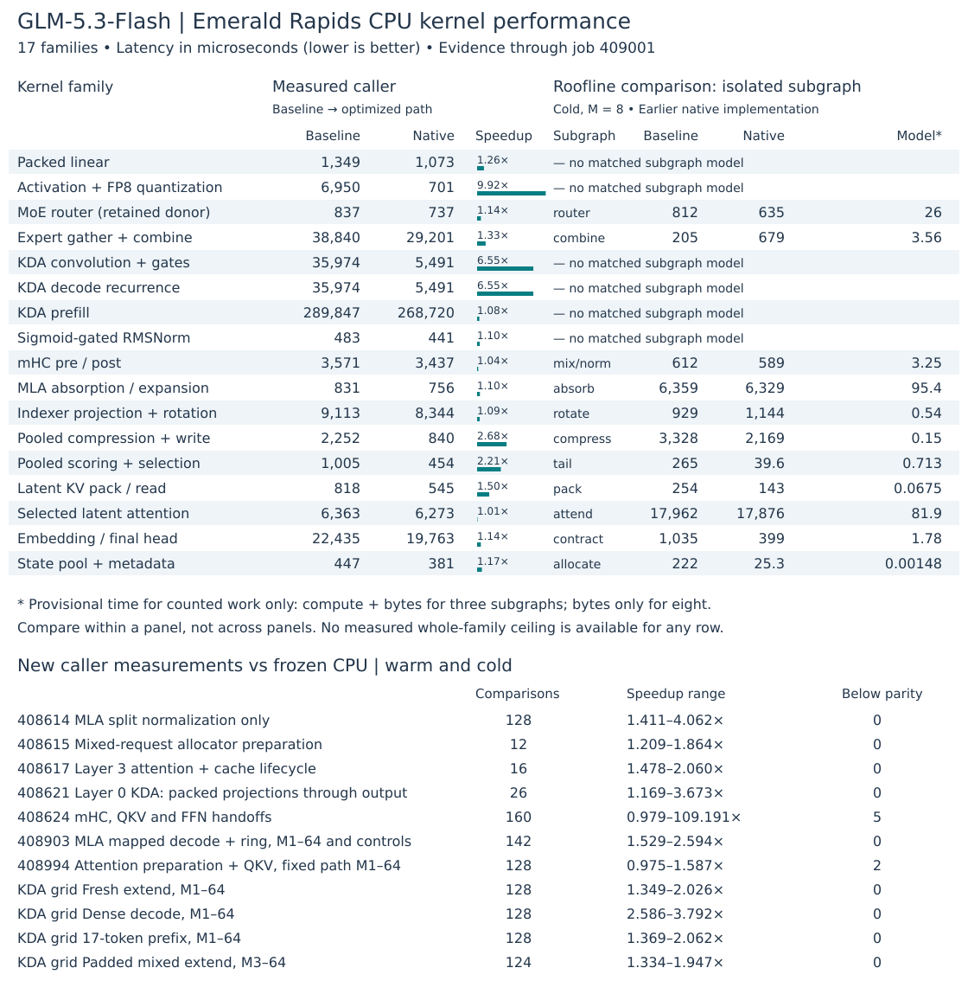

Show numeric data

| Family | Baseline µs | Native µs | Speedup | Gain (4 blocks = 2×) | Isolated M8 model µs¹ |
| --- | --- | --- | --- | --- | --- |
| Packed linear | 1,349.15 | 1,073.18 | 1.26× | ▏█ | — |
| Activation + FP8 quantization | 6,949.61 | 700.88 | 9.92× | ▏█████████████ | — |
| MoE router (retained donor) | 837.30 | 737.03 | 1.14× | ▏█ | router: 26 |
| Expert gather + combine | 38,839.51 | 29,200.93 | 1.33× | ▏██ | combine: 3.56 |
| KDA convolution + gates | 35,973.70 | 5,491.22 | 6.55× | ▏███████████ | — |
| KDA decode recurrence | 35,973.70 | 5,491.22 | 6.55× | ▏███████████ | — |
| KDA prefill | 289,847.31 | 268,720.30 | 1.08× | ▏ | — |
| Sigmoid-gated RMSNorm | 482.98 | 440.84 | 1.10× | ▏█ | — |
| mHC pre / post | 3,570.68 | 3,437.40 | 1.04× | ▏ | mixed_norm: 3.25 |
| MLA absorption / expansion | 830.98 | 755.96 | 1.10× | ▏█ | absorb: 95.4 |
| Indexer projection + rotation | 9,113.17 | 8,344.12 | 1.09× | ▏█ | rotate: 0.54 |
| Pooled compression + write | 2,252.11 | 840.30 | 2.68× | ▏██████ | compress: 0.15 |
| Pooled scoring + selection | 1,004.61 | 454.08 | 2.21× | ▏█████ | tail: 0.713 |
| Latent KV pack / read | 818.42 | 545.05 | 1.50× | ▏██ | pack: 0.0675 |
| Selected latent attention | 6,363.39 | 6,273.49 | 1.01× | ▏ | attend: 81.9 |
| Embedding / final head | 22,435.29 | 19,763.38 | 1.14× | ▏█ | contract: 1.78 |
| State pool + metadata | 446.58 | 380.50 | 1.17× | ▏█ | allocate: 0.00148 |

¹ The modeled time is for the named **subgraph**, not the caller in the latency columns. Whole-family rooflines: **0/17 verified**.

<!-- /glm5-inline -->

 Each row compares two implementations on identical inputs. It shows the lowest-speedup case in the named benchmark, except for the router, which shows the **retained native donor** at M=8 cold rather than the rejected alternative. Times are medians of three process medians; bars show their ratio on a log₂ scale (zero length = parity). These are named caller or kernel timings, not averages across batch sizes. The two KDA decode rows share a caller; do not sum them.

**Right: how close to a roofline?** The three numbers compare the baseline, the native path and a provisional model **for the same isolated subgraph** at M=8 cold. These are not ceilings for the callers on the left. A dash means there is no corresponding modeled subgraph in this sweep. Through job **408917**, all 17 families have a measured stage or peer comparison, but **0 of 17 has a verified whole-family roofline**. [Caller fixtures and process timings](plots/glm5/overview_callers.csv) · [Subgraph timings and model inputs](plots/glm5/roofline_cold.csv) · [Roofline assumptions](#roofline-comparison) · [Chart renderer](../plugin/validate/plot_glm5_overview.py)

**Bottom: do the gains survive between kernels?** Complete layer-0 KDA dense decode measured **2.586–3.792×** across every M=1–64, warm and cold (408912). Fresh extend measured **1.349–2.026×** across the same batch sizes: 60 sizes in 408911 and four earlier anchors in 408621 with different seeds and initial state. Layer-3 mapped attention beat frozen CPU on **142/142** comparisons (408903), but lost to the prior native path on **7/142**. In the mHC/QKV/FFN run (408624), **5 of 160** frozen-reference comparisons lost, all in attention preparation through QKV projection; the worst was **0.979×** at M=1 cold. That run used captured attention output, not a timed attention core. [Paired comparisons, including separate controls](plots/glm5/joined_screens_408917.csv)

**Correctness is a separate result.** The five-layer run (408917) matched same-node frozen CPU at **464/464** tensor boundaries, but the frozen CPU run itself differed from the historical capture (406015) at **205/232** comparable boundaries. It does not establish historical parity or five-layer throughput. [Per-boundary comparisons](plots/glm5/live_state_408917.csv)

**QKV holdout.** On independent short-capture inputs (408994), a fixed native mHC-pre schedule with the unchanged packed QKV projection beat the frozen CPU path in **126/128** comparisons. Both losses were at M=8: **0.975× warm, 0.986× cold**. The fixed path's geometric-mean gain over the *incumbent native path* was **1.473× warm, 1.470× cold**; no batch-specific exceptions were selected. [Holdout and same-path controls](plots/glm5/qkv_holdout_408994.csv).

**KDA state coverage through 409001.** Across all four fixtures, every one of the three paired process medians favored native at each of **508 warm/cold coordinates**. The 17-token prefix sweep covered M=1–64 (M=17 from 408621); the mixed fixture covered M=3–64 because it requires two live requests and one padded row. Outputs, both state pools and continuations matched the frozen CPU caller. Jobs 409000 and 409001 supplied the new measurements; timed-out job 408997 supplied none. These are layer-0 caller results, not a whole-family roofline. [508 coordinates and process timings](plots/glm5/kda_grid_409001.csv)

**Emerald Rapids (EMR), batch M = 1–64.** Fusing activation and FP8 quantization cut that isolated kernel's latency by **9.92–83.02×**. The more informative caller-level result is KDA prefill: at M=64 the parallel subchunk reduced fresh prefill from **195.84 to 121.33 ms (1.61×)**, but the same substitution *increased* latency at M=8 and 16. That is why the journey records regressions and tests dispatch rules separately.

**How to read the plots.** A point is the matching CPU reference latency divided by candidate latency on the same node; **1× is parity**, and below 1× is a loss. Ratios use replicated process medians. Cold means a cache flush before each timed call, not measured DRAM traffic. The figures show measured batch sizes only; connecting lines do not qualify intermediate sizes. Axes use log scales and the vertical range varies by panel. These are standalone or named caller measurements on synthetic inputs, **not model speedups, GPU accuracy results or percentages of an accepted roofline**.

[Activation fusion](#activation-and-fp8-quantization) · [FP8 linear](#native-fp8-linear) · [Decode and norm](#kda-decode-and-gated-rmsnorm) · [Prefill](#kda-prefill-from-subchunk-to-caller) · [Eleven-family wave](#eleven-family-native-candidate-wave) · [Roofline comparison](#roofline-comparison) · [Data and reproduction](#data-and-reproduction)

## Activation and FP8 quantization

Jobs **406471 → 406472 → 406473**: fuse clamp, SiLU, multiply, BF16 rounding and block-128 FP8 quantization; compare scalar and vector conversion with serial and parallel loops; then measure a fixed adaptive dispatch at both widths for every integer M. The final curve is a measured policy, not the fastest point cherry-picked from each curve.

<!-- glm5-inline -->

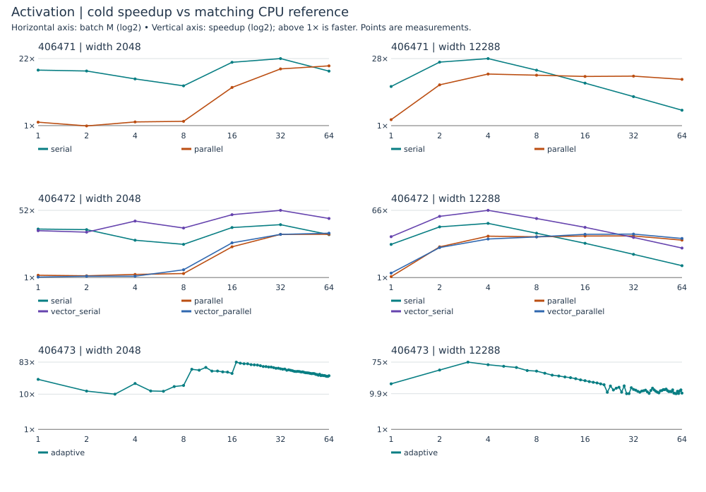

Show numeric data

| Series (×) | Trend by M¹ | M1 | M2 | M4 | M8 | M16 | M32 | M64 |
| --- | --- | --- | --- | --- | --- | --- | --- | --- |
| 406471 \| width 2048 · serial | ▅▅▃▁▇█▅ | 13.1 | 12.5 | 8.69 | 6.31 | 18.8 | 22.3 | 12.5 |
| 406471 \| width 2048 · parallel | ▁▁▁▂▅██ | 1.17 | 0.986 | 1.19 | 1.22 | 5.85 | 13.8 | 15.9 |
| 406471 \| width 12288 · serial | ▄██▆▅▃▁ | 7.01 | 23.6 | 28.1 | 15.8 | 8.29 | 4.23 | 2.15 |
| 406471 \| width 12288 · parallel | ▁▆████▇ | 1.35 | 7.61 | 13 | 12.3 | 11.5 | 11.7 | 10 |
| 406472 \| width 2048 · serial | ▆▆▂▁▇█▄ | 17.3 | 16.7 | 8.97 | 7.04 | 18.9 | 22.4 | 12.5 |
| 406472 \| width 2048 · parallel | ▁▁▁▁▆██ | 1.14 | 1.11 | 1.2 | 1.26 | 6.09 | 12.7 | 12.7 |
| 406472 \| width 2048 · vector_serial | ▁▁▅▂▇█▅ | 15.7 | 14.4 | 27.7 | 18.4 | 40.3 | 52 | 32.2 |
| 406472 \| width 2048 · vector_parallel | ▁▁▁▂▆██ | 1.03 | 1.08 | 1.08 | 1.58 | 7.69 | 12.7 | 13.6 |
| 406472 \| width 12288 · serial | ▅▇█▆▅▃▁ | 7.91 | 23.6 | 29.4 | 15.9 | 8.48 | 4.26 | 2.1 |
| 406472 \| width 12288 · parallel | ▁▆████▇ | 1.06 | 6.79 | 13.2 | 12.7 | 13.4 | 13.4 | 10.3 |
| 406472 \| width 12288 · vector_serial | ▃▇█▆▅▃▁ | 12.8 | 45.5 | 66.2 | 39.7 | 22.9 | 12.2 | 6.3 |
| 406472 \| width 12288 · vector_parallel | ▁▆▇▇██▇ | 1.32 | 6.49 | 11.1 | 12.6 | 14.9 | 15.1 | 11.5 |
| 406473 \| width 2048 · adaptive | ▄▂▁▃▂▂▃▃▆▆▇▆▆▆▆▆████▇▇▇▇▇▇▇▇▇▇▇▇▆▆▆▆▆▆▆▆▆▆▆▆▆▆▆▆▆▅▆▅▅▅▅▅▅▅▅▅▅▅▅▅ | 26.7 | 12.4 | 20.4 | 17.9 | 39.4 | 53.5 | 33.9 |
| 406473 \| width 12288 · adaptive | ▃▆█▇▇▇▆▆▆▅▅▅▅▄▄▄▄▄▃▃▃▁▃▂▂▂▁▃▁▁▂▂▂▂▁▂▂▂▁▁▂▂▂▂▁▁▂▂▂▂▂▂▁▂▁▂▁▁▁▂▁▂▂▁ | 18.7 | 45.3 | 63.8 | 42.3 | 22.9 | 13 | 10.3 |

¹ One tick per measured batch size, in ascending order; height is log-scaled within each row. Numeric columns show selected batch sizes.

<!-- /glm5-inline -->

Warm-cache measurements

<!-- glm5-inline -->

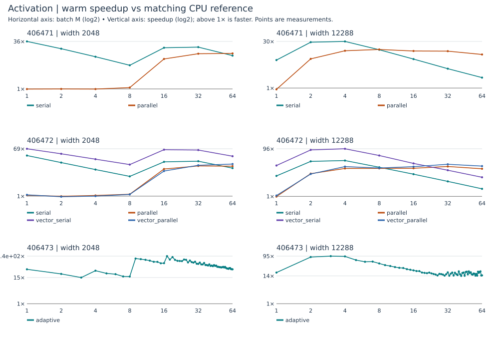

Show numeric data

| Series (×) | Trend by M¹ | M1 | M2 | M4 | M8 | M16 | M32 | M64 |
| --- | --- | --- | --- | --- | --- | --- | --- | --- |
| 406471 \| width 2048 · serial | █▆▄▁▆▆▄ | 35.5 | 20.5 | 11.2 | 5.91 | 22.1 | 23.2 | 12.2 |
| 406471 \| width 2048 · parallel | ▁▁▁▁▇██ | 0.987 | 0.997 | 0.988 | 1.1 | 9.52 | 14.1 | 14.4 |
| 406471 \| width 12288 · serial | ▄██▆▅▃▁ | 7.73 | 28.6 | 30.2 | 16.4 | 8.31 | 4.12 | 2.14 |
| 406471 \| width 12288 · parallel | ▁▆████▇ | 0.907 | 8.45 | 15.3 | 16.8 | 15 | 14.9 | 11.6 |
| 406472 \| width 2048 · serial | █▆▃▁▆▆▄ | 37.9 | 20.2 | 10.8 | 5.86 | 21.6 | 22.8 | 12.3 |
| 406472 \| width 2048 · parallel | ▁▁▁▁▇██ | 1.09 | 0.989 | 1.06 | 1.18 | 11.3 | 15 | 14.6 |
| 406472 \| width 2048 · vector_serial | █▆▃▁█▇▅ | 69.4 | 44.3 | 27.3 | 16.9 | 63.9 | 61.9 | 35.6 |
| 406472 \| width 2048 · vector_parallel | ▁▁▁▁▇██ | 1.12 | 0.95 | 1 | 1.17 | 9.46 | 15.8 | 17.7 |
| 406472 \| width 12288 · serial | ▄██▆▅▃▁ | 7.1 | 28.6 | 31 | 16.3 | 8.38 | 4.2 | 2.06 |
| 406472 \| width 12288 · parallel | ▁▆████▇ | 0.979 | 8.83 | 14.5 | 14.6 | 14.8 | 17.5 | 14.1 |
| 406472 \| width 12288 · vector_serial | ▄██▆▄▃▁ | 19.3 | 85.9 | 95.8 | 50.2 | 23.5 | 12.2 | 6.22 |
| 406472 \| width 12288 · vector_parallel | ▁▆▇▇▇██ | 1.08 | 8.53 | 17.3 | 15.2 | 17.2 | 21.7 | 18.2 |
| 406473 \| width 2048 · adaptive | ▄▂▁▃▂▂▁▁▇▇▇▇▆▆▆▆█▇█▇▆▆▆▇▇▆▇▆▆▆▆▅▆▅▅▆▅▅▅▅▅▅▅▅▅▅▅▅▄▄▄▄▄▄▄▄▄▄▄▄▄▄▄▄ | 34.9 | 21.6 | 30.2 | 16.6 | 65.6 | 60.9 | 34.9 |
| 406473 \| width 12288 · adaptive | ▂███▇▆▆▅▅▄▄▄▄▃▃▃▃▃▂▂▂▂▂▂▁▁▂▂▁▁▂▂▁▂▂▁▂▂▁▃▂▁▂▂▁▂▂▂▃▂▂▂▁▂▂▁▂▁▂▂▂▃▁▁ | 19.7 | 86.8 | 92.3 | 46.9 | 24.2 | 20.1 | 15 |

¹ One tick per measured batch size, in ascending order; height is log-scaled within each row. Numeric columns show selected batch sizes.

<!-- /glm5-inline -->

## Native FP8 linear

Jobs **406480 → 406483**: keep checkpoint weights packed, compare native checks alone against bounded vector-tile conversion, then vary row and column tile sizes. The `block64` candidate measured **1.89–4.02×** at the four MLP shapes and seven M anchors. The panel labels retain the output dtype and the two non-batch dimensions from the benchmark. The projections and vocabulary head outside this subset are not covered by these timings.

<!-- glm5-inline -->

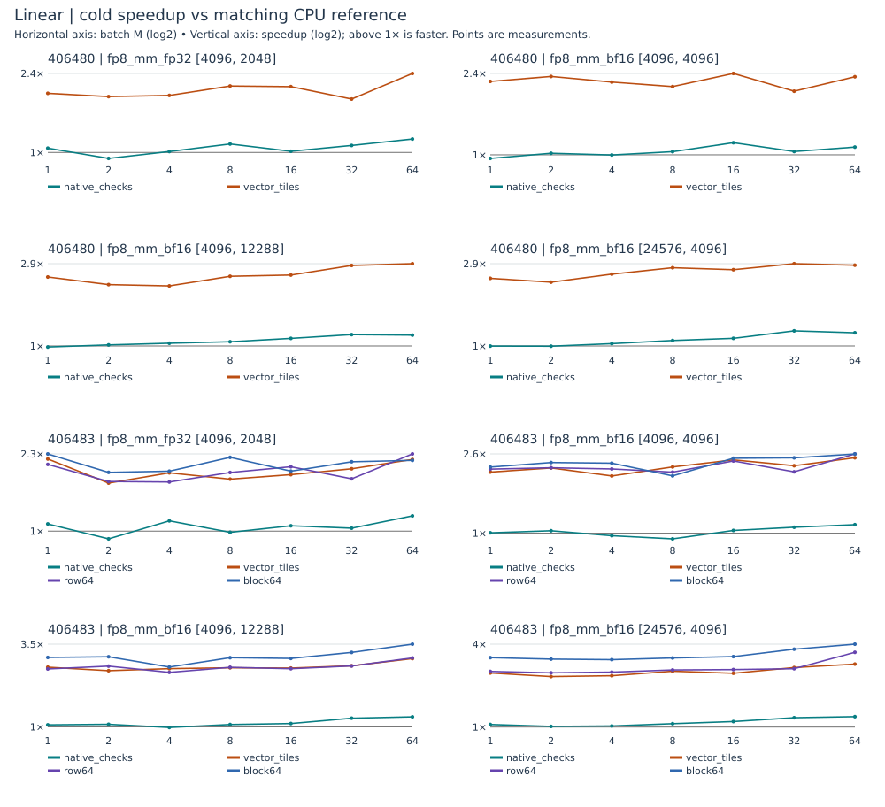

Show numeric data

| Series (×) | Trend by M¹ | M1 | M2 | M4 | M8 | M16 | M32 | M64 |
| --- | --- | --- | --- | --- | --- | --- | --- | --- |
| 406480 \| fp8_mm_fp32 [4096, 2048] · native_checks | ▅▁▃▆▄▆█ | 1.05 | 0.937 | 1.01 | 1.1 | 1.01 | 1.08 | 1.16 |
| 406480 \| fp8_mm_fp32 [4096, 2048] · vector_tiles | ▃▂▂▅▄▁█ | 1.91 | 1.85 | 1.87 | 2.07 | 2.06 | 1.8 | 2.38 |
| 406480 \| fp8_mm_bf16 [4096, 4096] · native_checks | ▁▃▃▄█▄▆ | 0.962 | 1.02 | 0.998 | 1.03 | 1.14 | 1.04 | 1.09 |
| 406480 \| fp8_mm_bf16 [4096, 4096] · vector_tiles | ▅▇▅▃█▁▇ | 2.2 | 2.32 | 2.19 | 2.08 | 2.4 | 1.98 | 2.31 |
| 406480 \| fp8_mm_bf16 [4096, 12288] · native_checks | ▁▂▃▄▆██ | 0.987 | 1.01 | 1.04 | 1.06 | 1.1 | 1.16 | 1.15 |
| 406480 \| fp8_mm_bf16 [4096, 12288] · vector_tiles | ▄▁▁▄▄▇█ | 2.46 | 2.23 | 2.19 | 2.48 | 2.52 | 2.85 | 2.92 |
| 406480 \| fp8_mm_bf16 [24576, 4096] · native_checks | ▁▁▂▄▅█▇ | 0.999 | 0.997 | 1.03 | 1.07 | 1.1 | 1.22 | 1.19 |
| 406480 \| fp8_mm_bf16 [24576, 4096] · vector_tiles | ▂▁▄▆▆█▇ | 2.42 | 2.3 | 2.55 | 2.78 | 2.71 | 2.93 | 2.87 |
| 406483 \| fp8_mm_fp32 [4096, 2048] · native_checks | ▆▁▆▃▅▄█ | 1.08 | 0.92 | 1.12 | 0.987 | 1.06 | 1.03 | 1.18 |
| 406483 \| fp8_mm_fp32 [4096, 2048] · vector_tiles | █▁▄▂▃▅█ | 2.18 | 1.68 | 1.88 | 1.76 | 1.84 | 1.96 | 2.17 |
| 406483 \| fp8_mm_fp32 [4096, 2048] · row64 | ▅▁▁▃▅▂█ | 2.06 | 1.71 | 1.7 | 1.89 | 2.01 | 1.76 | 2.31 |
| 406483 \| fp8_mm_fp32 [4096, 2048] · block64 | █▁▁▇▁▅▆ | 2.3 | 1.89 | 1.91 | 2.22 | 1.91 | 2.12 | 2.15 |
| 406483 \| fp8_mm_bf16 [4096, 4096] · native_checks | ▄▅▃▁▅▇█ | 1 | 1.03 | 0.97 | 0.935 | 1.03 | 1.07 | 1.11 |
| 406483 \| fp8_mm_bf16 [4096, 4096] · vector_tiles | ▂▄▁▄▇▅█ | 2.07 | 2.17 | 1.97 | 2.19 | 2.39 | 2.23 | 2.45 |
| 406483 \| fp8_mm_bf16 [4096, 4096] · row64 | ▂▃▂▁▅▁█ | 2.14 | 2.17 | 2.14 | 2.06 | 2.36 | 2.07 | 2.56 |
| 406483 \| fp8_mm_bf16 [4096, 4096] · block64 | ▄▅▅▁▇▇█ | 2.19 | 2.31 | 2.3 | 1.97 | 2.43 | 2.44 | 2.56 |
| 406483 \| fp8_mm_bf16 [4096, 12288] · native_checks | ▃▃▁▃▄▇█ | 1.03 | 1.04 | 0.991 | 1.04 | 1.05 | 1.14 | 1.17 |
| 406483 \| fp8_mm_bf16 [4096, 12288] · vector_tiles | ▃▁▂▃▃▄█ | 2.5 | 2.36 | 2.44 | 2.47 | 2.46 | 2.55 | 2.85 |
| 406483 \| fp8_mm_bf16 [4096, 12288] · row64 | ▃▄▁▃▃▄█ | 2.43 | 2.53 | 2.31 | 2.49 | 2.44 | 2.54 | 2.88 |
| 406483 \| fp8_mm_bf16 [4096, 12288] · block64 | ▄▄▁▄▄▅█ | 2.9 | 2.93 | 2.5 | 2.89 | 2.85 | 3.13 | 3.55 |
| 406483 \| fp8_mm_bf16 [24576, 4096] · native_checks | ▂▁▁▃▄▇█ | 1.04 | 1.01 | 1.02 | 1.06 | 1.1 | 1.17 | 1.19 |
| 406483 \| fp8_mm_bf16 [24576, 4096] · vector_tiles | ▃▁▁▄▃▆█ | 2.48 | 2.33 | 2.37 | 2.55 | 2.47 | 2.71 | 2.88 |
| 406483 \| fp8_mm_bf16 [24576, 4096] · row64 | ▁▁▁▂▂▂█ | 2.54 | 2.49 | 2.52 | 2.61 | 2.62 | 2.66 | 3.5 |
| 406483 \| fp8_mm_bf16 [24576, 4096] · block64 | ▂▁▁▂▂▆█ | 3.2 | 3.13 | 3.1 | 3.19 | 3.26 | 3.69 | 4.02 |

¹ One tick per measured batch size, in ascending order; height is log-scaled within each row. Numeric columns show selected batch sizes.

<!-- /glm5-inline -->

Warm-cache measurements

<!-- glm5-inline -->

Show numeric data

| Series (×) | Trend by M¹ | M1 | M2 | M4 | M8 | M16 | M32 | M64 |
| --- | --- | --- | --- | --- | --- | --- | --- | --- |
| 406480 \| fp8_mm_fp32 [4096, 2048] · native_checks | ▃▅█▇▁▄█ | 0.954 | 1.02 | 1.14 | 1.09 | 0.887 | 0.992 | 1.13 |
| 406480 \| fp8_mm_fp32 [4096, 2048] · vector_tiles | ▁▂▄▄▃▆█ | 1.43 | 1.6 | 1.81 | 1.83 | 1.64 | 2.26 | 2.62 |
| 406480 \| fp8_mm_bf16 [4096, 4096] · native_checks | ▆▆▁▂▇▃█ | 1.08 | 1.09 | 0.971 | 1 | 1.11 | 1.02 | 1.14 |
| 406480 \| fp8_mm_bf16 [4096, 4096] · vector_tiles | ▁▂▃▃▆▅█ | 1.57 | 1.77 | 1.9 | 1.84 | 2.31 | 2.13 | 2.79 |
| 406480 \| fp8_mm_bf16 [4096, 12288] · native_checks | ▃▃▁▄▅██ | 1.04 | 1.05 | 0.992 | 1.08 | 1.12 | 1.19 | 1.19 |
| 406480 \| fp8_mm_bf16 [4096, 12288] · vector_tiles | ▁▄▂▄▆▇█ | 2.3 | 2.53 | 2.42 | 2.54 | 2.71 | 2.85 | 2.96 |
| 406480 \| fp8_mm_bf16 [24576, 4096] · native_checks | ▁▁▂▂▅▇█ | 1.01 | 1.02 | 1.03 | 1.04 | 1.12 | 1.18 | 1.2 |
| 406480 \| fp8_mm_bf16 [24576, 4096] · vector_tiles | ▁▁▁▂▄▇█ | 2.59 | 2.61 | 2.61 | 2.64 | 2.77 | 2.96 | 3 |
| 406483 \| fp8_mm_fp32 [4096, 2048] · native_checks | ▃▁█▅▅▂▆ | 1.01 | 0.903 | 1.25 | 1.11 | 1.07 | 0.968 | 1.13 |
| 406483 \| fp8_mm_fp32 [4096, 2048] · vector_tiles | ▂▁▅▄▅▅█ | 1.45 | 1.37 | 2.02 | 1.84 | 2.05 | 1.94 | 2.67 |
| 406483 \| fp8_mm_fp32 [4096, 2048] · row64 | ▂▁▂▂▅▆█ | 1.72 | 1.53 | 1.63 | 1.68 | 2.13 | 2.4 | 2.75 |
| 406483 \| fp8_mm_fp32 [4096, 2048] · block64 | ▁▂▃▂▃▅█ | 1.58 | 1.67 | 1.99 | 1.87 | 2.09 | 2.53 | 3.55 |
| 406483 \| fp8_mm_bf16 [4096, 4096] · native_checks | ▃▁█▆▆▇▆ | 0.99 | 0.934 | 1.19 | 1.1 | 1.1 | 1.14 | 1.11 |
| 406483 \| fp8_mm_bf16 [4096, 4096] · vector_tiles | ▁▃▄▄▇██ | 1.65 | 1.85 | 2.09 | 2.01 | 2.46 | 2.66 | 2.61 |
| 406483 \| fp8_mm_bf16 [4096, 4096] · row64 | ▁▂▄▃▄▆█ | 1.66 | 1.86 | 2.08 | 2.03 | 2.19 | 2.45 | 2.93 |
| 406483 \| fp8_mm_bf16 [4096, 4096] · block64 | ▁▃█▆▇██ | 1.7 | 1.99 | 2.96 | 2.49 | 2.74 | 2.87 | 2.98 |
| 406483 \| fp8_mm_bf16 [4096, 12288] · native_checks | ▁▂▃▄▅▇█ | 0.988 | 1.02 | 1.05 | 1.06 | 1.1 | 1.15 | 1.18 |
| 406483 \| fp8_mm_bf16 [4096, 12288] · vector_tiles | ▁▇▂▆▆▆█ | 2.31 | 2.73 | 2.39 | 2.67 | 2.67 | 2.68 | 2.84 |
| 406483 \| fp8_mm_bf16 [4096, 12288] · row64 | ▁▂▄▄▅▆█ | 2.28 | 2.43 | 2.67 | 2.59 | 2.76 | 2.82 | 3.17 |
| 406483 \| fp8_mm_bf16 [4096, 12288] · block64 | ▁▂▂▆▆▆█ | 2.71 | 2.79 | 2.86 | 3.32 | 3.31 | 3.3 | 3.65 |
| 406483 \| fp8_mm_bf16 [24576, 4096] · native_checks | ▁▁▂▃▅▇█ | 1.02 | 1.02 | 1.06 | 1.06 | 1.13 | 1.18 | 1.2 |
| 406483 \| fp8_mm_bf16 [24576, 4096] · vector_tiles | ▁▁▅▃▇██ | 2.47 | 2.45 | 2.74 | 2.62 | 2.91 | 2.95 | 2.92 |
| 406483 \| fp8_mm_bf16 [24576, 4096] · row64 | ▁▁▂▁▄▃█ | 2.63 | 2.63 | 2.67 | 2.6 | 2.93 | 2.91 | 3.63 |
| 406483 \| fp8_mm_bf16 [24576, 4096] · block64 | ▁▁▂▅▆▅█ | 3.24 | 3.25 | 3.37 | 3.75 | 3.93 | 3.79 | 4.28 |

¹ One tick per measured batch size, in ascending order; height is log-scaled within each row. Numeric columns show selected batch sizes.

<!-- /glm5-inline -->

## KDA decode and gated RMSNorm

- **406495 → 406497 → 406498, decode:** move convolution, gates and recurrence into native loops while retaining the reference reduction order. Compare serial and parallel loops, then contiguous-state copies against the original commit. Serial copies helped M=1 but lost at large M. The fixed policy used serial at M=1, parallel otherwise, and the native commit at M=1 and M≥32. Across both convolution-state layouts it delivered **6.55–8.70× cold**. That ratio is for the *combined decoder*, not for each constituent kernel.
- **406496 → 406498 → 406518, norm:** compare native serial and parallel preparation, then fuse sigmoid, ordered affine/gate multiplies and BF16 store. The fused candidate beat the frozen reference, but lost to the prior native implementation at **seven cold M values**. Both curves are shown against the same reference. No unconditional replacement was selected.

<!-- glm5-inline -->

Show numeric data

| Series (×) | Trend by M¹ | M1 | M2 | M4 | M8 | M16 | M32 | M64 |
| --- | --- | --- | --- | --- | --- | --- | --- | --- |
| 406495 \| decode_contiguous · serial | █▇▆▆▄▂▁ | 7.58 | 6.57 | 4.8 | 4.02 | 2.56 | 1.7 | 1.14 |
| 406495 \| decode_contiguous · parallel | ▁▄▅█▇▆▃ | 6.18 | 6.92 | 7.12 | 7.86 | 7.57 | 7.31 | 6.73 |
| 406495 \| decode_strided · serial | █▇▆▆▄▂▁ | 7.52 | 6.42 | 4.62 | 3.88 | 2.47 | 1.69 | 1.15 |
| 406495 \| decode_strided · parallel | ▁▃▄█▅▆▃ | 6.02 | 6.64 | 6.87 | 7.99 | 7.13 | 7.27 | 6.66 |
| 406496 \| gated_norm · serial | ▅▁▁███▇ | 3.89 | 1.1 | 1.09 | 7.99 | 7.77 | 7.12 | 5.25 |
| 406496 \| gated_norm · parallel | ▁▃▃████ | 0.186 | 0.412 | 0.614 | 5.14 | 5.37 | 5.17 | 4.9 |
| 406497 \| decode_contiguous · serial | █▇▆▆▄▂▁ | 7.72 | 6.01 | 4.72 | 3.93 | 2.18 | 1.59 | 1.07 |
| 406497 \| decode_contiguous · parallel | ▁▃▆█▆▅▂ | 6.18 | 6.68 | 7.3 | 8.01 | 7.51 | 7.27 | 6.51 |
| 406497 \| decode_contiguous · commit_serial | █▇▆▅▄▂▁ | 8.52 | 6.25 | 4.64 | 3.42 | 2.09 | 1.32 | 0.812 |
| 406497 \| decode_contiguous · commit_parallel | ▁▃▇█▇▇▅ | 6.2 | 6.66 | 7.38 | 7.57 | 7.45 | 7.36 | 6.87 |
| 406497 \| decode_strided · serial | █▇▆▆▄▃▁ | 7.47 | 5.98 | 4.48 | 3.95 | 2.15 | 1.54 | 0.924 |
| 406497 \| decode_strided · parallel | ▁▅▅█▇▅▃ | 5.96 | 6.92 | 6.86 | 7.78 | 7.44 | 7.03 | 6.49 |
| 406497 \| decode_strided · commit_serial | █▇▆▅▃▂▁ | 8.79 | 6.17 | 4.41 | 3.39 | 2.03 | 1.26 | 0.917 |
| 406497 \| decode_strided · commit_parallel | ▁▃▃██▅▃ | 6.45 | 6.8 | 6.75 | 7.76 | 7.72 | 7.22 | 6.8 |
| 406498 \| gated_norm · selected | ▅▁▁▁██████████████▇███▇▇█▇█▇▇▇▇▇▇▇▇▇▇▇▇▇▇▇▇▇▇▇▇▇▆▇▇▇▇▇▆▆▇▆▆▆▆▆▆▆ | 3.93 | 1.28 | 1.14 | 8.22 | 7.8 | 6.37 | 4.82 |
| 406498 \| decode_contiguous · selected | █▁▂▂▇▆▇▄▃▄▃▃▄▃▃▃▂▃▃▂▂▂▂▃▃▃▃▃▂▂▁▃▃▃▃▃▃▃▂▃▃▃▃▂▂▂▃▂▂▂▂▂▂▂▂▂▂▂▂▂▁▁▁▁ | 8.7 | 6.97 | 7.16 | 7.66 | 7.34 | 7.3 | 7 |
| 406498 \| decode_strided · selected | ▇▁▂▁▆█▇▅▄▄▄▄▄▄▃▃▄▄▃▃▂▃▄▃▃▃▃▃▃▂▃▄▄▄▃▃▄▃▃▃▃▃▃▄▃▃▃▃▃▃▂▂▂▃▃▃▂▂▃▃▂▂▂▃ | 8.44 | 6.55 | 6.55 | 7.55 | 7.18 | 7.33 | 7.03 |
| 406518 \| gated_norm · serial | ▅▂▁▁███████████▇█▇█▇██▇▇▇█▇▇▇▇▇▇▇▇▇▇▇▇▇▇▇▇▇▇▇▇▇▇▇▇▇▇▆▆▇▆▇▆▆▆▆▆▆▆ | 3.87 | 1.4 | 1.07 | 7.33 | 7.27 | 6.94 | 5.07 |
| 406518 \| gated_norm · fused_serial | ▆▂▁▁███████████████████▇████████▇▇█▇▇▇▇▇▇▇▇▇▇▇▇▇▇▇▇▇▇▇▇▇▇▇▇▇▇▇▇▇ | 4.41 | 1.31 | 1.12 | 7.57 | 8.08 | 7.47 | 5.89 |

¹ One tick per measured batch size, in ascending order; height is log-scaled within each row. Numeric columns show selected batch sizes.

<!-- /glm5-inline -->

Warm-cache measurements

<!-- glm5-inline -->

Show numeric data

| Series (×) | Trend by M¹ | M1 | M2 | M4 | M8 | M16 | M32 | M64 |
| --- | --- | --- | --- | --- | --- | --- | --- | --- |
| 406495 \| decode_contiguous · serial | █▇▆▆▄▂▁ | 8.25 | 6.92 | 5.01 | 4.17 | 2.59 | 1.7 | 1.14 |
| 406495 \| decode_contiguous · parallel | ▁▄▅█▇▆▂ | 6.39 | 7.09 | 7.19 | 7.95 | 7.6 | 7.41 | 6.68 |
| 406495 \| decode_strided · serial | █▇▆▆▄▂▁ | 7.88 | 6.08 | 4.94 | 4.11 | 2.53 | 1.52 | 1.14 |
| 406495 \| decode_strided · parallel | ▁▃▃█▆▅▂ | 6.53 | 6.89 | 6.82 | 7.83 | 7.5 | 7.22 | 6.63 |
| 406496 \| gated_norm · serial | ▆▁▁██▇▇ | 4.44 | 1.3 | 1.26 | 7.82 | 7.29 | 6.41 | 5.48 |
| 406496 \| gated_norm · parallel | ▁▃▄████ | 0.144 | 0.388 | 0.562 | 5.05 | 5.21 | 5.31 | 5.26 |
| 406497 \| decode_contiguous · serial | █▇▆▆▄▂▁ | 7.9 | 6.09 | 4.81 | 3.9 | 2.4 | 1.58 | 1.07 |
| 406497 \| decode_contiguous · parallel | ▁▄▅█▆▄▂ | 6.31 | 6.91 | 7.17 | 8.12 | 7.67 | 7.07 | 6.43 |
| 406497 \| decode_contiguous · commit_serial | █▇▆▅▄▂▁ | 9.24 | 6.24 | 4.78 | 3.55 | 2.02 | 1.25 | 0.814 |
| 406497 \| decode_contiguous · commit_parallel | ▁▃▄█▅▆▂ | 6.58 | 7.11 | 7.37 | 8.28 | 7.47 | 7.72 | 6.91 |
| 406497 \| decode_strided · serial | █▇▆▆▄▃▁ | 8.46 | 6.17 | 4.68 | 4.26 | 2.15 | 1.53 | 0.915 |
| 406497 \| decode_strided · parallel | ▁▂▂█▆▅▁ | 6.36 | 6.54 | 6.6 | 7.81 | 7.28 | 7.15 | 6.42 |
| 406497 \| decode_strided · commit_serial | █▇▆▅▃▂▁ | 9.1 | 6.26 | 4.41 | 3.51 | 1.95 | 1.36 | 0.909 |
| 406497 \| decode_strided · commit_parallel | ▁▃▃█▅▆▄ | 6.2 | 6.72 | 6.73 | 8.15 | 7.32 | 7.48 | 6.84 |
| 406498 \| gated_norm · selected | ▆▁▂▂██████████▇██▇▇██▇▇▇▇▇▇▇▇▇▇▇▇▇▇▇▇▇▇▇▇▇▇▇▇▇▇▇▇▇▇▇▇▇▇▇▇▆▇▇▆▆▆▆ | 4.51 | 0.881 | 1.17 | 8.34 | 8.09 | 6.33 | 5.01 |
| 406498 \| decode_contiguous · selected | █▁▁▁▆▆▆▃▂▄▃▂▂▂▂▃▂▃▂▂▂▂▂▂▂▂▁▂▁▂▁▃▂▂▂▂▂▂▂▁▂▁▂▂▁▂▃▂▂▂▂▂▂▂▂▁▂▂▂▁▁▁▁▂ | 9.17 | 7.02 | 7.09 | 7.59 | 7.5 | 7.47 | 7.2 |
| 406498 \| decode_strided · selected | █▁▁▃▇██▅▅▅▄▄▃▄▄▅▄▄▄▂▄▃▄▃▃▃▃▃▂▃▂▃▃▄▄▄▄▄▃▃▃▃▃▃▃▃▃▄▃▃▂▃▂▃▃▂▃▂▃▂▂▂▂▂ | 8.36 | 6.65 | 7 | 7.5 | 7.51 | 7.15 | 6.85 |
| 406518 \| gated_norm · serial | ▅▁▁▁████████████████▇██▇▇▇█▇▇▇▇▇▇▇▇▇▇▇▇▇▇▇▇▇▇▇▇▇▇▇▆▇▇▇▇▆▇▆▇▆▆▆▆▆ | 3.97 | 1.22 | 1.11 | 7.83 | 7.92 | 6.49 | 4.88 |
| 406518 \| gated_norm · fused_serial | ▆▁▁▁███████████████████▇▇████▇▇██▇▇▇▇▇▇█▇▇▇▇▇▇▇▇▇▇▇█▇▇▇▇▇▇▇▇▇▇▇▇ | 4.79 | 1.1 | 1.23 | 8.45 | 8.28 | 8.23 | 6.06 |

¹ One tick per measured batch size, in ascending order; height is log-scaled within each row. Numeric columns show selected batch sizes.

<!-- /glm5-inline -->

## KDA prefill: from subchunk to caller

**407379:** keep the FP32 batched-matmul donor, move the subchunk control flow to C++, and use AVX-512 for TF32 operand rounding. The parallel workers had to inherit inference mode before the full-prefill benchmark could run. The serial path lost at all 18 full-prefill coordinates; parallel won at 14. At M=64, fresh/prefix/ragged speedups were **1.61× / 1.59× / 1.05×**. The `intra_*` panels isolate the subchunk; `fresh`, `prefix` and `ragged` include the rest of the KDA prefill step and its state writes.

<!-- glm5-inline -->

Show numeric data

| Series (×) | Trend by M¹ | M1 | M2 | M4 | M8 | M16 | M32 | M64 |
| --- | --- | --- | --- | --- | --- | --- | --- | --- |
| fresh · parallel | ▂▂▃▁▁▃█ | 1 | 1.02 | 1.09 | 0.916 | 0.914 | 1.07 | 1.61 |
| fresh · serial | █▁▂▄▄▂▁ | 0.903 | 0.425 | 0.46 | 0.57 | 0.574 | 0.49 | 0.432 |
| intra_fused · parallel | ▄▅▅█▁▁▁▁▁▁▁▁▁▁▁▁▂▃▃▃▄▄▃▃▃▄▃▄▄▄▄▄▅▅▅▅▆▆▆▆▆▆▆▆▆▆▆▆▆▇▇▇▇▇▇▇▇▇▇▇▇▇▇▇ | 1.46 | 1.97 | 3.75 | 0.656 | 0.67 | 1.23 | 3.14 |
| intra_fused · serial | █▁▁▄▆▆▆▆▆▆▆▆▆▆▆▆▇▆▆▆▇▇▇▇▇▇▇▇▇▇▇▇█▇▇▇▇▇▇▇▇▇▇▇▇▇▇▇████████████████ | 0.322 | 0.038 | 0.0967 | 0.187 | 0.193 | 0.23 | 0.32 |
| intra_nonfused · parallel | ▂▆▆▅▁▁▁▁▁▁▁▁▁▁▁▁▂▂▂▂▄▄▄▄▄▄▄▄▄▄▄▄▅▅▅▅▆▆▆▆▆▆▆▆▆▆▆▆▇▇▇▇████████████ | 1.37 | 2.79 | 2.35 | 1.14 | 1.14 | 1.89 | 3.9 |
| intra_nonfused · serial | █▁▁▁▆▆▆▆▆▆▆▆▆▆▆▆▇▅▅▅▇▇▇▇▇▇▇▇▇▇▇▇▇▆▆▆▇▇▇▇▇▇▇▇▆▆▆▆▆▆▆▆▆▆▆▆▆▆▆▆▆▆▆▆ | 0.584 | 0.0478 | 0.0536 | 0.327 | 0.328 | 0.353 | 0.339 |
| prefix · parallel | ▂▂▃▁▁▃█ | 1.02 | 1.01 | 1.1 | 0.912 | 0.924 | 1.05 | 1.59 |
| prefix · serial | █▁▂▄▄▂▁ | 0.934 | 0.426 | 0.471 | 0.572 | 0.576 | 0.49 | 0.433 |
| ragged · parallel | ▁█▄▂ | — | — | — | 1.05 | 1.06 | 1.05 | 1.05 |
| ragged · serial | ▅▁██ | — | — | — | 0.438 | 0.351 | 0.541 | 0.544 |

¹ One tick per measured batch size, in ascending order; height is log-scaled within each row. Numeric columns show selected batch sizes.

<!-- /glm5-inline -->

Warm-cache measurements

<!-- glm5-inline -->

Show numeric data

| Series (×) | Trend by M¹ | M1 | M2 | M4 | M8 | M16 | M32 | M64 |
| --- | --- | --- | --- | --- | --- | --- | --- | --- |
| fresh · parallel | ▂▂▃▁▁▃█ | 1.01 | 1.01 | 1.1 | 0.92 | 0.91 | 1.07 | 1.6 |
| fresh · serial | █▁▂▄▄▂▁ | 0.898 | 0.422 | 0.464 | 0.57 | 0.568 | 0.493 | 0.429 |
| intra_fused · parallel | ▃▆▅█▁▁▁▁▁▁▁▁▁▁▁▁▂▃▃▃▄▄▃▄▃▄▃▄▄▃▄▄▅▅▅▅▆▅▆▅▆▆▅▆▆▆▅▆▆▇▇▇▇▇▇▇▇▇▇▇▇▇▇▇ | 1.2 | 2.04 | 3.86 | 0.663 | 0.678 | 1.24 | 3.13 |
| intra_fused · serial | ▇▁▁▄▆▆▆▆▆▆▆▆▆▆▆▆▇▆▆▆▇▇▇▇▇▇▇▇▇▇▇▇█▇▇▇▇▇▇▇▇▇▇▇▇▇▇▇████████████████ | 0.273 | 0.0381 | 0.0955 | 0.191 | 0.195 | 0.233 | 0.32 |
| intra_nonfused · parallel | ▂█▆▅▁▁▁▁▁▁▁▁▁▁▁▁▂▂▂▂▄▄▄▄▄▄▄▄▄▄▄▄▄▅▅▅▆▆▆▆▆▆▆▆▆▆▆▆▇▇▇▇████████████ | 1.41 | 3.68 | 2.41 | 1.15 | 1.14 | 1.9 | 4 |
| intra_nonfused · serial | █▁▁▁▇▇▇▇▇▇▇▇▇▇▇▇▇▆▆▆▇▇▇▇▇▇▇▇▇▇▇▇▇▇▆▆▇▇▇▇▇▇▇▇▆▆▆▆▇▆▆▆▇▇▇▇▇▇▇▇▇▇▇▇ | 0.494 | 0.0477 | 0.0517 | 0.331 | 0.331 | 0.352 | 0.34 |
| prefix · parallel | ▂▂▃▁▁▃█ | 1 | 1.02 | 1.08 | 0.918 | 0.924 | 1.06 | 1.58 |
| prefix · serial | █▁▂▄▄▂▁ | 0.903 | 0.434 | 0.469 | 0.571 | 0.575 | 0.494 | 0.432 |
| ragged · parallel | ▁█▃▁ | — | — | — | 1.05 | 1.07 | 1.05 | 1.05 |
| ragged · serial | ▅▁██ | — | — | — | 0.439 | 0.353 | 0.541 | 0.542 |

¹ One tick per measured batch size, in ascending order; height is log-scaled within each row. Numeric columns show selected batch sizes.

<!-- /glm5-inline -->

**407549, held-out policy:** use parallel native code for fused subchunks with M≥32; retain the reference otherwise. Fresh and prefix requests at M=33, 40, 48, 56 and 63 improved **1.17–1.61× cold**. The smaller sizes and ragged requests exercise the fallback; ratios near 1 there do not represent a new kernel win. No serving default changed.

<!-- glm5-inline -->

Show numeric data

| Series (×) | Trend by M¹ | M1 | M2 | M4 | M8 | M16 | M32 | M64 |
| --- | --- | --- | --- | --- | --- | --- | --- | --- |
| fresh · selected | ▁▁▃▅▅██ | — | — | — | — | — | — | — |
| prefix · selected | ▁▁▃▅▅██ | — | — | — | — | — | — | — |
| ragged · selected | ▃▄▅▅█▁▅ | — | — | — | — | — | — | — |

¹ One tick per measured batch size, in ascending order; height is log-scaled within each row. Numeric columns show selected batch sizes.

<!-- /glm5-inline -->

Warm-cache measurements

<!-- glm5-inline -->

Show numeric data

| Series (×) | Trend by M¹ | M1 | M2 | M4 | M8 | M16 | M32 | M64 |
| --- | --- | --- | --- | --- | --- | --- | --- | --- |
| fresh · selected | ▁▁▃▅▅██ | — | — | — | — | — | — | — |
| prefix · selected | ▁▁▃▅▅██ | — | — | — | — | — | — | — |
| ragged · selected | ▁▇▇▅▆▄█ | — | — | — | — | — | — | — |

¹ One tick per measured batch size, in ascending order; height is log-scaled within each row. Numeric columns show selected batch sizes.

<!-- /glm5-inline -->

## Eleven-family native candidate wave

Build **407572**, EMR array **407573**. Each candidate matched the tested valid synthetic outputs and layouts at M=1–64. Performance was sampled at seven anchors, not 64. Some candidates perform fewer checks than the enclosing caller: use these results to select caller experiments, not to bypass validation.

| Plot | Optimization and measured boundary | What the measurement does not establish |
|---|---|---|
| `router` | FP32 projection and top-8; omit the redundant mask for a single expert group | Whole MoE layer latency |
| `combine` | Fuse eight ordered routed contributions, the shared contribution and BF16 store | Grouping, gather or scatter cost; **0.30× at M=8** rules out unconditional dispatch |
| `mixed_norm` | Native four-channel residual mix and normalization; retain unrounded variance | Full mHC pre/post and Sinkhorn latency |
| `absorb` | Native wrapper around BF16 MLA absorption using `bmm` | Expansion or a consistent gain over the existing donor |
| `rotate` | Row-local Hadamard butterflies followed by BF16 rounding and FP8 quantization | Full indexer; losses at M=4 and 8 |
| `compress` | Four-slot gated contraction and rotation/quantization | Mask handling and actual cache writes |
| `tail` | Copy selected history and append the causal tail | Scoring, top-k or physical-page remapping |
| `pack` | Produce the packed 528-byte latent row with group scales | Random reads or masked writes |
| `attend` | Batched score/softmax/value math on already-gathered keys, context 257 | Long-context selection and cache read; little change against the original donor |
| `contract` | Reduce four BF16 residual streams into one output pass | Embedding, final normalization or vocabulary projection |
| `allocate` | Compute page-64 token indices directly | Allocator state transitions and whole runtime latency |

<!-- glm5-inline -->

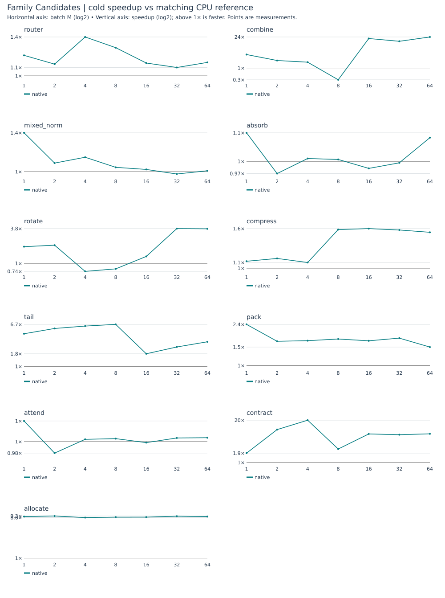

Show numeric data

| Series (×) | Trend by M¹ | M1 | M2 | M4 | M8 | M16 | M32 | M64 |
| --- | --- | --- | --- | --- | --- | --- | --- | --- |
| router · native | ▄▂█▆▂▁▂ | 1.2 | 1.11 | 1.4 | 1.28 | 1.12 | 1.08 | 1.12 |
| combine · native | ▅▄▄▁█▇█ | 3.94 | 2.15 | 1.81 | 0.301 | 20.2 | 15.2 | 23.6 |
| mixed_norm · native | █▃▄▂▂▁▂ | 1.41 | 1.08 | 1.14 | 1.04 | 1.02 | 0.979 | 1.01 |
| absorb · native | █▁▄▃▂▃▇ | 1.07 | 0.971 | 1.01 | 1 | 0.983 | 0.996 | 1.06 |
| rotate · native | ▅▅▁▁▃██ | 1.9 | 2 | 0.737 | 0.812 | 1.31 | 3.78 | 3.75 |
| compress · native | ▁▂▁███▇ | 1.08 | 1.11 | 1.07 | 1.53 | 1.55 | 1.53 | 1.49 |
| tail · native | ▆▇██▁▃▄ | 4.38 | 5.56 | 6.21 | 6.69 | 1.77 | 2.41 | 3.05 |
| pack · native | █▃▃▃▃▄▁ | 2.44 | 1.69 | 1.71 | 1.78 | 1.71 | 1.81 | 1.49 |
| attend · native | █▁▄▄▃▄▄ | 1.03 | 0.982 | 1 | 1 | 0.998 | 1.01 | 1.01 |
| contract · native | ▁▆█▂▅▅▅ | 1.93 | 10.2 | 19.8 | 2.59 | 7.51 | 7.12 | 7.57 |
| allocate · native | ▅█▁▃▃▇▅ | 9.02 | 9.3 | 8.56 | 8.77 | 8.77 | 9.21 | 9.03 |

¹ One tick per measured batch size, in ascending order; height is log-scaled within each row. Numeric columns show selected batch sizes.

<!-- /glm5-inline -->

Warm-cache measurements

<!-- glm5-inline -->

Show numeric data

| Series (×) | Trend by M¹ | M1 | M2 | M4 | M8 | M16 | M32 | M64 |
| --- | --- | --- | --- | --- | --- | --- | --- | --- |
| router · native | █▅▆▅▂▂▁ | 1.16 | 1.14 | 1.15 | 1.15 | 1.12 | 1.12 | 1.12 |
| combine · native | ▅▄▃▁███ | 3.29 | 1.79 | 1.24 | 0.369 | 22.5 | 21.1 | 19.5 |
| mixed_norm · native | █▆▆▁▃▃▃ | 1.6 | 1.35 | 1.28 | 0.833 | 1.01 | 1.02 | 1.04 |
| absorb · native | ▁▇█▄▅▄▃ | 0.944 | 1.02 | 1.03 | 0.984 | 0.996 | 0.982 | 0.972 |
| rotate · native | █▇▁▂▄██ | 3.41 | 2.51 | 0.49 | 0.727 | 1.34 | 3.76 | 3.92 |
| compress · native | ▂▁▃▇▇█▇ | 1.09 | 1.05 | 1.2 | 1.54 | 1.53 | 1.61 | 1.54 |
| tail · native | ▇█▅▅▁▁▃ | 14.9 | 19.3 | 6.23 | 7.86 | 1.91 | 1.97 | 3.27 |
| pack · native | █▇▆▆▅▄▁ | 2.71 | 2.46 | 2.19 | 2.25 | 2.01 | 1.92 | 1.36 |
| attend · native | ▁▆▄▃██▇ | 0.973 | 0.993 | 0.985 | 0.982 | 1 | 1 | 1 |
| contract · native | ▁▇█▁▃▃▄ | 1.97 | 28.2 | 37.9 | 2.3 | 4.67 | 5.37 | 6.86 |
| allocate · native | █▄▄▃▃▃▁ | 52.1 | 31.3 | 33 | 29.8 | 29.3 | 28.4 | 22.1 |

¹ One tick per measured batch size, in ascending order; height is log-scaled within each row. Numeric columns show selected batch sizes.

<!-- /glm5-inline -->

## From isolated kernels to their callers

Build **407601**, EMR array **407602**. Each caller was checked against its CPU reference for M=1–64; seven batch sizes were timed in three processes. The cache tests also checked that invalid active writes left prior bytes intact and that reads rejected invalid selected rows, not unused rows.

| Caller | Cold speedup range | Interpretation |
|---|---:|---|
| MLA value expansion | 0.95–1.07× | Wrapping the existing batched GEMM did not consistently improve it. |
| Masked latent-KV write | 1.81–6.86× | The pack gain survives active-row validation, packing and committing to the cache. |
| Selected latent-KV read | 1.92–12.60× | Gather and convert only the selected packed rows, validating scales and BF16 outputs. |
| Cached selected attention | 1.99–2.10× | Replacing the cache read alone roughly halved the caller time. The workload cycles through lengths 2047, 2048, 2049, 2175 and padding; it is not the no-prefix BF16 path. |
| Pooled compression and cache write | 0.95–1.07× | The rotation change alone is approximately neutral once mask handling and writes are included. |
| Indexer projection and quantization | 0.93–1.87× | Mixed by batch size; the full projection caller reached 1.87× at M=64. |

<!-- glm5-inline -->

Show numeric data

| Series (×) | Trend by M¹ | M1 | M2 | M4 | M8 | M16 | M32 | M64 |
| --- | --- | --- | --- | --- | --- | --- | --- | --- |
| expand · candidate | █▅▁▅█▅▅ | 1.07 | 1.01 | 0.951 | 1.02 | 1.07 | 1.02 | 1.02 |
| write · candidate | ▁▁▁██▇▅ | 1.81 | 1.89 | 1.87 | 6.86 | 6.27 | 5.22 | 3.75 |
| read · candidate | ▃▃▃██▆▁ | 3.54 | 3.58 | 3.43 | 12.6 | 11.5 | 7.99 | 1.92 |
| attention · candidate | █▁▂██▇▆ | 2.1 | 1.99 | 2.01 | 2.1 | 2.1 | 2.09 | 2.07 |
| pool_write · candidate | ▁█▅▆▄▄▅ | 0.946 | 1.07 | 1.01 | 1.03 | 1 | 1 | 1.01 |
| index_proj · candidate | ▂▂▁▂▃██ | 1.01 | 1.03 | 0.929 | 1.02 | 1.14 | 1.84 | 1.87 |

¹ One tick per measured batch size, in ascending order; height is log-scaled within each row. Numeric columns show selected batch sizes.

<!-- /glm5-inline -->

Warm-cache measurements

<!-- glm5-inline -->

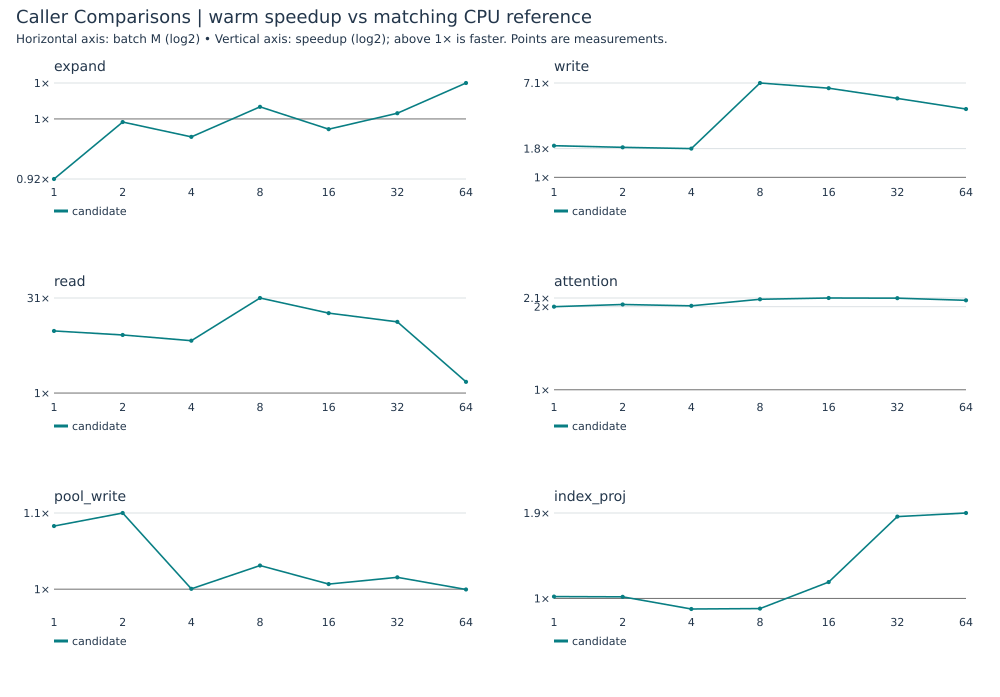

Show numeric data

| Series (×) | Trend by M¹ | M1 | M2 | M4 | M8 | M16 | M32 | M64 |
| --- | --- | --- | --- | --- | --- | --- | --- | --- |
| expand · candidate | ▁▅▄▆▅▆█ | 0.922 | 0.996 | 0.976 | 1.02 | 0.986 | 1.01 | 1.05 |
| write · candidate | ▁▁▁█▇▆▅ | 1.93 | 1.87 | 1.82 | 7.15 | 6.41 | 5.18 | 4.15 |
| read · candidate | ▅▅▄█▇▆▁ | 9.52 | 8.23 | 6.69 | 31.5 | 18.2 | 13.2 | 1.5 |
| attention · candidate | ▁▃▂▇██▆ | 1.97 | 2.01 | 1.99 | 2.1 | 2.12 | 2.12 | 2.08 |
| pool_write · candidate | ▇█▁▃▁▂▁ | 1.12 | 1.14 | 1 | 1.04 | 1.01 | 1.02 | 0.999 |
| index_proj · candidate | ▂▂▁▁▃██ | 1.01 | 1.01 | 0.924 | 0.927 | 1.13 | 1.85 | 1.9 |

¹ One tick per measured batch size, in ascending order; height is log-scaled within each row. Numeric columns show selected batch sizes.

<!-- /glm5-inline -->

## Roofline comparison

**Unlike the speedup plots, this chart shows absolute latency; lower is better.** Each panel compares the frozen CPU reference and native candidate from array **407573** with a provisional model at the seven measured batch sizes. The solid lines use cache-flushed timings (median of three process medians). These are the eleven isolated operations, not complete families or serving calls.

<!-- glm5-inline -->

Show numeric data

| Series (µs) | Trend by M¹ | M1 | M2 | M4 | M8 | M16 | M32 | M64 |
| --- | --- | --- | --- | --- | --- | --- | --- | --- |
| router · ref | ▁▁▄▃▇▇█ | 588 | 595 | 848 | 812 | 1.27e+03 | 1.39e+03 | 1.56e+03 |
| router · native | ▁▂▂▃▇██ | 492 | 537 | 604 | 635 | 1.14e+03 | 1.29e+03 | 1.39e+03 |
| router · model | ▁▁▁▁▁▂█ | 25.7 | 25.7 | 25.8 | 26 | 26.4 | 27.1 | 45.9 |
| combine · ref | ▁▁▂▂███ | 101 | 120 | 148 | 205 | 1.09e+04 | 1.09e+04 | 1.11e+04 |
| combine · native | ▁▃▃█▇█▇ | 25.7 | 55.7 | 82 | 679 | 537 | 714 | 470 |
| combine · model | ▁▂▃▅▆▇█ | 0.445 | 0.89 | 1.78 | 3.56 | 7.12 | 14.2 | 28.5 |
| mixed_norm · ref | ▁▁▁▄███ | 135 | 141 | 161 | 612 | 6.45e+03 | 6.26e+03 | 6.45e+03 |
| mixed_norm · native | ▁▂▂▄███ | 96 | 131 | 142 | 589 | 6.33e+03 | 6.39e+03 | 6.4e+03 |
| mixed_norm · model | ▁▂▃▄▆▇█ | 0.445 | 0.846 | 1.65 | 3.25 | 6.46 | 12.9 | 25.7 |
| absorb · ref | ▁▆█████ | 772 | 3.22e+03 | 6.36e+03 | 6.36e+03 | 6.25e+03 | 6.18e+03 | 6.77e+03 |
| absorb · native | ▁▆█████ | 720 | 3.31e+03 | 6.32e+03 | 6.33e+03 | 6.36e+03 | 6.2e+03 | 6.39e+03 |
| absorb · model | ▁▁▁▂▃▅█ | 91.7 | 92.2 | 93.3 | 95.4 | 99.7 | 108 | 125 |
| rotate · ref | ▁▂▂▃▆██ | 206 | 295 | 380 | 929 | 7.64e+03 | 2.23e+04 | 2.23e+04 |
| rotate · native | ▁▂▄▅███ | 109 | 147 | 515 | 1.14e+03 | 5.85e+03 | 5.89e+03 | 5.94e+03 |
| rotate · model | ▁▂▃▅▆▇█ | 0.0675 | 0.135 | 0.27 | 0.54 | 1.08 | 2.16 | 4.32 |
| compress · ref | ▁▁▁▆▅▆█ | 2.23e+03 | 2.3e+03 | 2.28e+03 | 3.33e+03 | 3.27e+03 | 3.48e+03 | 4.16e+03 |
| compress · native | ▁▁▂▂▂▃█ | 2.06e+03 | 2.06e+03 | 2.14e+03 | 2.17e+03 | 2.11e+03 | 2.28e+03 | 2.79e+03 |
| compress · model | ▁▂▃▄▅▇█ | 0.0285 | 0.0459 | 0.0808 | 0.15 | 0.29 | 0.568 | 1.13 |
| tail · ref | ▁▂▂▃▇▇█ | 116 | 189 | 197 | 265 | 844 | 1.1e+03 | 1.43e+03 |
| tail · native | ▁▂▁▂███ | 26.5 | 34 | 31.7 | 39.6 | 476 | 456 | 469 |
| tail · model | ▁▂▃▅▆▇█ | 0.089 | 0.178 | 0.356 | 0.713 | 1.43 | 2.85 | 5.7 |
| pack · ref | ▁▂▂▂▃▄█ | 171 | 199 | 216 | 254 | 310 | 440 | 1.13e+03 |
| pack · native | ▁▃▃▃▄▅█ | 70.1 | 118 | 126 | 143 | 181 | 243 | 759 |
| pack · model | ▁▂▃▅▆▇█ | 0.00843 | 0.0169 | 0.0337 | 0.0675 | 0.135 | 0.27 | 0.54 |
| attend · ref | ▁▂▃▄▆▇█ | 2.43e+03 | 4.57e+03 | 8.88e+03 | 1.8e+04 | 3.59e+04 | 7.2e+04 | 1.45e+05 |
| attend · native | ▁▂▃▄▆▇█ | 2.35e+03 | 4.66e+03 | 8.85e+03 | 1.79e+04 | 3.59e+04 | 7.16e+04 | 1.44e+05 |
| attend · model | ▁▂▃▅▆▇█ | 10.2 | 20.5 | 41 | 81.9 | 164 | 328 | 655 |
| contract · ref | ▁▄▆▆███ | 68 | 423 | 1.11e+03 | 1.04e+03 | 3.03e+03 | 2.98e+03 | 3.26e+03 |
| contract · native | ▁▁▂████ | 35.1 | 41.5 | 56 | 399 | 404 | 418 | 431 |
| contract · model | ▁▂▃▅▆▇█ | 0.223 | 0.445 | 0.89 | 1.78 | 3.56 | 7.12 | 14.2 |
| allocate · ref | ▄▆▁▄█▇▇ | 221 | 228 | 208 | 222 | 238 | 233 | 234 |
| allocate · native | ▁▁▁▄█▄▅ | 24.5 | 24.5 | 24.3 | 25.3 | 27.1 | 25.3 | 25.9 |
| allocate · model | ▁▂▃▅▆▇█ | 0.000174 | 0.000348 | 0.000739 | 0.00148 | 0.00296 | 0.00591 | 0.0118 |

¹ One tick per measured batch size, in ascending order; height is log-scaled within each row. Numeric columns show selected batch sizes.

<!-- /glm5-inline -->

**What the dashed line means.** Calibration job **406478** measured large-array triad bandwidth of **184.04 GB/s** and cache-warm library GEMM rates of **3.29 TFLOP/s FP32** and **17.59 TFLOP/s BF16** on EMR. For router, absorption and gathered attention, model time is `max(unique logical bytes / triad bandwidth, GEMM FLOPs / matching dtype rate)`. Count two FLOPs per multiply-add; attention includes both contractions and counts the fixture's shared KV input once. For the other eight panels, the line is **only** useful input/output bytes divided by triad bandwidth, not a compute ceiling. The model excludes temporary traffic, conversion, selection, validation and dispatch. Logical bytes are not DRAM-counter measurements.

**What to investigate first.** Expert combine at M=8 takes **679 µs** native versus **205 µs** baseline, despite a byte model of just **3.56 µs**. At M=64 the same candidate takes **470 µs** versus **11,102 µs** baseline. Test serial versus threaded combine around M=8 before changing dispatch. For MLA absorption at M=64, native takes **6.39 ms**, baseline **6.77 ms**, and the model gives **0.125 ms**. Time the identical strided BF16 batched GEMM without the wrapper, then add validation back; this separates a shape/layout limitation from wrapper cost.

**Qualification still pending.** The calibration was a separate run, not a shape-matched measurement on every timing node. Do not read the gap as recoverable speedup. For credible efficiency percentages we need matched-node, matched-thread streamed and resident measurements: exact-layout GEMM for the contractions; copy/gather, conversion and dispatch measurements for the other paths. Warm timings need a separate cache-resident reference, not the triad line.

[Absolute timings, work counts and model times (CSV)](plots/glm5/roofline_cold.csv) · [Work formulas, source hashes and renderer](../plugin/validate/plot_glm5_roof.py). Run `python3 -B plugin/validate/plot_glm5_roof.py` to render from the CSV; pass the campaign reference-probes directory to regenerate it from the pinned jobs.

## All 64 batch sizes and follow-up callers

EMR array **407619** completed all eleven isolated C++ candidates at **every integer M=1–64**. Each point below compares cache-flushed reference and candidate timings on the same node (three processes, three samples per process). Five candidates had a faster median at all 64 sizes: pooled compression excluding writes, causal tail append, latent pack, four-stream contraction and allocation-index calculation. This is a pointwise median comparison, not confidence intervals or qualification of five complete families. The other six had at least one slower median.

<!-- glm5-inline -->

Show numeric data

| Series (×) | Trend by M¹ | M1 | M2 | M4 | M8 | M16 | M32 | M64 |
| --- | --- | --- | --- | --- | --- | --- | --- | --- |
| op: router | ▇▂▂█▇▄█▁▃▆▃▃▆▄▃▆▃▃▆▁▃▁▁▄▄▆▅▂▄▅▃▄▃▂▃▂▂▃▄▆▁▅▃▃▂▃▅▃▁▄▄▆▃▄▄▅▃▃▂▁▃▂▃▄ | 1.35 | 1.02 | 1.41 | 0.977 | 1.24 | 1.14 | 1.15 |
| op: combine | ▄▄▄▄▄▃▃▁▇█▇█▇█▇███▇██▇████▇████▇▇█▇█▇▇▇▇█▇███▇█▇▇█▇▇▇▇▇▇▇▇▇█▇███ | 2.33 | 2.22 | 1.89 | 0.399 | 23 | 17.9 | 23.4 |
| op: mixed_norm | █▆▆▅▆▇▇▅▂▂▂▃▂▁▂▁▂▂▁▂▂▂▂▂▂▁▂▂▁▂▃▂▁▂▃▃▂▂▁▂▂▂▂▂▂▂▂▂▁▁▂▁▂▂▂▂▁▂▂▂▂▂▂▁ | 1.26 | 1.18 | 1.12 | 1.12 | 0.969 | 1.02 | 0.982 |
| op: absorb | ▆▄▅▅▅▅▄▄▄▄▄▅▄▅▃▆▄▄▃▅▃▅▃▅▄▅▄▂▅▆▆▆▂▄▄▆▅▂▃▆▅▄█▄▃▄▃▄▄▅▆▅▂▅▃▄▇▄▅▁▃▃▄▆ | 1.03 | 0.997 | 1.01 | 0.999 | 1.03 | 1.03 | 1.03 |
| op: rotate | ▆▅▆▁▂▂▂▂▄▄▄▄▄▄▄▄████████████████████████████████████████████████ | 2.13 | 2.05 | 0.665 | 0.807 | 1.29 | 3.73 | 3.82 |
| op: compress | ▁▃▂▁▂▅▇▆▆▇▇▆▇▆▆▆▆▆▇▇▇▆▆▆▇▆▆▆▆▅▇▆▆▆▆▇▅▆▇▆▇▆▆▇▆▆▆▆▇▇▇▇▆▇▆▇▇▆▆▆▆▇█▅ | 1.01 | 1.16 | 1.05 | 1.5 | 1.57 | 1.56 | 1.46 |
| op: tail | ▇▇▇▇▇▇▇████████▂▂▂▁▂▄▂▂▂▂▂▃▂▂▃▂▂▃▄▃▄▂▃▄▃▃▄▃▂▄▃▃▄▃▂▄▄▄▄▄▄▅▄▄▄▅▃▃▅ | 5.39 | 5.42 | 5.96 | 6.67 | 1.79 | 1.65 | 3.18 |
| op: pack | ▄▄▅▄▄▄▅▃▄▄▅▃▄▃▄▄█▇▄▄▄▄▁▆▄▄▅▄▅▄▅▄▄▇▇▅▄█▅▃▃▆▅▄▃▅▄▅▄▄▄▄▃▅▅▄▅▆▄▄▃▄▄▂ | 1.8 | 1.84 | 1.75 | 1.72 | 1.81 | 1.85 | 1.55 |
| op: attend | ▅▃▅█▁▃▂▆▂▄▄▅▅▃▄▃▄▅▄▄▂▄▃▂▅▅▂▄▄▄▄▃▅▄▃▃▃▄▄▄▄▄▄▅▄▃▄▅▃▄▄▄▄▄▄▄▄▄▄▄▄▄▄▄ | 1.01 | 0.992 | 1.04 | 1.02 | 0.996 | 0.999 | 1 |
| op: contract | ▂▇██▇▇▇▁▅▅▅▅▅▄▅▄▄▅▄▅▄▅▅▄▄▄▅▅▅▄▄▄▄▅▄▄▅▄▄▄▄▄▄▅▄▅▄▄▄▅▄▅▃▄▅▄▃▄▄▄▅▅▅▄ | 2.38 | 13.6 | 18.1 | 1.85 | 5.3 | 5.66 | 5.04 |
| op: allocate | █▁▂▃▄▄▃▃▃▄▄▅▃▄▆▃▄▅▃▃▄▅▄▄▆▂▆▅▅▄▄▃▆▅▄▅▄▅▇▄▃▄▄▃▂▃▄▄▅▃▃▃▅▂▃▃▅▃▃█▃▄▇▅ | 10.5 | 7.77 | 8.56 | 8.52 | 8.52 | 8.55 | 9.29 |

¹ One tick per measured batch size, in ascending order; height is log-scaled within each row. Numeric columns show selected batch sizes.

<!-- /glm5-inline -->

[Speedups, including losses](plots/glm5/dense_sweep.csv). The roofline section above remains provisional. The new same-fixture component controls (matrix multiply or first-input copy) are not complete-operation ceilings.

**Caller checks.** Job **407631** exercised new no-prefix BF16 attention and pooled scoring, selection and physical-token remapping. Cold median paired speedups were **1.08×** for the tested extend caller and **1.22× / 1.23×** for short/long decode. Job **407632** measured **1.39–1.53×** for four runtime preparation transitions, and **1.16–1.90×** for final contraction/norm/head on tested *nonempty* selected-row sets. Embedding expansion was mixed (**0.73–3.04×**), so universal replacement is not supported. These are synthetic caller tests, not whole-model results.

**Full-width expert and mHC retry.** Job **407630** exposed an empty-batch layout mismatch in mHC pre: an in-place multiply retained the wrong stride. Restoring the reference’s allocating multiply fixed the layout without relaxing the test. In **407634**, three EMR processes matched the synthetic CPU reference’s output bytes and layouts for mHC pre/post at every M=0–64, and for the full-width MoE and joined mHC-pre → MoE → mHC-post caller at M=0, 1, 2, 4, 8, 16, 32 and 64. The two full-width callers were **1.36–1.42× faster cold** across the seven nonempty anchors. This is not an all-M timing result or real-checkpoint accuracy evidence.

## Full-width expert sweep and small-batch fixes

EMR jobs **407638–407641** split the 64 nonempty batch sizes across four nodes. The joined mHC-pre → MoE → mHC-post caller matched reference bytes and layouts and was **1.37–1.47× faster cold at every M**. MoE alone was **1.33–1.46×**, and mHC post **4.87–27.64×**. Isolated mHC pre had a slower median at **8/64** sizes (minimum **0.985×**); the joined result does not justify replacing standalone pre unconditionally. Paired measurements on synthetic full-width W8A8 weights; median of three process medians per path, three cold samples per process. These are caller results, not tokens/s.

<!-- glm5-inline -->

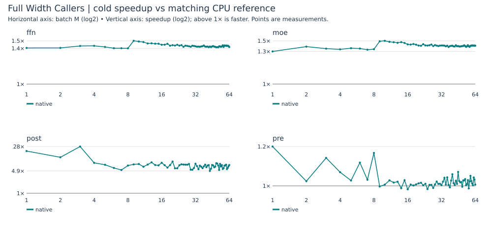

Show numeric data

| Series (×) | Trend by M¹ | M1 | M2 | M4 | M8 | M16 | M32 | M64 |
| --- | --- | --- | --- | --- | --- | --- | --- | --- |
| ffn | ▁▁▃▃▂▁▁▁█▇▇▆▆▅▅▄▄▅▃▄▄▄▄▄▂▃▃▃▂▃▃▃▃▃▂▃▃▄▃▃▃▂▃▂▃▃▃▂▂▂▂▃▃▂▃▄▂▄▃▄▃▃▃▂ | 1.38 | 1.38 | 1.4 | 1.37 | 1.42 | 1.4 | 1.39 |
| moe | ▁▄▃▂▃▃▂▂██▇▇▇▇▇▆▆▆▅▅▅▆▅▅▅▆▅▅▅▅▅▅▅▅▄▅▄▄▅▅▄▄▅▄▅▄▄▄▅▅▅▅▄▄▅▄▄▅▅▅▅▅▅▅ | 1.33 | 1.39 | 1.35 | 1.36 | 1.41 | 1.4 | 1.4 |
| post | ▇▅█▃▃▂▁▃▃▃▂▃▃▃▃▃▃▂▃▄▂▂▃▃▃▃▃▃▁▁▂▃▂▂▃▂▂▂▃▂▃▃▁▂▃▃▂▂▃▃▃▁▃▂▃▂▂▃▃▃▂▂▂▃ | 20 | 12.8 | 8.68 | 7.16 | 8.71 | 8.17 | 7.42 |
| pre | █▂▆▄▂▅▃▇▁▂▂▂▂▁▂▁▂▂▂▂▂▂▂▁▂▂▁▂▂▂▂▂▂▃▂▃▂▁▂▃▂▂▂▂▄▂▂▂▁▂▂▃▂▂▃▁▂▃▂▂▂▃▃▂ | 1.19 | 1.02 | 1.06 | 1.16 | 0.985 | 1 | 1.01 |

¹ One tick per measured batch size, in ascending order; height is log-scaled within each row. Numeric columns show selected batch sizes.

<!-- /glm5-inline -->

[Process medians and job IDs](plots/glm5/full_width_sweep.csv) · [Chart renderer](../plugin/validate/plot_glm5_caller_sweep.py)

**Small-batch dispatch.** Job **407642** kept expert combine serial through M=8 and index rotation serial through 256 input rows. Both beat their matched reference at all 64 sizes (**1.63–26.59×** and **1.29–3.95×** respectively). Compression, which also calls rotation, had one cold loss (**0.992×**); an isolated rotation win does not certify compression. Job **407644** used a serial AVX-512 embedding path through M=16: at M=8 it took **59–65 μs** cold. At vocabulary width 154,880 the head matched output bytes for **2,144** batch/selected-count combinations; timings on boundary cases do not cover every combination.

**Measured EMR calibration, job 407645.** On 16 physical cores in NUMA domain 0, triad reached **184.02 GB/s**. Register-resident BF16/FP32 compute reached **45.57/3.746 TFLOP/s**, versus **12.78/2.991 TFLOP/s** with streamed weights in dense linear. Shape matters: cold M=64 MLA absorption BMM measured **0.884 TFLOP/s** and router logits **0.230 TFLOP/s**. Those last two are rates for the matching contractions, not ceilings for validation, routing or the whole caller. The earlier roofline chart retains its original calibration and caveats.

## Ragged indexer extend and mixed decode

EMR job **407646** compared the opt-in native ragged gather, scoring and token remap with the CPU reference. Output and committed cache/ring bytes matched on ten synthetic caller fixtures, including padding, zero complete pools and tied cutoff scores. The table shows cold speedup as the median of three **paired process ratios**, with their range. It excludes the upstream projection chain.

| Caller fixture | Median cold speedup | Process range |
|---|---:|---:|
| Fresh ragged extend, 64 rows | 1.25× | 1.22–1.29× |
| Extend at cutoff | 1.06× | 1.04–1.06× |
| Mixed decode, 64 rows | 1.58× | 1.57–1.62× |
| Extend, no complete pools | 1.02× | 0.84–1.13× |
| Extend, no active rows | 1.05× | 0.91–1.05× |

The degenerate extend cases did not consistently beat the reference. This is not an all-context speedup or a change to serving dispatch.

**Including projection and quantization.** Job **407647** used frozen layer-3 checkpoint weights and identical synthetic inputs for both paths. Across ten fixtures, projection outputs, selected indices and committed cache/ring bytes matched the CPU reference. Cold speedup for the complete indexer caller was **1.17×, 1.18× and 1.27×** at decode M=7, 8 and 9, and **1.60×** at M=33. Active ragged extend measured **1.06–1.61×**. Singleton decode and extend with no completed pools were approximately neutral. All-padding decode was slower in each process (**0.955–0.992×**, median **0.965×**). These are paired process ratios, not full-layer or serving measurements.

**All-padding decode follow-up.** In EMR job **407659**, the revised opt-in indexer reduced all-padding M=8 cold latency from **5.99 to 4.36 ms** versus the CPU reference. Paired speedup was **1.37×** (three processes: **1.36–1.38×**). With one live row, median speedup ranged from essentially neutral to **2.22×** across the tested fixtures. Active M=8 and M=33 retained **1.17×** and **1.61×**. Projection outputs, selected indices and committed cache/ring bytes matched on ten synthetic decode fixtures. Invalid-shape, dtype and nonfinite-input tests still rejected invalid calls without state changes. This resolves the reported M=8 regression, not every possible batch/context case.

**Standalone mHC pre holdout.** The initial fused candidate in **407664** regressed at M=8 warm and cold. For **407897** the rule was fixed before timing: use the archived native implementation at M=8 and the fused implementation elsewhere. On fresh inputs, no measured median was slower than the frozen CPU reference across **64 batch sizes × two cache conditions**. This closes the measured standalone regression, not the entire family.

## MLA absorption and expansion

Job **407924** retained the strided BF16 batched GEMM and changed the validation around it. The C++ path scans dense BF16 storage for nonfinite exponent bits without allocating an intermediate mask; non-dense views still use the stride-aware check. Compared with the frozen CPU reference, absorption was **1.10–6.19× faster cold**, and expansion **1.41–6.00× faster cold**. Both improved at every M=1–64 across the three-process median timings and matched the reference output bytes and layouts. Tests also checked that nonfinite inputs or results were rejected and unused storage outside a view was ignored. These figures measure the projections including validation, not the complete MLA layer.

<!-- glm5-inline -->

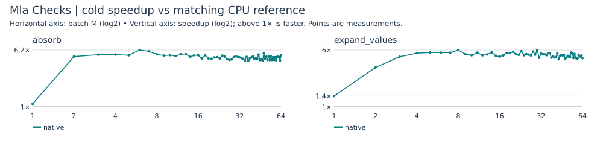

Show numeric data

| Series (×) | Trend by M¹ | M1 | M2 | M4 | M8 | M16 | M32 | M64 |
| --- | --- | --- | --- | --- | --- | --- | --- | --- |
| op: absorb | ▁▇▇▇▇██▇▇▇▇▇▇▇▇▇▇▇▇▇▇▇▇▇▇▇▇▇▇▇▇▇▇▇▇▇▇▇▇▇▇▇▇▇▇▇▇█▇▇▇▇▇▇▇▇▇▇▇▇▇▇▇▇ | 1.1 | 5.03 | 5.35 | 5.4 | 5.24 | 4.9 | 5.22 |
| op: expand_values | ▁▅▇█████▇▇█▇▇█▇▇▇███▇▇█▇▇▇▇█▇█▇▇▇▇▇██▇▇▇▇█▇▇▇▇▇▇▇▇▇▇█▇▇▇▇▇▇▇▇▇▇▇ | 1.41 | 3.46 | 5.43 | 6 | 4.88 | 5.38 | 4.64 |

¹ One tick per measured batch size, in ascending order; height is log-scaled within each row. Numeric columns show selected batch sizes.

<!-- /glm5-inline -->

[Exact cold speedups (CSV)](plots/glm5/mla_checks.csv)

## Packed FP8 projections: all seven shapes

EMR job **407926** compared the existing optimized kernel (406483) to the frozen native reference (405982) on representative packed checkpoint weights for **all seven FP8 text-graph projection shapes**. Outputs matched in bytes and dtype at every M=1–64. Across 1,792 comparisons (seven shapes × 64 batch sizes × warm/cold × two timed boundaries), no median paired speedup fell below 1×. Cold speedups were **1.40–6.61×** for matrix multiplication alone and **1.27–5.55×** including activation quantization. This closes the FP8 projection **shape sweep**, not serving or the overall kernel phase.

<!-- glm5-inline -->

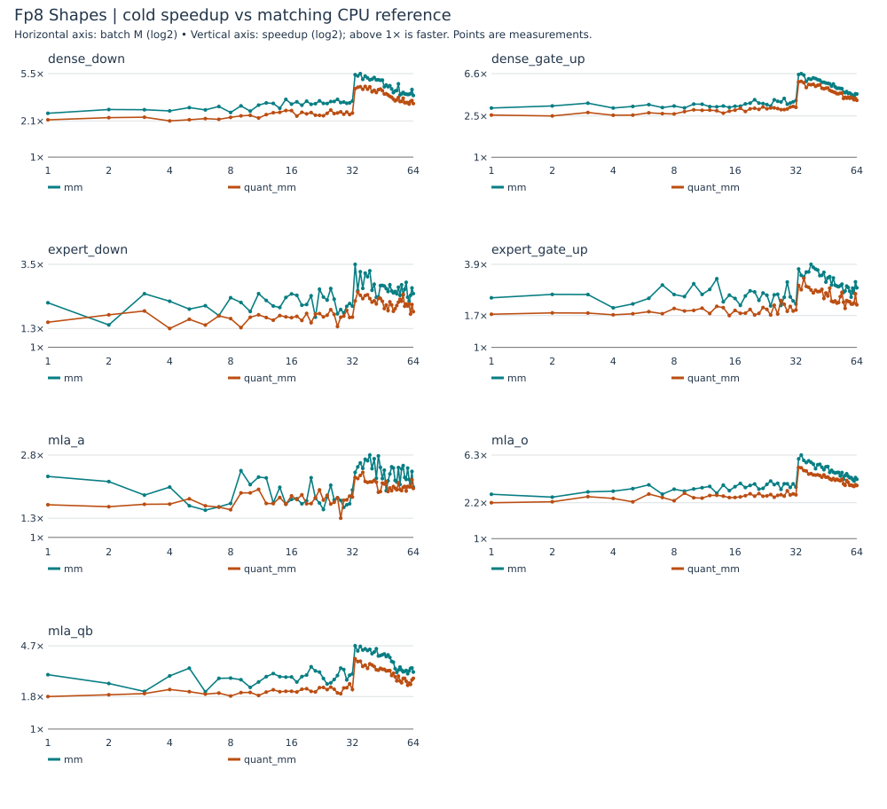

Show numeric data

| Series (×) | Trend by M¹ | M1 | M2 | M4 | M8 | M16 | M32 | M64 |
| --- | --- | --- | --- | --- | --- | --- | --- | --- |
| dense_down · mm | ▁▂▂▁▂▂▂▁▂▁▂▃▃▂▃▃▃▂▃▃▃▃▃▃▃▃▃▃▃▃▃▃███▇█▇▇▇▇▇▇▇▇▆▆▆▆▅▅▅▅▆▄▄▅▄▄▄▄▄▅▄ | 2.46 | 2.65 | 2.58 | 2.5 | 2.97 | 3.16 | 3.54 |
| dense_down · quant_mm | ▁▂▂▁▁▁▁▂▂▂▂▂▃▃▃▃▂▃▂▃▂▂▂▃▃▂▃▃▂▃▂▃███▇█▇█▇▇▇▇▇▇▆▇▆▆▆▅▅▅▆▅▅▆▅▅▅▄▅▅▅ | 2.15 | 2.25 | 2.1 | 2.26 | 2.6 | 2.47 | 3 |
| dense_gate_up · mm | ▁▁▂▁▁▂▁▁▁▂▂▁▁▁▁▁▁▂▂▃▂▂▂▁▃▂▂▃▂▂▂▃███▆▇▇▇▇▇▇▆▆▆▆▆▅▆▅▅▅▅▅▄▄▄▄▄▄▄▃▄▄ | 3.04 | 3.19 | 3.04 | 3.18 | 3.17 | 3.6 | 4.17 |
| dense_gate_up · quant_mm | ▁▁▂▁▁▂▁▁▂▂▂▂▂▂▂▂▃▂▂▃▂▃▂▃▃▂▂▂▂▃▃▃███▇▇▇▇▇▇▇▇▆▇▇▆▆▆▆▆▅▆▆▅▅▅▅▅▅▅▄▅▄ | 2.59 | 2.54 | 2.58 | 2.66 | 2.9 | 3.09 | 3.62 |
| expert_down · mm | ▄▁▅▄▃▃▂▄▄▃▅▄▃▃▄▅▄▃▃▄▂▅▄▄▅▄▂▃▂▃▃▃█▅▇▅▇▇▇▅▆▄▄▆▆▅▅▅▆▅▅▅▅▅▄▆▄▅▆▄▄▄▅▅ | 1.96 | 1.4 | 2.01 | 2.12 | 2.25 | 1.87 | 2.26 |
| expert_down · quant_mm | ▂▄▄▁▃▂▃▃▁▃▄▃▃▃▃▃▃▃▄▂▄▄▃▄▅▄▁▃▃▄▃▃▆█▇▇▇▇▇▆▆▆▇▇▆▅▆▄▆▆▄▅▅▆▇▆█▅▆▅▆▄▆▄ | 1.46 | 1.64 | 1.33 | 1.54 | 1.57 | 1.58 | 1.72 |
| expert_gate_up · mm | ▃▃▃▁▂▃▅▃▃▅▃▄▆▂▃▃▁▃▄▄▂▃▃▁▃▃▁▃▅▃▂▂▇▆▆▇▇██▇▇▆▆▇▅▆▆▅▆▅▅▄▅▅▃▄▅▄▄▃▄▃▅▄ | 2.27 | 2.4 | 1.92 | 2.39 | 2.24 | 2.05 | 2.67 |
| expert_gate_up · quant_mm | ▁▂▁▁▁▂▁▂▂▂▂▁▃▂▁▂▁▁▂▁▁▃▂▁▃▁▄▃▂▃▂▂▇▆█▆▆▆▅▆▅▆▆▄▅▅▆▄▄▄▃▃▅▅▄▂▄▄▄▃▃▃▅▃ | 1.73 | 1.77 | 1.71 | 1.9 | 1.84 | 1.86 | 2.02 |
| mla_a · mm | ▅▅▃▄▂▁▁▂▆▄▅▅▂▄▂▂▂▂▂▅▃▂▁▃▄▂▃▂▁▂▂▄▆▇▇▆▇▇█▆█▅█▆▅▆▃▅▆▇▆▅▅▆▄▆▇▅▅▆▅▄▆▄ | 2.12 | 1.99 | 1.86 | 1.52 | 1.6 | 1.79 | 1.85 |
| mla_a · quant_mm | ▃▃▃▃▄▃▃▂▅▅▅▃▃▄▃▄▄▅▃▃▄▅▄▄▃▃▄▁▄▄▄▄▇▇██▇▆▇▇▇▇▅▅▆▆▇▅▆▅▆▆▅▆▅▅▆▆▅▆▆▆▇▆ | 1.49 | 1.46 | 1.51 | 1.41 | 1.67 | 1.64 | 1.82 |
| mla_o · mm | ▁▁▂▂▂▃▁▂▂▂▃▃▂▃▂▃▃▃▃▃▂▂▃▄▃▃▂▃▃▃▃▃▇█▇▇▇▇▆▆▆▆▆▆▆▆▅▅▅▅▅▅▅▅▄▅▅▄▄▄▄▄▄▄ | 2.65 | 2.49 | 2.84 | 2.97 | 3.14 | 3.1 | 3.69 |
| mla_o · quant_mm | ▁▁▂▂▁▃▂▁▃▂▂▂▂▂▂▂▂▂▃▂▃▂▂▃▂▂▃▂▃▃▃▃██▇▇▇▇▇▆▇▆▆▇▆▆▆▆▆▅▆▅▅▆▅▄▅▅▄▅▄▄▅▄ | 2.2 | 2.25 | 2.42 | 2.3 | 2.47 | 2.62 | 3.21 |
| mla_qb · mm | ▄▂▁▃▅▁▃▃▃▂▂▃▄▃▃▃▂▃▄▅▄▄▃▂▂▃▃▅▄▃▄▄█▇█▇█▇▇▇▇█▆▇▇▇▆▇▆▆▆▅▄▄▅▄▄▄▄▄▄▅▅▄ | 2.74 | 2.33 | 2.68 | 2.58 | 2.63 | 2.78 | 2.88 |
| mla_qb · quant_mm | ▁▁▂▂▂▁▂▁▂▂▁▂▂▂▂▂▂▂▂▂▂▃▃▂▃▂▂▂▃▃▃▂█▇█▇▇▆▇▇▇▆▆▆▆▆▆▆▆▅▅▅▄▅▄▄▄▄▄▃▃▃▄▄ | 1.83 | 1.89 | 2.08 | 1.85 | 2.02 | 2.08 | 2.56 |

¹ One tick per measured batch size, in ascending order; height is log-scaled within each row. Numeric columns show selected batch sizes.

<!-- /glm5-inline -->

[Per-coordinate timings and paired process speedup ranges](plots/glm5/fp8_shapes.csv)

## Native KDA prefill with state updates

In EMR job **407927**, the opt-in native caller matched the frozen CPU caller byte-for-byte on outputs and both convolution and temporal state across **72 synthetic cases**. These include fresh M=1–64, prefixes, padded ragged inputs, and a 64→65 chunk-boundary diagnostic. Four invalid-input tests left both state pools unchanged.

The comparison below is against the **previous selective implementation** (407549), not just the original baseline. With caches flushed, fresh prefill improved **1.32–1.85×** across M=1–64. The two padded ragged cases improved **1.08–1.13×**. Each point is the median of three paired process ratios, with three cold calls per path per process. This measures the complete tested prefill caller, not model throughput.

<!-- glm5-inline -->

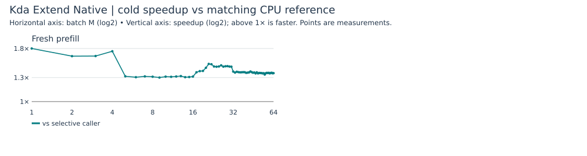

Show numeric data

| Series (×) | Trend by M¹ | M1 | M2 | M4 | M8 | M16 | M32 | M64 |
| --- | --- | --- | --- | --- | --- | --- | --- | --- |
| heads=64 | █▆▆▇▁▁▁▁▁▁▁▁▁▁▁▁▂▃▃▃▄▄▄▄▄▄▄▄▄▄▄▂▂▂▂▂▂▂▂▂▂▂▂▂▂▂▂▂▂▂▂▂▂▂▂▂▂▂▂▂▂▂▂▂ | 1.85 | 1.69 | 1.79 | 1.33 | 1.34 | 1.41 | 1.39 |

¹ One tick per measured batch size, in ascending order; height is log-scaled within each row. Numeric columns show selected batch sizes.

<!-- /glm5-inline -->

[All 72 cases, including prefixes and ragged inputs (CSV)](plots/glm5/kda_extend_native.csv)

## Complete cached latent attention

Jobs **407929–407931** tested every M=1–64 at context lengths **2047, 2048 and 2049**. The C++ caller validates the selected tokens, gathers packed FP8 keys with the reference BF16 rounding, and shares one FP32 panel between the score and value contractions. Outputs matched reference bytes at all 192 coordinates. Cold speedups were **1.19–1.28× over the earlier optimized cache-read path** and **2.39–2.68× over the frozen CPU reference** (median of three paired process ratios at each coordinate). Additional mixed-context fixtures through length 4099, padding, invalid selection and cache-write ordering were tested; the quoted speedup ranges apply only to the 192 cutoff coordinates.

<!-- glm5-inline -->

Show numeric data

| Series (×) | Trend by M¹ | M1 | M2 | M4 | M8 | M16 | M32 | M64 |
| --- | --- | --- | --- | --- | --- | --- | --- | --- |
| S=2048 vs reference | █▆▆▅▆▇▅▅▆▆▄▇▄▇▆▄▇▄▄▃▅▄▄▄▆▃▅▄▆▄▄▅▄▄▄▂▅▄▄▃▅▃▃▅▃▃▅▄▃▃▃▁▃▃▃▄▄▃▄▄▃▄▃▃ | 2.57 | 2.51 | 2.5 | 2.5 | 2.47 | 2.49 | 2.44 |
| S=2048 vs native_read | █▆▃▂▄▄▃▃▄▄▁▄▄▃▂▄▄▃▃▃▄▄▃▃▃▂▅▄▅▂▄▄▃▄▃▃▃▄▄▃▃▂▄▃▄▃▄▃▃▄▄▃▃▃▃▃▃▃▃▄▃▄▄▃ | 1.28 | 1.26 | 1.21 | 1.21 | 1.23 | 1.23 | 1.22 |
| S=2047 vs reference | ▄▅█▃▇▅▄▄▄▄▅▄▆▄▃▄▃▄▂▂▂▄▅▄▄▃▃▃▄▄▃▃▄▃▃▃▃▄▅▂▃▂▂▄▃▃▃▃▃▃▃▄▃▃▃▁▃▂▂▂▂▃▃▂ | 2.49 | 2.51 | 2.46 | 2.49 | 2.47 | 2.45 | 2.43 |
| S=2047 vs native_read | ▅▃█▄▅▅▂▃▁▃▂▂▃▃▂▂▂▃▂▃▃▄▄▃▅▃▂▂▄▂▄▃▃▃▃▂▄▄▃▃▃▂▃▃▄▂▃▃▂▃▃▂▄▂▄▃▃▃▃▃▃▃▃▃ | 1.25 | 1.23 | 1.24 | 1.23 | 1.21 | 1.23 | 1.22 |
| S=2049 vs reference | ▆▄▇▃█▅▃▄▃▄▂▅▄▅▂▅▅▄▄▃▂▅▄▄▃▃▃▄▂▃▄▂▃▅▄▃▅▃▃▂▃▄▃▃▄▃▃▃▂▃▂▂▂▂▃▂▃▃▃▂▄▃▁▃ | 2.62 | 2.57 | 2.53 | 2.56 | 2.59 | 2.52 | 2.53 |
| S=2049 vs native_read | ▅▂▅▁█▂▁▂▁▃▂▃▅▃▁▃▄▃▃▂▂▂▄▂▃▃▃▄▃▃▃▂▂▁▄▄▃▂▃▂▃▂▂▂▃▂▃▃▃▂▃▂▂▂▃▂▂▃▂▃▂▃▂▂ | 1.25 | 1.23 | 1.21 | 1.22 | 1.23 | 1.22 | 1.22 |

¹ One tick per measured batch size, in ascending order; height is log-scaled within each row. Numeric columns show selected batch sizes.

<!-- /glm5-inline -->

[All 192 paired comparisons (CSV)](plots/glm5/cached_latent.csv). These are synthetic caller timings, not serving throughput.

## Pooled compression including masked cache writes

The earlier rotation-only change did not consistently speed up the full write. Jobs **407933–407934** instead fused the four-slot contraction, rotation, quantization and cache commit in C++. For both scale modes and every M=1–64, the tested masks produced reference-identical bytes; rejected batches did not partially update the cache.

In **407934**, cold mixed-mask writes were **3.17–9.37× faster than the CPU reference** and **2.81–8.86× faster than the earlier native rotation path**. Isolated compression improved **2.54–5.93×** over the 407642 implementation. In the six complete decode-ring cases, the gain over native rotation was **1.07–2.14×**. These are medians of three paired process ratios. One process measured **0.65×** against native rotation for the rounded M=32 return-only case; it was not a median regression.

<!-- glm5-inline -->

Show numeric data

| Series (×) | Trend by M¹ | M1 | M2 | M4 | M8 | M16 | M32 | M64 |
| --- | --- | --- | --- | --- | --- | --- | --- | --- |
| round=0 vs reference | ▃▅▂▃▁▃▅▃▆▇▅▇▅▆▅▆▅▅▄▅▅▃▃▅▇▃▄▆▄▇▇▇▅▆▇▇▆▇▆▅▆▅▅▇▇█▆▆▇▆▇▇▆▅▅█▅▇▇▅▆▇▇▇ | 4.05 | 5.77 | 4 | 4.62 | 6.91 | 8.64 | 8.16 |
| round=0 vs read | ▄▅▃▃▁▄▆▄▇▇▆▇▆▆▆▆▆▆▄▅▆▄▄▅▇▄▄▆▅▇▇█▆▇▇▇▇▇▇▅▆▆▅▇▇█▇▆▇▇▇▇▇▆▇█▆▇▇▅▇██▇ | 4.37 | 5.24 | 3.98 | 4.47 | 6.65 | 8.34 | 7.77 |
| round=1 vs reference | ▅▂▂▁▂▃▄▆▅▆▆▃▇▅▄▄▆▅▆▅▅▅▄▅▅▄▆▅▅▅▇▆▆▆▅█▆▇▇▇▆▅▇▆▇▅▄▅█▇▇▆▆▄▇▆▆▅▆▆▆▅▆▇ | 5.81 | 3.87 | 3.49 | 6.63 | 5.51 | 7.25 | 7.62 |
| round=1 vs read | ▆▂▂▁▂▃▄▅▅▆▆▄▆▆▅▅▆▅▆▅▆▆▄▅▅▄▆▅▅▅▇▆▆▅▄▇▆▆▇▇▇▅▇▆▇▅▅▇█▇▆▆▅▅▆▅▅▅▇▆▆▅▆▇ | 6.38 | 3.85 | 3.23 | 5.77 | 5.59 | 7.07 | 7.65 |

¹ One tick per measured batch size, in ascending order; height is log-scaled within each row. Numeric columns show selected batch sizes.

<!-- /glm5-inline -->

[Per-fixture median and process range](plots/glm5/pooled_commit.csv)

## Qualification status through job 407934

Of the **11 families in the original parallel wave**, eight had no measured regression on their named reference comparisons. Three still had losses: standalone MoE routing at seven batch sizes, and two families sharing the projected-indexer caller on sparse or degenerate inputs. Across the **full 17-family inventory**, the corresponding count was **14 with no measured loss, three with a loss**.

These are benchmark outcomes, not completion percentages. Three families had matched component calibration, but none had an achievable roofline matched to its full scope. **Zero families were formally qualified** at this cutoff. The measurements above remain valid for their stated inputs; coverage outside those inputs and whole-caller efficiency still require evidence. Serving defaults are unchanged.

## Matched whole-caller scheduling trials

EMR jobs **407941–407943** compared two executable schedules on the same node at each of **576 cold coordinates**. Narrower FP8 projection tiles beat the existing schedule at **119/448** shape/batch coordinates, but never on MLA output or dense gate/up. Coarser head scheduling beat the existing fresh KDA extend path at only **2/64** sizes. For cached attention at S=2048, dense position lookup won at **63/64**, with a median paired speedup across M of **1.014×**. These are demonstrated alternatives for specific callers, **not optimal-latency or hardware ceilings**. The attention comparison used one cold call per arm per process; projection and KDA used three. None was promoted.

<!-- glm5-inline -->

Show numeric data

| Series (×) | Trend by M¹ | M1 | M2 | M4 | M8 | M16 | M32 | M64 |
| --- | --- | --- | --- | --- | --- | --- | --- | --- |
| tag: dense_down | ▆▅▇▇▃▅▃▆▄▄▄▄▄▂▇▄▄▆▄▂▅▃▁▄▄▅▅▆▃▄▂▅▄▄▅▄▆▃▆▅▅▄▄▆▅▂▅▇▇▇▆▆▆▄█▆▅▅█▆▆▄▃▃ | 0.913 | 0.895 | 0.961 | 0.929 | 0.862 | 0.88 | 0.837 |
| tag: dense_gate_up | ▄▆▇▇▅▅▅▃▅▃▅▄▂▂▅▄▅▃▃▃▃▄▃▅▂▂▁▅▄▄▅▅▃▄▂▇▁▄▄▃▃▅▆▄▅▅▅▇▆▆▆▇▇▃█▇▆▇█▇▄▁▆▇ | 0.825 | 0.867 | 0.889 | 0.809 | 0.829 | 0.835 | 0.901 |
| tag: expert_down | ▇▅▂▄▂▄▅▆▅▁▇▄▄▄▆▃▆▇▄▃▃▅▅▂▅▄▆▄▆▆▄▁▃▄▄▅▅▃▇▂▄▇▄▅▄▇▆▅▄█▄▄▅▃▄▇▃▆▄▅▆▃▅▅ | 1.13 | 1.02 | 0.968 | 1.09 | 0.918 | 0.845 | 1.05 |
| tag: expert_gate_up | ▄▆▆▆▅▄▄▄▂▃▆▃▆▂▅▆▆▆▃▃▇▅▅▁▄▃▃▄▅▆▅▅▄▅▄▄▅▄▅▄▆▆▅▆▄▄▃▆▆▆▆▅█▇▆▆█▆▅▆▆▃▅▆ | 0.907 | 1.02 | 1.02 | 0.905 | 1.02 | 0.992 | 1.02 |
| tag: mla_a | ▅▅▅▄█▇▂▅▅▅█▆▅▅▃▄▆▆▅▆▆▅▆▆▃▅▇▆▆▆▇▄▆▂▇▃▅▆▅▅▄▄▅▄▅▄▆▅▄▅▆▄▅▆▇▄▅▆▆▄▅▁▃▅ | 1.02 | 1.05 | 0.964 | 1.03 | 0.983 | 0.966 | 0.997 |
| tag: mla_o | ▅▅▇▃▇▇▄▂▁▆▂▅▅▅▆▄▄▄▄▁▄▄▅▄▄▆▃▅▄▆▄▅▅▅▅▅▄▄▄▇▅▆▆▄▆█▇▆▅▆▅▄▃▂▅▆▄▄▅▆▅▄▃▅ | 0.886 | 0.89 | 0.825 | 0.789 | 0.838 | 0.877 | 0.862 |
| tag: mla_qb | ▄▄▄▄▆▄▅▅▃▄▆▇▅▅▅▄▅▅▄▄▃▇▃▅▄▃▃▄▃▁▂▃▃▄▃▅▂▅▃▄▆▃▃▄▆▄▅▅▅▆▇▇▇▇▆▇▇▇█▇▆▅▆▇ | 0.894 | 0.875 | 0.875 | 0.943 | 0.903 | 0.841 | 1.04 |
| tag: fresh | ▆▇▇▇▇██▇█▇▇▇███▇▇▇▆▇▇▆▇▆▆▆▇▆▇▇▇▆▆▆▆▅▅▅▅▆▅▄▄▅▄▄▄▄▄▃▂▃▃▂▂▂▃▃▂▂▂▁▂▁ | 0.982 | 0.986 | 0.993 | 0.993 | 0.989 | 0.982 | 0.92 |
| tag: S2048 | ▄█▅▇▁▄▆▄▅▃▄▆▃▅▆▄▅▄▅▄▅▅▅▃▄▄▅▅▄▄▄▅▅▄▄▄▄▅▄▅▅▄▅▄▄▄▄▅▃▅▆▆▄▅▄▅▆▄▃▄▄▄▄▄ | 1.01 | 1.04 | 1.04 | 1.01 | 1.01 | 1.02 | 1.01 |

¹ One tick per measured batch size, in ascending order; height is log-scaled within each row. Numeric columns show selected batch sizes.

<!-- /glm5-inline -->

[Per-coordinate paired speedups and median latencies (CSV)](plots/glm5/schedule_trials.csv)

**Standalone router:** job **407939** removed temporary logits-validation masks but lost against the frozen reference at M=14, 25 and 45. Job **407944** also fused the selected-weight gather and index conversion: it beat the reference at **60/64** sizes, losing at M=7, 10, 16 and 17 (worst **0.937×**). The losses moved, so neither run justifies a fixed batch blacklist or an unconditional dispatch change.

## Sparse indexer holdouts

Job **407945** retested the two projected-indexer cases flagged in the qualification review. With fixed C++ validation and masking, extend with no completed pool was **1.13× faster cold** than the frozen caller (paired process range **1.09–1.15×**); decode with only the first row active was **1.10× faster** (**1.05–1.13×**). All three processes favored the candidate in both cases. Active decode gained **1.25× at M=8** and **2.06× at M=33**. Outputs, selection indices and committed cache/ring bytes matched on ten synthetic fixtures.

In first-live decode, the query-weight multiply alone took about **0.50 ms reference versus 0.51 ms candidate**. The speedup was in the complete caller, not a faster matrix multiply. These results resolve the two named holdouts, not a whole-family roofline or a serving change.

## Router decision: retain the existing native kernel

EMR jobs **407951 and 407952** used layer-4 checkpoint weights and replayed activations. At every M=1–64, the alternative matched reference expert IDs, weights and layouts, including tie and correction-bias controls. It did **not** demonstrate a consistent speed advantage: **14 batch-size/cache-condition combinations** were slower than the existing native kernel in both jobs. Against the frozen CPU reference, no loss repeated across jobs, but the holdout minimum was **0.986× warm and 0.989× cold**. Even repeated timings of the identical native kernel varied. Retain the existing kernel; there is no evidence for a batch-size exception list or a change to serving dispatch. This resolves the implementation choice, not whole-family roofline qualification.

## Fresh attention and sparse physical remapping

In EMR job **407955**, fresh no-prefix BF16 attention matched the frozen caller’s output and cache bytes at every M=1–64 with cache saving both on and off. The median cold speedup across those 128 cases was **1.31×**. The only slower median was **M=1 with cache saving enabled (0.92×)**; retain the existing path there rather than enabling the candidate unconditionally. At M=64 with saves, the frozen caller took **156.5 ms**, the native caller **116.7 ms**, and the matched FP32 compute component **97.8 ms**. The component excludes caller work and is not a whole-operation ceiling.

Invalid selections were rejected before cache writes; score overflow preserved the reference’s post-write state. Six tied sparse-remap cases matched selected indices, outputs and cache contents, with **1.44–2.24×** cold speedups.

<!-- glm5-inline -->

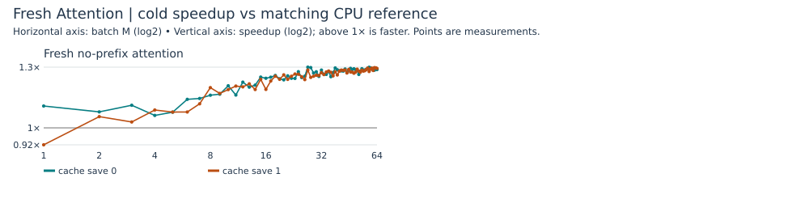

Show numeric data

| Series (×) | Trend by M¹ | M1 | M2 | M4 | M8 | M16 | M32 | M64 |
| --- | --- | --- | --- | --- | --- | --- | --- | --- |
| cache_save: 0 | ▂▂▂▁▁▃▃▄▄▅▄▆▅▅▇▆▇▇▆▆▇▆▆▇▆▇██▇▇▇█▇▇▇▇▇██▇▇▇█▇██████▇▇████████████ | 1.11 | 1.08 | 1.06 | 1.17 | 1.28 | 1.33 | 1.33 |
| cache_save: 1 | ▁▄▃▄▄▄▅▆▆▆▆▆▇▆▇▆▇▇▇▇▇▇▇▇▇▇█▇▇▇▇█▇███▇█▇████████▇████████████████ | 0.92 | 1.06 | 1.09 | 1.22 | 1.21 | 1.31 | 1.34 |

¹ One tick per measured batch size, in ascending order; height is log-scaled within each row. Numeric columns show selected batch sizes.

<!-- /glm5-inline -->

[All 128 cold comparisons and component timings](plots/glm5/fresh_attention.csv)

## Prefixed KDA and mixed chunk boundaries

Job **407956** checked nonzero-prefix inputs at every M=1–64, including continuation calls. Outputs and both committed state pools matched the frozen CPU reference byte-for-byte. Median cold speedups ranged from **1.37–2.28× versus frozen** and **1.003–1.075× versus the previous optimized caller (407927)**.

Job **407954** exposed a one-byte output mismatch for packed lengths `[65,16,1,2,0]` in both native paths. A fixed rule using the frozen implementation on nonfused mixed multichunk calls passed all five mixed cases in 407956. For the failing input, that correct path ran at **0.576×** the speed of the incorrect native path. The latter is not an eligible performance baseline. Native handling of this mixed case remains open.

**Native repair (407957, 407961).** The first FP32 state projection at token 65 diverged after native staging made a transposed V/K state row contiguous. Preserving the reference strides fixed the result without changing tolerances. The old binary reproduced both historical one-byte errors; both repaired native paths matched frozen output, both state pools and continuation results across 38 replay and independent cases without the frozen fallback. This is correctness evidence; the repaired mixed path needs its own timing before a speedup can be claimed.

**Repaired native timings (407968).** With both state commits inside the timer, direct/staged were **1.72×/1.74× faster** than the correct frozen caller on the original mixed-cross extend and **1.39×/1.42×** on its continuation. Across five held-out permutations and their continuations the range was **1.38–1.76×**. Output and both pools matched frozen bytes. No tested case needed the frozen fallback for performance. Against older native paths, only byte-verified controls were eligible: the worst observed slowdown was **4.3%** for direct at prefixed M=1. The erroneous old mixed-cross result is excluded.

**M=1 cache-save specialization (407971).** An independent cold sweep tested a fixed C++ path for the previous exception. At M=1 with cache saving on, it took **0.887 ms**, versus **2.399 ms** frozen and **2.301 ms** for the prior native caller. Across all 128 batch/save combinations, outputs and cache bytes matched, and no median regressed against frozen. Outside the specialization, the lowest measured speedup against the prior native caller was **0.962×** (M=12, cache saving off). Invalid-input rejection and write-before-overflow ordering were preserved. Job 407970 is excluded: it failed on an overflow-test literal.

## Data and reproduction

**Qualification update through 407952:** 16 of 17 families have no loss on their current named source comparisons (14 previously clean, plus two resolved sparse-indexer holds). The remaining family retains its existing native router; the alternative was not promoted. No family yet has both complete caller coverage and a matched whole-family roofline. The 576 comparisons of feasible schedules across three families do not establish ceilings. Priority caller gaps are prefixed KDA, fresh no-prefix attention and sparse physical remapping.

[Exact plotted ratios (CSV)](plots/glm5/measurements.csv) · [Source artifact names and SHA-256 hashes](plots/glm5/sources.json) · [Evidence exporter](../plugin/validate/export_glm5_journey.py) · [Chart renderer](../plugin/validate/plot_glm5_journey.py)

To render from the portable CSV, run `python -B plugin/validate/plot_glm5_journey.py` from the repository root with `rsvg-convert` available. To refresh the data from the cluster, run `python -B plugin/validate/export_glm5_journey.py <campaign-reference-probes-directory>` first. For new measurements, add the completed paired evidence to the exporter, update the interpretation here, version any changed PNG filenames and run `python plugin/validate/check_doc_images.py`. Baseline-only profiles, failed jobs and queued caller trials do not produce speedup curves.
