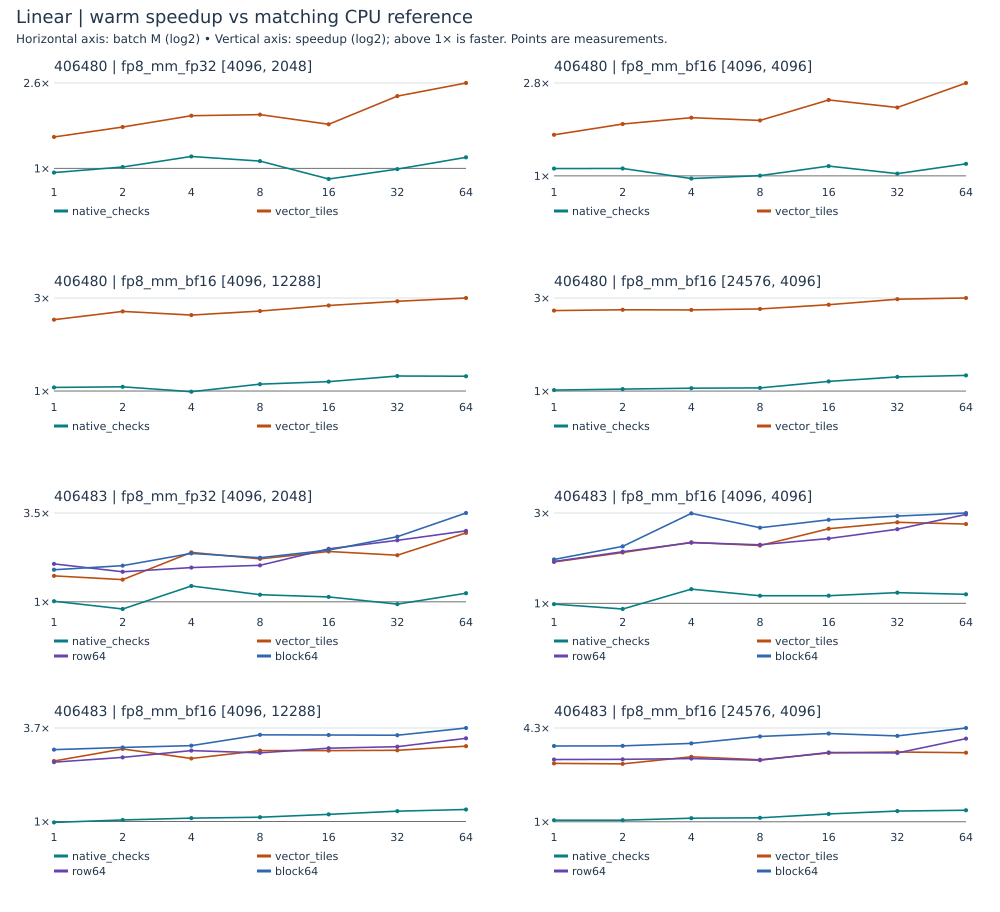
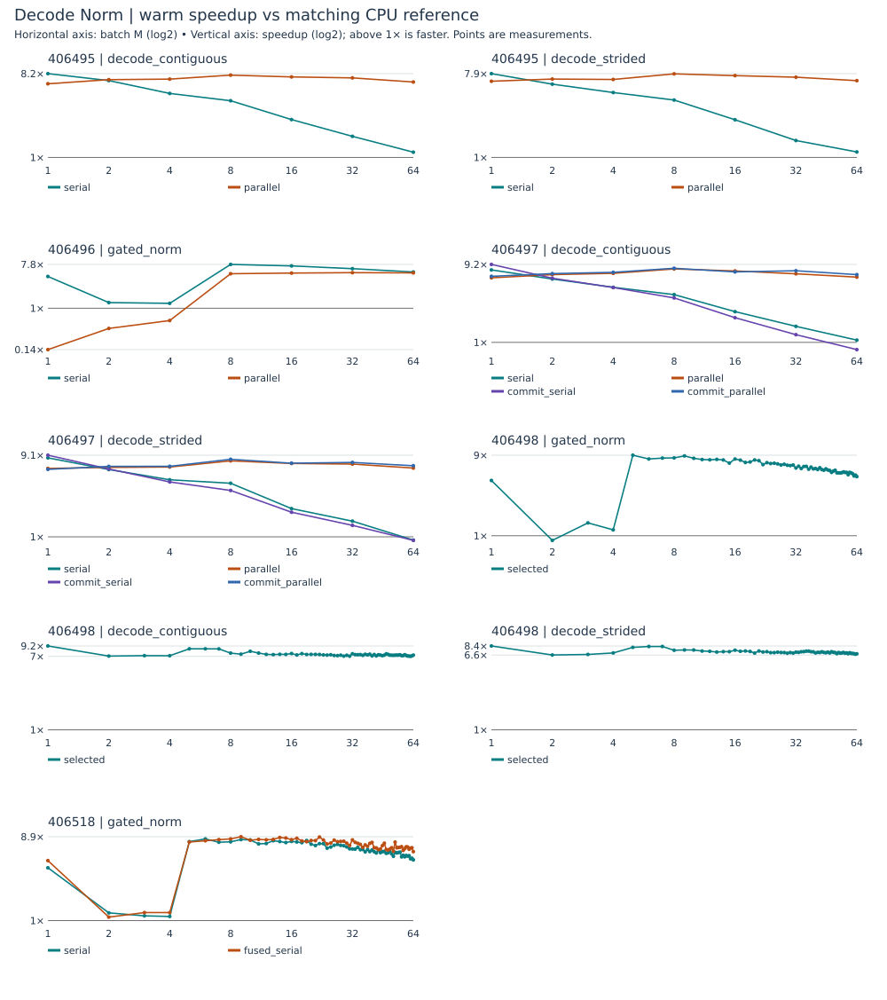
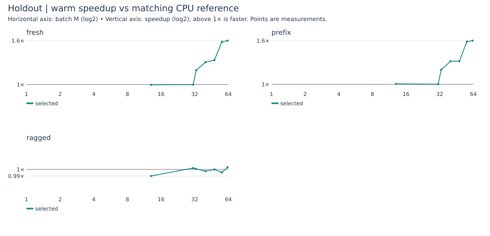
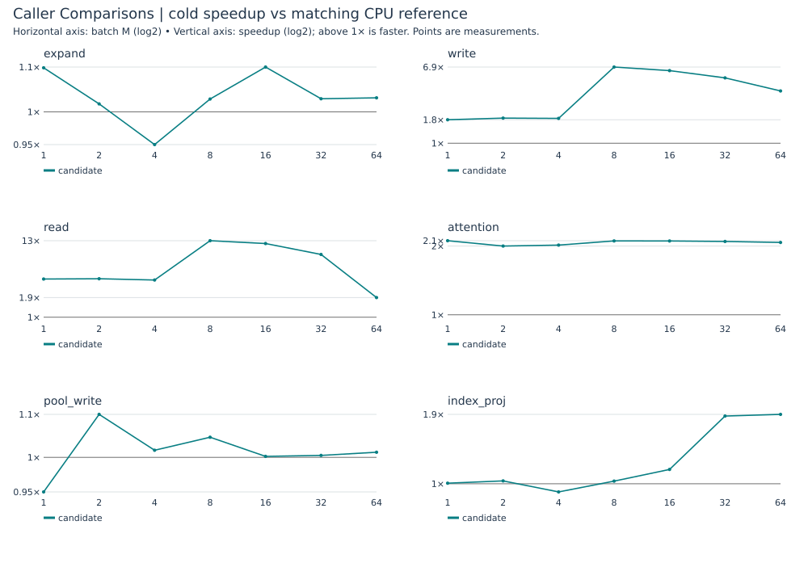
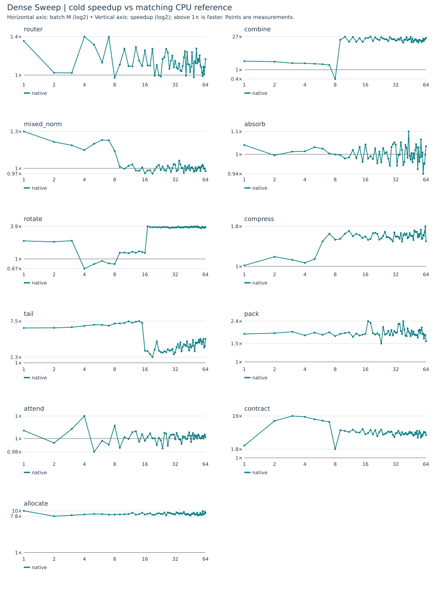

# GLM-5.3-Flash CPU kernel performance journey

**Emerald Rapids (EMR), batch M = 1–64.** Fusing activation and FP8 quantization cut that isolated kernel's latency by **9.92–83.02×**. The more informative caller-level result is KDA prefill: at M=64 the parallel subchunk reduced fresh prefill from **195.84 to 121.33 ms (1.61×)**, but the same substitution *increased* latency at M=8 and 16. That is why the journey records regressions and tests dispatch rules separately.

**How to read the plots.** A point is the matching CPU reference latency divided by candidate latency on the same node; **1× is parity**, and below 1× is a loss. Ratios use replicated process medians. Cold means a cache flush before each timed call, not measured DRAM traffic. The figures show measured batch sizes only; connecting lines do not qualify intermediate sizes. Axes use log scales and the vertical range varies by panel. These are standalone or named caller measurements on synthetic inputs, **not model speedups, GPU accuracy results or percentages of an accepted roofline**.

[Activation fusion](#activation-and-fp8-quantization) · [FP8 linear](#native-fp8-linear) · [Decode and norm](#kda-decode-and-gated-rmsnorm) · [Prefill](#kda-prefill-from-subchunk-to-caller) · [Eleven-family wave](#eleven-family-native-candidate-wave) · [Roofline comparison](#roofline-comparison) · [Data and reproduction](#data-and-reproduction)

## Activation and FP8 quantization

Jobs **406471 → 406472 → 406473**: fuse clamp, SiLU, multiply, BF16 rounding and block-128 FP8 quantization; compare scalar and vector conversion with serial and parallel loops; then measure a fixed adaptive dispatch at both widths for every integer M. The final curve is a measured policy, not the fastest point cherry-picked from each curve.

Warm-cache measurements

## Native FP8 linear

Jobs **406480 → 406483**: keep checkpoint weights packed, compare native checks alone against bounded vector-tile conversion, then vary row and column tile sizes. The `block64` candidate measured **1.89–4.02×** at the four MLP shapes and seven M anchors. The panel labels retain the output dtype and the two non-batch dimensions from the benchmark. The projections and vocabulary head outside this subset are not covered by these timings.

Warm-cache measurements

## KDA decode and gated RMSNorm

- **406495 → 406497 → 406498, decode:** move convolution, gates and recurrence into native loops while retaining the reference reduction order. Compare serial and parallel loops, then contiguous-state copies against the original commit. Serial copies helped M=1 but lost at large M. The fixed policy used serial at M=1, parallel otherwise, and the native commit at M=1 and M≥32. Across both convolution-state layouts it delivered **6.55–8.70× cold**. That ratio is for the *combined decoder*, not for each constituent kernel.
- **406496 → 406498 → 406518, norm:** compare native serial and parallel preparation, then fuse sigmoid, ordered affine/gate multiplies and BF16 store. The fused candidate beat the frozen reference, but lost to the prior native implementation at **seven cold M values**. Both curves are shown against the same reference. No unconditional replacement was selected.

Warm-cache measurements

## KDA prefill: from subchunk to caller

**407379:** keep the FP32 batched-matmul donor, move the subchunk control flow to C++, and use AVX-512 for TF32 operand rounding. The parallel workers had to inherit inference mode before the full-prefill benchmark could run. The serial path lost at all 18 full-prefill coordinates; parallel won at 14. At M=64, fresh/prefix/ragged speedups were **1.61× / 1.59× / 1.05×**. The `intra_*` panels isolate the subchunk; `fresh`, `prefix` and `ragged` include the rest of the KDA prefill step and its state writes.

Warm-cache measurements

**407549, held-out policy:** use parallel native code for fused subchunks with M≥32; retain the reference otherwise. Fresh and prefix requests at M=33, 40, 48, 56 and 63 improved **1.17–1.61× cold**. The smaller sizes and ragged requests exercise the fallback; ratios near 1 there do not represent a new kernel win. No serving default changed.

Warm-cache measurements

## Eleven-family native candidate wave

Build **407572**, EMR array **407573**. Each candidate matched the tested valid synthetic outputs and layouts at M=1–64. Performance was sampled at seven anchors, not 64. Some candidates perform fewer checks than the enclosing caller: use these results to select caller experiments, not to bypass validation.

| Plot | Optimization and measured boundary | What the measurement does not establish |
|---|---|---|
| `router` | FP32 projection and top-8; omit the redundant mask for a single expert group | Whole MoE layer latency |
| `combine` | Fuse eight ordered routed contributions, the shared contribution and BF16 store | Grouping, gather or scatter cost; **0.30× at M=8** rules out unconditional dispatch |
| `mixed_norm` | Native four-channel residual mix and normalization; retain unrounded variance | Full mHC pre/post and Sinkhorn latency |
| `absorb` | Native wrapper around BF16 MLA absorption using `bmm` | Expansion or a consistent gain over the existing donor |
| `rotate` | Row-local Hadamard butterflies followed by BF16 rounding and FP8 quantization | Full indexer; losses at M=4 and 8 |
| `compress` | Four-slot gated contraction and rotation/quantization | Mask handling and actual cache writes |
| `tail` | Copy selected history and append the causal tail | Scoring, top-k or physical-page remapping |
| `pack` | Produce the packed 528-byte latent row with group scales | Random reads or masked writes |
| `attend` | Batched score/softmax/value math on already-gathered keys, context 257 | Long-context selection and cache read; little change against the original donor |
| `contract` | Reduce four BF16 residual streams into one output pass | Embedding, final normalization or vocabulary projection |
| `allocate` | Compute page-64 token indices directly | Allocator state transitions and whole runtime latency |

Warm-cache measurements

## From isolated kernels to their callers

Build **407601**, EMR array **407602**. Each caller was checked against its CPU reference for M=1–64; seven batch sizes were timed in three processes. The cache tests also checked that invalid active writes left prior bytes intact and that reads rejected invalid selected rows, not unused rows.

| Caller | Cold speedup range | Interpretation |
|---|---:|---|
| MLA value expansion | 0.95–1.07× | Wrapping the existing batched GEMM did not consistently improve it. |
| Masked latent-KV write | 1.81–6.86× | The pack gain survives active-row validation, packing and committing to the cache. |
| Selected latent-KV read | 1.92–12.60× | Gather and convert only the selected packed rows, validating scales and BF16 outputs. |
| Cached selected attention | 1.99–2.10× | Replacing the cache read alone roughly halved the caller time. The workload cycles through lengths 2047, 2048, 2049, 2175 and padding; it is not the no-prefix BF16 path. |
| Pooled compression and cache write | 0.95–1.07× | The rotation change alone is approximately neutral once mask handling and writes are included. |
| Indexer projection and quantization | 0.93–1.87× | Mixed by batch size; the full projection caller reached 1.87× at M=64. |

Warm-cache measurements

## Roofline comparison

**Unlike the speedup plots, this chart shows absolute latency; lower is better.** Each panel compares the frozen CPU reference and native candidate from array **407573** with a provisional model at the seven measured batch sizes. The solid lines use cache-flushed timings (median of three process medians). These are the eleven isolated operations, not complete families or serving calls.

**What the dashed line means.** Calibration job **406478** measured large-array triad bandwidth of **184.04 GB/s** and cache-warm library GEMM rates of **3.29 TFLOP/s FP32** and **17.59 TFLOP/s BF16** on EMR. For router, absorption and gathered attention, model time is `max(unique logical bytes / triad bandwidth, GEMM FLOPs / matching dtype rate)`. Count two FLOPs per multiply-add; attention includes both contractions and counts the fixture's shared KV input once. For the other eight panels, the line is **only** useful input/output bytes divided by triad bandwidth, not a compute ceiling. The model excludes temporary traffic, conversion, selection, validation and dispatch. Logical bytes are not DRAM-counter measurements.

**What to investigate first.** Expert combine at M=8 takes **679 µs** native versus **205 µs** baseline, despite a byte model of just **3.56 µs**. At M=64 the same candidate takes **470 µs** versus **11,102 µs** baseline. Test serial versus threaded combine around M=8 before changing dispatch. For MLA absorption at M=64, native takes **6.39 ms**, baseline **6.77 ms**, and the model gives **0.125 ms**. Time the identical strided BF16 batched GEMM without the wrapper, then add validation back; this separates a shape/layout limitation from wrapper cost.

**Qualification still pending.** The calibration was a separate run, not a shape-matched measurement on every timing node. Do not read the gap as recoverable speedup. For credible efficiency percentages we need matched-node, matched-thread streamed and resident measurements: exact-layout GEMM for the contractions; copy/gather, conversion and dispatch measurements for the other paths. Warm timings need a separate cache-resident reference, not the triad line.

[Absolute timings, work counts and model times (CSV)](plots/glm5/roofline_cold.csv) · [Work formulas, source hashes and renderer](../plugin/validate/plot_glm5_roof.py). Run `python3 -B plugin/validate/plot_glm5_roof.py` to render from the CSV; pass the campaign reference-probes directory to regenerate it from the pinned jobs.

## All 64 batch sizes and follow-up callers

EMR array **407619** completed all eleven isolated C++ candidates at **every integer M=1–64**. Each point below compares cache-flushed reference and candidate timings on the same node (three processes, three samples per process). Five candidates had a faster median at all 64 sizes: pooled compression excluding writes, causal tail append, latent pack, four-stream contraction and allocation-index calculation. This is a pointwise median comparison, not confidence intervals or qualification of five complete families. The other six had at least one slower median.

[Speedups, including losses](plots/glm5/dense_sweep.csv). The roofline section above remains provisional. The new same-fixture component controls (matrix multiply or first-input copy) are not complete-operation ceilings.

**Caller checks.** Job **407631** exercised new no-prefix BF16 attention and pooled scoring, selection and physical-token remapping. Cold median paired speedups were **1.08×** for the tested extend caller and **1.22× / 1.23×** for short/long decode. Job **407632** measured **1.39–1.53×** for four runtime preparation transitions, and **1.16–1.90×** for final contraction/norm/head on tested *nonempty* selected-row sets. Embedding expansion was mixed (**0.73–3.04×**), so universal replacement is not supported. These are synthetic caller tests, not whole-model results.

## Data and reproduction

[Exact plotted ratios (CSV)](plots/glm5/measurements.csv) · [Source artifact names and SHA-256 hashes](plots/glm5/sources.json) · [Evidence exporter](../plugin/validate/export_glm5_journey.py) · [Chart renderer](../plugin/validate/plot_glm5_journey.py)

To render from the portable CSV, run `python -B plugin/validate/plot_glm5_journey.py` from the repository root with `rsvg-convert` available. To refresh the data from the cluster, run `python -B plugin/validate/export_glm5_journey.py <campaign-reference-probes-directory>` first. For new measurements, add the completed paired evidence to the exporter, update the interpretation here, version any changed PNG filenames and run `python plugin/validate/check_doc_images.py`. Baseline-only profiles, failed jobs and queued caller trials do not produce speedup curves.
