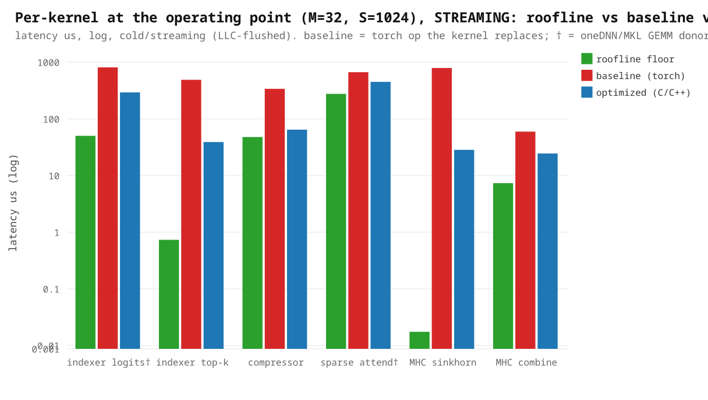
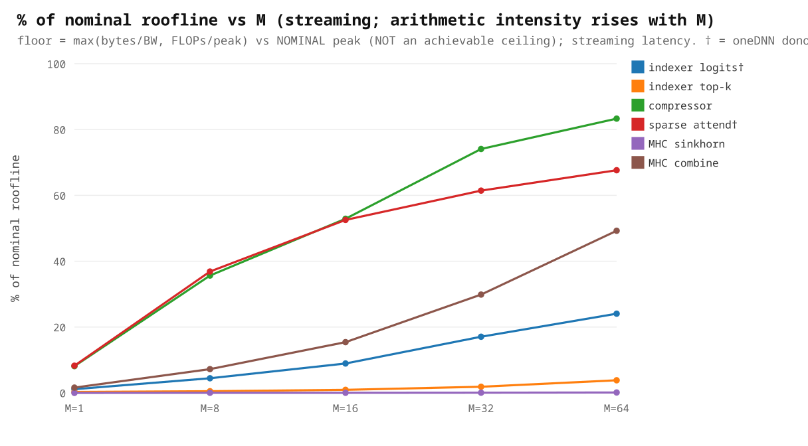

# DSv4-Flash DSA — C/C++ Kernel Pilot (Intel Xeon / EMR)

Performance for the six authored CPU kernels of the DeepSeek-V4-Flash DSA path at the serving operating
point **(M=32 decode batch, input S=1024, output G=256)**: for each kernel we show the **roofline floor**,
the **baseline** (the torch op it replaces), and the **C/C++ speedup** — with oneDNN/MKL use called out.
All latencies are **streaming (cold-cache, LLC-flushed per call)** — the reliable methodology: warm-cache
reuse lets an L3-resident working set be re-read from cache and hides the real DRAM ceiling. From
[operating_point.json](../plugin/validate/results/operating_point.json) (EMR job 385059, the **promoted
variant** per kernel + **512-bit build flags**, via [bench_operating_point.py](../plugin/validate/bench_operating_point.py));
regenerate plots with [make_kernel_pilot_plots.py](../plugin/validate/make_kernel_pilot_plots.py).

> **Caveats.** (1) Latencies are **streaming/cold**; the warm case (where the preceding GEMM leaves inputs hot
> in cache) is faster and is quoted per kernel below. (2) The roofline peak is the **nominal datasheet
> reference** (BW 358.4 GB/s, AMX bf16 124.5 TF, FP32 7.78 TF @ 1.9 GHz base) — **not a measured achievable
> ceiling**, so "% of roofline" means "% of nominal reference." (3) `indexer logits` and `sparse attend`
> (**†**) reuse a **oneDNN/MKL GEMM donor** and author the fused epilogue; the other four are **pure-authored**
> (no library GEMM). (4) Standalone microbench, single job. Correctness is tracked separately (F4) and remains
> **PARTIAL** (promotion **BLOCKED**); the hand-`exp` kernels retain **both** the exact-libm path (bit-exact
> oracle) and the Cephes path (~1 ULP, measured) for end-to-end accuracy A/B.

## 1. Per-kernel at the operating point (M=32, S=1024, streaming): roofline vs baseline vs C/C++



| kernel | implementation | baseline (torch) µs | C/C++ µs | **speedup** | roofline floor µs | % of roofline |
|---|---|---:|---:|---:|---:|---:|
| indexer logits † | oneDNN BRGEMM + authored epilogue (512-bit) | 810 | 293 | **2.8×** | 50.1 | 17% |
| indexer top-k | pure-authored (`nth_element` selection) | 489 | 39 | **12.5×** | 0.73 | 2% |
| compressor | pure-authored (hand-inlined Cephes `exp`) | 339 | 64 | **5.3×** | 47.7 | 74% |
| sparse attend † | oneDNN `at::bmm` + hand-`exp` softmax/sink | 667 | 449 | **1.5×** | 275.9 | 61% |
| MHC sinkhorn | pure-authored (fused recurrence) | 790 | 28 | **27.8×** | 0.017 | 0% |
| MHC combine | pure-authored (accumulate-once) | 60 | 25 | **2.4×** | 7.3 | 30% |

The two **oneDNN-donor** kernels (†) are GEMM-bound; the authored gain is the fused epilogue, plus — for
sparse — the **hand-inlined Cephes `exp`** in the softmax. The four **pure-authored** kernels get the large
gains: sinkhorn 27.8× and top-k 12.5× (torch pays ~40 tiny dispatched ops / a full sort that the fused kernel
collapses), and **compressor 5.3×** (a hand-inlined AVX-512 `exp` replaced a per-lane `libm` call). After
optimization, **compressor is DRAM-bandwidth-bound (74% of the BW roof)** and **sparse is compute-bound (61%
of the FP32 roof)** — both near their real hardware ceiling, so their speedups are bounded by the machine, not
by more kernel work.

## 2. % of nominal roofline across the M-sweep (1→64): arithmetic intensity (streaming)



As the decode batch M grows, arithmetic intensity rises and the BW/compute-bound kernels climb toward their
roofline (streaming, at M=64): **compressor → 83%**, **sparse → 68%**, **combine → 49%**, **indexer logits →
24%**. `indexer top-k` (~4%) and `sinkhorn` (~0%) stay low because they are **selection/dispatch-bound** — a
byte-or-FLOP roofline is the wrong ceiling for them, so the low % is a diagnostic, not a recoverable gap. This
is the "how close to the metal, and does more work help?" view.


## 3. Kernel deep-dives — roofline / baseline / C/C++ for every kernel

For each of the six kernels: **(a)** the roofline floor (byte/FLOP contract vs nominal peak, at M=32 unless
noted), **(b)** the baseline torch op it replaces and why it is slow, and **(c)** the authored C/C++ and the
optimizations. All numbers are M=32, S=1024, **streaming**, from
[operating_point.json](../plugin/validate/results/operating_point.json) (job 385059, promoted variants + 512-bit
flags); floor = `max(bytes/BW, FLOPs/peak)` vs the **nominal** peak (not an achievable ceiling).

| kernel | bound | floor µs | C/C++ µs | % roof | baseline µs | speedup |
|---|---|---:|---:|---:|---:|---:|
| 3.1 indexer logits † | BW (AMX) | 50.1 | 293 | 17% | 810 | 2.8× |
| 3.2 indexer top-k | selection | 0.73 | 39 | 2% | 489 | 12.5× |
| 3.3 compressor | BW (FP32) | 47.7 | 64 | 74% | 339 | 5.3× |
| 3.4 sparse attend † | **compute** (FP32) | 275.9 | 449 | 61% | 667 | 1.5× |
| 3.5 MHC sinkhorn | latency/dispatch | 0.017 | 28 | ~0% | 790 | 27.8× |
| 3.6 MHC combine | BW (FP32) | 7.3 | 25 | 30% | 60 | 2.4× |

---

### 3.1 Indexer logits † (oneDNN donor + fused epilogue)

`logits[n,s] = Σ_h relu( q[n,h,:] · kv[n,s,:] ) · weight[n,h]` — a `[H,D]×[D,S]` score GEMM per request
(H=64, D=128, S=1024) followed by a relu·weight·sum reduction over the H heads. **† oneDNN donor.**

**Roofline (M=32).** FLOPs = `2·M·H·S·D + 3·M·H·S` = 2·32·64·1024·128 + … ≈ **543 MFLOP**;
bytes = q`[M,H,D]` + kv`[M,S,D]` + weight + logits = 1.05 + 16.78 + … ≈ **17.97 MB** (the kv read dominates).
AI ≈ 30 FLOP/byte ≪ AMX ridge 347 → **BW-bound**. Floor = max(17.97 MB/358.4 GB/s = **50.1 µs**, 543 MFLOP/124.5 TF = 4.4 µs) = **50.1 µs**. C/C++ 293 µs = **17%** (streaming); building with the 512-bit flags (`zmm=0→322`) lifted it from 343 → 293 µs.

**Baseline (torch)** — [bench_replicated.py `_idx_ref`](../plugin/validate/bench_replicated.py#L53):
```python
s = torch.einsum("nhd,nsd->nhs", q.bfloat16(), kv.bfloat16())
return (s.relu_() * w.bfloat16().unsqueeze(-1)).sum(1)
```
The `einsum` materializes the full `[N,H,S]` score tensor in DRAM, then relu, multiply, and sum each make
another full `[N,H,S]` pass — the `[N,H,S]` scores round-trip to memory ~3–4× (558.3 µs).

**C/C++** — [indexer_logits.cpp `indexer_logits_tiled`](../plugin/kernels/dsa_pilot/indexer_logits.cpp):
1. **Score GEMM on the oneDNN cpublas BRGEMM donor** (bf16 AMX, VNNI-packed `q^T` reused across all S-tiles).
2. **Tiled so scores never leave cache** — S is processed in `Sb`-row tiles; each tile's `[Sb,H]` scores land
   in an L1/L2 stack buffer and the **relu·weight·sum epilogue runs in-cache**, removing the `[N,H,S]` DRAM
   round-trip that made a naive port BW-bound. kv is streamed exactly once.
3. **Adaptive tiling** (`~4·threads` tasks, `Sb` multiple of 16) keeps brgemm M large (AMX-efficient) while
   still filling cores at small N; a dedicated M=1 path does one GEMM over all S to avoid tiny-tile dispatch.
4. **bf16-faithful stage rounding** in the epilogue matches the published model's bf16 boundaries bit-for-bit.

**Net:** the GEMM is the donor's; the authored win is the **in-cache fused epilogue** (no score round-trip),
and building with the 512-bit flags lifted it **343 → 293 µs** streaming. Still 17% of the nominal BW roof —
useful byte-throughput is below reference BW, so ROI is **open**, not a wall.

---

### 3.2 Indexer top-k (pure-authored selection)

Select the top-k=512 KV indices per row of `logits[N,S=1024]`. Sparse attention only needs the **set** of
top-k (gather is permutation-invariant), so this is a **selection**, not a sort.

**Roofline (M=32).** FLOPs = 0 (comparisons, not float ops). bytes = logits`[M,S]` + indices`[M,k]` int64 =
0.13 + 0.13 = **0.26 MB** → floor = 0.26 MB/358.4 GB/s = **0.73 µs**. C/C++ 39 µs = **2%** (streaming) — but a
byte/FLOP roofline is the **wrong ceiling** here: the cost is `O(S)` comparison work + thread dispatch, not
memory. The 2% is a diagnostic, not a recoverable gap.

**Baseline (torch)** — `torch.topk(logits, 512, dim=1, sorted=False).indices`. torch.topk does a **full
per-row sort/partition** (and over-returns ordering we discard), 489 µs streaming.

**C/C++** — [indexer_topk.cpp](../plugin/kernels/dsa_pilot/indexer_topk.cpp):
1. **`std::nth_element` (O(S) selection)** instead of a sort — no ordering computed, just the partition.
2. **Best-of dispatch:** large N → one row per thread (saturates the machine); **small N → chunked 2-pass**
   (split each row into C chunks, exact local top-k per chunk in parallel, merge the C·k candidates) so M=1/8
   use **all** cores, not 1/8 of them — this closed the small-M gap that used to route to torch.topk.
3. **Guards**: N=1 runs serially (no thread-team spinup, which regressed at M=1); chunking is used only when
   `k ≪ chunk-length` (else the merge is pure overhead).

**Net:** ~12.5× streaming (24× warm) by replacing a sort with a saturating parallel selection. Pure-authored, no library.

---

### 3.3 Compressor (pure-authored online-softmax pool)

Reduce a window of `R`=128 raw KV tokens to one compressed token via a **per-channel** softmax-weighted pool:
`out[n,d] = Σ_r softmax_r( score[n,r,d] + ape[r,d] ) · kv[n,r,d]`. Each of D=512 channels softmaxes over R
independently. Shapes `kv, score=[N,R,D]`, `ape=[R,D]` → `out=[N,D]`.

**Roofline (M=32).** bytes = kv + score + ape + out = 8.39 + 8.39 + 0.26 + 0.07 = **17.10 MB**;
FLOPs ≈ `3·M·R·D` ≈ 6.3 MFLOP. Naively AI ≈ 0.37 FLOP/byte ≪ FP32 ridge 21.7 would say BW-bound, DRAM
floor = 17.10 MB/358.4 GB/s = **47.7 µs**. **This label was wrong** (see the retry below): at decode M the
17 MB working set is **cache-resident** (EMR has 320 MB L3), so the DRAM roofline is not the ceiling, and the
real bottleneck was the **scalar `exp`**, not bandwidth. The shipped scalar path was 176.1 µs; the retried
hand-exp path is **36.9 µs** (below, reading at ~460 GB/s from cache).

**Baseline (torch)** — [dsa_compressor_cpu.py](../plugin/intel_cpu_models/dsa_compressor_cpu.py):
```python
w = (score.float() + ape.float().unsqueeze(0)).softmax(dim=1)   # materializes w[N,R,D]
return (w * kv.float()).sum(dim=1)
```
`score+ape`, the softmax (max/exp/sum/div), `w*kv`, and `.sum` each make a full `[N,R,D]` pass and the softmax
**materializes the weights `w[N,R,D]` in DRAM** → the ~17 MB useful traffic is multiplied ~5–7× (409 µs).

**C/C++** — [compressor.cpp](../plugin/kernels/dsa_pilot/compressor.cpp), inner loop:
```cpp
for (r = 0; r < R; ++r) {                 // ONE streaming pass over the window
  #pragma omp simd                        // (3) AVX-512 over the D channels
  for (j = 0; j < dd; ++j) {
    float x    = srow[j] + arow[j];
    bool  up   = x > m[j];
    float mnew = up ? x : m[j];
    float arg  = surv_masked ? -INF : (up ? (m[j]-x) : (x-m[j]));
    float t    = std::exp(arg);           // (4) C1: ONE exp (other factor is exp(0)=1)
    float corr = up ? t : 1.f, e = up ? 1.f : t;
    l[j]   = l[j]*corr + e;               // running denom
    acc[j] = acc[j]*corr + e*krow[j];     // running weighted accumulator
    m[j]   = mnew;                        // running max
  }
}
for (j) orow[j] = l[j] > 0 ? acc[j]/l[j] : 0;   // single divide at the end
```
1. **Streaming online ("flash") softmax — the big win.** Softmax+pool fused into **one pass over R** with
   running `(m,l,acc)`; `w[N,R,D]` is **never materialized** and each input is read **once**.
2. **N×D-tile parallelism** fills all cores even at M=1 (N-only parallelism regressed there).
3. **AVX-512 SIMD over D** (tile width rounded to 16 lanes).
4. **C1 one-exp** — the non-surviving softmax factor is exactly `exp(0)=1`, hardcoded; **bit-exact**, ~halves
   the exp work at R=128.
5. Masked `−∞` positions contribute nothing; FP32 accumulate; single final divide.

**Net (shipped C1):** win is #1 (kill the DRAM weights temporary, ~6 passes → 1). But C1 still sat at
176.1 µs — attributed at the time to “grain/exp throughput.”

#### 3.3.1 Retry (libxsmm/RAJAPerf `hpc-kernel-optimization` SKILL): the real bottleneck was the `exp`

Applying the SKILL's Stage-0/1 (build flags + classify by inspecting the built object) exposed two things the
“BW-bound” label hid:

- **The build never emitted 512-bit code.** `objdump` of the shipped `-O3 -fopenmp -march=native` build shows
  `zmm=0` (GCC defaults to 256-bit), and `at::vec` falls back to 8-lane AVX2 in a JIT extension unless
  `-DCPU_CAPABILITY_AVX512` is set — which is why an earlier vectorized-exp variant looked slow (mis-built).
- **The op is `exp`-compute-bound and cache-resident, not BW-bound.** The scalar per-lane `libm` exp was the
  serial bottleneck; the 17 MB working set lives in L3.

Measured on EMR (job 385022, interleaved median, M=32, **warm cache**, rel-err vs the fp32 torch oracle):

| variant | µs @ M=32 | vs shipped C1 | rel-err | notes |
|---|---:|---:|---:|---|
| C1 scalar (shipped) | 176–186 | 1× | 4.0e-7 | per-lane `std::exp` |
| C2 `at::vec` Sleef exp, 512-bit | 80.7 | 2.2× | 4.8e-7 | non-inlined exp call |
| **D1 hand-written AVX-512 Cephes exp (fp32)** | **36.9** | **4.8×** | **2.8e-7** | **shipped throughput path** |
| D2 reduced degree-4 exp (fp32) | 32.5 | 5.4× | 2.1e-5 | marginal, less accurate |
| D3 bf16 operands + fp32 exp island | 38.3 | 4.6× | **6.4e-3** | **no speed gain, large error** |

**D1 — [`compressor_softmax_pool_fp32intrin`](../plugin/kernels/dsa_pilot/compressor.cpp)** — hand-inlines an
AVX-512 Cephes `exp` (range-reduce + degree-6 FMA poly + `2^n` bit-scale) instead of the `at::vec`/Sleef
call. It is **fp32 throughout**, **as accurate as the scalar oracle** (2.8e-7), and needs **no special build
flags** (pure `AVX512F` intrinsics). Removing the non-inlined exp call boundary is the whole 2.2× over C2.

#### 3.3.1a Streaming (cold-cache) — the reliable number

The warm table above reuses one buffer, so a 17 MB working set that fits in L3 is re-read from cache (that is
why D1 "reads at 460 GB/s", above DRAM peak). For a **reliable** standalone number we flush ≥2× the LLC
before every call so inputs stream from DRAM (job 385039, M=32):

| variant | warm µs | **stream µs** | stream GB/s | % of nominal DRAM roof |
|---|---:|---:|---:|---:|
| C1 scalar (shipped) | 187 | 283.8 | 60 | 17% |
| C2 Sleef-512 | 80 | 90.8 | 188 | 53% |
| **D1 hand-exp** | 36.7 | **61.9** | 276 | **77%** |
| D3 bf16 | 38 | 70.7 | 242 | 68% |

So **D1's reliable M=32 latency is ~62 µs** (the warm 37 µs was ~1.7× cache-flattered). Cold, D1 runs at
**77% of the nominal DRAM roofline (85% at M=64)** — it is now genuinely **DRAM-bandwidth-bound**, the honest
post-optimization ceiling: the hand-exp pushed the kernel to the memory wall, so further `exp` work cannot
help. The warm 37 µs is still the right model for the *fused pipeline*, where the compressor consumes `kv`/
`score` the preceding GEMM just wrote (hot in cache). **D3 bf16 is slower cold too** (70.7 vs 61.9) — a
non-win on bandwidth as well, since the fp32 inputs still stream from DRAM and the bf16 rounding only adds
work. (Streaming is now the default standalone-kernel methodology; see
[bench_compressor_vectorize.py](../plugin/validate/bench_compressor_vectorize.py) `tmed_stream`.)

#### 3.3.2 Why bf16 does **not** help here (and the corpus agrees)

The proposal “run in bf16, upconvert for `exp`, downconvert after” is the standard attention pattern — and it
is in the corpus, but for **sparse-attention / indexer**, not the compressor: `inference/kernel.py::sparse_attn_kernel`
keeps q/kv/o in bf16 yet runs every softmax internal (`acc_s`, `scores_max`, `sum_exp`, `T.exp`) in **fp32**.
For the compressor the reference does the opposite *on purpose*: `inference/model.py::Compressor.forward` has
`x = x.float()  # compression need fp32` and keeps the entire pool in fp32, downcasting to bf16 only after the
pool at the norm. There is **no GPU compressor kernel** at all. So we did not miss a bf16 compressor — there
isn't one.

The measurement confirms the mechanism: since `exp` must be fp32, **bf16 gives zero `exp`-throughput gain** —
D3 is the *same speed* as the fp32 D1 (38.3 vs 36.9 µs) but its error jumps to **6.4e-3** (4 orders worse).
bf16 would only save read bytes, and this op is cache-resident + `exp`-bound, not read-BW-bound. So D1 (fp32,
hand-exp) is the right answer; bf16 is a conformance regression with no upside.

> **Note.** The §1 table/plots now use the promoted D1 at **streaming** (job 385059, ~64 µs); this §3.3
> narrative keeps the detailed warm/stream retry from jobs 385022/385039 (62 µs, within single-run variance).
> **Correctness:** D1 passes the F4 hard gates — output contract,
> finiteness, run-to-run determinism, and the overlap `−∞` mask case — and screens at 2.4–7.2e-7 (identical
> to the scalar oracle); an all-masked channel is guarded to return 0, matching C1 (EMR job 385033). Both
> the scalar-`libm` path (C1, bit-exact oracle) and the Cephes path (D1, ~1 ULP, measured — §4) are retained
> as an end-to-end accuracy A/B pair — the exact path is never deleted.

---

### 3.4 Sparse attend † (oneDNN donor + fused softmax) — the compute-bound one

MLA sparse attention: q`[N,H,D]` attends over the gathered latent kv`[N,K,D]` (MQA: one latent shared across
H=64 heads, D=K=512) with a per-head softmax **sink**. Two GEMMs (`q@kv^T` score, `w@kv` value) + softmax.
**† oneDNN donor.**

**Roofline (M=32).** FLOPs = `4·M·H·K·D` = 4·32·64·512·512 ≈ **2.15 GFLOP** (two `H×K×D` GEMMs);
bytes = kv`[K,D]` + q + out ≈ **41.9 MB**. AI ≈ 51 FLOP/byte **>** FP32 ridge 21.7 → **compute-bound** (the
only one). Floor = max(2.15 GFLOP/7.78 TF = **275.9 µs**, 41.9 MB/358.4 GB/s = 117 µs) = **275.9 µs**.
C/C++ 449 µs = **61%** of the FP32 roof (streaming), baseline 667 µs → **1.5×** (small *by design* — it is
already near the compute ceiling).

**Baseline (torch)** — [`_sparse_ref` → `ora_sparse_fp32`](../plugin/validate/bench_replicated.py#L58): the
fp32 einsum sparse-attn fallback — two matmuls plus a softmax that allocates four extra `[N,H,K]` temporaries
(`m`, `e`, `denom`, `w`).

**C/C++** — [sparse_attend.cpp `sparse_attend_bestof`](../plugin/kernels/dsa_pilot/sparse_attend.cpp):
1. **Both GEMMs on the oneDNN/MKL `at::bmm` donor** (fp32, near ~64% of the fp32 roof where a scalar loop
   would lose badly) — this is the right call in a compute-bound regime.
2. **Fused in-place softmax + per-head sink in ONE parallel pass** over `[N,H,K]` (max/exp/sum/div + the sink
   logit), avoiding the baseline's four full temporaries; bit-conformant with the fp32 oracle.
3. **Best-of dispatch:** N=1 → a scalar **online-softmax** path (no bmm launch overhead, bit-exact, ~3.4×);
   N≥2 → the donor-GEMM + fused-softmax path.
4. **Hand-inlined Cephes `exp` in the softmax** ([`sparse_attend_bestof_hx`](../plugin/kernels/dsa_pilot/sparse_attend.cpp)):
   the same compressor lever — replacing the per-lane `std::exp` with the inlined `exp512_ps` — lifts it
   **541 → 449 µs** streaming (1.19×). The `exp` was a meaningful share even though the op is GEMM-bound.
   ~1 ULP, F4-screened (screens identically to the libm path, §4).

**Net:** compute-bound, so the lever is the library GEMM; the authored contribution is the **fused softmax/
sink epilogue** (now with a hand-inlined `exp`) over the donor. 61% of the fp32 roof is the realistic
near-ceiling for this op.

---

### 3.5 MHC sinkhorn (pure-authored fused recurrence)

Per row, build a tiny `hc×hc` (4×4) comb matrix and run 20 Sinkhorn normalization iters (alternating row/col
normalize), plus `pre=sigmoid+eps`, `post=2·sigmoid`. Inputs are tiny (`mixes[B,S,24]`).

**Roofline (M=32).** FLOPs ≈ `M·hc·hc·iters·5` ≈ 51 KFLOP; bytes ≈ **6.1 KB**. Floor = 6.1 KB/358.4 GB/s =
**0.017 µs**. C/C++ 28 µs = **~0%** (streaming) — the roofline is the **wrong ceiling**: the op is a tiny
per-row serial recurrence of divides/exps, so it is **latency/dispatch-bound**, not byte- or FLOP-bound. The
~0% is a diagnostic that this kernel will never be roofline-limited.

**Baseline (torch)** — [`_hc_split_sinkhorn_torch`](../plugin/validate/bench_replicated.py#L77) (sglang MHC oracle): ~40 tiny
global tensor ops (each of the 20 iters does a row-normalize and a col-normalize as separate ops over the
whole `[B,S,hc,hc]` tensor), each paying full dispatch + a memory pass — 790 µs streaming.

**C/C++** — [sinkhorn.cpp](../plugin/kernels/dsa_pilot/sinkhorn.cpp):
1. **Fuse all 20 iters per row** with the `hc×hc` matrix kept **register/L1-resident** — no per-iter global
   tensor pass, no 40 kernel launches; just one parallel loop over rows.
2. **eps placement matches the oracle exactly** (initial row-norm adds eps to the result, later iters add eps
   to the denominator) so parity holds.

**Net:** ~28× streaming purely by collapsing ~40 dispatched torch ops into one fused per-row recurrence. Pure-authored.

---

### 3.6 MHC combine (pure-authored accumulate-once)

`y[m,h] = Σ_k pre[m,k] · x_flat[m, k·H + h]` — a weighted sum over hc=4 clusters (`einsum("mk,mkh->mh")`),
H=4096.

**Roofline (M=32).** FLOPs ≈ `M·H·7` ≈ 0.92 MFLOP; bytes = x_flat`[M,hc·H]` + pre + y ≈ **2.62 MB**. AI ≈
0.35 FLOP/byte → **BW-bound**. Floor = 2.62 MB/358.4 GB/s = **7.3 µs**. C/C++ 25 µs = **30%** (streaming),
baseline 60 µs → **2.4×**. (Warm it is cache-resident at ~63%; cold it streams from DRAM at 30% of the roof.)

**Baseline (torch)** — [`_combine_ref`](../plugin/validate/bench_replicated.py#L67):
```python
return torch.einsum("mk,mkh->mh", pre.float(), x_flat.reshape(m, hc, h).float())
```
The einsum broadcasts `pre` against the `[m,hc,H]` view, creating a full `[m,hc,H]` intermediate before the
reduction (60 µs streaming).

**C/C++** — [combine.cpp](../plugin/kernels/dsa_pilot/combine.cpp):
1. **Accumulate-once tiling** — per H-tile, accumulate over the hc clusters into an L1 buffer, **read x once
   and write y once**. The naive per-k `y += p·x` pass re-reads and re-writes the whole y row hc times; this
   does it in a single pass with **no `[m,hc,H]` broadcast temporary**.
2. **AVX-512 SIMD over H**, parallel over M.

**Net:** 2.4×, limited because it is already close to the BW roof — the win is killing the broadcast temporary
and the hc-fold redundant y traffic.


## 4. Re-optimization wave — streaming journeys for every kernel

Applying the compressor learnings (512-bit build flags, `objdump` ISA check, hand-inlined Cephes `exp` where
exp-bound, and **streaming / cold-cache timing**) to all six kernels as a parallel wave, then consolidated in
one run (EMR job 385059). Latencies are **streaming (LLC-flushed per call)** at M=32 — the reliable number.

| kernel | torch | shipped C/C++ | re-optimized | lever | regime |
|---|---:|---:|---:|---|---|
| compressor | 339 | 284 | **64** | hand-exp Cephes **4.4×** | now DRAM-bound (74% roof) |
| sparse_bestof † | 667 | 541 | **449** | hand-exp Cephes **1.19×** | GEMM-bound (oneDNN donor) |
| indexer_logits † | 810 | 343 | **293** | 512-bit flags **1.17×** | GEMM-bound (oneDNN donor) |
| indexer_topk | 489 | 39 | 39 | none | selection-bound (at ceiling) |
| sinkhorn | 790 | 28 | 28 | none | dispatch-bound (at ceiling) |
| combine | 60 | 25 | 25 | none | cache-resident / BW (at ceiling) |

† oneDNN GEMM donor. `shipped` is the pre-wave C/C++ variant (compressor scalar C1, sparse `bestof`, indexer
256-bit build); `re-optimized` is the promoted variant (compressor `fp32intrin`, sparse `bestof_hx`, indexer
512-bit). torch baselines under streaming are the noisiest column (they allocate temporaries) — the robust
signal is the shipped→re-optimized delta, both C/C++.

**Findings.** Two new levers. The **512-bit flag fix** (`-mprefer-vector-width=512 -DCPU_CAPABILITY_AVX512` —
GCC defaults to 256-bit and `at::vec` falls back to AVX2 in a JIT build; `objdump` showed `zmm=0 → 322` for
indexer) lifts the oneDNN-donor indexer 1.16×, and the **hand-inlined Cephes `exp`** transfers to sparse's
softmax (1.19× via `sparse_attend_bestof_hx`). The other three kernels are already at their regime ceiling —
selection (`nth_element`), tiny dispatch, and cache-resident FMA have no `exp` to inline and no bandwidth to
recover, so the flags move them within noise. Only the compressor had the large **~4.4× (streaming; 4.8× warm)**,
because it was uniquely *exp-bound and unvectorized*; this is the honest result of measuring rather than
assuming every kernel has the same headroom.

**`exp` accuracy (industry-standard ULP bound).** The inlined `exp512_ps` was measured against a correctly-
rounded fp64 reference over the softmax range: **max 1.000 ULP, 0% of inputs exceed 1 ULP** (EMR job 385051) —
it meets the ~1 ULP faithfully-rounded bar (0.5 ULP / correctly-rounded is impractical for a hot vector kernel
and not met by the reference stack either: GPU `ex2.approx` ≈ 2 ULP). Each hand-`exp` kernel retains **both**
the exact-`libm` path (bit-exact oracle) and the Cephes path for end-to-end accuracy A/B; the Cephes path is
F4-screened (passes the contract/finiteness/determinism/mask gates) until the E2E task metric confirms it.


## Provenance
- Kernel latency + speedup: EMR node, **job 385059** (promoted variant per kernel + 512-bit flags), **streaming**
  (LLC-flushed per call); baseline = the torch op each kernel replaces at its arithmetic contract (torch refs
  are the noisiest column — they allocate temporaries). Compressor warm/stream retry detail: jobs 385022/385039.
- Roofline floor: analytic `max(bytes/BW, FLOPs/peak)` from each kernel's byte/FLOP contract vs the nominal datasheet peak.
- `exp` ULP: `tools/exp_ulp_test.cpp` vs fp64 (job 385051). Correctness: F4 acceptance gate (PARTIAL, screening-only;
  compressor D1 + sparse `bestof_hx` gated-clean, jobs 385033/385053); GPU oracle (H200, job 384502) for the sparse reference dtype.
- Methodology: **streaming (cold-cache) timing** is the standing standalone-kernel method; **`objdump %zmm`** ISA
  check and the **512-bit build flags** (`-mprefer-vector-width=512 -DCPU_CAPABILITY_AVX512`) are standard.

## Next: end-to-end (Phase-2)
Progressive end-to-end wall-time on the depth-reduced dummy-weight proxy (proxy4 + proxy8 → `t(L)=t_fixed+L·t_layer`
extrapolation to 43 layers), at the chosen operating point (throughput headline B=32 @ S=1024, plus the B=1
single-stream latency floor), integrating each kernel one at a time. The E2E tok/s curves will be added here.
