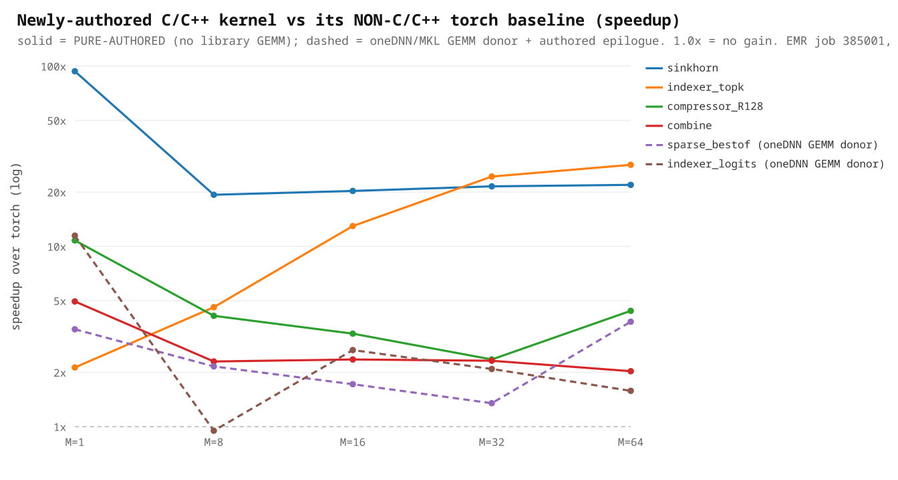
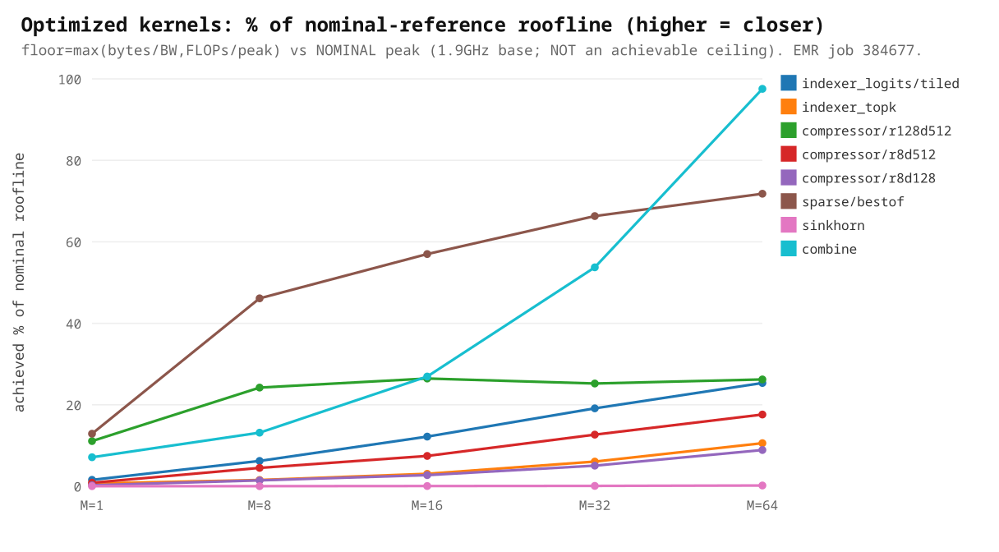
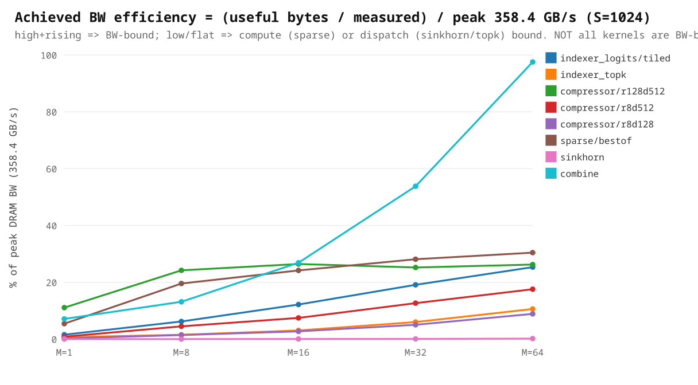
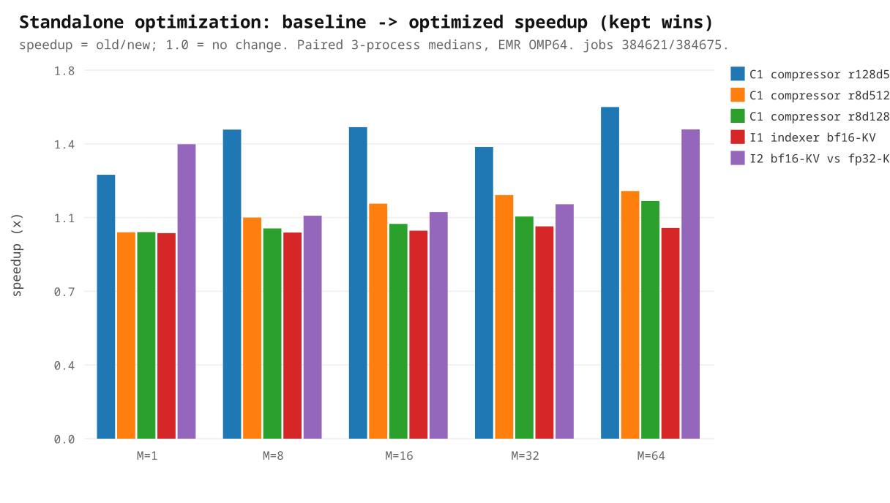
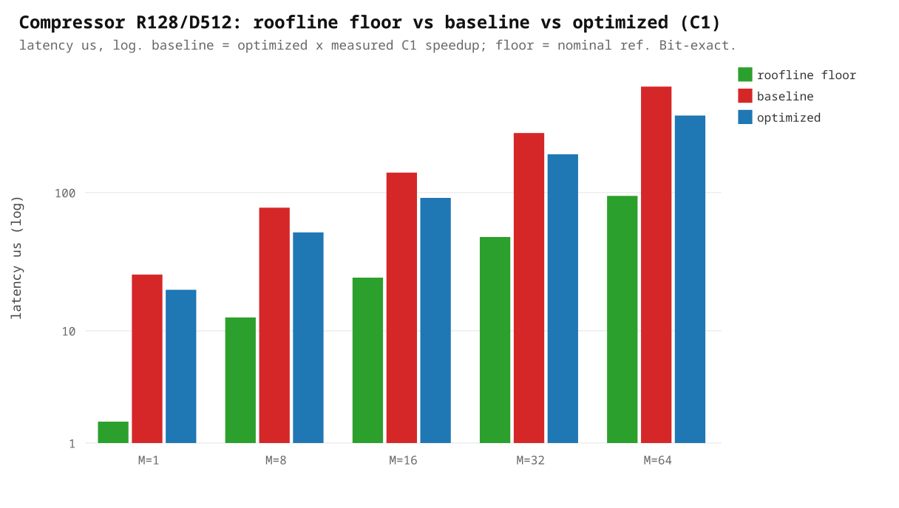

# DSv4-Flash DSA — C/C++ Kernel Pilot (Intel Xeon / EMR)

Standalone-kernel performance for the six authored CPU kernels of the DeepSeek-V4-Flash DSA path
(indexer logits, indexer top-k, compressor softmax-pool, sparse attention, MHC sinkhorn, MHC combine),
visualized **roofline vs baseline vs optimized**. All numbers are from the committed, self-identifying
artifacts [roofline_sweep.json](../plugin/validate/results/roofline_sweep.json) and
[standalone_opt.json](../plugin/validate/results/standalone_opt.json); regenerate the plots with
[make_kernel_pilot_plots.py](../plugin/validate/make_kernel_pilot_plots.py).

> **Read these honestly.** The roofline peak is the **nominal datasheet reference** (1.9 GHz base clock,
> BW 358.4 GB/s, AMX bf16 124.5 TF, FP32 7.78 TF) — **not a measured achievable ceiling**, so "% of
> roofline" is "% of nominal reference." The `regime` tag is the larger theoretical term (a diagnostic,
> not a measured bottleneck); cache-resident rows are not DRAM-saturated. These are **standalone
> microbench** results at each kernel's call contract — **not** end-to-end or a production certificate.
> Correctness is tracked separately and remains **PARTIAL** (F4 screening, thresholds UNRATIFIED,
> promotion **BLOCKED**).

## 1. Headline: newly-authored kernel vs its non-C/C++ (torch) baseline

The real benefit of authoring each kernel — measured against the **torch op it replaces**, at the kernel's
arithmetic contract (order-varied paired, 3-process medians, EMR job 385001). **solid = pure-authored**
(no library GEMM); **dashed = oneDNN/MKL GEMM donor + authored epilogue**.

| kernel | implementation | speedup vs torch (M1→M64) |
|---|---|---|
| **sinkhorn** | pure-authored (fused 20-iter recurrence) | **93.7× → 21.9×** |
| **indexer_topk** | pure-authored (selection + chunked) | 2.1× → **28.4×** |
| **compressor** | pure-authored (AVX-512 online-softmax) | **10.8× → 4.4×** |
| **combine** | pure-authored (accumulate-once) | 5.0× → 2.0× |
| sparse (best-of) | **oneDNN `at::bmm`** + authored fused softmax/sink | 3.5× → 3.8× |
| indexer_logits | **oneDNN `cpublas` BRGEMM** + authored bf16 epilogue | 11.5× → 1.6× (torch ref noisy) |

The four **pure-authored** kernels are **2×–94×** over torch. The two GEMM-heavy kernels (indexer_logits,
sparse) deliberately **reuse the oneDNN/MKL library GEMM** (donor-first) and author only the fused
epilogue/dispatch — so their speedup includes the library contraction; the *authored* contribution there is
the fusion that avoids the reference's extra temporaries, not the matmul itself.

## 2. How close the optimized kernels run to the nominal roofline

Achieved % of the nominal-reference roofline across the M-sweep (EMR 8592+, OMP64, job 384677, 3-process
medians). Highlights at M64: **combine 97.5%** (BW, cache-resident — near its useful-byte ceiling),
**sparse/bestof 71.8%** (compute-bound fp32-bmm donor, genuinely near the FP32 reference), **compressor
R128/D512 ~26%**, **indexer logits 25.3%** (BW, convert/pack-bound at small M). `indexer_topk` and
`sinkhorn` are **selection/dispatch-bound** — a byte-or-FLOP roofline is the *wrong* ceiling for them, so
their low % is a diagnostic, not a recoverable gap.

## 3. Achieved bandwidth efficiency (S=1024) — are they actually BW-bound?

Achieved BW = (useful bytes / measured time) ÷ peak 358.4 GB/s, at input seq-len S=1024 (indexer/top-k use
S=1024; compressor/sparse/sinkhorn/combine operate on fixed intermediate sizes, so S doesn't apply). **Not
all kernels are BW-bound**: `combine` approaches saturation at large M (but that is **cache-resident** BW,
not DRAM); `sparse` reaches only ~30% of BW because it is **compute-bound** (71.8% of the FP32 roof, §2);
`sinkhorn`/`indexer_topk` sit near 0% because they are **dispatch/selection-bound** (their byte traffic is
trivially small — the cost is op dispatch, not data movement). So the right ceiling differs per kernel.

## 4. Incremental standalone micro-optimizations (secondary — small by design)

These are *further* tweaks on top of the already-authored C/C++ kernels (not the kernel-vs-torch benefit in
§1). They are deliberately small.

Kept: **C1** compressor one-`exp` (bit-exact; R128 1.29–1.62×), **I1** indexer drop-unused-alloc (bit-exact;
small at large M), **I2** bf16-KV vs fp32-KV (1.09–1.51×, caller-dependent). The compressor 3-series shows
roofline floor vs pre-opt baseline vs C1-optimized.

### Measured dispositions (full audit trail in [standalone_opt.json](../plugin/validate/results/standalone_opt.json))

| Experiment | Result | Disposition |
|---|---|---|
| I1 — drop unused bf16 staging alloc | bit-exact; M32/M64 ~1.03–1.04× | **Kept** |
| I2 — bf16-KV vs fp32-KV | 1.09–1.51× (caller-dependent) | **Conditional** |
| C1 — one `exp` per compressor update | bit-exact; R128 1.29–1.62× | **Kept** |
| I3 — hoist invariant weight rounding | ~1.00× (compiler already hoists) | **Neutral → reverted** |
| C2 — ATen vector-`exp` | 0.62–1.01× (slower) | **Rejected** |
| C3 — multipass pooling | ~1.0–1.14× (not bit-exact, marginal) | **Not promoted** |
| S1 — blockwise bf16 brgemm sparse | 0.08–0.65× (1.6–12.8× slower than the donor) | **Rejected (measured loss)** |

Only measured wins ship (I1 + C1, both bit-exact); C2/C3/S1 are retained as labelled, correctness-screened
experimental variants, out of the shipped dispatch. A measured loss/neutral is a valid disposition.

## Provenance
- Roofline sweep: EMR node `pcl-sprh11`, source `aaccef6`, 3-process medians (job 384677), `LEGACY_RECONSTRUCTED` aggregate.
- Optimization deltas: EMR, jobs 384621 (step-2 I1/I2/C1) + 384675 (step-3 I3/C2/C3) + 384676 (S1), order-varied paired, 3 process replicates.
- Correctness: F4 acceptance gate (PARTIAL, screening-only), GPU oracle (H200, job 384502) for the sparse reference dtype.

## Next: end-to-end (Phase-2)
Progressive end-to-end wall-time on the depth-reduced dummy-weight proxy (proxy4 + proxy8 → `t(L)=t_fixed+L·t_layer`
extrapolation to 43 layers), at the chosen operating point (throughput headline B=32 @ S=1024, plus the B=1
single-stream latency floor), integrating each kernel one at a time. Baseline calibration is in progress; the
E2E tok/s curves will be added here.
