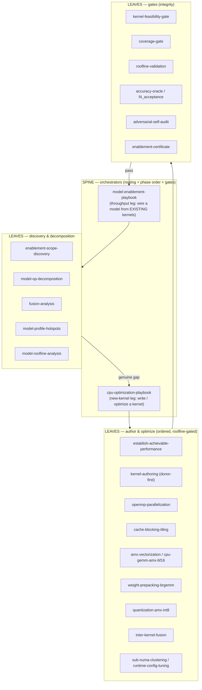
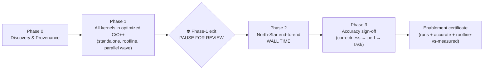

# CPU Enablement & Kernel-Optimization Playbook — Methodology

How a new model is brought up and made fast on Intel Xeon (EMR/GNR) CPUs: a **waterfall** of phases that
starts with discovery + provenance and ends with a running, accurate, roofline-validated model — orchestrated
by a **spine-leaf** set of skills, where **every phase is closed by a gate** so the output of one phase is
*trusted* before the next begins.

> This page documents the *method*. The executable rules live in `.agents/skills/`; a worked application is
> [kernel-pilot-performance.md](kernel-pilot-performance.md) (the DSv4-Flash DSA standalone-kernel results).
> The **Phase-1 "how-to"** — the staged way to optimize one kernel — is the
> [Standalone Kernel Optimization Playbook](standalone-kernel-optimization-playbook.md).

---

## 1. Spine-leaf structure

The method is **not** a monolith. A thin **spine** (two orchestrators) *routes* a target through a library of
**leaf** skills, loading each only when its trigger condition is met and gating every step against the
measured roofline. The spine decides *which* technique and *in what order*; the leaves *do* the work.

Same structure as a Mermaid source graph

- **`cpu-optimization-playbook`** — the *new-kernel* leg: write/optimize a kernel; routes it through
  establish-achievable → parallelize → tile → vectorize/AMX → prepack/BRGEMM → quantize → fuse, each gated by
  the roofline.
- **`model-enablement-playbook`** — the *throughput* leg: wire a whole model from existing kernels; its
  `coverage-gate` hands any genuine kernel gap to the new-kernel leg via the `cpu-optimizer` agent.
- **`shared/`** leaves (roofline-validation, establish-achievable-performance, perf-proxy, runtime-config-tuning,
  overhead-attribution, adversarial-self-audit, compute-from-native-precision) are used by both legs.

---

## 2. The waterfall — phases, in order

Each phase has a **purpose** (what it accomplishes), a **method** (how), and a **closing gate** (what makes
its output trusted). The order is strict: a later phase may not start until the prior gate passes.

### Phase 0 — Discovery & Provenance

- **Accomplishes:** a trustworthy map of *what* must be built — the real op graph, every op **and fused op**,
  per-op tensor shapes/dtypes, the knobs (batch/token **M**, KV-cache **S**/topk/page), and the dynamic
  dispatch branches — plus a **provenance binding** of every future kernel to the published source op at a
  pinned revision.
- **Method:** `enablement-scope-discovery` + `model-op-decomposition` + `fusion-analysis` read the *actual*
  model/reference (not assumptions); shapes are captured from a real run, never config-inferred.
  `model-profile-hotspots` + `model-roofline-analysis` rank the work by ROI and bound class.
- **Gate (trust):** **shape-provenance gate** — a kernel target is admitted only with captured shapes +
  dtypes + the source-op contract (storage/compute/accumulator dtype, intermediate rounding, mask/sink,
  output boundary, state). *A config-inferred shape is flagged UNVERIFIED and cannot carry a perf claim.*

### Phase 1 — All kernels in optimized C/C++ (the hard prerequisite)

- **Accomplishes:** every op/fused-op has an **authored C/C++ kernel**, each optimized across its knobs
  (full M-sweep + KV) **toward roofline**, with a published per-kernel roofline-target-vs-measured record.
- **Standing practice (exhaust in-phase + publish):** every legitimate **kernel-authoring** optimization for a
  kernel is **attempted in this phase** — not deferred, not left as a "could try." Attempt it, **measure it
  under the streaming methodology, and publish the result on the standalone-kernel page** — including a
  **measured loss**, which is a valid, first-class disposition (it closes the lever honestly so it is not
  re-proposed). *Example: sparse-attend's bf16-AMX lever was attempted in 3 configs, all measured slower than
  the fp32 donor, and that loss is published.* Only levers realized in the **serving path** (memory-traffic /
  dtype / layout) are handed to Phase 2; everything that lives **inside the kernel** is exhausted here.
- **Method (donor-first, parallel wave):** reuse an existing optimized primitive wherever one exists
  (OneDNN, ATen cpublas BRGEMM + VNNI pack, `at::bmm`, MKL, LIBXSMM) and author only the irreducible glue;
  author a net-new kernel only when no donor covers the contract (`kernel-authoring`). The per-kernel
  optimizations are **independent work items → fan them out in parallel**, ranked by ROI. Apply techniques
  in order (parallelize → tile → vectorize/AMX → prepack → quantize → fuse), **re-running `roofline-validation`
  after each step** and classifying the regime (BW / compute / selection / dispatch / cache-resident) before
  assuming headroom. The staged how-to is the
  [Standalone Kernel Optimization Playbook](standalone-kernel-optimization-playbook.md).
- **Gates (trust), all required per kernel:**
  - **`kernel-feasibility-gate`** (before authoring a net-new kernel): user-reviewed roofline + measured
    baseline → go/no-go.
  - **No-regression floor** vs the same-contract torch fallback at *every* M (faster or at worst a tie; else
    dispatch to the library path at that M).
  - **Fusion gate** — no avoidable intermediate DRAM round-trip (record the irreducible residual + why).
  - **Precision/BW gate** — store/read at the lowest precision the *reference* tolerates; fp32-accumulate;
    a precision that changes the reference dtype is a *conformance decision*, not a free lever.
  - **`accuracy-oracle` / `f4_acceptance`** — per-op acceptance: output contract (shape/dtype/device),
    finiteness, run-to-run **determinism**, selection membership (`tie_eps=0`), and a *screened* continuous
    error vs a **source-conformed** oracle. (Thresholds are the human reviewer's to ratify → verdict is
    PARTIAL, never a silent PASS.)
  - **Transcendental rule** — a replaced `exp`/`erf`/`tanh` uses an industry-standard minimax, carries a
    **measured ULP** (≈1 ULP bar for exp, vs fp64 over the real range), guards the edge cases the approximation
    changes, and **keeps both** the exact-`libm` (bit-exact oracle) and approx variants for the E2E A/B.
  - **Standalone-kernel performance PAGE** (like [kernel-pilot-performance.md](kernel-pilot-performance.md)):
    per-kernel roofline + baseline + optimization + analysis, **streaming (cold-cache) headline latency**
    (flush ≥2× LLC; warm only as a labeled secondary), `objdump %zmm` ISA check + stated flags, honest
    regime verdicts ("at ceiling" is a valid outcome **only after a config sweep shows the bound doesn't
    move** — see [§4 rule 7](#4-per-kernel-performance-gap-ledger-model-agnostic)), replicated with the noisy column flagged.
  - **In-phase exhaustion + gap ledger** — every legitimate kernel-authoring lever is attempted, measured, and
    its outcome (win *or* measured loss) published; every kernel exits Phase 1 with a
    [gap-ledger](#4-per-kernel-performance-gap-ledger-model-agnostic) row whose owning phase is assigned (no
    un-triaged gap, no deferred in-kernel lever).

### ⛔ Phase-1 exit — PAUSE FOR REVIEW (the integrity checkpoint)

- **Accomplishes:** prevents a mis-aimed or under-validated Phase 1 from contaminating the whole E2E phase.
- **Method:** run the **adversarial self-audit** *yourself* first — conform every oracle/reference to the
  authoritative published source, validate by **falsification** (red-team unseen sibling cases through the
  *full* entry path, not confirmation), and apply provenance to your *own* claims (re-verify every
  "closed/all/validated" against the artifact + real source).
- **Gate (trust):** **human review ratifies policy/tolerances** — the executor never silently widens a
  tolerance, drops a case, swaps a comparator, or relabels uncertainty as parity. Do **not** auto-advance.

### Phase 2 — North-Star end-to-end wall time

- **Accomplishes:** the actual deployment metric — end-to-end tok/s at a chosen operating point — with each
  optimization's wall-time contribution attributed.
- **Method:**
  1. **Frame the KPI first (ask the user):** fix the operating point **(input S, batch B=M, output G)** +
     headline metric (throughput serving vs B=1 latency floor; default both).
  2. **Preserve the kosher baseline:** freeze the golden fingerprint, **tag** the baseline commit, make every
     optimization **env-gated default-OFF** so gate-off reproduces the baseline byte-for-byte. Clear the known
     systemic pathologies on the *baseline* (threads bound once at init, one rank per NUMA domain, no
     per-forward `set_num_threads`).
  3. **Integrate the authored kernels progressively — on the truncated `perf-proxy`.** The depth-reduced,
     full-width proxy is the integration *vehicle* (queue-free, ~`full/proxy`× faster): wire each authored
     kernel **one at a time**, env-gated default-OFF, with a per-toggle dummy-weight fingerprint gate, and
     record each wall-time delta **broken down into kernel / framework / dispatch** (via `overhead-attribution`)
     so every delta is bisectable to one op and the residual is *named*, not lumped. Predict full depth during
     iteration with the **two-depth linear model** `t(L) = t_fixed + L·t_layer` *per regime* (prefill/decode) —
     never naive `t_proxy/layers × full_layers`.
  4. **Carry forward the integration-class levers** surfaced during the standalone-kernel phase — memory-traffic,
     dtype, and data-layout wins that the kernel already supports but that are realized only in the serving path
     (e.g. a **bf16 KV cache**: numerically identical to what a bf16-rounding GEMM consumes, yet halves the
     dominant read and **amortizes across every op that reads that cache**, with the most leverage at decode
     M=1). Log each at discovery as a tracked Phase-2 lever (mechanism / amortization / expected delta /
     fingerprint-invariant gate / status), so it is optimized here instead of rediscovered later.
  5. **Address framework / dispatch overhead last** (after the kernels are in). With the authored kernels
     wired, the residual is the per-op **dispatch/framework tax** — OpenMP barriers, allocations, thread-pool
     rebuilds, lost affinity — attacked with **fewer/bigger parallel regions, bind-once-at-init, one rank per
     NUMA domain, prepack** (`runtime-config-tuning`). Doing it *after* kernel integration keeps the per-kernel
     attribution clean: a global config pathology otherwise masquerades as uniform per-op cost.
  6. **Full-depth dummy-weight run — measure & attribute.** Once proxy iteration converges, run the
     **full-depth (all-layer) dummy-weight** model to *measure* the real wall time and **attribute it across
     components** (per-kernel / framework / dispatch, via the per-op pivot). This both **validates the two-depth
     extrapolation** and exposes any residual depth-accumulating overhead (allocator / thread-pool /
     cache-residency) to bisect. Only now is the headline tok/s final — then the real-weight accuracy sign-off
     (Phase 3).
- **MoE proxy mode-collapse guard (when the model is MoE).** A depth-reduced **dummy-weight** proxy's random
  router routes **degenerately** — it collapses the whole batch onto the *same* few experts, not the real
  learned distribution — which **invalidates both the wall-time and the correctness check** until fixed:
  batched-MoE decode cost tracks the **distinct-expert working set** (which grows with batch), so a collapsed
  router under-counts expert memory traffic and looks **falsely fast**, and a single-expert path hides the
  grouped-GEMM gather/scatter routing bugs. **Keep the real router/gate weights** (tiny — load them even with
  dummy *expert* weights), drive **varied tokens** (never one repeated prompt), match the real top-k/grouping,
  and **gate on the measured distinct-expert-per-batch histogram matching the real `E(distinct | B)`** (not 1,
  not all-N) before trusting any MoE perf or parity from the proxy. (See `perf-proxy`.)
- **The ceiling is the model-level throughput roofline (target measured tok/s ≥ 70–75% at *every* M).**
  Decode is memory-bound: `tok/s_roof(M) = M·BW / (W_active + M·KV_tok)`, where `W_active` = weight bytes
  read per step (**MoE-aware: active experts only**, at the checkpoint dtype) and `KV_tok` = KV bytes/token
  (KV dtype). Prefill is compute-bound → a separate `FLOPs/peak` roofline, so **split the ceiling by phase.**
  Plot `tok/s_roof(M)` as the **ceiling line** on the E2E progression chart; the measured-vs-roofline gap is
  **integration efficiency**, attributed by the per-op pivot (e.g. MoE ~47%, authored DSA+MHC ~25–30%). The
  roofline rewards memory-traffic levers directly — **bf16-KV halves `KV_tok`; fp4/fp8 experts shrink
  `W_active`; both raise the ceiling** — and at M=1 the ceiling is both LOW (weights read for one token) and
  hard to reach (overhead), so batching raises both the ceiling and the efficiency (DSv4 ~26% at M=1 vs ~75%
  batched). The 70–75% headroom budgets non-overlap, dispatch gaps, and the authored-op slice (not pure
  weight-GEMM).
- **Gate (trust):** per-toggle **dummy-weight fingerprint** stays invariant (perf transform, not a numeric
  change); the full-depth run validates the extrapolation; the roofline+pivot report pair is emitted.

### Phase 3 — Accuracy sign-off (correctness → perf → task, in that order)

- **Accomplishes:** proves the fast CPU build is *numerically faithful*, then *task-accurate*.
- **Method:** per-layer **parity** vs the reference oracle (real weights, one short prefill) is the first
  correctness gate; on the dummy proxy the guard is the optimized-vs-reference A/B on the same input; **task
  accuracy** (real weights, full generation) is last. The task sign-off has two legitimate routes —
  **(A) reproduce the published card number** or **(B) CPU-vs-GPU equivalence on a short benchmark** — surfaced
  as a **user decision** (cost vs external-validation tradeoff), never silently chosen.
- **Gate (trust):** golden per-op parity + full-model re-diff; an optimization becomes the default only after
  it passes both. `enablement-certificate` records runs-end-to-end + accuracy-parity + roofline-vs-measured.

---

## 3. The gate ladder (why each phase output is trusted)

| phase | closing gate | what it guarantees |
|---|---|---|
| 0 Discovery | shape-provenance gate | shapes/dtypes/contract are *captured from source*, not assumed |
| 1 Author (per kernel) | feasibility → no-regression floor → fusion → precision → `f4_acceptance` → page | correct (contract/finite/deterministic/selection), never slower than torch, no wasted DRAM traffic, published roofline record |
| 1 exit | adversarial self-audit + **human review** | falsified not just confirmed; tolerances ratified by a human, not the executor |
| 2 E2E | kosher-baseline freeze/tag/env-gate + per-toggle fingerprint + two-depth validation | every speedup is bisectable to one op; baseline is one `git checkout` away; extrapolation is validated |
| 3 Accuracy | golden parity + full re-diff + task sign-off (user-chosen route) | numerically faithful *and* task-accurate vs a trusted reference |
| cycle exit | roofline+pivot report pair + standalone-kernel page + certificate | "done" = runs + accurate + roofline-vs-measured, published |

**Cross-cutting invariants** (hold in every phase): PROVENANCE always (no claim without its bound evidence);
DONOR-FIRST (never re-implement a library primitive); MEASURE don't assume (regime, ULP, streaming number,
ISA via `objdump`); and `adversarial-self-audit` before submitting any gate/record/review-response — fix the
vulnerability **class**, not the shown instance.

---

## 4. Per-kernel performance-gap ledger (model-agnostic)

The standing mechanism that turns "roofline vs measured" into a tracked to-do list for **any** model. Every
standalone kernel gets **one row**; a kernel is not "done" until its gap is *classified* and, if recoverable,
*assigned an owning phase*. It is populated at **Phase-1 exit**, carried through Phase 2/3, and **published on
the standalone-kernel page** so the gap analysis ships alongside the speedup — not just the win.

**Ledger row (one per kernel):**

| field | meaning |
|---|---|
| roofline floor | analytic `max(bytes/BW, FLOPs/peak)` vs the **nominal** peak (not an achievable ceiling) |
| measured | promoted-variant **streaming** latency (LLC-flushed), 3-replicate median |
| % roof | floor / measured — the honest ceiling check |
| regime / bound | BW · compute · cache-resident · selection · dispatch · recurrence |
| **gap class** | **RECOVERABLE** (roofline *is* the operative bound and measured is below it) · **WRONG-CEILING** (selection/dispatch/recurrence — a byte/FLOP roofline is not the bound; low % is diagnostic, not owed) · **AT-CEILING** (meets the roof, or cache-resident so the nominal roof under-counts) |
| root cause | *why* perf is lost — attributed, not guessed (which bytes, which overhead, which serial dependency) |
| opportunity | the concrete lever + **expected effect** (e.g. "bf16-KV halves the dominant read → floor 50→25 µs, ~1.5×") |
| **owning phase** | where the fix is realized (see mapping below) |
| status | open · in-flight · closed · owed-to-Phase-2 |

**Owning-phase mapping** (every RECOVERABLE gap gets exactly one):

- **Phase 1 — kernel authoring:** the lever lives *inside the kernel* — compute dtype (bf16/AMX), fusion,
  vectorization, transcendental, tiling. *(e.g. sparse-attend bf16-AMX GEMM.)*
- **Phase 2 — E2E integration:** the lever is realized only in the **serving path** — memory-traffic / cache
  dtype / data layout / batching. The kernel may already support it; the caller must supply it. These are
  **mirrored into the Phase-2 carry-forward lever backlog** (default-OFF, env-gated, dummy-weight
  fingerprint-invariant). *(e.g. bf16 KV cache, amortized across every KV-reading op.)*
- **Phase 3 — accuracy:** a numerically non-identical candidate (a tolerance-gated bf16/fp8 path) that is
  **ratified** by the task-accuracy gate before promotion. *(e.g. the sparse bf16 candidate.)*
- **Closed — regime ceiling:** WRONG-CEILING or AT-CEILING kernels — no owed work; the low/high % is honest.

**Rules.** (1) No kernel ships without a ledger row. (2) Never label a gap RECOVERABLE without **attribution**
(stage timers / isolation microbench) separating achievable-BW shortfall from fixed convert/pack/dispatch
overhead — the roofline % alone does not prove recoverability. (3) WRONG-CEILING is a first-class, legitimate
disposition: a selection/dispatch/recurrence op at 2% of a byte roofline is *at ceiling*, not failing. (4) Each
RECOVERABLE row is mirrored to its owning queue (Phase-2 backlog or the standalone author queue) so it is not
rediscovered later. (5) The ledger is the per-kernel source of truth published on the standalone-kernel page.
(6) **PREDICTED ≠ MEASURED.** The "opportunity (expected effect)" is a **hypothesis** — label it predicted/
unvalidated and never publish a predicted multiple as a result. Validate upside **cost-scaled, cheapest-first**
(whole-op component model → isolation microbench → minimal variant → full); the roofline of *one component*
over-predicts when the op has other first-order costs the lever doesn't move or *inflates* (the sparse-attend
bf16 miss). For an expensive pass the isolation microbench is **mandatory before committing**; for a cheap pass,
measurement is the smoke test — but the predicted number is never the published outcome. *(See the standalone
playbook [Stage 1.5](standalone-kernel-optimization-playbook.md#stage-15--validate-a-levers-upside-before-committing-cost-scaled).)*

**(7) A BOUND IS A TESTED HYPOTHESIS, NOT A WALL.** An `AT-CEILING` or `WRONG-CEILING` disposition is valid
**only after** (a) a **config sweep** — tiles / grain / effective-threads, via `grain_size`/task-count, **never
per-forward `set_num_threads`** (it rebuilds the OMP pool and loses affinity) — shows the bound does **not**
move, *and* (b) the attribution-motivated knob has been **measured**: the **precision** lever where it hits the
dominant component (bf16/fp8 — may win *or* lose, both published) and **authoring our own donor** inner loop
when measurement localizes the bottleneck *there* (rare — otherwise document the donor's interface shortcoming,
route around it, publish the gap). If the bound **moves** with config it was config (fix it, ship the per-M
optimum); if it doesn't, it is algorithmic/hardware (at ceiling). *Closing on assertion is the anti-pattern —
the sinkhorn low-batch win (adaptive serial dispatch, +1.15–2.09× bit-exact) was found precisely because the
knob was tested, not assumed; and three other ceilings were **confirmed** by the knob measuring a loss.*

**(8) TARGET PER COMPONENT, not the total %.** Decompose into data-movement / compute / dispatch and target
**each**: data-movement ≥75% of the **operative** BW (DRAM when the working set exceeds cache; **cache BW when
it fits** — not nominal DRAM); compute ≥ its ISA/dtype peak (AMX or AVX-512, per shape/M); overhead → 0 via
adaptive config. The roofline-% of the *total* latency is a **diagnostic** of which component dominates the
leftover gap, not the target — and the nominal roofline can be the **wrong ceiling** (an op at 24% of the
nominal DRAM roof but ~52% of its measured *operative* GEMM/dispatch floor is near its real ceiling).
