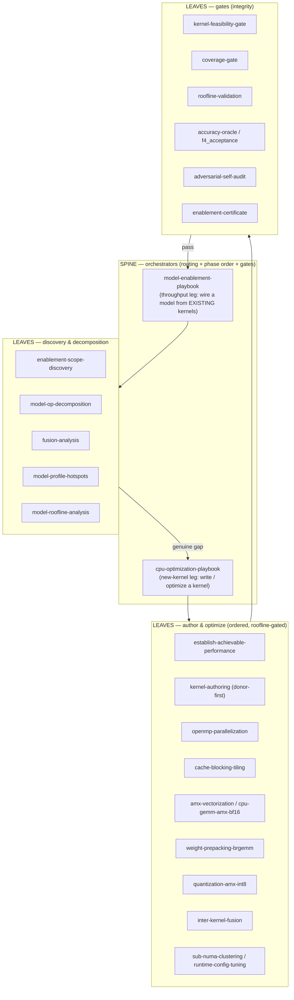
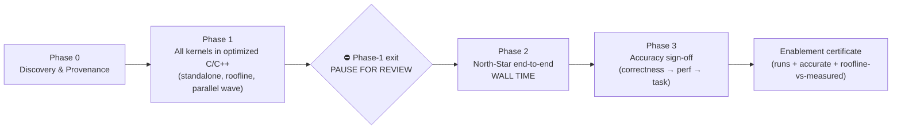

# CPU Enablement & Kernel-Optimization Playbook — Methodology

How a new model is brought up and made fast on Intel Xeon (EMR/GNR) CPUs: a **waterfall** of phases that
starts with discovery + provenance and ends with a running, accurate, roofline-validated model — orchestrated
by a **spine-leaf** set of skills, where **every phase is closed by a gate** so the output of one phase is
*trusted* before the next begins.

> This page documents the *method*. The executable rules live in `.agents/skills/`; a worked application is
> [kernel-pilot-performance.md](kernel-pilot-performance.md) (the DSv4-Flash DSA standalone-kernel results).

---

## 1. Spine-leaf structure

The method is **not** a monolith. A thin **spine** (two orchestrators) *routes* a target through a library of
**leaf** skills, loading each only when its trigger condition is met and gating every step against the
measured roofline. The spine decides *which* technique and *in what order*; the leaves *do* the work.

- **`cpu-optimization-playbook`** — the *new-kernel* leg: write/optimize a kernel; routes it through
  establish-achievable → parallelize → tile → vectorize/AMX → prepack/BRGEMM → quantize → fuse, each gated by
  the roofline.
- **`model-enablement-playbook`** — the *throughput* leg: wire a whole model from existing kernels; its
  `coverage-gate` hands any genuine kernel gap to the new-kernel leg via the `cpu-optimizer` agent.
- **`shared/`** leaves (roofline-validation, establish-achievable-performance, perf-proxy, runtime-config-tuning,
  overhead-attribution, adversarial-self-audit, compute-from-native-precision) are used by both legs.

---

## 2. The waterfall — phases, in order

Each phase has a **purpose** (what it accomplishes), a **method** (how), and a **closing gate** (what makes
its output trusted). The order is strict: a later phase may not start until the prior gate passes.

### Phase 0 — Discovery & Provenance

- **Accomplishes:** a trustworthy map of *what* must be built — the real op graph, every op **and fused op**,
  per-op tensor shapes/dtypes, the knobs (batch/token **M**, KV-cache **S**/topk/page), and the dynamic
  dispatch branches — plus a **provenance binding** of every future kernel to the published source op at a
  pinned revision.
- **Method:** `enablement-scope-discovery` + `model-op-decomposition` + `fusion-analysis` read the *actual*
  model/reference (not assumptions); shapes are captured from a real run, never config-inferred.
  `model-profile-hotspots` + `model-roofline-analysis` rank the work by ROI and bound class.
- **Gate (trust):** **shape-provenance gate** — a kernel target is admitted only with captured shapes +
  dtypes + the source-op contract (storage/compute/accumulator dtype, intermediate rounding, mask/sink,
  output boundary, state). *A config-inferred shape is flagged UNVERIFIED and cannot carry a perf claim.*

### Phase 1 — All kernels in optimized C/C++ (the hard prerequisite)

- **Accomplishes:** every op/fused-op has an **authored C/C++ kernel**, each optimized across its knobs
  (full M-sweep + KV) **toward roofline**, with a published per-kernel roofline-target-vs-measured record.
- **Method (donor-first, parallel wave):** reuse an existing optimized primitive wherever one exists
  (OneDNN, ATen cpublas BRGEMM + VNNI pack, `at::bmm`, MKL, LIBXSMM) and author only the irreducible glue;
  author a net-new kernel only when no donor covers the contract (`kernel-authoring`). The per-kernel
  optimizations are **independent work items → fan them out in parallel**, ranked by ROI. Apply techniques
  in order (parallelize → tile → vectorize/AMX → prepack → quantize → fuse), **re-running `roofline-validation`
  after each step** and classifying the regime (BW / compute / selection / dispatch / cache-resident) before
  assuming headroom.
- **Gates (trust), all required per kernel:**
  - **`kernel-feasibility-gate`** (before authoring a net-new kernel): user-reviewed roofline + measured
    baseline → go/no-go.
  - **No-regression floor** vs the same-contract torch fallback at *every* M (faster or at worst a tie; else
    dispatch to the library path at that M).
  - **Fusion gate** — no avoidable intermediate DRAM round-trip (record the irreducible residual + why).
  - **Precision/BW gate** — store/read at the lowest precision the *reference* tolerates; fp32-accumulate;
    a precision that changes the reference dtype is a *conformance decision*, not a free lever.
  - **`accuracy-oracle` / `f4_acceptance`** — per-op acceptance: output contract (shape/dtype/device),
    finiteness, run-to-run **determinism**, selection membership (`tie_eps=0`), and a *screened* continuous
    error vs a **source-conformed** oracle. (Thresholds are the human reviewer's to ratify → verdict is
    PARTIAL, never a silent PASS.)
  - **Transcendental rule** — a replaced `exp`/`erf`/`tanh` uses an industry-standard minimax, carries a
    **measured ULP** (≈1 ULP bar for exp, vs fp64 over the real range), guards the edge cases the approximation
    changes, and **keeps both** the exact-`libm` (bit-exact oracle) and approx variants for the E2E A/B.
  - **Standalone-kernel performance PAGE** (like [kernel-pilot-performance.md](kernel-pilot-performance.md)):
    per-kernel roofline + baseline + optimization + analysis, **streaming (cold-cache) headline latency**
    (flush ≥2× LLC; warm only as a labeled secondary), `objdump %zmm` ISA check + stated flags, honest
    regime verdicts ("at ceiling" is a valid outcome), replicated with the noisy column flagged.

### ⛔ Phase-1 exit — PAUSE FOR REVIEW (the integrity checkpoint)

- **Accomplishes:** prevents a mis-aimed or under-validated Phase 1 from contaminating the whole E2E phase.
- **Method:** run the **adversarial self-audit** *yourself* first — conform every oracle/reference to the
  authoritative published source, validate by **falsification** (red-team unseen sibling cases through the
  *full* entry path, not confirmation), and apply provenance to your *own* claims (re-verify every
  "closed/all/validated" against the artifact + real source).
- **Gate (trust):** **human review ratifies policy/tolerances** — the executor never silently widens a
  tolerance, drops a case, swaps a comparator, or relabels uncertainty as parity. Do **not** auto-advance.

### Phase 2 — North-Star end-to-end wall time

- **Accomplishes:** the actual deployment metric — end-to-end tok/s at a chosen operating point — with each
  optimization's wall-time contribution attributed.
- **Method:**
  1. **Frame the KPI first (ask the user):** fix the operating point **(input S, batch B=M, output G)** +
     headline metric (throughput serving vs B=1 latency floor; default both).
  2. **Preserve the kosher baseline:** freeze the golden fingerprint, **tag** the baseline commit, make every
     optimization **env-gated default-OFF** so gate-off reproduces the baseline byte-for-byte. Clear the known
     systemic pathologies on the *baseline* (threads bound once at init, one rank per NUMA domain, no
     per-forward `set_num_threads`).
  3. **Integrate one optimization at a time**, env-gated, with a dummy-weight output-fingerprint gate per
     toggle; record the wall-time delta per toggle.
  4. **Extrapolate from the `perf-proxy`** (depth-reduced, full-width, dummy weights) with the **two-depth
     linear model** `t(L) = t_fixed + L·t_layer` *per regime* (prefill/decode) — never naive
     `t_proxy/layers × full_layers`. The one full-depth dummy run **validates** the extrapolation and exposes
     residual depth-accumulating overhead to bisect (`runtime-config-tuning` for threads/affinity/NUMA/prepack).
- **Gate (trust):** per-toggle **dummy-weight fingerprint** stays invariant (perf transform, not a numeric
  change); the full-depth run validates the extrapolation; the roofline+pivot report pair is emitted.

### Phase 3 — Accuracy sign-off (correctness → perf → task, in that order)

- **Accomplishes:** proves the fast CPU build is *numerically faithful*, then *task-accurate*.
- **Method:** per-layer **parity** vs the reference oracle (real weights, one short prefill) is the first
  correctness gate; on the dummy proxy the guard is the optimized-vs-reference A/B on the same input; **task
  accuracy** (real weights, full generation) is last. The task sign-off has two legitimate routes —
  **(A) reproduce the published card number** or **(B) CPU-vs-GPU equivalence on a short benchmark** — surfaced
  as a **user decision** (cost vs external-validation tradeoff), never silently chosen.
- **Gate (trust):** golden per-op parity + full-model re-diff; an optimization becomes the default only after
  it passes both. `enablement-certificate` records runs-end-to-end + accuracy-parity + roofline-vs-measured.

---

## 3. The gate ladder (why each phase output is trusted)

| phase | closing gate | what it guarantees |
|---|---|---|
| 0 Discovery | shape-provenance gate | shapes/dtypes/contract are *captured from source*, not assumed |
| 1 Author (per kernel) | feasibility → no-regression floor → fusion → precision → `f4_acceptance` → page | correct (contract/finite/deterministic/selection), never slower than torch, no wasted DRAM traffic, published roofline record |
| 1 exit | adversarial self-audit + **human review** | falsified not just confirmed; tolerances ratified by a human, not the executor |
| 2 E2E | kosher-baseline freeze/tag/env-gate + per-toggle fingerprint + two-depth validation | every speedup is bisectable to one op; baseline is one `git checkout` away; extrapolation is validated |
| 3 Accuracy | golden parity + full re-diff + task sign-off (user-chosen route) | numerically faithful *and* task-accurate vs a trusted reference |
| cycle exit | roofline+pivot report pair + standalone-kernel page + certificate | "done" = runs + accurate + roofline-vs-measured, published |

**Cross-cutting invariants** (hold in every phase): PROVENANCE always (no claim without its bound evidence);
DONOR-FIRST (never re-implement a library primitive); MEASURE don't assume (regime, ULP, streaming number,
ISA via `objdump`); and `adversarial-self-audit` before submitting any gate/record/review-response — fix the
vulnerability **class**, not the shown instance.
