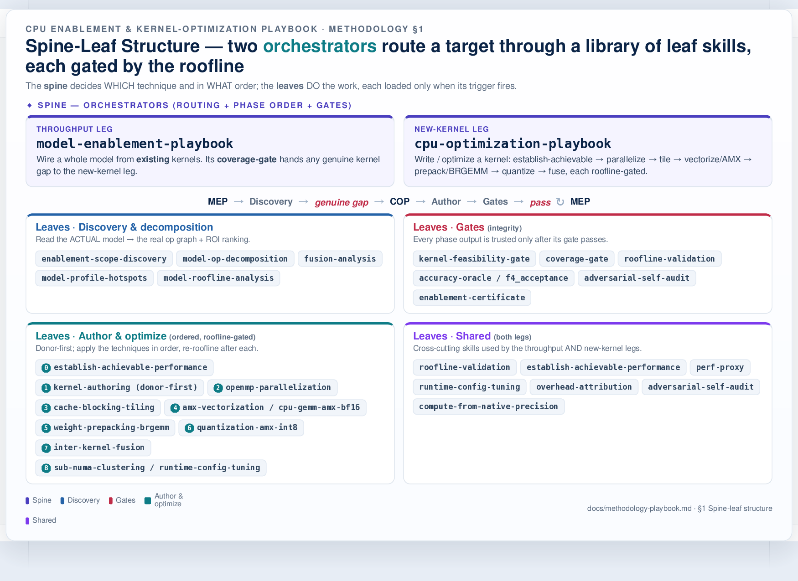
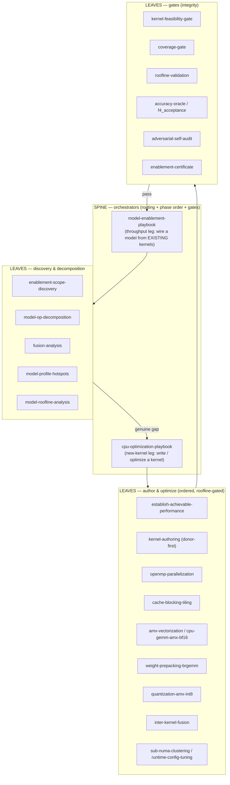
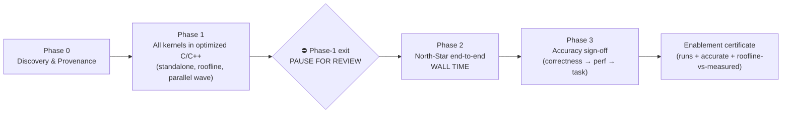

# CPU Enablement & Kernel-Optimization Playbook — Methodology

How a new model is brought up and made fast on Intel Xeon (EMR/GNR) CPUs: a **waterfall** of phases that
starts with discovery + provenance and ends with a running, accurate, roofline-validated model — orchestrated
by a **spine-leaf** set of skills, where **every phase is closed by a gate** so the output of one phase is
*trusted* before the next begins.

> This page documents the *method*. The executable rules live in `.agents/skills/`; a worked application is
> [kernel-pilot-performance.md](kernel-pilot-performance.md) (the DSv4-Flash DSA standalone-kernel results).
> The **Phase-1 "how-to"** — the staged way to optimize one kernel — is the
> [Standalone Kernel Optimization Playbook](standalone-kernel-optimization-playbook.md).

---

## 1. Spine-leaf structure

The method is **not** a monolith. A thin **spine** (two orchestrators) *routes* a target through a library of
**leaf** skills, loading each only when its trigger condition is met and gating every step against the
measured roofline. The spine decides *which* technique and *in what order*; the leaves *do* the work.

Same structure as a Mermaid source graph

- **`cpu-optimization-playbook`** — the *new-kernel* leg: write/optimize a kernel; routes it through
  establish-achievable → parallelize → tile → vectorize/AMX → prepack/BRGEMM → quantize → fuse, each gated by
  the roofline.
- **`model-enablement-playbook`** — the *throughput* leg: wire a whole model from existing kernels; its
  `coverage-gate` hands any genuine kernel gap to the new-kernel leg via the `cpu-optimizer` agent.
- **`shared/`** leaves (roofline-validation, establish-achievable-performance, perf-proxy, runtime-config-tuning,
  overhead-attribution, adversarial-self-audit, compute-from-native-precision) are used by both legs.

---

## 2. The waterfall — phases, in order

Each phase has a **purpose** (what it accomplishes), a **method** (how), and a **closing gate** (what makes
its output trusted). The order is strict: a later phase may not start until the prior gate passes.

### Phase 0 — Discovery & Provenance

- **Accomplishes:** a trustworthy map of *what* must be built — the model's **dataflow graph** (not just an op
  *list*): every op **and fused op** as a **node**, plus the **edges** (producer→consumer), the **operands
  shared across nodes** (e.g. a KV cache or a compressed representation read by several ops), the **per-edge
  dtype/layout flow** (what each op actually *receives* from its producer), each node's **scaling dimension**
  (what makes its cost grow — batch / seq / top-k / experts), and the **architectural *intent*** of each
  sub-graph (e.g. a cheap low-precision *filter* feeding a precise *consumer*). Plus per-op shapes/dtypes, the
  knobs (batch/token **M**, KV-cache **S**/topk/page), the dynamic dispatch branches, and a **provenance
  binding** of every future kernel to the published source op at a pinned revision.
- **Method:** `enablement-scope-discovery` + `model-op-decomposition` + `fusion-analysis` read the *actual*
  model/reference (not assumptions); shapes are captured from a real run, never config-inferred. The
  **dataflow graph (nodes + edges + shared operands + intent) is verified against the EXTERNAL reference
  architecture** (the paper / official repo / reference kernels), not inferred from config or our own port — a
  composite mechanism (e.g. a sparse-attention sub-graph: compress → index → select → attend) is only understood
  once its stages and their hand-offs are confirmed against the source design.
  `model-profile-hotspots` + `model-roofline-analysis` rank the work by ROI and bound class.
- **Gate (trust):** **graph-/shape-provenance gate** — a kernel target is admitted only with captured shapes +
  dtypes + the source-op contract (storage/compute/accumulator dtype, intermediate rounding, mask/sink,
  output boundary, state) **and its place in the externally-verified dataflow graph** (what produces its
  inputs, what consumes its outputs, which operands it shares, what dimension it scales with). *A
  config-inferred shape — or a kernel scoped in isolation from its verified graph context — is flagged
  UNVERIFIED and cannot carry a perf claim.*
- **Gate (trust): REFERENCE+ORACLE HANDSHAKE — run it BEFORE any kernel code is written.** Establish the two
  correctness anchors *up front*, so every op is ported against an authoritative contract and a frozen
  per-layer target from day one (not reverse-engineered after an accuracy miss). The ordered handshake:
  1. **Authors' reference = PRIMARY provenance.** Locate the authors' reference inference code
     (`inference/model.py`+`kernel.py` / `modeling_*.py` / released paper code), pin its path/commit, and make
     it a **required input** to decomposition alongside the config + framework model class. Extract each op's
     **numerical contract** (dtype at each stage, QAT round-trips, norm scope, RoPE direction/convention, scale
     factors, mask, routing kind). Port to **match** it — *"numerically exact / higher precision" is a BUG when
     the model is QAT-trained for a lower precision.*
  2. **Compare the GPU oracle (the framework stack you'll run) AGAINST that reference** — op-level torch
     transcription + the oracle reproducing published accuracy via a trusted path (the reference often needs
     special deps and may not run end-to-end, so this is usually op-level, not a full reference run). If the GPU
     oracle itself deviates from the reference, resolve that **first** — else "CPU matching the GPU" silently
     inherits the GPU's deviation.
  3. **Only if they match, RUN the GPU implementation to produce the frozen anchors:** **(a)** certify it hits
     the **published accuracy** on the right checkpoint+protocol (this certifies the oracle *before* it judges
     anything); **(b)** capture **per-(layer, sub-op) fingerprints** (logits/tensors) once, reused for all later
     CPU A/Bs.
  4. **Before porting EACH op, read the reference op and match its contract;** validate the port against the
     reference math (a cheap op-level `cos` on random inputs, **no model load**) — not only a self-oracle (a
     self-oracle derived from your own reading **inherits your blindspot**).

  **Capture-contract + comparison rules that make the fingerprints trustworthy** (learned the hard way):
  **(i)** a canonical capture contract — same TP degree, batch/seq, prefill chunking, **frozen token-ids**,
  identical named sub-op taps + layout convention (define which axis is "hidden"; how clustered streams flatten),
  greedy/teacher-forced, fixed seed; **request-BIND** the capture to the real prompt and **reject the
  warmup/dummy forward** (assert the embedding anchor). **(ii)** Discrete artifacts (expert indices, hash
  lookups, top-k selections) use **exact set-match, not cosine**. **(iii)** Per-layer cosine is **thresholded**
  (≈≥0.999 at bf16) at **sub-op granularity**, with first-divergence bisection on fail. **(iv)** The pass bar is
  the measured **noise floor** (GPU-vs-GPU run-to-run + version), on a **version-pinned** oracle — not 1.0.
  **(v)** Success = per-op cosine/exact-match vs reference **and** end-to-end published/peer accuracy;
  **top-1-vs-GPU is a LOCALIZER, not the success criterion** (it can stay flat as a cross-config artifact while
  accuracy is fine, or vice-versa). *(Cost moves EARLIER, not up: the GPU time + published-accuracy repro +
  layer-capture plumbing are paid once, up front, and reused. Had this handshake been a Phase-0 precondition,
  the DSV4 ~15-pt bug would have surfaced at port time, not after a multi-day arc.)*

### Phase 1 — All kernels in optimized C/C++ (the hard prerequisite)

- **Accomplishes:** every op/fused-op has an **authored C/C++ kernel**, each optimized across its knobs
  (full M-sweep + KV) **toward roofline**, with a published per-kernel roofline-target-vs-measured record.
- **Standing practice (exhaust in-phase + publish):** every legitimate **kernel-authoring** optimization for a
  kernel is **attempted in this phase** — not deferred, not left as a "could try." Attempt it, **measure it
  under the streaming methodology, and publish the result on the standalone-kernel page** — including a
  **measured loss**, which is a valid, first-class disposition (it closes the lever honestly so it is not
  re-proposed). *Example: sparse-attend's bf16-AMX lever was attempted in 3 configs, all measured slower than
  the fp32 donor, and that loss is published.* Only levers realized in the **serving path** (memory-traffic /
  dtype / layout) are handed to Phase 2; everything that lives **inside the kernel** is exhausted here.
- **Method (donor-first, parallel wave):** reuse an existing optimized primitive wherever one exists
  (OneDNN, ATen cpublas BRGEMM + VNNI pack, `at::bmm`, MKL, LIBXSMM) and author only the irreducible glue;
  author a net-new kernel only when no donor covers the contract (`kernel-authoring`). The per-kernel
  optimizations are **independent work items → fan them out in parallel**, ranked by ROI. Apply techniques
  in order (parallelize → tile → vectorize/AMX → prepack → quantize → fuse), **re-running `roofline-validation`
  after each step** and classifying the regime (BW / compute / selection / dispatch / cache-resident) before
  assuming headroom. The staged how-to is the
  [Standalone Kernel Optimization Playbook](standalone-kernel-optimization-playbook.md).
- **Gates (trust), all required per kernel:**
  - **`kernel-feasibility-gate`** (before authoring a net-new kernel): user-reviewed roofline + measured
    baseline → go/no-go.
  - **No-regression floor** vs the same-contract torch fallback at *every* M (faster or at worst a tie; else
    dispatch to the library path at that M).
  - **Fusion gate** — no avoidable intermediate DRAM round-trip (record the irreducible residual + why).
  - **Precision/BW gate** — store/read at the lowest precision the *reference* tolerates; fp32-accumulate;
    a precision that changes the reference dtype is a *conformance decision*, not a free lever.
  - **`accuracy-oracle` / `f4_acceptance`** — per-op acceptance: output contract (shape/dtype/device),
    finiteness, run-to-run **determinism**, selection membership (`tie_eps=0`), and a *screened* continuous
    error vs a **source-conformed** oracle. (Thresholds are the human reviewer's to ratify → verdict is
    PARTIAL, never a silent PASS.)
  - **Transcendental rule** — a replaced `exp`/`erf`/`tanh` uses an industry-standard minimax, carries a
    **measured ULP** (≈1 ULP bar for exp, vs fp64 over the real range), guards the edge cases the approximation
    changes, and **keeps both** the exact-`libm` (bit-exact oracle) and approx variants for the E2E A/B.
  - **Standalone-kernel performance PAGE** (like [kernel-pilot-performance.md](kernel-pilot-performance.md)):
    per-kernel roofline + baseline + optimization + analysis, **streaming (cold-cache) headline latency**
    (flush ≥2× LLC; warm only as a labeled secondary), `objdump %zmm` ISA check + stated flags, honest
    regime verdicts ("at ceiling" is a valid outcome **only after a config sweep shows the bound doesn't
    move** — see [§4 rule 7](#4-per-kernel-performance-gap-ledger-model-agnostic)), replicated with the noisy column flagged.
  - **In-phase exhaustion + gap ledger** — every legitimate kernel-authoring lever is attempted, measured, and
    its outcome (win *or* measured loss) published; every kernel exits Phase 1 with a
    [gap-ledger](#4-per-kernel-performance-gap-ledger-model-agnostic) row whose owning phase is assigned (no
    un-triaged gap, no deferred in-kernel lever).

### ⛔ Phase-1 exit — PAUSE FOR REVIEW (the integrity checkpoint)

- **Accomplishes:** prevents a mis-aimed or under-validated Phase 1 from contaminating the whole E2E phase.
- **Method:** run the **adversarial self-audit** *yourself* first — conform every oracle/reference to the
  authoritative published source, validate by **falsification** (red-team unseen sibling cases through the
  *full* entry path, not confirmation), and apply provenance to your *own* claims (re-verify every
  "closed/all/validated" against the artifact + real source).
- **Gate (trust):** **human review ratifies policy/tolerances** — the executor never silently widens a
  tolerance, drops a case, swaps a comparator, or relabels uncertainty as parity. Do **not** auto-advance.

### Phase 2 — North-Star end-to-end wall time

- **Accomplishes:** the actual deployment metric — end-to-end tok/s at a chosen operating point — with each
  optimization's wall-time contribution attributed.
- **Method:**
  1. **Frame the KPI first (ask the user):** fix the operating point **(input S, batch B=M, output G)** +
     headline metric (throughput serving vs B=1 latency floor; default both).
  2. **Preserve the kosher baseline:** freeze the golden fingerprint, **tag** the baseline commit, make every
     optimization **env-gated default-OFF** so gate-off reproduces the baseline byte-for-byte. Clear the known
     systemic pathologies on the *baseline* (threads bound once at init, one rank per NUMA domain, no
     per-forward `set_num_threads`).
  3. **Integrate the authored kernels progressively — on the truncated `perf-proxy`.** The depth-reduced,
     full-width proxy is the integration *vehicle* (queue-free, ~`full/proxy`× faster): wire each authored
     kernel **one at a time**, env-gated default-OFF, with a per-toggle dummy-weight fingerprint gate, and
     record each wall-time delta **broken down into kernel / framework / dispatch** (via `overhead-attribution`)
     so every delta is bisectable to one op and the residual is *named*, not lumped. Predict full depth during
     iteration with the **two-depth linear model** `t(L) = t_fixed + L·t_layer` *per regime* (prefill/decode) —
     never naive `t_proxy/layers × full_layers`.
     - **Resolve every integration AMBIGUITY against the reference oracle — the way fingerprinting resolves
       correctness.** When the wiring is unclear (which op *form* does the serving path use? is attention MQA
       `k==v` or generic? is there a sink and where — numerator or denominator? what dtype/layout does the
       producer supply? does the kernel gather internally or take pre-gathered inputs?), **do not guess from a
       local scaffold** — a Phase-0 *validator* (e.g. a dense-reducible reference op) is often a simplification,
       not the deployment form. Consult the **two oracles**: the **reference source** (DeepSeek `inference/
       kernel.py` / `model.py`) for the op's *signature + semantics* (MQA/sink/gather/scale/dtype), and the
       **GPU per-(layer,op) capture** for the *parity gate* (diff the wired op against ground truth; first
       divergent layer localizes the bug). *Worked: the DSA sparse-attend CPU validator was generic gather-SDPA
       with no sink, but the reference `sparse_attn_kernel` (and the real serving attend) is **MQA `k==v` +
       per-head sink in the denominator + gather-by-top-k-indices** — wiring to the validator's form would have
       silently corrupted attention (the "zero-attention" bug class). The MHC sinkhorn/combine signatures were
       likewise *confirmed* against the reference `hc_split_sinkhorn` before wiring.* Oracle-for-ambiguity is a
       standing gate, not a one-off: an unverified integration assumption is as dangerous as an unverified number.
  4. **Carry forward the integration-class levers** surfaced during the standalone-kernel phase — memory-traffic,
     dtype, and data-layout wins that the kernel already supports but that are realized only in the serving path
     (e.g. a **bf16 KV cache**: numerically identical to what a bf16-rounding GEMM consumes, yet halves the
     dominant read and **amortizes across every op that reads that cache**, with the most leverage at decode
     M=1). Log each at discovery as a tracked Phase-2 lever (mechanism / amortization / expected delta /
     fingerprint-invariant gate / status), so it is optimized here instead of rediscovered later.
  5. **Address framework / dispatch overhead last** (after the kernels are in). With the authored kernels
     wired, the residual is the per-op **dispatch/framework tax** — OpenMP barriers, allocations, thread-pool
     rebuilds, lost affinity — attacked with **fewer/bigger parallel regions, bind-once-at-init, one rank per
     NUMA domain, prepack** (`runtime-config-tuning`). Doing it *after* kernel integration keeps the per-kernel
     attribution clean: a global config pathology otherwise masquerades as uniform per-op cost.
     - **Measure every integration delta with a HELD-FIXED A/B, never a sequential bisection — the instrument
       lies otherwise.** The only trustworthy integration number is **gate-OFF vs gate-ON with every other knob
       (mem-fraction, layers, batch, threads, affinity) held identical in the *same* job**. A **sequential
       per-op sweep** (toggle op1, measure; toggle op2, measure; …) silently drifts the scheduler/KV-pool/
       batching regime between points and manufactures **phantom regressions** — the baseline itself can swing
       3× from a config knob (`mem-fraction` 0.85→0.5 moved the torch decode 81→24) that has nothing to do with
       the kernels. *Worked (DSv4): a sequential bisection "found" a 4× `compressor`+`sinkhorn` decode
       regression and a 10× prefill regression (jobs 385956/386002); the controlled held-fixed all-kernels
       OFF-vs-ON (job 386039, mem-fraction fixed) showed the opposite — prefill **1.14×** and decode **1.03×**,
       i.e. neutral-to-positive. The regression was the measurement, not the kernels.*
     - **A tiny-per-call op "regressing" large is a tell for a GLOBAL pathology (or a measurement confound), not
       a slow op.** When bisection flags a trivial op (a 4×4 sinkhorn, a small compress window) with a big
       end-to-end hit, the op cannot *do* that much work — it is either perturbing global thread state
       (per-call parallel-region barrier: `at::parallel_for` spawning N threads for trivial work ~128×/decode)
       or the number came from an un-held-fixed sweep. **Fix the integration *pattern* once** (adaptive serial/
       coarse-grain below the grain-size floor; keep dispatch thread-pool-neutral — no nested `#pragma omp
       parallel`, no per-forward `set_num_threads`), **not** the kernel — and **re-confirm on a held-fixed A/B**
       before recording it. "Validate the instrument before you document the pathology."
  6. **Full-depth dummy-weight run — measure & attribute.** Once proxy iteration converges, run the
     **full-depth (all-layer) dummy-weight** model to *measure* the real wall time and **attribute it across
     components** (per-kernel / framework / dispatch, via the per-op pivot). This both **validates the two-depth
     extrapolation** and exposes any residual depth-accumulating overhead (allocator / thread-pool /
     cache-residency) to bisect. Only now is the headline tok/s final — then the real-weight accuracy sign-off
     (Phase 3).
- **MoE proxy mode-collapse guard (when the model is MoE).** A depth-reduced **dummy-weight** proxy's random
  router routes **degenerately** — it collapses the whole batch onto the *same* few experts, not the real
  learned distribution — which **invalidates both the wall-time and the correctness check** until fixed:
  batched-MoE decode cost tracks the **distinct-expert working set** (which grows with batch), so a collapsed
  router under-counts expert memory traffic and looks **falsely fast**, and a single-expert path hides the
  grouped-GEMM gather/scatter routing bugs. **Keep the real router/gate weights** (tiny — load them even with
  dummy *expert* weights), drive **varied tokens** (never one repeated prompt), match the real top-k/grouping,
  and **gate on the measured distinct-expert-per-batch histogram matching the real `E(distinct | B)`** (not 1,
  not all-N) before trusting any MoE perf or parity from the proxy. (See `perf-proxy`.)
- **The ceiling is the model-level throughput roofline (target measured tok/s ≥ 70–75% at *every* M).**
  Decode is memory-bound: `tok/s_roof(M) = M·BW / (W_active + M·KV_tok)`, where `W_active` = weight bytes
  read per step (**MoE-aware: active experts only**, at the checkpoint dtype) and `KV_tok` = KV bytes/token
  (KV dtype). Prefill is compute-bound → a separate `FLOPs/peak` roofline, so **split the ceiling by phase.**
  The **TPOT** (time-per-output-token) roofline is the same ceiling inverted per request:
  `TPOT_floor(M) = (W_active/M + KV_tok) / BW` — so batching amortizes `W_active` across `M` tokens (TPOT
  falls as M rises until KV_tok/BW dominates), and a **prefill TTFT** floor = `prefill_FLOPs / peak`. Both the
  wall-time (prefill FLOPs-bound) and TPOT (decode BW-bound) rooflines are rooted in **native-compute peak + BW**
  (gap-ledger rule 13) — low-bit experts/KV cut the *bytes* (`W_active`, `KV_tok`), they do not raise a compute
  ceiling the HW lacks. Plot `tok/s_roof(M)` as the **ceiling line** on the E2E progression chart; the
  measured-vs-roofline gap is **integration efficiency**, attributed by the per-op pivot (e.g. MoE ~47%,
  authored DSA+MHC ~25–30%). The roofline rewards memory-traffic levers directly — **bf16-KV halves `KV_tok`;
  fp4/fp8 experts shrink `W_active`; both raise the ceiling** — and at M=1 the ceiling is both LOW (weights read
  for one token) and hard to reach (overhead), so batching raises both the ceiling and the efficiency (DSv4
  ~26% at M=1 vs ~75% batched). The 70–75% headroom budgets non-overlap, dispatch gaps, and the authored-op
  slice (not pure weight-GEMM). **Execution loop:** integrate one kernel → measure wall-time + TPOT vs the
  roofline → attribute the gap (kernel / framework / **dispatch & parallelization overhead**) → clear the
  overhead (bind-once, fewer/bigger parallel regions, one rank per NUMA domain, prepack) → re-measure, so
  **every integration step updates measured-vs-roofline** until the 70–75% target holds at every M.
- **ROOFLINE HONESTY — publish the IDEALIZED ceiling AND the ACHIEVABLE time-budget; score against the latter.**
  A single `FLOPs/peak` (or `bytes/BW`) roofline is an **idealized upper bound**: it counts only the *modeled*
  resource (dense-GEMM FLOPs, or weight-streaming bytes) and implicitly assumes **every other op-class is free**
  — attention/sparse/indexer, norms/softmax, the fused-op residual (e.g. MHC), and all layout/dtype **glue**.
  That is rarely true: profile the phase and categorize wall-time **by op-class**. *Worked example — DSv4 prefill:*
  only **~40%** of wall-time is the AMX GEMM the 409 tok/s roofline models; **~60%** is glue (~26%), eager
  elementwise/attention math (~24%), and fallback matmul (~10%) the roofline assumes free — so "43% of roofline"
  **overstates the gap** and hides where it is. **Rule: publish TWO ceilings** — (1) the **idealized**
  single-resource roofline (loose upper bound), and (2) an **ACHIEVABLE time-budget roofline**
  = `Σ_class Work_class / AchievableRate_class` (dense GEMM at the **streamed**-achievable rate, *not* the
  resident peak; memory-bound classes at bytes/BW; glue at memcpy-BW or an explicit irreducible floor). Score
  efficiency as **measured ÷ achievable**, and report **achievable ÷ idealized** = the **structural** fraction of
  the gap (unreachable without changing the op graph). The modeled GEMMs are usually already near their own roof,
  so the headroom lives in the work the idealized roofline pretends is free — `inter-kernel-fusion` (glue) +
  kernelizing the eager math, not faster GEMMs. Chart both as lines (idealized + achievable); label the idealized
  one *idealized*.
- **COMPUTE-BOUND vs LATENCY-BOUND — and "DISPATCHED to a C kernel ≠ RUNNING at its roofline."** At small M a
  memory-bound op can sit far below its `bytes/BW` ceiling because the per-step **fixed cost** (kernel launch,
  parallel-region entry/barriers, non-overlapped tiny GEMMs, thread-oversubscription) dominates — it is
  **latency-bound by IMPLEMENTATION**, not by physics. Critically, **do not read "the op dispatches to a C/AMX
  kernel" as "the op is near its roofline"**: a C kernel at tiny M can run **1000×+ above its own floor**
  (DSv4 `moe.expert_apply`: 8 threads = 0.1 ms vs 120 threads = 5175 ms — a ~50,000× *threading* pathology; the
  kernel hits its floor only at the right thread count). So a decode that is "~88% dispatched-to-C" can still be
  **12–62× above the BW floor** (DSv4: M=32 = 12×, M=1 = 62×). **The latency gap is an OPPORTUNITY, not a
  ceiling** — and the fix is not only "bigger batch": it is **thread right-sizing** (parallelize across
  experts/layers, not within a tiny GEMM), **BRGEMM/grouped-GEMM** (one batched weight-stream vs hundreds of
  tiny per-expert launches), **dispatch reduction / graph-capture**, and **weight prefetch/overlap** — the
  Kimi-K3 single-stream levers that convert a latency-bound step into a BW-bound one. **Score ops by
  %-of-their-own-kernel-roofline (ms/step vs weight-bytes/BW), not by dispatch**; name the regime first; the
  mistake to avoid is anchoring an "achievable" estimate on the current latency-bound implementation (it hides a
  10×+ opportunity).
- **MoE roofline is SUB-LINEAR in batch — `W_active(B)` GROWS with distinct experts.** For sparse-MoE decode,
  `W_active` is **not constant**: more batch activates more *distinct* experts, so doubling B does **not** double
  the ceiling (DSv4: B=32→64 roofline 678→~840 tok/s, +24% not +100%, because `W_active` 40→~63 GB). Fit
  `distinct(B)=N·(1−(1−p)^B)` to a **measured** `distinct_experts(B0)` and carry `W_active(B)` through the
  `tok/s_roof(M)` formula; it saturates at all-N experts (then grows linearly again). **Never assume `W_active`
  constant for MoE**, and never read `distinct_experts` off a dummy-random router (it degenerates — see
  perf-proxy). *(This corrects the naive "batching amortizes a fixed `W_active`" reading above — the amortization
  is only partial for MoE.)*
- **VALIDATE recoverable headroom BEFORE authoring (cheap counterfactual ablation).** Don't build fused kernels
  on faith. In a **timing-only** run (dummy weights, depth-proxy — output correctness irrelevant), **no-op /
  pass-through the suspected-recoverable op-class** (glue copies → preallocated reuse; eager math → identity
  stand-in; fallback matmul → route to the kernel) and measure the delta: it is the **MAX** recoverable (you
  fully removed the cost), so it **bounds the ROI before a kernel is written** (<~15% → skip; 30–40% → build).
  This is also how the **achievable time-budget** above is firmed up — the ablation replaces assumed recoverable
  fractions with measured floors. Complement with env-gated **boundary timers** (wall-clock, to correct
  `self_cpu` over-weighting of many-call small ops) and gate each lever on the **Amdahl bound**
  `share·(1−floor/measured)`. (overhead-attribution + kernel-feasibility-gate + inter-kernel-fusion.)
- **ATTRIBUTE AT THE TARGET OPERATING POINT — recovery targets DIFFER by phase/batch.** The op-class whose
  overhead dominates is **operating-point-specific**, so attribute (and ROI-gate) at the point the deployment
  actually targets, not just the throughput point. *Worked example (DSv4, wall-clock TIMEIT):* **prefill B=32**'s
  #1 recoverable op is the **attention mask construction** (~19%, glue → fuse into the attention kernel), but
  **decode B=1** (the Xeon low-batch latency target)'s #1 is the **eager DSA compressor/indexer + MHC** (~30%,
  torch → kernelize) with the mask only ~7%. Attributing only at B=32 **under-weights** the decode fixed-cost
  levers that define the low-batch value. Also re-check the `self_cpu`-vs-wall-clock gotcha: `self_cpu` scattered
  the mask across thousands of `copy_`/`index` calls (looked ~0%); the wall-clock region timer showed it is the
  single biggest op. (Pairs with the model-enablement **FRAME-THE-KPI-FIRST** rule: the target S/B/G decides
  which attribution — and thus which levers — matter.)
- **DISPATCH-PROVENANCE & WIRING-CHAIN audit (a kernel that EXISTS is not a kernel that RAN).** Unit parity
  proves a kernel is *correct*, not that the serving forward *dispatches* to it — a hot-path op can silently
  stay an **eager-torch reimplementation** (einsum / per-token Python loop) that **bypasses** an authored C/C++
  kernel that already exists (even one with a ready wrapper). The mandatory audit: **(a)** treat the op inventory
  as a **graph** (nodes + dtype/shape/layout edges = the seam map, so kernels are authored *fused*, not
  isolated-then-glued); **(b)** instrument the hot forward so every op logs which impl ACTUALLY RAN —
  `c_kernel` / `torch_op` / `eager` — and **gate: assert ZERO `eager` ops in the hot chain** (each eager op in
  the hot path is a DEFECT ticket, not a note — promote the `overhead-attribution` kernel/torch/framework tag of
  a hot-path non-`c_kernel` op to a FAILING gate); **(c)** registry-vs-dispatch cross-check — for every authored
  kernel, assert the serving path CALLS it (runtime dispatch counter) — *a kernel that exists but is never
  dispatched = a WIRING GAP, surfaced loud*; **(d)** end-to-end dispatch proof + A/B vs the eager oracle, not
  just unit parity. *Worked miss (DSV4): decode was ~46 s/step and weeks of profiling/feasibility-gating treated
  it as "author/wire a kernel" — the real cause was the serving forward reimplementing DSA/attention in eager
  torch while the fused `indexer_logits.cpp`/`indexer_topk.cpp`/`sparse_attend.cpp` kernels sat un-dispatched
  (one had a ready wrapper never called). A 1-shot dispatch-provenance trace at bring-up replaces that whole
  arc.* **Law:** *a kernel is done when the serving forward is PROVEN to dispatch to it and no eager op remains
  in the hot chain — not when it exists and passes unit parity.*
- **Gate (trust):** per-toggle **dummy-weight fingerprint** stays invariant (perf transform, not a numeric
  change); **dispatch-provenance = zero eager ops in the hot chain + every authored kernel proven dispatched**;
  the full-depth run validates the extrapolation; the roofline+pivot report pair is emitted.

### Phase 3 — Accuracy sign-off (correctness → perf → task, in that order)

- **Accomplishes:** proves the fast CPU build is *numerically faithful*, then *task-accurate*.
- **Method:** per-layer **parity** vs the reference oracle (real weights, one short prefill) is the first
  correctness gate; on the dummy proxy the guard is the optimized-vs-reference A/B on the same input; **task
  accuracy** (real weights, full generation) is last. The task sign-off has two legitimate routes —
  **(A) reproduce the published card number** or **(B) CPU-vs-GPU equivalence on a short benchmark** — surfaced
  as a **user decision** (cost vs external-validation tradeoff), never silently chosen.
- **Gate (trust):** golden per-op parity + full-model re-diff; an optimization becomes the default only after
  it passes both. `enablement-certificate` records runs-end-to-end + accuracy-parity + roofline-vs-measured.
- **COMPARATOR-PROVENANCE (mandatory before any "we're at X vs published Y").** A published number is a
  **claim**, not a motivating given, until you open its authoritative source and bind Y to
  `{exact checkpoint VARIANT, HF revision hash, eval harness + protocol (shots/extraction/generation-budget),
  the specific table cell}`. If any differ from what you ran, the comparison is **NOT apples-to-apples** —
  label it so until reconciled; never write the exoneration ("the gap is the harness, not the port") before
  the binding. This is symmetric to pinning a kernel's donor source op, applied to the EVALUATION comparator.
  *Worked miss (DSV4): "CPU gsm8k ~0.77 below the published 90.8%" was carried for weeks — 90.8% is
  Flash-**Base** (FP8); we ran the post-trained Flash (FP4+FP8), which has no published gsm8k number. Our
  compute-path provenance (shape/dispatch/scope) could not catch it: it instruments the computation, not the
  comparator — a different axis that needs its own binding.*
  **Resolution (the other half of the lesson — bind to the RIGHT anchor, then believe it):** removing the
  wrong anchor is necessary but not sufficient. The decisive move was running the **GPU oracle on the SAME
  post-trained Flash checkpoint + the SAME harness/protocol** (route B, §Phase-3 TWO-CHECKPOINTS) — GPU-Flash
  scored **0.9535**, so the apples-to-apples target was ~0.95, not ~0.80. That **refuted** the comfortable
  "it's the eval harness, not the port" story and proved a **real ~15-pt CPU port bug** (see §5). *Meta: a
  checkpoint/harness mismatch and a real port bug can coexist; comparator-provenance dissolves the false panic,
  but you must still build the correctly-bound oracle and act on what it shows — do not let "the gap is the
  harness" become an unfalsified exoneration.*
- **TWO CHECKPOINTS, TWO ROLES — don't fuse the model you OPTIMIZE with the model you VALIDATE accuracy
  against.** When the architecture is identical, the kernels/harness are validated on *either* variant.
  **Accuracy anchor →** the variant that has the PUBLISHED number (e.g. Base): run it so the CPU-correctness
  claim is apples-to-apples vs an external number (no self-generated gap to explain). **Perf/tok-s headline →**
  the variant whose footprint the demonstration depends on (e.g. the FP4 post-trained checkpoint that fits one
  NUMA domain — an FP4-specific story that does NOT transfer to an FP8 Base). Report the perf-checkpoint's
  accuracy as **CPU-vs-GPU equivalence on identical token IDs** (route B), and the correctness anchor as the
  **published-number reproduction on the Base variant** (route A) — two runs, two legitimate claims, neither
  forced to carry the other's burden.

---

## 3. The gate ladder (why each phase output is trusted)

| phase | closing gate | what it guarantees |
|---|---|---|
| 0 Discovery | shape-provenance gate **+ reference+oracle handshake** | shapes/dtypes/contract *captured from source*, not assumed; authors' reference + published-accuracy GPU oracle bound and per-layer fingerprints frozen **before any kernel is written** |
| 1 Author (per kernel) | feasibility → no-regression floor → fusion → precision → `f4_acceptance` → page | correct (contract/finite/deterministic/selection), never slower than torch, no wasted DRAM traffic, published roofline record |
| 1 exit | adversarial self-audit + **human review** | falsified not just confirmed; tolerances ratified by a human, not the executor |
| 2 E2E | kosher-baseline freeze/tag/env-gate + per-toggle fingerprint + **dispatch-provenance (zero eager in hot chain)** + two-depth validation | every speedup is bisectable to one op; baseline is one `git checkout` away; **the serving path is proven to dispatch to each authored kernel**; extrapolation is validated |
| 3 Accuracy | golden parity + full re-diff + task sign-off (user-chosen route) **+ boundary-capture/reference-replay localization on any divergence** | numerically faithful *and* task-accurate vs a trusted reference; any gap localized to the first divergent op, not explained away |
| cycle exit | roofline+pivot report pair + standalone-kernel page + certificate | "done" = runs + accurate + roofline-vs-measured, published |

> **Definition of done includes publishing.** Any phase whose output changes a published fact is not complete
> until the collateral is synced per the **PUBLISH-SYNC invariant** below — prose + charts (regenerated from
> data, cache-busted) + gap ledger, committed and pushed. A measured win that isn't on the page didn't ship.

**Cross-cutting invariants** (hold in every phase): PROVENANCE always (no claim without its bound evidence);
DONOR-FIRST *for the compute inner loop* — never re-implement a library GEMM, **but own the composition/fusion
when the op is dispatch- or materialization-bound** (donor-first is not a reason to ship a donor whose per-call
dispatch dominates — see gap-ledger rule 14); MEASURE don't assume (regime, ULP, streaming number,
ISA via `objdump`); and `adversarial-self-audit` before submitting any gate/record/review-response — fix the
vulnerability **class**, not the shown instance.

**PUBLISH-SYNC invariant (collateral update is part of the work, not a follow-up).** Any change that alters a
**published fact** — a skill/playbook edit, a performance-optimization pass, a new or revised measurement, a
gap-ledger change, a kernel landing — **automatically** triggers, *in the same unit of work and before the task
is called done*, a sync of the published collateral: **(a) prose** (README / THESIS / docs pages that state the
fact), **(b) charts** regenerated **from the committed data** (`make_*.py` → re-render PNG, cache-bust the
filename) with their embedding + caption updated, **(c) the gap ledger / opportunities / roofline tables**, and
**(d) commit + push**. "Done" is not "the code or number changed"; "done" is "the published artifacts reflect it
and are pushed." Charts are **generated-from-data** (edit the JSON / re-run the bench, re-run the generator) —
never hand-edited pixels. No separate prompt is required to publish.

> **Chart-RENDER invariant (so an updated chart actually shows on GitHub, every time).** GitHub proxies repo
> images through the `camo` cache **keyed on the file URL**, so a chart whose *bytes* change under the *same
> filename* keeps rendering the **stale** image. Therefore every content change to a chart **must bump its
> versioned filename** (`foo_v4.png → foo_v5.png`) and update every markdown reference — a new URL forces a
> fresh fetch. This is mechanized, not manual:
> - `python plugin/validate/bump_chart.py docs/plots/<chart>.png` (or `--all`) renames to the next `_vN`,
>   rewrites all `docs/**/*.md` references, and refreshes the render-guard manifest.
> - `python plugin/validate/check_doc_images.py` is the **gate**: it fails if any doc image is missing, is an
>   **SVG** (GitHub blanks inline `` SVGs — always rasterize to PNG), is a git-LFS pointer / 0-byte stub /
>   non-raster, **or** if a referenced chart's bytes changed without a filename bump (the stale-camo trap). It
>   runs locally via the `.githooks/pre-commit` hook (`git config core.hooksPath .githooks`) and in CI
>   (`.github/workflows/doc-images.yml`) on every `docs/**` change. Never reference a `.svg` from a docs page.

---

## 4. Per-kernel performance-gap ledger (model-agnostic)

The standing mechanism that turns "roofline vs measured" into a tracked to-do list for **any** model. Every
standalone kernel gets **one row**; a kernel is not "done" until its gap is *classified* and, if recoverable,
*assigned an owning phase*. It is populated at **Phase-1 exit**, carried through Phase 2/3, and **published on
the standalone-kernel page** so the gap analysis ships alongside the speedup — not just the win.

**Ledger row (one per kernel):**

| field | meaning |
|---|---|
| roofline floor | analytic `max(bytes/BW, FLOPs/peak)` vs the **nominal** peak (not an achievable ceiling) |
| measured | promoted-variant **streaming** latency (LLC-flushed), 3-replicate median |
| % roof | floor / measured — the honest ceiling check |
| regime / bound | BW · compute · cache-resident · selection · dispatch · recurrence |
| **gap class** | **RECOVERABLE** (roofline *is* the operative bound and measured is below it) · **WRONG-CEILING** (selection/dispatch/recurrence — a byte/FLOP roofline is not the bound; low % is diagnostic, not owed) · **AT-CEILING** (meets the roof, or cache-resident so the nominal roof under-counts) |
| root cause | *why* perf is lost — attributed, not guessed (which bytes, which overhead, which serial dependency) |
| opportunity | the concrete lever + **expected effect** (e.g. "bf16-KV halves the dominant read → floor 50→25 µs, ~1.5×") |
| **owning phase** | where the fix is realized (see mapping below) |
| status | open · in-flight · closed · owed-to-Phase-2 |

**Owning-phase mapping** (every RECOVERABLE gap gets exactly one):

- **Phase 1 — kernel authoring:** the lever lives *inside the kernel* — compute dtype (bf16/AMX), fusion,
  vectorization, transcendental, tiling. *(e.g. sparse-attend bf16-AMX GEMM.)*
- **Phase 2 — E2E integration:** the lever is realized only in the **serving path** — memory-traffic / cache
  dtype / data layout / batching. The kernel may already support it; the caller must supply it. These are
  **mirrored into the Phase-2 carry-forward lever backlog** (default-OFF, env-gated, dummy-weight
  fingerprint-invariant). *(e.g. bf16 KV cache, amortized across every KV-reading op.)*
- **Phase 3 — accuracy:** a numerically non-identical candidate (a tolerance-gated bf16/fp8 path) that is
  **ratified** by the task-accuracy gate before promotion. *(e.g. the sparse bf16 candidate.)*
- **Closed — regime ceiling:** WRONG-CEILING or AT-CEILING kernels — no owed work; the low/high % is honest.

**Rules.**
1. **Every kernel gets a row** — nothing ships without one.
2. **No `RECOVERABLE` without attribution.** Prove the gap with stage timers or an isolation microbench that
   separates a *real bandwidth shortfall* from *fixed convert/pack/dispatch overhead*. A low roofline-% alone
   does **not** prove the gap is recoverable.
3. **`WRONG-CEILING` is a valid result, not a failure.** A selection / dispatch / recurrence op at 2% of a byte
   roofline is *at its real ceiling* — the byte roofline is simply the wrong yardstick.
4. **Mirror every `RECOVERABLE` gap to its owning queue** (Phase-2 backlog or the author queue) so it isn't
   rediscovered later.
5. **The ledger is the per-kernel source of truth**, published on the standalone-kernel page.
6. **Predicted ≠ measured.** The *opportunity* column is a **hypothesis** — label it unvalidated, and never
   publish a predicted speedup as a result. Validate cheapest-first: component model → isolation microbench →
   minimal variant → full. A one-component roofline over-predicts when the op has other first-order costs the
   lever doesn't move (the sparse-attend bf16 miss) — so an **expensive** change needs the isolation microbench
   *before* you commit; a **cheap** one, just measure it. *(See standalone
   [Stage 1.5](standalone-kernel-optimization-playbook.md#stage-15--validate-a-levers-upside-before-committing-cost-scaled).)*

**7. A bound is a tested hypothesis, not a wall.** Before you write `AT-CEILING` or `WRONG-CEILING`, do two things:
   - **Sweep the config** — tiles / grain / effective-threads (via `grain_size` or task-count; **never**
     per-forward `set_num_threads`, which loses thread affinity). If the bound **moves**, it was config → fix it
     and ship the per-M optimum. If it **doesn't** move, it's algorithmic/hardware → the ceiling is earned.
   - **Test the one knob attribution points to** — the **precision** lever where it hits the dominant component
     (bf16/fp8 can win *or* lose; publish either), and **author your own inner GEMM** only if measurement puts
     the bottleneck *inside* the donor (rare — otherwise route around it and publish the gap).

   Closing on assertion is the anti-pattern: sinkhorn's low-batch win (adaptive serial dispatch, +1.15–2.09×,
   bit-exact) was found because the knob was *tested*; three other ceilings were *confirmed* because the knob
   measured a loss.

**8. Target each component, not the total %.** Split the latency into **data-movement / compute / dispatch** and
   give each its own target: data-movement ≥ 75% of the **operative** bandwidth (DRAM if the working set spills
   cache, **cache bandwidth if it fits** — not nominal DRAM); compute ≥ its ISA/dtype peak (AMX or AVX-512);
   overhead → 0. The roofline-% of the *total* is only a **diagnostic** of which component dominates — not the
   target — and the nominal roofline can be the **wrong ceiling** (an op at 24% of the nominal DRAM roof but
   ~52% of its measured *operative* floor is already near its real ceiling).

**9. Hunt data reuse where tiling allows it — predict the traffic cut, then measure it.** When you shard into
   tiles (rule 7), look for an operand that is **re-read from DRAM** and block/order the loop so it is read
   **once** and reused from cache. This raises the op's effective arithmetic intensity (fewer DRAM bytes per
   FLOP) and moves it right on the roofline — **capped at the compute ridge** (reuse turns a BW-bound op
   compute-bound, then stops). **State the predicted floor first:** reuse factor = total reads ÷ unique bytes,
   so the floor drops from `redundant_bytes/BW` to `unique_bytes/BW`. Then size the tile **jointly** for reuse
   + cache-fit + core-fill (rule 7), re-assess per M (small M is often already cache-resident → overhead is the
   lever; large M must block to keep reuse before eviction), own the **composition** not the donor's inner loop
   (donor-first), and **validate on traffic** — confirm the operand is read from DRAM ≈ once (achieved bytes ≈
   unique bytes); a latency win *without* a measured traffic drop means the reuse didn't bite.

**10. The best ISA is per‑(target, shape, M) — probe it, sweep it, dispatch adaptively (and conformance‑gate the switch).**
   The structure is arch‑invariant (author once); the **inner compute** (AMX‑bf16/int8 · AVX‑512‑bf16/fp16/fp32 ·
   AVX2) is arch‑specific and chosen by **measurement** — AMX is **not** always best (it underfills narrow or
   small‑M GEMMs where AVX‑512 wins). The mechanism:
   - **Probe** the target's CPUID flags (`uarch-perf-probe`) — never infer the ISA from the part name (EMR‑8580
     has AMX‑bf16 *and* AVX‑512‑bf16 *and* fp16; a client like Panther Lake has **no AMX** → AVX2/AVX‑VNNI).
   - **Isolation M‑sweep** each candidate ISA at the real GEMM shape, **find the crossover M**, and **dispatch
     the per‑M optimum** (like adaptive tiling). The donor dispatches its own ISA; your authored glue owns its
     ISA and needs an AVX2/scalar fallback for AMX/AVX‑512‑less targets. Add a path by *need* or *measured
     upside*, not speculatively.
   - **Conformance‑gate the switch** (ISA paths aren't bit‑exact): validate each to the oracle on **realistic**
     distributions. A precision change (fp32 vs the model's bf16 boundary) is Phase‑3‑gated; a dtype proxy
     (fp16 for a bf16 roofline) is **perf‑only**, fenced from accuracy. *Worked example — indexer score GEMM:
     AVX‑512 beats AMX **2.6× at M=1 → tie at M=32 → AMX wins M=64** (AMX underfills the K=128/N=64 shape), so
     the win lands at the decode latency floor; but the fast path is **fp32** (a precision change — open,
     Phase‑3‑gated), the conformance‑safe bf16 single‑bmm measured **slower**, and the shipped bf16 tiled
     brgemm stays the best bit‑exact path. Counter‑example — **sparse attend**: fat GEMMs where AMX is already
     the right, well‑utilized ISA, so an AVX‑512 swap can't help; the rule correctly excludes it.*
   - **AMX‑underfill at low M is often a CALL‑SHAPE artifact, not an ISA verdict — reframe before you switch.**
     Measured (wave 385951): a *batched* `at::bmm` of the score GEMM is catastrophic at batch‑1 on AMX (12× slow)
     and AVX‑512‑bf16 "rescues" it — but the **shipped single‑brgemm `m1` path already avoids it** by framing the
     long sequence dim S as the GEMM's **M‑dimension** (so AMX fills), and then AMX *wins* at M≥8 while the forced
     AVX‑512‑bf16 *loses*. So: when AMX underfills, first ask *can I reshape the GEMM so AMX fills* (batch→M,
     coalesce tiles) — a conformance‑safe win — before concluding "switch ISA." The ISA switch is the last resort,
     for shapes that genuinely can't be reframed.

**11. Optimize the graph, not the node — and enumerate the decision space it seeds.** A kernel is a **node** in
   the model's dataflow graph (discovered + externally verified in Phase 0 — see the graph-provenance gate),
   **not an island**. Before optimizing, read its graph context: what **produces** its inputs (upstream
   dtype/layout/residency), what **consumes** its outputs, which operands are **shared**, which **dimension it
   scales with**, and the architectural **intent**. Then build a **decision-space ledger** for the node whose
   axes are *seeded by the graph*:
   - **local axes:** donor · ISA (AMX/AVX-512/AVX2) · precision/dtype · algorithm · layout/packing · fusion;
   - **graph axes** (only visible from the graph): the **true input dtype/layout the pipeline supplies** (a
     standalone fp32/contiguous assumption may be an *artifact* — the real producer may emit bf16/fp8),
     **cross-kernel fusion** of producer→consumer pairs (kill the intermediate DRAM round-trip),
     **shared-operand residency** (read once, reused across nodes), and **pipeline-position priority**
     (optimize the node that scales with the hard dimension, not the one with the worst *local* %).

   **Dispose of every axis explicitly** — *shipped · measured-loss · N/A because X · **UNTESTED (named)***. An
   unexplored alternative is **named as untested, never silently absent** — that is how a blind spot (an
   alternative no one put on the list) is prevented. And **carry Phase-0 discovery findings forward** as
   pre-seeded rows (e.g. *"the reference already ships an AVX-512 kernel here"* — a fact our coverage report
   held but our kernel authoring ignored). *Worked: the DSA sub-graph (compressor→indexer→top-k→sparse-attn) —
   the **indexer** scales with seq-length (the long-context bottleneck) while **sparse** is bounded by top-k;
   sparse's fp32-KV was a **standalone artifact** (the pipeline supplies bf16/fp8); and the indexer's AVX-512
   win was **pre-stated in Phase-0** but not carried forward.*

**12. Benchmark the reference's *actual* algorithm/dtype/fusion — not a locally-plausible reformulation.** A
   kernel's ceiling is the ceiling of the **algorithm the reference uses**, measured at the **dtype and fusion
   structure it uses** — not of whatever formulation is convenient to write on CPU. External verification
   (Phase 0) must therefore capture, from the reference source, three things beyond the op-list/shapes/edges:
   the **algorithm** (e.g. FlashAttention-style fused gather+score+softmax+value vs a dense gather-then-two-GEMMs),
   the **dtype flow** (e.g. fp8/bf16 *stored* KV with fused dequant vs fp32), and the **fusion boundaries** (what
   is kept resident / never materialized to DRAM). Reconstructing a *different* formulation and measuring **its**
   ceiling measures the **wrong wall** — and worse, a negative result obtained under that reformulation (e.g. a
   bf16 GEMM that "lost") can be an **artifact of the reformulation** (a fp32→bf16 cast the reference never pays
   on its natively-bf16 operand), which then wrongly **closes** a real opportunity. *Worked: DSA sparse-attend —
   our dense-fp32 reformulation measured "compute-bound, at-ceiling," but the DeepSeek reference (`inference/
   kernel.py` `sparse_attn_kernel`) is **flash-fused, bf16-KV-resident, nothing materialized**.* **The reference
   is the right *algorithm* — not a guaranteed CPU win.** A GPU reference's algorithm/dtype/fusion is a
   **hypothesis to measure on the target HW**, never a result: fusion/precision that wins on a GPU can **lose on
   a CPU** because the cost model differs (cheap GPU shared-mem residency + warp GEMMs vs expensive CPU per-block
   AMX-underfill + pack/dispatch). *Measured (wave job 385941): the bf16-flash sparse path **lost** on CPU (flash
   0.33–0.76×, bf16-native dense 1.18×@M32 only) — the fp32 donor **is** the CPU ceiling, now known by direct
   bf16-native + flash measurement, not inference. The reference check was still essential: it turned an
   assumption into a falsifiable test.* So: reconstruct the reference algorithm, **measure it on the target**,
   and let the measurement — not the reference's provenance — decide ship/close.

**13. The roofline compute ceiling is the NATIVE-dtype peak; a sub-native low-bit dtype is a DATA-MOVEMENT
   optimization, not a ceiling.** The roofline has exactly two HW ceilings: the **BW slope** and the **compute
   peak of the dtypes the HW computes *natively*** (e.g. AMX bf16/int8/fp32 — *not* fp8/fp4 on GNR/EMR, which
   have no tile). A dtype the HW lacks a compute unit for is **never a compute-roofline point**: it is used for
   **storage/movement** only — store low-bit, **upcast to the nearest native dtype** (bf16), compute native. Its
   benefit is therefore **data-movement (fewer DRAM bytes) only**, realized **only when the op is BW-bound** (not
   dispatch- or compute-bound). Keep the roofline at **native-compute + BW**, compute `%roof` against it, and put
   the low-bit down-conversion in the **optimization/upside ledger** as a traffic cut — **do not relabel a
   storage optimization as a lower roofline** (that implies a compute capability the HW lacks and over-credits
   the win). *Worked: the indexer "fp8 ceiling" was this error — fp8 has no AMX tile, so it is a BW-only lever
   that helps at long context but buys ~0 at S=1024 where the op is dispatch-bound (wave 385941: 0.1–3.7% of the
   BW roof). Same principle as the MXFP4 MoE: fp4 **moved**, bf16 **computed**.*

**14. Donor-first has an EXIT CONDITION: own the *composition* when the op is dispatch/materialization-bound, not
   the donor's inner loop.** Donor-first forbids re-implementing a **library GEMM inner loop** you can't beat —
   that is a statement about **compute FLOPS**. It does **not** oblige you to accept the donor's **call shape**.
   When the regime is **dispatch- or materialization-bound** (low M / small-op / decode), the donor's cost is
   its **per-call primitive dispatch + the intermediate tensors it forces you to materialize** (e.g. two separate
   `at::bmm` calls + a `[N,H,K]` scores round-trip + a separate softmax pass), which can **exceed** the GEMM win
   it buys. The lever is then **FUSION / owning the composition**: one pass, intermediates kept **resident**
   (L1/L2), producer→consumer fused (softmax into the value step; logits into top-k), **persistent** packed
   micro-kernels instead of per-call primitive creation — *keeping the donor's math* where it is actually used.
   **Decision rule:** attribute first (rule 8) — if **data-movement ≈ 0 and compute ≈ 0 but latency ≫ roofline**
   (tiny `%roof` that is **flat** vs problem size), the op is **dispatch-bound → the donor is the wrong *shape*,
   author the fusion** (not the inner GEMM). Conversely if the donor's inner GEMM **is** the bottleneck (high
   `%roof`, compute-bound), keep it. *Don't get stuck shipping a donor whose per-call overhead dominates just
   because "donor-first."* Still **measure** the own-fused path against the donor before committing (rule 6) —
   over-blocking can reintroduce the very dispatch cost you set out to remove (the DSA sparse `blockbf16` flash
   lost by splitting into 64-token blocks). *Worked: DSA sparse/indexer are dispatch-bound at decode — the fp32
   donor forces 2 dispatches + a materialized score matrix; the lever is a fused one-pass kernel, not a faster
   GEMM. The ISA knob (AVX-512 vs AMX, rule 10) is the sibling: AMX tile-setup is pure dispatch overhead at low
   M, so the no-tile ISA wins there.*

---

## 5. Correctness-bug localization & serving-completeness (model-agnostic)

The Phase-3 companion to §4's perf ledger: how to **localize a correctness gap to one line** and how to know a
ported serving op is actually *done*. Distilled from the DeepSeek-V4-Flash compressed-attention bring-up, where
a ~15-pt CPU-vs-GPU gsm8k gap was driven to ~1 pt (0.796 → 0.865 → **0.9437** vs GPU **0.9535**).

**1. The two-reference correctness anchor (authors' reference FIRST, GPU oracle SECOND).** Before porting, read
the **authors' reference implementation** (`inference/model.py`+`kernel.py`) and extract each op's **numerical
contract** — dtype at each stage, QAT round-trips (fp8/fp4 `act_quant`), norm scope, RoPE direction/convention,
scale factors, masking, routing kind. Port to **match** it, not to maximize precision ("numerically exact" is a
**bug** when the model is QAT-trained for a lower precision). The **GPU oracle that reproduces the published
accuracy on the SAME checkpoint** is the second reference, for the wired system. A self-built torch oracle is
convenience only — it **shares your blindspot** (the DSV4 MoE parity oracle omitted the same SwiGLU clamp the
kernel omitted, so parity passed while both were wrong). Capture the GPU oracle's **per-(layer,op) tensors +
logits once** and reuse them for every CPU A/B.

**2. Localize with BOUNDARY CAPTURE + REFERENCE REPLAY on IDENTICAL operands — never cosine-chase.** The method
that drove "somewhere in a 43-layer model" to one weight in ~4 runs:
   - **Per-layer OUTPUT cosine vs the version-matched GPU oracle → first divergent LAYER** (here the attention-
     module output broke exactly at the first compressed/DSA layer; pure-SWA layers were 0.9995).
   - **BOUNDARY capture at the suspect op:** dump **all** operands + output (q, keys, mask, sink, scale, out);
     replay an **independent** reference on the **identical captured operands**. This splits *arithmetic bug*
     from *wrong operands* (here: attention self-consistency cos≈1.0 + membership/mask/sink all correct → the
     arithmetic was fine, the operand VALUES were wrong).
   - **OPERAND-IDENTITY check (the decisive probe):** recompute the operand from the **RAW CHECKPOINT weights**
     and compare to production. **Comparing the live weight to the raw-checkpoint weight is the single
     highest-value probe for a silent layout/permutation bug** — the signature is **orthogonal cosine with
     per-row norms preserved = a layout permutation (prepack), not a value error**.

**3. The WEIGHT-PREPACK vs CONSUMPTION-PATH audit (a whole silent bug class).** On a CPU port that blanket
   VNNI/AMX-prepacks every linear's weight, a weight is correct **only if its consumer uses the matching
   packed-GEMM** (`weight_packed_linear`, is_vnni). **Any weight consumed by a plain matmul, a hand-rolled
   einsum, or a custom kernel must be EXEMPTED from the pack (kept row-major) or un-packed first.** Make it a
   Phase-1 checklist: for **every** weight, `(consumer path) × (pack applied?)` must match. The failure is
   **silent** (no crash, just wrong numbers) and **invisible to op-level cosine on self-oracles** (both sides
   share the blindspot). *Worked: the DSV4 `wkv_gate` (DSA compressor projection) was consumed by a plain
   `compute_kv_score → linear_bf16_fp32` matmul but got VNNI-packed → scrambled projection → garbage compressed
   KV → the whole ~15-pt gap. The plugin had already hit + fixed the identical class for `wo_a` but never
   audited the other plain-matmul-consumed weights.*

**4. "PREFILL-CORRECT" ≠ "SERVING-CORRECT" — validate a ported op on THREE axes.** A teacher-forced single-
   sequence layer-cosine certifies only **axis 1**. A ported serving op is done only when all three pass:
   - **(1) Prefill numerics** — per-layer cosine vs the oracle on a real prompt.
   - **(2) DECODE** — autoregressive generation. A prefill-only handoff/stash **silently drops state across
     steps** (DSV4: the compressed-KV handoff was consumed once in prefill and never persisted → decode ran
     SWA-only, missing long-range context). Persist per-request state (keyed by `req_pool_index`) and
     re-publish it each decode step.
   - **(3) BATCHING / cross-request identity** — a mask/cache keyed only on position **leaks across requests**
     in a batched prefill (positions are per-request 0-indexed → request A's query sees request B's blocks).
     Masks and caches must carry **(source, request, logical-block, physical-slot) identity**, not position
     alone.
   **The end-to-end ACCURACY metric — not the per-layer cosine — is what surfaces axes 2 and 3; keep it in the
   loop even after the per-layer numerics look perfect.** (DSV4: layer-cosine was 0.9997 after the axis-1 fix,
   but gsm8k only reached 0.865 until decode-persistence + cross-request masking took it to 0.9437.)

**5. Capture hygiene (so an expensive diagnostic run is trustworthy).**
   - **Request-BIND the capture** to the forward whose `input_ids` match the frozen prompt; **reject the engine
     WARMUP/dummy forward** (a one-shot "first forward" capture otherwise fires on 256 copies of token 0, making
     every cross-leg tensor look orthogonal). Assert the embedding anchor before trusting downstream diffs.
   - **The offline test must call the ACTUAL production function**, not a second transcription — a test that
     compares two transcriptions of the same math is **circular** and certifies nothing. Refactor the producer
     into a pure fn that **both** production and the test call.
   - **count ≠ softmax MASS** — "291 of 419 keys" does not prove a source dominates; measure the real per-head
     softmax mass before blaming it.
   - **TP-layout traps** — a CPU last-global-head vector vs a GPU rank-local last-head vector are **different
     heads**; prefer **replicated / all-reduced** boundaries (post-o_proj `[N,hidden]`, 1-KV-head MLA compressed
     KV) that are TP-invariant, or reconstruct sharded ones in global coordinates before comparing.
   - **Multi-hypothesis runs** — with ~15-min real-weight loads, env-gate isolation switches
     (`FORCE_DENSE`, `COMPRESSOR_FIX`, boundary/operand captures) so one run resolves several unknowns at once
     (weight/ape/out_loc identity **and** the output cosine), not one yes/no per run.
