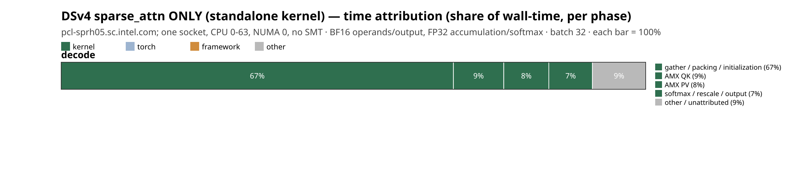

# Time attribution (where the wall-clock goes) — DSv4 sparse_attn ONLY (standalone kernel)

**Node** `pcl-sprh05.sc.intel.com; one socket, CPU 0-63, NUMA 0, no SMT` · **BF16 operands/output, FP32 accumulation/softmax** · batch 32 · unit `% of phase wall-time` — each phase sums to 100%.

## decode

| op | bucket | time (s) | % of phase |
|----|--------|----------|------------|
| gather / packing / initialization | kernel | 0.000 | 67.1 |
| AMX QK | kernel | 0.000 | 8.6 |
| AMX PV | kernel | 0.000 | 7.7 |
| softmax / rescale / output | kernel | 0.000 | 7.4 |
| other / unattributed | other | 0.000 | 9.1 |

> Each bar is one phase, segments = share of that phase's wall-time (sum = 100%). `other / unattributed` = phase wall − sum(wrapped ops); a big slice there means more ops need wrapping before trusting the split.
