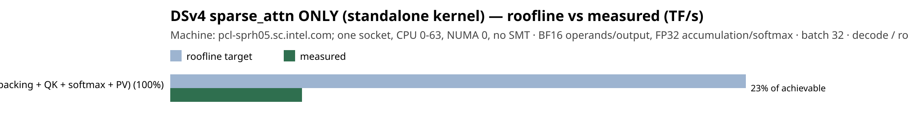

# Roofline target vs measured — DSv4 sparse_attn ONLY (standalone kernel)

**Node** `pcl-sprh05.sc.intel.com; one socket, CPU 0-63, NUMA 0, no SMT` · **BF16 operands/output, FP32 accumulation/softmax** · **decode / rotating inputs larger than LLC** · batch 32 · unit `TF/s` · **M=1 H=64 D=512 S=1024 K=512; optimistic useful-byte lower bound**

**Model-level:** roofline target **30.0 TF/s** · measured **6.9 TF/s** · **23% of achievable**

Per-op, ranked by recoverable end-to-end fraction (shortfall × phase share):

| op | phase share % | regime | roofline (TF/s) | measured (TF/s) | efficiency | recoverable % |
|----|---------------|--------|-------------------|-------------------|------------|---------------|
| sparse_attn (gather + packing + QK + softmax + PV) | 100.0 | memory | 30.0 | 6.9 | 23% | 77.1 |

> Bars: roofline-achievable (target) vs measured per op. A tall gap on a high-share op is the top optimization RoI. `PENDING` = target published; measured fills in when the kernel runs.
